# Mock Paper 1 · Predicted Paper

**B.Tech (Seventh Semester) Examination 2026-27 · CS-401T · Machine Learning**<br>
**Time: Three Hours · Maximum Marks: 70**<br>
**Note:** Attempt any **five** questions. All questions carry equal marks (14 each).

Built on the topics already asked in the 2025-26 end-sem and the mids (see [PYQ analysis](#analysis)), with new numbers for every numerical. Write it in 3 hours first, then read the answers. Every numerical below was checked by computer.

## Question paper

| Q | (a) 7 marks | (b) 7 marks |
|---|---|---|
| 1 | What is machine learning? How does it differ from AI and deep learning? Give applications. | Differentiate supervised, unsupervised and reinforcement learning with examples. |
| 2 | Explain Bayes decision theory, class-conditional density, the Bayes optimal classifier and Bayes error. | Two classes ω<sub>1</sub>, ω<sub>2</sub> have priors 0.6 and 0.4. At x, p(x\|ω<sub>1</sub>) = 0.3 and p(x\|ω<sub>2</sub>) = 0.5. Compute the posteriors and the decision. For a confusion matrix TP = 40, FN = 10, FP = 5, TN = 45, compute accuracy, precision, recall and F1, and explain Type I and Type II errors. |
| 3 | Explain the perceptron learning algorithm. Train a perceptron for the OR gate with w<sub>1</sub> = w<sub>2</sub> = 0, b = 0, η = 1 and a step activation (output 1 if net > 0, else 0); show every epoch until convergence. Explain linear separability and why XOR fails. | Explain the Widrow–Hoff (LMS) rule. What is gradient descent? Explain its types. |
| 4 | Explain the architecture of a multi-layer perceptron and the backpropagation algorithm with a neat diagram. | Explain the activation functions sigmoid, tanh, ReLU and softmax. Differentiate on-line and off-line learning. |
| 5 | Define entropy and information gain. Explain the ID3 algorithm and build a decision tree for the given data. | Explain C4.5: gain ratio, handling of continuous attributes and pruning. |
| 6 | Explain the k-NN algorithm with a numerical. Why is it called a lazy learner? How is k chosen? | Explain the nearest-neighbour error probability and distance-weighted k-NN. |
| 7 | Explain SVM: margin, maximal margin classifier, support vectors, hard and soft margin. | Explain the kernel trick, kernel functions and the dual perceptron. |
| 8 | Write short notes on any four: (a) Bias vs variance (b) Overfitting vs underfitting (c) Approximation vs estimation error (d) PAC learning and VC dimension (e) Bagging vs boosting (f) Feature selection vs dimensionality reduction | |

**Data for Q5 (a):** ten students, did they pass the exam?

| # | Study | Attendance | Coaching | Pass |
|---|---|---|---|---|
| 1 | High | Good | Yes | Yes |
| 2 | High | Poor | No | Yes |
| 3 | High | Good | No | Yes |
| 4 | Medium | Good | Yes | Yes |
| 5 | Medium | Poor | Yes | No |
| 6 | Medium | Good | No | Yes |
| 7 | Low | Good | Yes | No |
| 8 | Low | Poor | No | No |
| 9 | Low | Good | Yes | No |
| 10 | Medium | Poor | No | No |

**Data for Q6 (a):** class A: (4, 5), (1, 2), (2, 1); class B: (6, 5), (5, 6), (7, 7), (6, 2). Classify the query Q = (4, 4) with k = 3.

---

## Q1 (a) Machine learning; ML vs AI vs deep learning; applications

::: ans Answer

**Introduction.** Traditional programs follow rules written by a programmer. Many real problems (recognising a face, filtering spam, predicting a price) have no simple rules. Machine learning lets the computer find the rules itself from examples.

**Definition.** <u>Machine learning is a subset of artificial intelligence in which a system learns patterns from data and improves its performance with experience, without being explicitly programmed with rules.</u>

Tom Mitchell's formal definition: <u>a computer program is said to learn from experience E with respect to some class of tasks T and performance measure P, if its performance at tasks in T, as measured by P, improves with experience E.</u>
*Example (spam filter):* T = classify emails as spam or not spam, P = percentage of emails classified correctly, E = a set of emails already labelled by users.

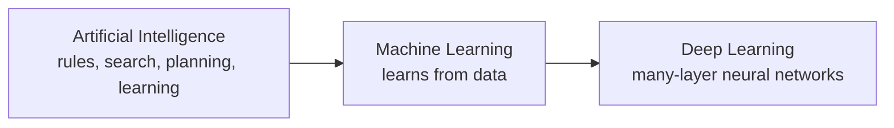
*Fig. 1: AI ⊃ ML ⊃ DL. Each one is a subset of the one before it.*

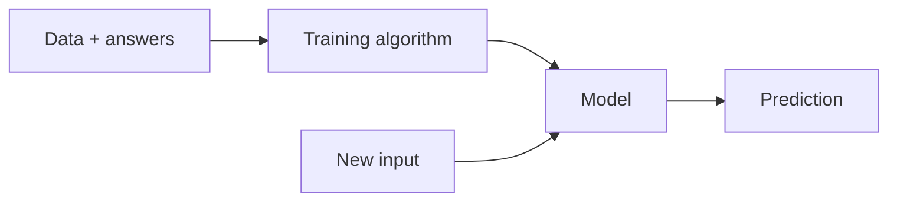
*Fig. 2: Traditional programming is rules + data → answers. Machine learning is data + answers → rules (the model).*

**The three terms.**
1. **Artificial intelligence (AI):** <u>the branch of computer science that builds machines able to perform tasks that normally need human intelligence, such as reasoning, planning, perception and language understanding.</u>
2. **Machine learning (ML):** the data-driven part of AI (definition above).
3. **Deep learning (DL):** <u>a subset of ML that uses artificial neural networks with many hidden layers to learn features and patterns automatically from raw data such as images, sound and text.</u>

**Comparison.**

| Point | Artificial Intelligence | Machine Learning | Deep Learning |
|---|---|---|---|
| Meaning | Machines behaving intelligently | Machines learning from data | Learning with many-layer neural networks |
| Scope | Widest field | Subset of AI | Subset of ML |
| Main idea | Rules, logic, search, planning and learning | Statistical models learned from examples | Layers of neurons learn features by themselves |
| Knowledge | Hand-written rules or learned | Learned from data | Learned from very large data |
| Feature engineering | Not always needed (rule based) | Done by a human expert | Done automatically by the network |
| Data needed | Can work with little data | Small to medium | Very large |
| Hardware | Ordinary computer | Ordinary computer | GPUs / TPUs |
| Training time | — | Minutes to hours | Hours to weeks |
| Interpretability | Rules are easy to read | Trees and linear models are readable | Black box |
| Examples | Chess program, expert system | Spam filter, decision tree, k-NN, SVM | Face recognition, ChatGPT, self-driving perception |

**Steps of a machine learning project.**
1. Define the task, the performance measure and the data needed.
2. Collect data and label it if needed.
3. Pre-process: clean, fill missing values, scale features.
4. Choose features (feature selection or extraction).
5. Choose a model and train it (Bayes, decision tree, neural network).
6. Evaluate on test data (accuracy, precision, recall).
7. Deploy and keep improving with new data.

**Applications.**

| Area | Application |
|---|---|
| Email and web | Spam filtering, search ranking, recommendation (YouTube, Amazon) |
| Vision | Face recognition (phone unlock), OCR, number-plate reading |
| Speech and language | Voice assistants, translation, chatbots |
| Medicine | Disease diagnosis from X-rays, cancer detection |
| Finance | Fraud detection, credit scoring, stock-trend prediction |
| Transport | Self-driving cars, route and traffic prediction |
| Agriculture | Crop-disease detection, yield prediction |
| Industry | Predictive maintenance, quality inspection |

**Advantages of ML.** Handles problems with no clear rules; improves with more data; adapts to change (new spam tricks); finds patterns humans miss.
**Limitations.** Needs good, plentiful data; can overfit; models may be hard to explain; biased data gives biased results.

**Conclusion.** All DL is ML and all ML is AI, but not all AI is ML. ML is the data-driven part of AI, and DL is the part of ML that learns its own features with deep neural networks.
:::

## Q1 (b) Supervised, unsupervised and reinforcement learning

::: ans Answer

**Introduction.** Learning methods are grouped by the kind of feedback the learner receives: correct answers, no answers, or rewards.

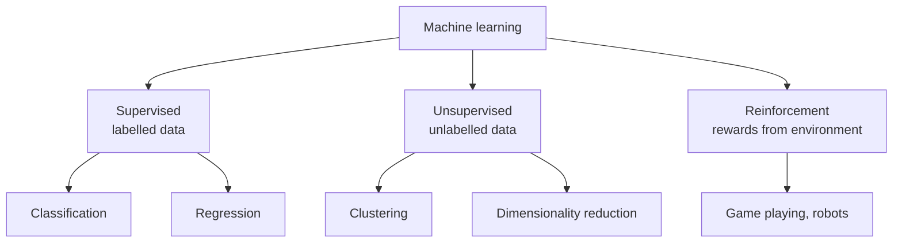
*Fig. 3: Types of machine learning.*

**1. Supervised learning.** <u>The learner is given training examples (x, y) where y is the correct output (label), and it learns a function f(x) ≈ y that predicts the label of new inputs.</u>
- **Classification:** output is a class (spam / not spam, disease / healthy).
- **Regression:** output is a number (house price, temperature).
- **Algorithms:** Bayes classifier, Naive Bayes, k-NN, decision tree, linear and logistic regression, SVM, neural networks.
- **Example:** 10,000 emails marked spam or not spam train a filter.

**2. Unsupervised learning.** <u>The learner is given only inputs x without labels, and it discovers hidden structure such as groups (clusters) or a compact representation.</u>
- **Clustering:** group similar items (customer segments).
- **Dimensionality reduction:** PCA compresses many features into a few.
- **Association rules:** "people who buy bread also buy butter".
- **Algorithms:** k-means, hierarchical clustering, PCA, Apriori.
- **Example:** an online shop groups its customers by buying habits without any labels.

**3. Reinforcement learning.** <u>An agent learns by interacting with an environment: it takes actions, receives rewards or penalties, and learns a policy that maximises the total reward over time.</u>

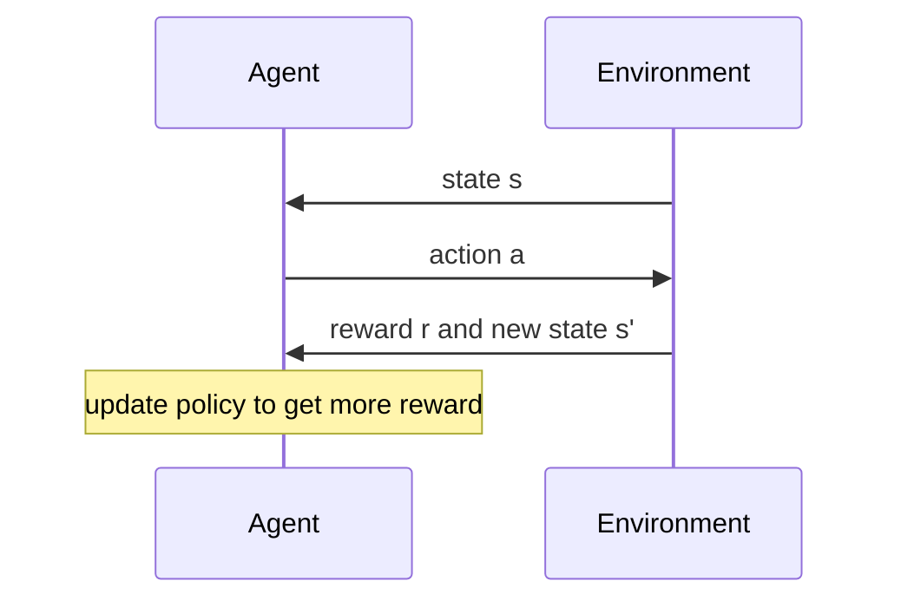
*Fig. 4: The reinforcement-learning loop.*

- **Algorithms:** Q-learning, SARSA, deep Q-networks, policy gradient.
- **Example:** AlphaGo learns Go by playing millions of games; a robot learns to walk; a self-driving car learns lane keeping in a simulator.

**Comparison.**

| Basis | Supervised | Unsupervised | Reinforcement |
|---|---|---|---|
| Data | Labelled (x, y) | Unlabelled x | No fixed data set; experience from interaction |
| Feedback | Correct answer for every example | None | Reward / penalty, often delayed |
| Goal | Predict labels of new inputs | Find structure, groups | Learn the best sequence of actions |
| Tasks | Classification, regression | Clustering, dimensionality reduction | Control, game playing |
| Algorithms | k-NN, decision tree, SVM, MLP | k-means, PCA | Q-learning |
| Evaluation | Accuracy, error on test set | Cluster quality | Total reward |
| Example | Spam filter | Customer segmentation | Chess-playing agent |

**Semi-supervised learning** (one line for extra marks): a few labelled and many unlabelled examples, e.g. a photo app that asks you to name a few faces and then labels the rest.

**Conclusion.** Supervised learning learns from a teacher, unsupervised learning finds patterns on its own, and reinforcement learning learns from trial and error with rewards. The choice depends on what feedback the data provides.
:::

## Q2 (a) Bayes decision theory, class-conditional density, Bayes optimal classifier and Bayes error

::: ans Answer

**Introduction.** When classes overlap (some salmon look exactly like some sea bass), no rule can be right every time. Bayes decision theory uses probabilities to make the decision with the smallest possible chance of error.

**Definition.** <u>Bayes decision theory is a fundamental statistical approach to pattern classification. It uses probabilities (priors and class-conditional densities) and the costs of decisions to make the decision with the least expected cost.</u>

**Class-conditional density.** <u>The class-conditional probability density function p(x|ω<sub>i</sub>) is the probability density function of the feature vector x given that the true class is ω<sub>i</sub>. It describes how the feature values are distributed within class ω<sub>i</sub>.</u> For a fixed observed x, p(x|ω<sub>i</sub>) is called the **likelihood** of ω<sub>i</sub>.

**Terms used.**
1. **Prior P(ω<sub>i</sub>):** probability of the class before seeing x (e.g. 2/3 of the catch is sea bass).
2. **Likelihood p(x|ω<sub>i</sub>):** how probable this x is inside class ω<sub>i</sub>.
3. **Evidence p(x) = Σ<sub>j</sub> p(x|ω<sub>j</sub>) P(ω<sub>j</sub>):** a scale factor that makes the posteriors add to 1.
4. **Posterior P(ω<sub>i</sub>|x):** probability of the class after seeing x.

**Bayes theorem:** P(ω<sub>i</sub>|x) = p(x|ω<sub>i</sub>) P(ω<sub>i</sub>) / p(x), i.e. posterior = likelihood × prior / evidence.

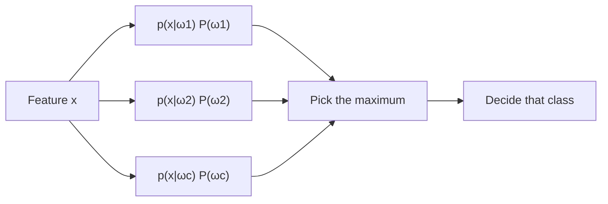
*Fig. 5: The Bayes classifier as a block diagram.*

**Bayes decision rule (minimum error).** Decide ω<sub>1</sub> if P(ω<sub>1</sub>|x) > P(ω<sub>2</sub>|x), otherwise ω<sub>2</sub>. Since p(x) is common, this is the same as: decide ω<sub>1</sub> if p(x|ω<sub>1</sub>) P(ω<sub>1</sub>) > p(x|ω<sub>2</sub>) P(ω<sub>2</sub>).
**Likelihood ratio test:** decide ω<sub>1</sub> if p(x|ω<sub>1</sub>) / p(x|ω<sub>2</sub>) > P(ω<sub>2</sub>) / P(ω<sub>1</sub>).

**Why it gives minimum error.**
1. If we decide ω<sub>1</sub>, we are wrong with probability P(ω<sub>2</sub>|x), and vice versa.
2. Average error P(error) = ∫ P(error|x) p(x) dx.
3. p(x) does not depend on our decision, so the integral is smallest when P(error|x) is smallest at every x.
4. Choosing the larger posterior gives P(error|x) = min[P(ω<sub>1</sub>|x), P(ω<sub>2</sub>|x)], the smallest possible.

**Bayes optimal classifier.** <u>The classifier that assigns every input x to the class with the maximum posterior probability P(ω<sub>i</sub>|x) computed from the true distributions. No other classifier using the same features can have a lower average probability of error.</u>

**Bayes error.** <u>The probability of error of the Bayes optimal classifier. It is the lowest error achievable for the given features and distributions, and is caused by the overlap of the classes.</u>
P(error) = ∫<sub>R2</sub> p(x|ω<sub>1</sub>) P(ω<sub>1</sub>) dx + ∫<sub>R1</sub> p(x|ω<sub>2</sub>) P(ω<sub>2</sub>) dx, where R<sub>1</sub>, R<sub>2</sub> are the regions where we decide ω<sub>1</sub>, ω<sub>2</sub>. At one point, P(error|x) = 1 − max<sub>i</sub> P(ω<sub>i</sub>|x).

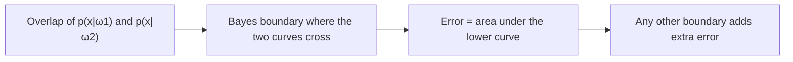
*Fig. 6: Why the Bayes boundary is optimal.*

**Bayes error depends on:** overlap of the densities (far-apart means, small spread → small error); the features used (a better feature lowers it); the priors. It is zero only when the classes do not overlap.

**Example (fish).** Sea bass ω<sub>1</sub>, salmon ω<sub>2</sub>, priors 2/3 and 1/3. With priors only we always say "sea bass", error 1/3. Measuring lightness x gives two density curves; each fish is now classified by its own posterior and the error falls. *Small numerical:* P(ω<sub>1</sub>) = P(ω<sub>2</sub>) = 0.5, p(x|ω<sub>1</sub>) = 0.6, p(x|ω<sub>2</sub>) = 0.3 → products 0.30 and 0.15 → decide ω<sub>1</sub>, posterior 0.667, error at this x 0.333.

**Advantages.** Optimal when probabilities are known; gives a confidence (posterior); handles unequal costs through minimum-risk rules. **Limitation:** true densities are rarely known and must be estimated from data.

**Conclusion.** Bayes decision theory combines prior knowledge with the evidence in the features. Its rule "choose the largest posterior" is the best any classifier can do, and the remaining Bayes error is the unavoidable error of the problem.
:::

## Q2 (b) Bayes numerical and confusion-matrix metrics

::: ans Answer

**Part 1: Bayes decision.**

**Given:** P(ω<sub>1</sub>) = 0.6, P(ω<sub>2</sub>) = 0.4, p(x|ω<sub>1</sub>) = 0.3, p(x|ω<sub>2</sub>) = 0.5.
**Formula:** P(ω<sub>i</sub>|x) = p(x|ω<sub>i</sub>) P(ω<sub>i</sub>) / p(x), with p(x) = Σ p(x|ω<sub>j</sub>) P(ω<sub>j</sub>).

| Class | Prior P(ω<sub>i</sub>) | Likelihood p(x\|ω<sub>i</sub>) | Product | Posterior = product / 0.38 |
|---|---|---|---|---|
| ω<sub>1</sub> | 0.6 | 0.3 | 0.18 | 0.4737 |
| ω<sub>2</sub> | 0.4 | 0.5 | 0.20 | **0.5263** |
| Total | 1.0 | | p(x) = 0.38 | 1.0000 |

1. Evidence p(x) = 0.18 + 0.20 = 0.38.
2. P(ω<sub>1</sub>|x) = 0.18 / 0.38 = 0.4737; P(ω<sub>2</sub>|x) = 0.20 / 0.38 = 0.5263.
3. 0.5263 > 0.4737, so **decide ω<sub>2</sub>**.
4. **LRT check:** likelihood ratio p(x|ω<sub>1</sub>)/p(x|ω<sub>2</sub>) = 0.3/0.5 = 0.6; threshold P(ω<sub>2</sub>)/P(ω<sub>1</sub>) = 0.4/0.6 = 0.667. Since 0.6 < 0.667, decide ω<sub>2</sub> ✓.
5. Probability of error at this x = 1 − 0.5263 = 0.4737.

> **Result.** **Decide ω<sub>2</sub>:** P(ω<sub>1</sub>|x) = 0.4737, P(ω<sub>2</sub>|x) = 0.5263. The prior favours ω<sub>1</sub>, but the evidence (likelihood 0.5 vs 0.3) is strong enough to change the decision.

**Part 2: confusion matrix.** <u>A confusion matrix is a table that compares the actual classes with the classes predicted by a classifier. For two classes it contains the counts of true positives (TP), false negatives (FN), false positives (FP) and true negatives (TN).</u>

| | Predicted positive | Predicted negative |
|---|---|---|
| **Actual positive** | TP = 40 | FN = 10 (Type II error) |
| **Actual negative** | FP = 5 (Type I error) | TN = 45 |

Total = 40 + 10 + 5 + 45 = 100.

| Measure | Formula | Working | Value |
|---|---|---|---|
| Accuracy | (TP + TN) / total | (40 + 45) / 100 | **0.85** |
| Error rate | (FP + FN) / total | (5 + 10) / 100 | 0.15 |
| Precision | TP / (TP + FP) | 40 / 45 | **0.889** |
| Recall (sensitivity) | TP / (TP + FN) | 40 / 50 | **0.80** |
| Specificity | TN / (TN + FP) | 45 / 50 | 0.90 |
| F1-score | 2PR / (P + R) | 2 × 0.889 × 0.80 / (0.889 + 0.80) | **0.842** |
| Type I error rate (FPR) | FP / (FP + TN) | 5 / 50 | 0.10 |
| Type II error rate (FNR) | FN / (FN + TP) | 10 / 50 | 0.20 |

*Check:* F1 = 2TP / (2TP + FP + FN) = 80 / 95 = 0.842 ✓.

**Type I and Type II errors.**
- <u>Type I error (false positive): predicting positive when the actual class is negative</u> — a false alarm. Here 5 healthy people are told they are sick.
- <u>Type II error (false negative): predicting negative when the actual class is positive</u> — a miss. Here 10 sick people are told they are healthy.

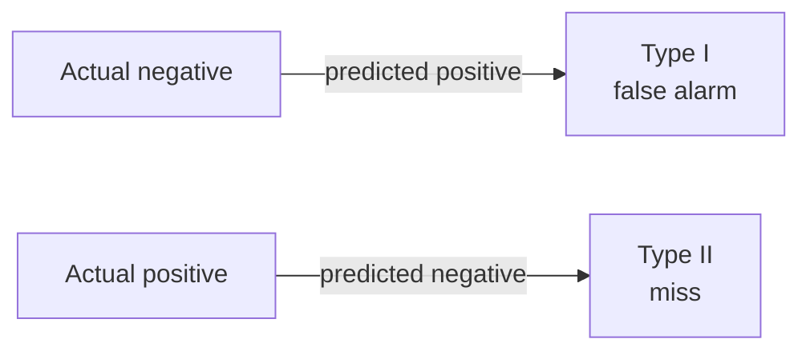
*Fig. 7: The two kinds of error.*

| Situation | Worse error | Measure to watch |
|---|---|---|
| Cancer / COVID screening | Type II (missing a patient) | High recall |
| Spam filter | Type I (real mail sent to spam) | High precision |
| Airport security | Type II (missing a weapon) | High recall |

Lowering the decision threshold catches more positives (fewer Type II) but raises false alarms (more Type I): a trade-off.

**Conclusion.** Accuracy 0.85, precision 0.889, recall 0.80, F1 0.842; Type I rate 0.10, Type II rate 0.20.
:::

## Q3 (a) Perceptron learning algorithm; OR gate numerical; linear separability and XOR

::: ans Answer

**Introduction.** The perceptron (Rosenblatt, 1958) is the simplest neural network: one neuron with a step output. It learns by fixing its mistakes.

**Definition.** <u>The perceptron learning algorithm is an error-correcting rule for a single threshold neuron. For each training sample (x, t) it computes y = step(w·x + b) and updates the weights only when y ≠ t: w<sub>i</sub> ← w<sub>i</sub> + η(t − y)x<sub>i</sub> and b ← b + η(t − y).</u>

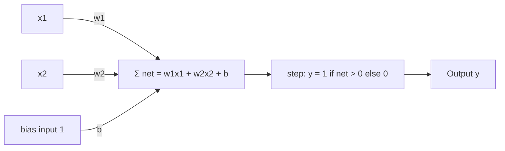
*Fig. 8: The perceptron model.*

**Algorithm.**
1. Initialise w and b (zero or small random values); choose 0 < η ≤ 1.
2. For each sample (x, t): net = Σ w<sub>i</sub>x<sub>i</sub> + b, y = step(net).
3. If y ≠ t: w<sub>i</sub> ← w<sub>i</sub> + η(t − y)x<sub>i</sub>, b ← b + η(t − y). Otherwise no change.
4. After one full pass (epoch), stop if there was no error; otherwise repeat (with a maximum epoch limit).

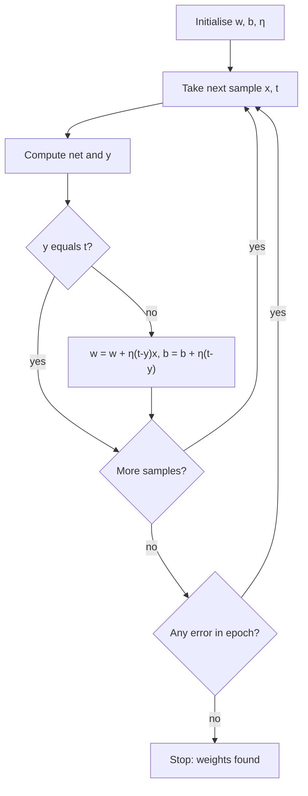
*Fig. 9: Flowchart of perceptron training.*

**Numerical: OR gate.** Convention: w<sub>1</sub> = w<sub>2</sub> = 0, b = 0, η = 1, y = 1 only if net > 0 (net = 0 gives y = 0). Samples in the order (0,0), (0,1), (1,0), (1,1). Each row uses the weights *before* that sample.

| Epoch | x<sub>1</sub> | x<sub>2</sub> | t | w<sub>1</sub>, w<sub>2</sub>, b (before) | net | y | t − y | w<sub>1</sub>, w<sub>2</sub>, b (after) |
|---|---|---|---|---|---|---|---|---|
| 1 | 0 | 0 | 0 | 0, 0, 0 | 0 | 0 | 0 | 0, 0, 0 |
| 1 | 0 | 1 | 1 | 0, 0, 0 | 0 | 0 | **+1** | **0, 1, 1** |
| 1 | 1 | 0 | 1 | 0, 1, 1 | 1 | 1 | 0 | 0, 1, 1 |
| 1 | 1 | 1 | 1 | 0, 1, 1 | 2 | 1 | 0 | 0, 1, 1 |
| 2 | 0 | 0 | 0 | 0, 1, 1 | 1 | 1 | **−1** | **0, 1, 0** |
| 2 | 0 | 1 | 1 | 0, 1, 0 | 1 | 1 | 0 | 0, 1, 0 |
| 2 | 1 | 0 | 1 | 0, 1, 0 | 0 | 0 | **+1** | **1, 1, 1** |
| 2 | 1 | 1 | 1 | 1, 1, 1 | 3 | 1 | 0 | 1, 1, 1 |
| 3 | 0 | 0 | 0 | 1, 1, 1 | 1 | 1 | **−1** | **1, 1, 0** |
| 3 | 0 | 1 | 1 | 1, 1, 0 | 1 | 1 | 0 | 1, 1, 0 |
| 3 | 1 | 0 | 1 | 1, 1, 0 | 1 | 1 | 0 | 1, 1, 0 |
| 3 | 1 | 1 | 1 | 1, 1, 0 | 2 | 1 | 0 | 1, 1, 0 |
| 4 | 0 | 0 | 0 | 1, 1, 0 | 0 | 0 | 0 | 1, 1, 0 |
| 4 | 0 | 1 | 1 | 1, 1, 0 | 1 | 1 | 0 | 1, 1, 0 |
| 4 | 1 | 0 | 1 | 1, 1, 0 | 1 | 1 | 0 | 1, 1, 0 |
| 4 | 1 | 1 | 1 | 1, 1, 0 | 2 | 1 | 0 | 1, 1, 0 |

*First update in detail:* epoch 1, x = (0, 1), t = 1, y = 0, t − y = 1: w<sub>1</sub> = 0 + 1·1·0 = 0, w<sub>2</sub> = 0 + 1·1·1 = 1, b = 0 + 1·1 = 1.

> **Result.** **w<sub>1</sub> = 1, w<sub>2</sub> = 1, b = 0** after 4 updates; epoch 4 is error-free, so training stops. Check: nets for (0,0), (0,1), (1,0), (1,1) are 0, 1, 1, 2 → outputs 0, 1, 1, 1 = OR ✓. Decision line x<sub>1</sub> + x<sub>2</sub> = 0: the point (0, 0) lies on it and gives y = 0 because the rule needs net > 0.

**Linear separability.** <u>Two sets of samples are linearly separable if there exist weights w and a bias b such that w·x + b > 0 for every sample of one class and w·x + b < 0 for every sample of the other.</u> In 2-D this means one straight line separates the classes. **Perceptron convergence theorem:** if the data are linearly separable, the perceptron finds a separating line in a finite number of updates. AND and OR are separable.

**Why XOR fails.** XOR = 1 for (0,1) and (1,0), 0 for (0,0) and (1,1): the two classes sit on opposite corners of the square.

| Input | XOR | Condition needed |
|---|---|---|
| (0, 0) | 0 | b ≤ 0 |
| (0, 1) | 1 | w<sub>2</sub> + b > 0 |
| (1, 0) | 1 | w<sub>1</sub> + b > 0 |
| (1, 1) | 0 | w<sub>1</sub> + w<sub>2</sub> + b ≤ 0 |

Adding rows 2 and 3: w<sub>1</sub> + w<sub>2</sub> + 2b > 0, so w<sub>1</sub> + w<sub>2</sub> + b > −b ≥ 0, which contradicts row 4. **No weights exist**, so no single perceptron can learn XOR (Minsky and Papert, 1969). Running the same algorithm on XOR keeps making 4 mistakes per epoch and never stops. **Remedy:** a hidden layer (MLP) or a kernel mapping such as adding the feature x<sub>1</sub>x<sub>2</sub>.

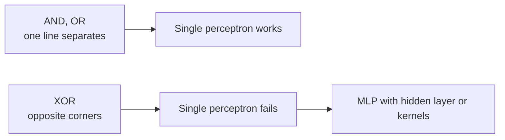
*Fig. 10: Linear separability decides whether a perceptron can learn a function.*

**Advantages:** simple, fast, on-line, guaranteed convergence on separable data. **Limitations:** only linear boundaries; never settles on non-separable data; hard 0/1 output; boundary not unique.

**Conclusion.** The perceptron learned OR with w = (1, 1), b = 0 (last update in epoch 3, epoch 4 error-free). It works only for linearly separable problems, which is why XOR led to multi-layer networks.
:::

## Q3 (b) Widrow–Hoff (LMS) rule; gradient descent and its types

::: ans Answer

**Introduction.** The perceptron uses only the sign of the output and stops at any separating line. Widrow and Hoff (ADALINE, 1960) instead minimise the squared error of the linear output, which works even when the data are not separable.

**Definition.** <u>The Widrow–Hoff or least-mean-square (LMS) rule is a gradient-descent rule that adjusts the weights of a linear unit after each sample in proportion to the error between the target and the linear output: w ← w + η(t − y)x, where y = w·x + b.</u>

**Mean-square criterion.** E(w) = ½ Σ<sub>k</sub> (t<sub>k</sub> − y<sub>k</sub>)<sup>2</sup>, with y<sub>k</sub> = w·x<sub>k</sub> + b. For one sample, ∂E/∂w<sub>i</sub> = −(t − y)x<sub>i</sub>, so stepping against the gradient gives
**w<sub>i</sub> ← w<sub>i</sub> + η(t − y)x<sub>i</sub>, b ← b + η(t − y)** (η = learning rate, t = target, y = linear output, x<sub>i</sub> = input).

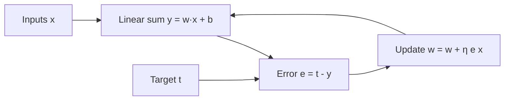
*Fig. 11: ADALINE trained by the LMS rule.*

**Algorithm.**
1. Initialise weights to small values; choose a small η (e.g. 0.1).
2. For each sample: y = w·x + b (no step function during training).
3. Error e = t − y.
4. Update w ← w + ηex, b ← b + ηe.
5. Repeat over epochs until the mean-square error is small or stops falling.

**Example.** w = (0.2, 0.4), b = 0.1, x = (1, 0.5), t = 1, η = 0.1.
1. y = 0.2(1) + 0.4(0.5) + 0.1 = 0.5; e = 1 − 0.5 = 0.5; E = ½(0.5)<sup>2</sup> = 0.125.
2. w<sub>1</sub> = 0.2 + 0.1 × 0.5 × 1 = 0.25; w<sub>2</sub> = 0.4 + 0.1 × 0.5 × 0.5 = 0.425; b = 0.1 + 0.1 × 0.5 = 0.15.
3. New y = 0.25 + 0.2125 + 0.15 = 0.6125; new E = 0.0751. The error fell.

| Perceptron rule | LMS rule |
|---|---|
| Uses y = step(net) | Uses y = net (linear) |
| Updates only on mistakes | Updates on every sample (unless e = 0) |
| Converges only if separable | Converges (small η) to the minimum-MSE solution |
| Any separating line | The least-squares line, robust to noise |

**Gradient descent.** <u>Gradient descent is an iterative optimisation method that minimises a cost function J(w) by repeatedly moving the weights a small step in the direction of the negative gradient: w ← w − η ∂J/∂w.</u>

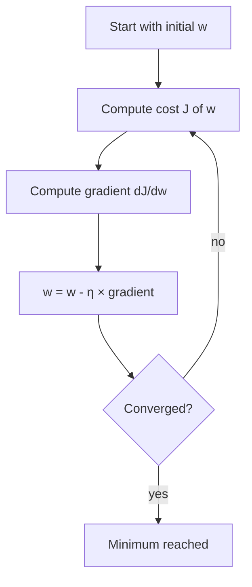
*Fig. 12: Gradient descent loop (a ball rolling downhill on the error surface).*

*Example:* J(w) = (w − 3)<sup>2</sup>, w<sub>0</sub> = 0, η = 0.1, gradient 2(w − 3).

| Step | Gradient | New w | J |
|---|---|---|---|
| 1 | −6.0 | 0.600 | 5.760 |
| 2 | −4.8 | 1.080 | 3.686 |
| 3 | −3.84 | 1.464 | 2.359 |
| 4 | −3.072 | 1.771 | 1.510 |
| 5 | −2.458 | 2.017 | 0.966 |

w moves towards the minimum w = 3 and J falls every step.

**Types of gradient descent.**

| Type | Gradient computed on | Advantages | Disadvantages |
|---|---|---|---|
| Batch (off-line) | All N samples, one update per epoch | Smooth, stable path; exact gradient | Slow and memory-heavy for big data |
| Stochastic (SGD, on-line) | One sample per update | Fast, can escape shallow local minima, works on streaming data | Noisy, zig-zag path |
| Mini-batch | A small batch (e.g. 32–256) per update | Balance of speed and stability; uses GPUs well | Batch size is one more setting |

**Learning rate.** Too small → very slow; too large → overshoots and diverges; often reduced over time.
**Difficulties:** local minima and saddle points; plateaus; choosing η; features on different scales (scale them first).

**Conclusion.** LMS is gradient descent on the mean-square error of a linear unit; the same idea, extended through layers, becomes backpropagation. Mini-batch gradient descent is the standard choice today.
:::

## Q4 (a) MLP architecture and backpropagation

::: ans Answer

**Introduction.** A single perceptron draws only a straight line and fails on XOR. Adding hidden layers of neurons with non-linear activations lets a network form any shape of boundary. Backpropagation (Rumelhart, Hinton, Williams, 1986) is the algorithm that trains such networks.

**Definition.** <u>A multi-layer perceptron (MLP) is a feed-forward neural network with an input layer, one or more hidden layers of neurons with non-linear activation functions, and an output layer, where every neuron in one layer is connected to every neuron in the next.</u>
<u>Backpropagation is a supervised learning algorithm for MLPs that computes the error at the output, propagates it backwards layer by layer using the chain rule, and updates every weight by gradient descent to minimise the squared error.</u>

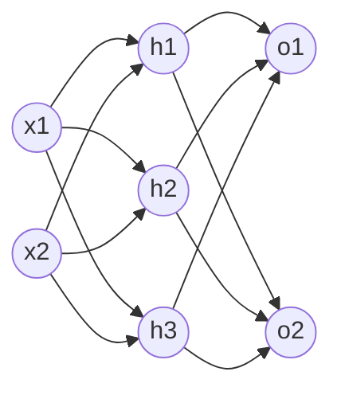
*Fig. 13: A 2-3-2 MLP: input layer → hidden layer (weights w<sub>ij</sub>) → output layer (weights w<sub>jk</sub>). Signals flow forward, errors flow backward.*

**Architecture.**
1. **Input layer:** one node per feature; only passes values on.
2. **Hidden layer(s):** each neuron computes net<sub>j</sub> = Σ<sub>i</sub> w<sub>ij</sub>x<sub>i</sub> + b<sub>j</sub> and h<sub>j</sub> = f(net<sub>j</sub>) with a non-linear f (sigmoid, tanh, ReLU).
3. **Output layer:** one neuron per output/class; o<sub>k</sub> = f(Σ<sub>j</sub> w<sub>jk</sub>h<sub>j</sub> + b<sub>k</sub>).
4. **Universal approximation:** a two-layer network (one hidden layer) with enough hidden units can approximate any continuous function.

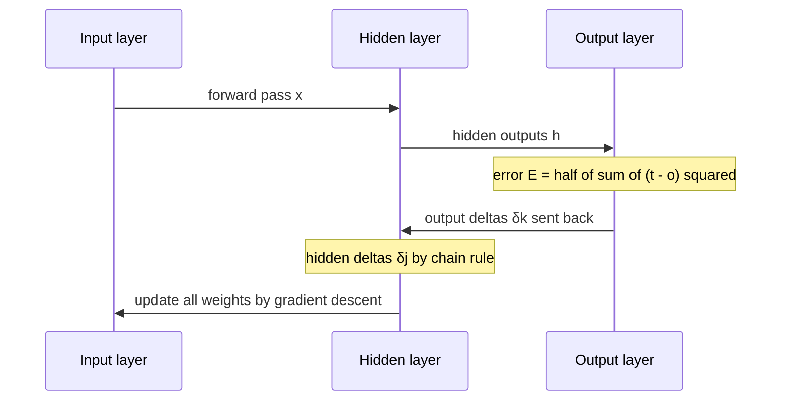
*Fig. 14: Forward pass and backward pass.*

**Backpropagation algorithm (sigmoid units).**
1. Initialise all weights to small random numbers; choose η.
2. **Forward pass:** compute h<sub>j</sub> and o<sub>k</sub> for the input x.
3. **Output error terms:** δ<sub>k</sub> = (t<sub>k</sub> − o<sub>k</sub>) o<sub>k</sub>(1 − o<sub>k</sub>).
4. **Hidden error terms:** δ<sub>j</sub> = h<sub>j</sub>(1 − h<sub>j</sub>) Σ<sub>k</sub> w<sub>jk</sub>δ<sub>k</sub>.
5. **Update:** w<sub>jk</sub> ← w<sub>jk</sub> + η δ<sub>k</sub> h<sub>j</sub>; w<sub>ij</sub> ← w<sub>ij</sub> + η δ<sub>j</sub> x<sub>i</sub> (biases use input 1).
6. Repeat for all samples and epochs until the error E = ½ Σ<sub>k</sub>(t<sub>k</sub> − o<sub>k</sub>)<sup>2</sup> is small.

These rules come from gradient descent, Δw = −η ∂E/∂w, using the chain rule and the sigmoid derivative f′ = f(1 − f).

**Small example.** x = 1 → hidden (w<sub>1</sub> = 0.5) → output (w<sub>2</sub> = 0.4), sigmoid units, no bias, t = 1, η = 0.5.

| Step | Working | Value |
|---|---|---|
| Hidden output | h = σ(0.5 × 1) | 0.6225 |
| Output | o = σ(0.4 × 0.6225) = σ(0.2490) | 0.5619 |
| Error | E = ½(1 − 0.5619)<sup>2</sup> | 0.0960 |
| Output delta | δ<sub>o</sub> = (1 − 0.5619)(0.5619)(0.4381) | 0.1078 |
| Hidden delta | δ<sub>h</sub> = 0.6225 × 0.3775 × 0.4 × 0.1078 | 0.0101 |
| New w<sub>2</sub> | 0.4 + 0.5 × 0.1078 × 0.6225 | 0.4336 |
| New w<sub>1</sub> | 0.5 + 0.5 × 0.0101 × 1 | 0.5051 |
| New output | forward pass again | 0.5672 (E = 0.0937) |

The output moved towards the target and the error fell.

**Significance and important parameters.** Backpropagation makes deep networks trainable; it is efficient (one backward pass gives all gradients). Important parameters: learning rate η, momentum, number of hidden layers and units, initial weights, number of epochs, activation function.

**Advantages of MLP over a single perceptron:** learns non-linear boundaries (XOR); universal approximator; multi-class outputs; learns internal features. **Disadvantages:** local minima, slow training, many hyper-parameters, overfitting, black box.

**Conclusion.** The MLP adds hidden non-linear layers to the perceptron, and backpropagation trains it by sending the output error backwards with the chain rule. Together they are the base of modern deep learning.
:::

## Q4 (b) Activation functions; on-line vs off-line learning

::: ans Answer

**Introduction.** Without a non-linear activation, any number of layers collapses into one linear layer. The activation function adds non-linearity and decides the range of a neuron's output.

**Definition.** <u>An activation function is a function f applied to the net input of a neuron, y = f(net), that decides the neuron's output and introduces non-linearity into the network.</u>

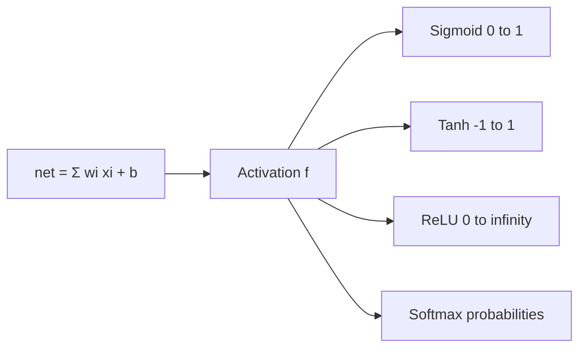
*Fig. 15: Common activation functions.*

| Function | Formula | Range | Derivative | Use |
|---|---|---|---|---|
| Sigmoid | σ(z) = 1 / (1 + e<sup>−z</sup>) | (0, 1) | σ(1 − σ), max 0.25 | Binary output as probability |
| Tanh | (e<sup>z</sup> − e<sup>−z</sup>) / (e<sup>z</sup> + e<sup>−z</sup>) | (−1, 1) | 1 − tanh<sup>2</sup>, max 1 | Hidden layers (zero-centred) |
| ReLU | max(0, z) | [0, ∞) | 1 if z > 0, 0 if z < 0 | Default for deep hidden layers |
| Softmax | e<sup>z<sub>i</sub></sup> / Σ<sub>j</sub> e<sup>z<sub>j</sub></sup> | (0, 1), sum = 1 | — | Multi-class output layer |

**Values at a few points.**

| z | Sigmoid | Sigmoid′ | Tanh | Tanh′ | ReLU |
|---|---|---|---|---|---|
| −2 | 0.1192 | 0.1050 | −0.9640 | 0.0707 | 0 |
| 0 | 0.5000 | 0.2500 | 0.0000 | 1.0000 | 0 |
| 2 | 0.8808 | 0.1050 | 0.9640 | 0.0707 | 2 |

**Softmax example:** z = (2, 1, 0.1) → e<sup>z</sup> = (7.389, 2.718, 1.105), sum 11.213 → probabilities (0.659, 0.242, 0.099), which add to 1.

**Points to write.**
1. **Sigmoid:** smooth, gives a probability; but saturates for large |z| (gradient near 0, the *vanishing-gradient* problem) and is not zero-centred.
2. **Tanh:** zero-centred, stronger gradient than sigmoid; still saturates.
3. **ReLU:** very cheap, no saturation for z > 0, fast training; but "dead" neurons when z < 0 always (Leaky ReLU fixes this).
4. **Softmax:** turns scores into class probabilities; used with cross-entropy loss.
5. The **step** function (perceptron) has zero gradient almost everywhere, so it cannot be used with backpropagation.

**On-line vs off-line learning.**
<u>On-line (incremental, stochastic) learning updates the weights after every single training sample. Off-line (batch) learning accumulates the error over the whole training set and updates the weights once per epoch.</u>

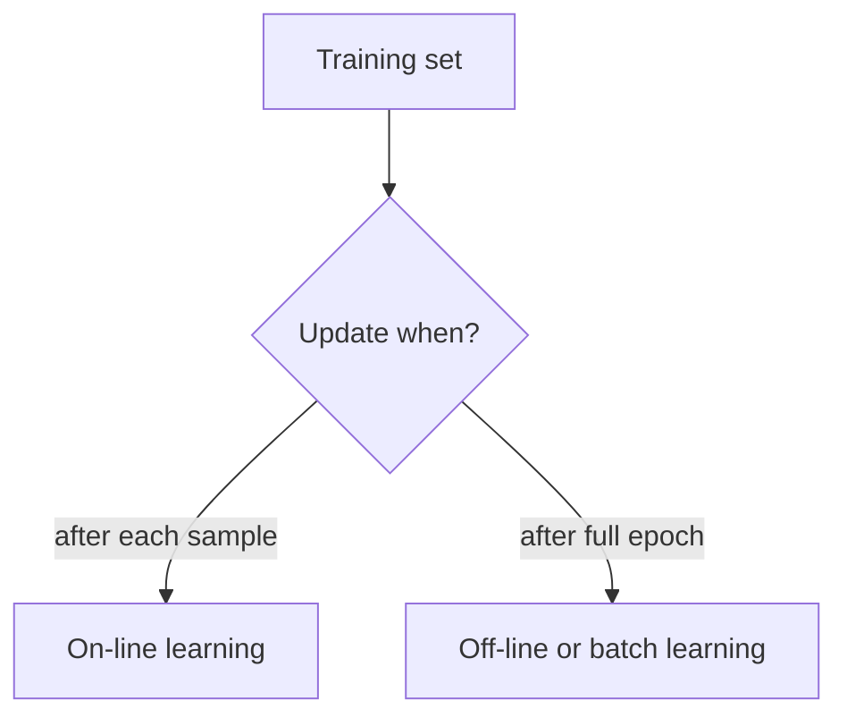
*Fig. 16: On-line vs off-line learning.*

| Basis | On-line | Off-line (batch) |
|---|---|---|
| Update | After each sample | After all samples |
| Gradient | Of one sample's error (noisy) | Of the total error (exact) |
| Path on error surface | Zig-zag; can jump out of shallow local minima | Smooth, steady descent |
| Memory | Low | Must process whole set |
| Data | Works on streaming / changing data | Needs fixed data set |
| Examples | Perceptron, LMS, SGD | Batch gradient descent |

**Error surface:** the plot of E against the weights. For a linear unit it is a bowl (one minimum); for an MLP it has many valleys, plateaus and saddle points, which is why on-line or mini-batch updates and momentum help.

**Conclusion.** ReLU for hidden layers, sigmoid or softmax at the output is the common choice today. On-line learning is fast and suits streaming data; off-line learning is stable; mini-batch combines both.
:::

## Q5 (a) Entropy, information gain and the ID3 algorithm (numerical)

::: ans Answer

**Introduction.** A decision tree asks one question at each node and follows the branch of the answer until it reaches a leaf with the class. ID3 (Quinlan, 1986) builds the tree top-down, choosing at every node the attribute that best separates the classes.

**Definitions.**
- <u>Entropy measures the impurity of a set S: Entropy(S) = − Σ<sub>i</sub> p<sub>i</sub> log<sub>2</sub> p<sub>i</sub>, where p<sub>i</sub> is the fraction of examples of class i.</u> It is 0 for a pure set and 1 for a 50-50 two-class set.
- <u>Information gain is the expected reduction in entropy caused by splitting S on attribute A: Gain(S, A) = Entropy(S) − Σ<sub>v</sub> (|S<sub>v</sub>|/|S|) Entropy(S<sub>v</sub>).</u> It equals the mutual information between A and the class.

**ID3 algorithm.**
1. If all examples have the same class, make a leaf with that class.
2. If no attributes are left, make a leaf with the majority class.
3. Otherwise compute the gain of every attribute and choose the one with the highest gain as the node.
4. Make one branch per value of that attribute and send the matching examples down it.
5. Repeat steps 1–4 on each branch with the remaining attributes.

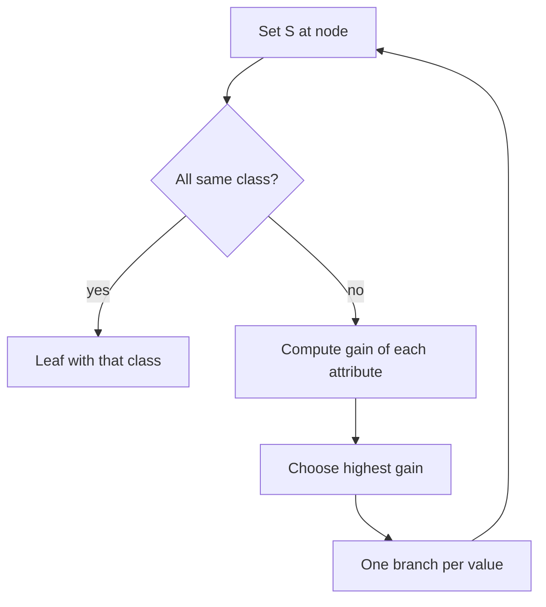
*Fig. 17: ID3 grows the tree recursively.*

**Numerical.** Data as in the question paper (10 students; attributes Study, Attendance, Coaching; class Pass). Convention: log base 2, 0 · log<sub>2</sub>0 = 0.

**Step 1: entropy of the whole set.** S = [5 Yes, 5 No] → Entropy(S) = −(5/10)log<sub>2</sub>(5/10) − (5/10)log<sub>2</sub>(5/10) = **1.000**.

**Step 2: gain of each attribute.**

| Attribute | Value | Yes | No | Entropy |
|---|---|---|---|---|
| Study | High (3) | 3 | 0 | 0.000 |
| | Medium (4) | 2 | 2 | 1.000 |
| | Low (3) | 0 | 3 | 0.000 |
| Attendance | Good (6) | 4 | 2 | 0.918 |
| | Poor (4) | 1 | 3 | 0.811 |
| Coaching | Yes (5) | 2 | 3 | 0.971 |
| | No (5) | 3 | 2 | 0.971 |

- Gain(Study) = 1 − [(3/10)(0) + (4/10)(1) + (3/10)(0)] = 1 − 0.400 = **0.600**
- Gain(Attendance) = 1 − [(6/10)(0.918) + (4/10)(0.811)] = 1 − 0.875 = **0.125**
- Gain(Coaching) = 1 − [(5/10)(0.971) + (5/10)(0.971)] = 1 − 0.971 = **0.029**

**Step 3: root.** Study has the highest gain (0.600) → **root = Study**. High → all Yes (leaf Yes). Low → all No (leaf No). Medium → [2 Yes, 2 No], split further.

**Step 4: inside Study = Medium** (rows 4, 5, 6, 10; entropy 1.000).

| Attribute | Subsets | Gain |
|---|---|---|
| Attendance | Good: [2 Yes, 0 No]; Poor: [0 Yes, 2 No] | **1.000** |
| Coaching | Yes: [1, 1]; No: [1, 1] | 0.000 |

Attendance splits perfectly: Good → Yes, Poor → No.

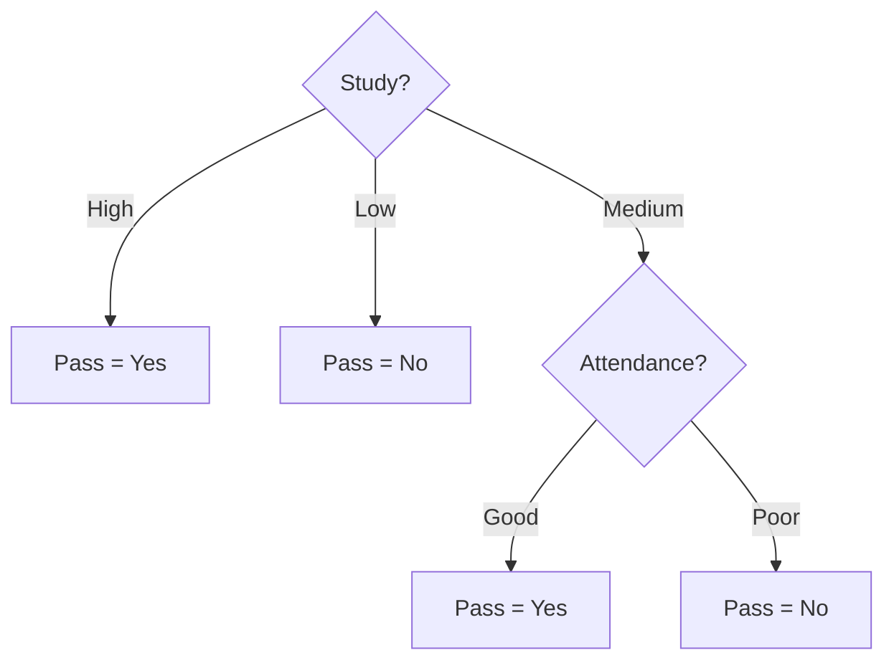
*Fig. 18: Final ID3 tree. Coaching (gain 0.029) is never used.*

> **Result.** Root = **Study** (gain 0.600 > Attendance 0.125 > Coaching 0.029). Rules: IF Study = High THEN Pass; IF Study = Low THEN Fail; IF Study = Medium AND Attendance = Good THEN Pass; IF Study = Medium AND Attendance = Poor THEN Fail.

**Advantages of ID3:** easy to read as rules; fast; handles multi-class; no scaling needed. **Disadvantages:** prefers many-valued attributes; only categorical attributes; no pruning, so it overfits; no missing values (all fixed in C4.5).

**Conclusion.** ID3 chooses the attribute with the largest information gain at every node; here Study at the root and Attendance under Medium give a consistent tree of depth 2.
:::

## Q5 (b) C4.5: gain ratio, continuous attributes, pruning

::: ans Answer

**Introduction.** C4.5 (Quinlan, 1993) is the improved successor of ID3. It fixes ID3's bias towards many-valued attributes, handles numeric attributes and missing values, and prunes the tree.

**Definition.** <u>C4.5 is a decision-tree algorithm that selects attributes by gain ratio, handles continuous attributes with binary threshold tests, handles missing values, and prunes the grown tree using error estimates.</u>

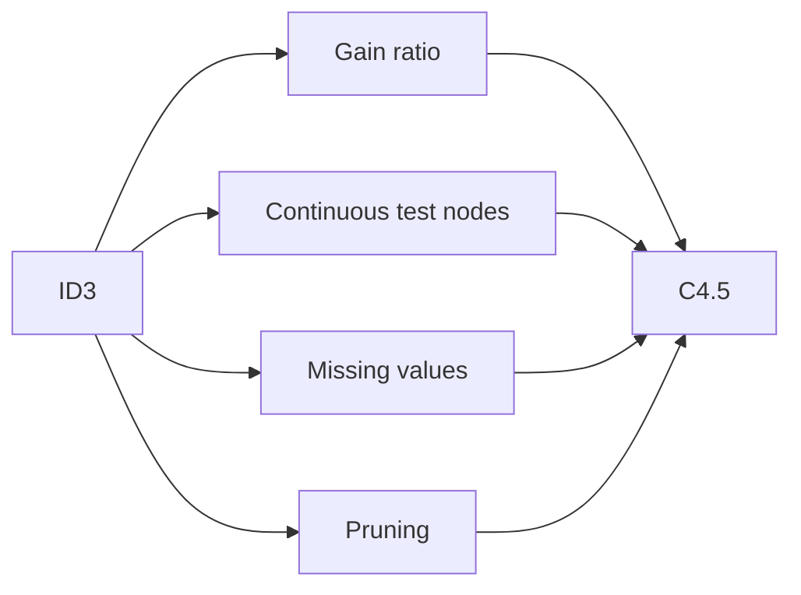
*Fig. 19: What C4.5 adds to ID3.*

**1. Gain ratio.** Information gain favours attributes with many values (a "Roll number" gives pure single-row branches and maximum gain, but is useless). C4.5 divides by the split information:
SplitInfo(S, A) = − Σ<sub>v</sub> (|S<sub>v</sub>|/|S|) log<sub>2</sub>(|S<sub>v</sub>|/|S|), **GainRatio(S, A) = Gain(S, A) / SplitInfo(S, A)**.

*On the Q5 (a) data:*

| Attribute | Split sizes | SplitInfo | Gain | Gain ratio |
|---|---|---|---|---|
| Study | 3 / 4 / 3 | 1.571 | 0.600 | **0.382** |
| Attendance | 6 / 4 | 0.971 | 0.125 | 0.128 |
| Coaching | 5 / 5 | 1.000 | 0.029 | 0.029 |

Study is still chosen. (A Roll-number attribute would have SplitInfo log<sub>2</sub>10 = 3.32, so its gain of 1.0 would shrink to 0.30.)

**2. Continuous attributes.** C4.5 makes a binary test "A ≤ t?".
1. Sort the examples by the numeric attribute.
2. Candidate thresholds = midpoints between neighbouring values where the class changes.
3. For each candidate compute the gain of the split A ≤ t / A > t.
4. Choose the threshold with the highest gain (C4.5 then uses the largest data value below it).

*Example:* hours studied and result for 8 students: 1 No, 2 No, 3 No, 4 Yes, 5 Yes, 6 No, 7 Yes, 8 Yes. Entropy(S) = H[4 Yes, 4 No] = 1.000. The class changes between 3–4, 5–6 and 6–7, so candidates are 3.5, 5.5 and 6.5.

| Threshold t | Hours ≤ t | Hours > t | Gain |
|---|---|---|---|
| 3.5 | [0 Yes, 3 No] | [4 Yes, 1 No] | **0.549** |
| 5.5 | [2 Yes, 3 No] | [2 Yes, 1 No] | 0.049 |
| 6.5 | [2 Yes, 4 No] | [2 Yes, 0 No] | 0.311 |

Best test: **Hours ≤ 3.5?** (≤ 3.5 → No; > 3.5 → mostly Yes). Example working: Gain(3.5) = 1 − (3/8)(0) − (5/8)H[4, 1] = 1 − 0.625 × 0.722 = 0.549. A numeric attribute may be tested again lower in the tree with another threshold.

**3. Missing values.** Gain is computed on the examples where the value is known (scaled by that fraction); an example with a missing value is sent down every branch with a fractional weight.

**4. Pruning.** <u>Pruning removes branches that fit noise in the training data, replacing a subtree by a leaf, to reduce overfitting and improve accuracy on unseen data.</u>

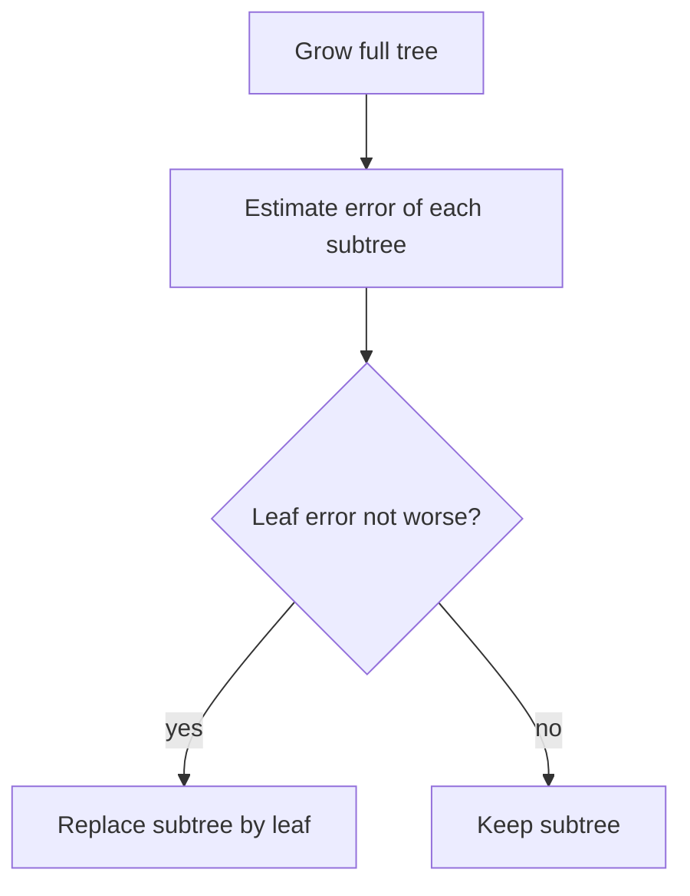
*Fig. 20: Post-pruning.*

- **Pre-pruning:** stop growing early (minimum samples per node, maximum depth, gain below a limit).
- **Post-pruning (C4.5):** grow the full tree, then work bottom-up. C4.5 uses *pessimistic (confidence-based) error*: the upper confidence limit (default confidence 25%) of the error at each node; if a leaf would have a lower estimated error than the subtree, the subtree is replaced.
- **Reduced-error pruning:** use a separate validation set; prune a node if validation accuracy does not drop.
- **Rule post-pruning:** convert the tree to rules and drop conditions that do not hurt accuracy.

| ID3 | C4.5 |
|---|---|
| Information gain | Gain ratio |
| Categorical attributes only | Categorical and continuous |
| No missing values | Handles missing values |
| No pruning | Error-based pruning |
| Overfits easily | Better generalisation |

**Conclusion.** Gain ratio removes the bias to many-valued attributes, threshold tests let the tree use numbers, and pruning controls overfitting; this makes C4.5 one of the most widely used tree learners.
:::

## Q6 (a) k-NN algorithm with a numerical; lazy learner; choosing k

::: ans Answer

**Introduction.** k-NN is the simplest instance-based method: to classify a new point, look at the most similar stored examples and copy their majority answer ("tell me who your neighbours are").

**Definition.** <u>The k-nearest-neighbour algorithm classifies a query x<sub>q</sub> by finding the k training examples nearest to it (by a distance measure) and assigning the majority class among them.</u>

**Algorithm.**
1. Choose k and a distance measure; scale features if their ranges differ.
2. Compute the distance from the query to every training example.
3. Sort the distances and take the k smallest.
4. Classification: majority vote of their classes (regression: average of their values).

**Distance:** Euclidean d(x, y) = √[Σ(x<sub>i</sub> − y<sub>i</sub>)<sup>2</sup>]; Manhattan d = Σ|x<sub>i</sub> − y<sub>i</sub>|.

```mermaid
flowchart LR
  Q[Query point] --> D[Distance to every training point]
  D --> S[Sort ascending]
  S --> K[Take k nearest]
  K --> V[Majority vote]
  V --> C[Predicted class]
```
*Fig. 21: k-NN classification.*

**Numerical.** Class A: (4, 5), (1, 2), (2, 1); class B: (6, 5), (5, 6), (7, 7), (6, 2). Query Q = (4, 4), k = 3, Euclidean distance (both features on the same scale, so no normalisation).

| Point | Class | (x<sub>1</sub> − 4)<sup>2</sup> + (x<sub>2</sub> − 4)<sup>2</sup> | d | Rank |
|---|---|---|---|---|
| (4, 5) | A | 0 + 1 = 1 | 1.000 | 1 |
| (5, 6) | B | 1 + 4 = 5 | 2.236 | 2 |
| (6, 5) | B | 4 + 1 = 5 | 2.236 | 3 |
| (6, 2) | B | 4 + 4 = 8 | 2.828 | 4 |
| (1, 2) | A | 9 + 4 = 13 | 3.606 | 5 |
| (2, 1) | A | 4 + 9 = 13 | 3.606 | 6 |
| (7, 7) | B | 9 + 9 = 18 | 4.243 | 7 |

The 3 nearest: (4, 5) A, (5, 6) B, (6, 5) B → **2 B vs 1 A → Q = B**.

> **Result.** With k = 3, **Q = (4, 4) is classified as B**. With k = 1 it would be A (nearest point (4, 5)); with k = 5 it is B (3 B vs 2 A). The answer depends on k.

**Why "lazy learner"?** <u>k-NN is a lazy (instance-based) learner because it does no generalisation during training: it only stores the training examples and postpones all computation until a query has to be classified.</u>

| Lazy (k-NN) | Eager (decision tree, perceptron, SVM) |
|---|---|
| Training: just store data | Training: builds a model |
| Slow at query time | Fast at query time |
| Local decision per query | One global model |
| Keeps all examples in memory | Keeps only the model |

**Choosing k.**
1. **Small k (k = 1):** follows every point, sensitive to noise → overfitting.
2. **Large k:** smoother boundary but includes far points of other classes → underfitting; k = n always predicts the majority class.
3. **Odd k** for two classes to avoid ties.
4. **Rule of thumb:** k ≈ √n.
5. **Best:** choose k by cross-validation (try k = 1, 3, 5, … and keep the lowest validation error).
6. Scale the features first, and remove irrelevant ones, because they spoil the distance.

**Advantages:** no training time; simple; any number of classes; any shape of boundary. **Disadvantages:** slow and memory-hungry at query time; needs scaling and a good k; suffers from the curse of dimensionality.

**Conclusion.** k-NN predicts from the k most similar examples; here k = 3 gives class B. It is lazy because all the work happens at query time, and k is best chosen by cross-validation.
:::

## Q6 (b) Nearest-neighbour error probability; distance-weighted k-NN

::: ans Answer

**Introduction.** The 1-NN rule is very simple, yet theory shows it is surprisingly good: with enough data its error is never more than twice the best possible (Bayes) error.

**Definition.** <u>The nearest-neighbour error probability P is the probability that the 1-NN rule misclassifies a new point. As the number of training samples n → ∞, it satisfies P<sup>∗</sup> ≤ P ≤ P<sup>∗</sup>(2 − (c/(c − 1))P<sup>∗</sup>) ≤ 2P<sup>∗</sup>, where P<sup>∗</sup> is the Bayes error and c the number of classes (Cover and Hart, 1967).</u>

**Why the bound holds (idea).**
1. As n → ∞, the nearest neighbour x′ of a query x lies almost at x, so P(ω<sub>i</sub>|x′) ≈ P(ω<sub>i</sub>|x).
2. The 1-NN rule makes an error when the label of x′ differs from the true label of x. For two classes, P(error|x) = 2P(ω<sub>1</sub>|x)P(ω<sub>2</sub>|x).
3. The Bayes rule has error P<sup>∗</sup>(x) = min[P(ω<sub>1</sub>|x), P(ω<sub>2</sub>|x)]. The other posterior is 1 − P<sup>∗</sup>(x), so the 1-NN error at x is 2P<sup>∗</sup>(x)(1 − P<sup>∗</sup>(x)) ≤ 2P<sup>∗</sup>(x).
4. Averaging over x gives P ≤ 2P<sup>∗</sup>(1 − P<sup>∗</sup>) for c = 2, the c = 2 case of the general bound.
5. In effect, the label of the nearest neighbour is a random sample from the posterior, so 1-NN "guesses with the right probabilities" instead of always taking the maximum.

```mermaid
flowchart LR
  B["Bayes error P*"] --> L["1-NN error P"]
  L --> U["at most 2P*"]
  K[k-NN with large k and n] --> B
```
*Fig. 22: P<sup>∗</sup> ≤ P(1-NN) ≤ 2P<sup>∗</sup>. As k grows (with k/n → 0), k-NN error approaches P<sup>∗</sup>.*

**Numbers (computed from the bound).**

| Bayes error P<sup>∗</sup> | Bound for c = 2: P<sup>∗</sup>(2 − 2P<sup>∗</sup>) | Bound for c = 3: P<sup>∗</sup>(2 − 1.5P<sup>∗</sup>) | Simple bound 2P<sup>∗</sup> |
|---|---|---|---|
| 0.05 | 0.095 | 0.096 | 0.10 |
| 0.10 | 0.180 | 0.185 | 0.20 |
| 0.20 | 0.320 | 0.340 | 0.40 |

So if the best possible error is 10%, a 1-NN classifier with a huge training set makes at most 18% errors (two classes). **Meaning:** half of the information about the class is contained in the nearest neighbour. **Caution:** the bound is asymptotic (n → ∞); with small n, or many irrelevant features, 1-NN can be much worse.

**Distance-weighted k-NN.** <u>In distance-weighted k-NN each of the k neighbours votes with weight w<sub>i</sub> = 1/d(x<sub>q</sub>, x<sub>i</sub>)<sup>2</sup>, so closer neighbours have more influence; the class with the largest total weight wins.</u> If the query exactly matches a training point (d = 0), its class is returned directly.
For regression: f(x<sub>q</sub>) = Σ w<sub>i</sub>f(x<sub>i</sub>) / Σ w<sub>i</sub>.

**Example (data of Q6 (a), Q = (4, 4), k = 3).**

| Neighbour | Class | d<sup>2</sup> | Weight 1/d<sup>2</sup> |
|---|---|---|---|
| (4, 5) | A | 1 | 1.000 |
| (5, 6) | B | 5 | 0.200 |
| (6, 5) | B | 5 | 0.200 |

Total: A = 1.000, B = 0.200 + 0.200 = 0.400 → **A wins**. With k = 5 (adding (6, 2) B, weight 0.125, and (1, 2) A, weight 0.077): A = 1.077, B = 0.525 → still **A**.

```mermaid
flowchart TB
  P[k nearest neighbours] --> W["weight = 1 / d squared"]
  W --> S[Sum weights per class]
  S --> M[Largest total wins]
```
*Fig. 23: Distance-weighted voting. The plain vote gave B; weighting gives A because the A point is much closer.*

| Plain k-NN | Distance-weighted k-NN |
|---|---|
| Every neighbour counts equally | Closer neighbours count more |
| Ties possible | Ties very rare |
| Sensitive to the choice of k | Robust to k; can even use all points (Shepard's method) |
| Far neighbours can outvote a very close one | Very close neighbour dominates |

**Conclusion.** For large data the 1-NN error lies between P<sup>∗</sup> and 2P<sup>∗</sup>, which justifies the method. Weighting the votes by 1/d<sup>2</sup> makes k-NN smoother and less sensitive to k, as the example (B → A) shows.
:::

## Q7 (a) SVM: margin, maximal margin classifier, support vectors, hard vs soft margin

::: ans Answer

**Introduction.** Many lines can separate two classes. A Support Vector Machine (Vapnik) chooses the line that stays as far as possible from the nearest points of both classes, like drawing the widest road between two villages.

**Definition.** <u>A Support Vector Machine (SVM) is a supervised learning method that finds the separating hyperplane w·x + b = 0 with the largest margin between two classes. The training points closest to the hyperplane are the support vectors. With kernel functions an SVM can also learn non-linear boundaries.</u>

```mermaid
flowchart LR
  N["Class -1 points"] --- M1["w·x + b = -1"]
  M1 --- H["Hyperplane w·x + b = 0"]
  H --- M2["w·x + b = +1"]
  M2 --- P["Class +1 points"]
```
*Fig. 24: The road: margin lines through the support vectors on each side; width 2/‖w‖.*

**1. Margin.**
- Functional margin of a point: γ̂<sub>i</sub> = y<sub>i</sub>(w·x<sub>i</sub> + b) (positive if correctly classified).
- <u>Geometric margin: γ<sub>i</sub> = y<sub>i</sub>(w·x<sub>i</sub> + b)/‖w‖, the distance of the point from the hyperplane; the margin of the classifier is the smallest geometric margin over the training set.</u>
- Fixing the closest points at functional margin 1 (canonical hyperplane), the margin width = **2/‖w‖** (each side 1/‖w‖).

**2. Maximal margin classifier (hard-margin SVM).** <u>The hyperplane that solves: minimise ½‖w‖<sup>2</sup> subject to y<sub>i</sub>(w·x<sub>i</sub> + b) ≥ 1 for every training example i.</u> It exists only for separable data and is unique; the problem is a convex quadratic program (one global minimum). Decision: class = sign(w·x + b).

**3. Support vectors.** With Lagrange multipliers α<sub>i</sub> ≥ 0, w = Σ α<sub>i</sub>y<sub>i</sub>x<sub>i</sub>. Only points with y<sub>i</sub>(w·x<sub>i</sub> + b) = 1 have α<sub>i</sub> > 0: these are the **support vectors**. Removing any other point does not change the hyperplane.

**Working of SVM (steps).**
1. Take labelled data with y ∈ {+1, −1}.
2. Set up the optimisation: minimise ½‖w‖<sup>2</sup> with the margin constraints.
3. Solve the dual: maximise Σα<sub>i</sub> − ½ΣΣα<sub>i</sub>α<sub>j</sub>y<sub>i</sub>y<sub>j</sub>(x<sub>i</sub>·x<sub>j</sub>), α<sub>i</sub> ≥ 0, Σα<sub>i</sub>y<sub>i</sub> = 0.
4. Find w = Σα<sub>i</sub>y<sub>i</sub>x<sub>i</sub> and b from any support vector: b = y<sub>s</sub> − w·x<sub>s</sub>.
5. Classify new x by sign(w·x + b). For non-linear data, replace x<sub>i</sub>·x<sub>j</sub> by a kernel.

**Example.** Points (4, 4) class +1 and (2, 2) class −1.
1. Both are support vectors; w = k(4 − 2, 4 − 2) = k(2, 2).
2. Hyperplane passes through the midpoint (3, 3): 6k + 6k + b = 0 → 12k + b = 0.
3. At (4, 4): 16k + b = 1. Subtract: 4k = 1 → k = 0.25.
4. **w = (0.5, 0.5), b = −3**, hyperplane x<sub>1</sub> + x<sub>2</sub> = 6. Check (2, 2): 1 + 1 − 3 = −1 ✓.
5. ‖w‖ = 0.7071, **margin width = 2/‖w‖ = 2.828** = distance between the two points ✓.

**4. Hard vs soft margin.** <u>The soft-margin SVM allows some points inside the margin or on the wrong side by adding slack variables ξ<sub>i</sub> ≥ 0: minimise ½‖w‖<sup>2</sup> + CΣξ<sub>i</sub> subject to y<sub>i</sub>(w·x<sub>i</sub> + b) ≥ 1 − ξ<sub>i</sub>.</u> ξ<sub>i</sub> = max(0, 1 − y<sub>i</sub>(w·x<sub>i</sub> + b)) (hinge loss).
*Example:* with the hyperplane above, a new +1 point (3, 3.5) gives y·f = 0.25 → ξ = 0.75 (inside the margin, still correct); a +1 point (5, 1) gives f = 0 → ξ = 1.0 (on the boundary).

```mermaid
flowchart TB
  D{Data separable?} -->|yes| H[Hard margin<br/>no errors allowed]
  D -->|no or noisy| S["Soft margin<br/>slack ξ, penalty C"]
  S --> C1[Large C: few violations, narrow margin]
  S --> C2[Small C: more violations, wide margin]
```
*Fig. 25: Hard vs soft margin.*

| Hard margin | Soft margin |
|---|---|
| All points outside the margin, correctly classified | Some violations allowed (ξ<sub>i</sub> > 0) |
| Only for separable data | Works on overlapping, noisy data |
| Sensitive to outliers | Robust to outliers |
| No C parameter | C trades margin width against errors |

**Advantages:** maximum margin gives good generalisation; convex (no local minima); effective in high dimensions; depends only on support vectors; kernels for non-linear data. **Disadvantages:** slow on very large data; choosing kernel and C is tricky; no direct probability output; hard to interpret with kernels.

**Conclusion.** SVM picks the separating hyperplane with the widest margin, defined by a few support vectors. The soft margin with parameter C makes it practical for real, noisy data.
:::

## Q7 (b) Kernel trick, kernel functions, dual perceptron

::: ans Answer

**Introduction.** Some data, such as XOR, cannot be separated by a straight line in the input space. Mapping the data to a higher-dimensional space can make it linearly separable. Kernels let us do this without ever computing the big feature vectors.

**Definition.** <u>A kernel function K(x, z) = φ(x)·φ(z) computes the dot product of two points after a (possibly very high-dimensional) feature mapping φ, without computing φ explicitly.</u>
<u>The kernel trick: because the SVM (and the dual perceptron) use the data only through dot products, every x<sub>i</sub>·x<sub>j</sub> is replaced by K(x<sub>i</sub>, x<sub>j</sub>). The classifier becomes f(x) = sign(Σα<sub>i</sub>y<sub>i</sub>K(x<sub>i</sub>, x) + b): linear in feature space, curved in input space.</u>

```mermaid
flowchart LR
  I["Input space<br/>not linearly separable"] -->|mapping φ| F["Feature space<br/>linearly separable"]
  F --> H[Linear hyperplane]
  H --> B[Curved boundary back in input space]
  K["Kernel K(x,z)"] -.->|computes φ dot products directly| F
```
*Fig. 26: "Map high, compute low".*

**Kernel functions.**

| Kernel | Formula | Notes |
|---|---|---|
| Linear | K(x, z) = x·z | Ordinary SVM |
| Polynomial | K(x, z) = (x·z + c)<sup>d</sup> | All feature products up to degree d |
| Gaussian / RBF | K(x, z) = exp(−‖x − z‖<sup>2</sup>/2σ<sup>2</sup>) | Infinite-dimensional φ; most popular |
| Sigmoid | K(x, z) = tanh(κ x·z + θ) | Like a neural network; valid only for some κ, θ |

**Mercer's condition:** K is a valid kernel if every kernel (Gram) matrix K<sub>ij</sub> = K(x<sub>i</sub>, x<sub>j</sub>) is symmetric and positive semi-definite.

**Example.** x = (2, 1), z = (1, 3).
1. x·z = 2 + 3 = 5 → polynomial kernel (x·z)<sup>2</sup> = **25**.
2. Explicit map φ(v) = (v<sub>1</sub><sup>2</sup>, √2 v<sub>1</sub>v<sub>2</sub>, v<sub>2</sub><sup>2</sup>): φ(x) = (4, 2.828, 1), φ(z) = (1, 4.243, 9); φ(x)·φ(z) = 4 + 12 + 9 = **25** ✓, same value without building φ.
3. (x·z + 1)<sup>2</sup> = 36. ‖x − z‖<sup>2</sup> = 1 + 4 = 5; RBF with σ = 1: e<sup>−2.5</sup> = 0.0821; σ = 2: e<sup>−0.625</sup> = 0.5353.

**XOR becomes separable:** map φ(x) = (x<sub>1</sub>, x<sub>2</sub>, x<sub>1</sub>x<sub>2</sub>) with inputs ±1; the third coordinate is +1 for one class and −1 for the other, so the plane x<sub>1</sub>x<sub>2</sub> = 0 separates them. The polynomial kernel (x·z + 1)<sup>2</sup> contains this feature automatically.

**Dual perceptron.** <u>The dual perceptron keeps a mistake count α<sub>i</sub> for every training example instead of a weight vector; the weight vector is w = Σα<sub>i</sub>y<sub>i</sub>x<sub>i</sub>, so the classifier f(x) = Σα<sub>i</sub>y<sub>i</sub>(x<sub>i</sub>·x) uses only dot products and can be kernelised.</u>

**Algorithm.**
1. Set all α<sub>i</sub> = 0 (bias handled by appending a constant 1 to each x).
2. For each example i: compute f(x<sub>i</sub>) = Σ<sub>j</sub> α<sub>j</sub>y<sub>j</sub>K(x<sub>j</sub>, x<sub>i</sub>).
3. If y<sub>i</sub>f(x<sub>i</sub>) ≤ 0 (mistake), set α<sub>i</sub> ← α<sub>i</sub> + 1.
4. Repeat epochs until no mistakes. Classify new x by sign(Σα<sub>i</sub>y<sub>i</sub>K(x<sub>i</sub>, x)).

```mermaid
flowchart TB
  A[All alpha = 0] --> B[Take example i]
  B --> C["f = Σ αj yj K(xj, xi)"]
  C --> D{"yi f ≤ 0?"}
  D -->|yes| E[alpha i = alpha i + 1]
  D -->|no| F[No change]
  E --> G{Epoch error-free?}
  F --> G
  G -->|no| B
  G -->|yes| H[Stop]
```
*Fig. 27: Dual (kernel) perceptron.*

*Small run* (linear kernel on augmented vectors (x<sub>1</sub>, x<sub>2</sub>, 1)): x<sub>1</sub> = (1, 2) +1, x<sub>2</sub> = (2, 3) +1, x<sub>3</sub> = (3, 1) −1, x<sub>4</sub> = (4, 2) −1.

| Epoch | Mistakes on | α after epoch |
|---|---|---|
| 1 | x<sub>1</sub> (f = 0), x<sub>3</sub> (f = 6) | (1, 0, 1, 0) |
| 2 | x<sub>1</sub> (f = 0), x<sub>3</sub> (f = 1) | (2, 0, 2, 0) |
| 3 | x<sub>1</sub> (f = 0) | (3, 0, 2, 0) |
| 4 | none | (3, 0, 2, 0) |

Final α = (3, 0, 2, 0) → w̃ = 3(1, 2, 1) − 2(3, 1, 1) = (−3, 4, 1): w = (−3, 4), b = 1. Check f: x<sub>1</sub> 6, x<sub>2</sub> 7, x<sub>3</sub> −4, x<sub>4</sub> −3 → all correct ✓. Replacing the dot product by any kernel gives a **non-linear perceptron** with no other change.

| Primal perceptron | Dual perceptron |
|---|---|
| Stores w (size d) | Stores α (size n) |
| Update w ← w + ηy<sub>i</sub>x<sub>i</sub> | Update α<sub>i</sub> ← α<sub>i</sub> + 1 |
| Needs explicit features | Needs only dot products / kernels |
| Linear boundary only | Non-linear with kernels |

**Conclusion.** Kernels give the dot products of a high-dimensional space at low cost, so SVMs and the dual perceptron learn non-linear boundaries with linear algorithms. RBF and polynomial kernels are the most used.
:::

## Q8 Short notes (write any four)

::: ans (a) Bias vs variance
**Bias** is the error from wrong or too-simple assumptions in the model (it misses the true pattern); **variance** is the error from too much sensitivity to the particular training sample (the model changes a lot with new data). Expected test error = bias<sup>2</sup> + variance + irreducible noise.

| Basis | Bias | Variance |
|---|---|---|
| Meaning | Average prediction far from truth | Predictions scatter between training sets |
| Cause | Model too simple | Model too complex |
| Result | Underfitting | Overfitting |
| Training error | High | Low |
| Example | Straight line on curved data | Deep unpruned tree, 1-NN |
| Remedy | More features, more complex model | More data, pruning, regularisation, bagging |

```mermaid
flowchart LR
  S[Simple model<br/>high bias, low variance] --> G[Best complexity<br/>lowest test error] --> C[Complex model<br/>low bias, high variance]
```
**Trade-off:** reducing one usually raises the other; choose the complexity at the bottom of the U-shaped test-error curve.
:::

::: ans (b) Overfitting vs underfitting
| Basis | Underfitting | Overfitting |
|---|---|---|
| Definition | Model too simple to capture the pattern | Model learns the noise of the training data |
| Training error | High | Very low |
| Test error | High | High (much higher than training) |
| Bias / variance | High bias | High variance |
| Example | Linear model for a curve; k-NN with very large k | Deep unpruned tree; 1-NN; huge MLP on little data |
| Remedy | More features, more complex model, train longer | More data, pruning, regularisation, early stopping, cross-validation, dropout |

```mermaid
flowchart LR
  U[Underfit<br/>train high, test high] --> G[Good fit<br/>both low] --> O[Overfit<br/>train low, test high]
```
A good model generalises: low error on both training and unseen data.
:::

::: ans (c) Approximation vs estimation error
The error of a learned hypothesis h<sub>S</sub> from class H splits into two parts: err(h<sub>S</sub>) = ε<sub>app</sub> + ε<sub>est</sub>.
- **Approximation error** ε<sub>app</sub> = min<sub>h∈H</sub> err(h) (some books measure it above the Bayes error, i.e. min<sub>h∈H</sub> err(h) − P<sup>∗</sup>): <u>the error of the best hypothesis in the class; it measures how well the chosen class can fit the target at all.</u> It depends only on H, not on the sample.
- **Estimation error** ε<sub>est</sub> = err(h<sub>S</sub>) − min<sub>h∈H</sub> err(h): <u>the extra error because the learner picks h<sub>S</sub> from a finite sample (by empirical risk minimisation) instead of the best h in H.</u> It falls with more data and rises with the size/complexity of H.

| Basis | Approximation error | Estimation error |
|---|---|---|
| Source | Limited hypothesis class (inductive bias) | Limited training data |
| Bigger H | Decreases | Increases |
| More data | No change | Decreases |
| Related to | Bias, underfitting | Variance, overfitting |

**Trade-off:** a rich class lowers approximation error but raises estimation error; structural risk minimisation chooses the class size that balances them.
:::

::: ans (d) PAC learning and VC dimension
**PAC learning** (Valiant, 1984): <u>a concept class C is probably approximately correct (PAC) learnable if, for any ε, δ in (0, 1) and any distribution, a learner using a polynomial number of examples outputs, with probability at least 1 − δ, a hypothesis whose error is at most ε.</u> ε = accuracy ("approximately correct"), δ = confidence ("probably").
**Sample complexity** (finite H, realizable case): m ≥ (1/ε)(ln|H| + ln(1/δ)). *Example:* |H| = 2<sup>10</sup> = 1024, ε = 0.1, δ = 0.05: m ≥ 10 × (6.931 + 2.996) = 99.27 → **100 examples**.
**VC dimension:** <u>the size of the largest set of points that the hypothesis class can shatter (classify in all 2<sup>n</sup> possible ways).</u> Lines in 2-D: VC = 3 (3 non-collinear points can be shattered, but no 4 points, e.g. the XOR labelling). Hyperplanes in d dimensions: VC = d + 1.

```mermaid
flowchart LR
  V[VC dimension h] --> S[Sample complexity]
  S --> P[PAC guarantee: error ≤ ε with prob 1-δ]
```
For infinite H, VC dimension replaces ln|H|: m grows roughly as (h log(1/ε) + ln(1/δ))/ε (realizable case). A finite VC dimension means the class is PAC learnable.
:::

::: ans (e) Bagging vs boosting
Both are **ensemble methods** that combine many weak or unstable models into one strong model.

| Basis | Bagging (bootstrap aggregating) | Boosting |
|---|---|---|
| Training | Models trained **in parallel**, independently | Models trained **sequentially** |
| Data | Each model on a bootstrap sample (n draws with replacement) | All data, with weights raised on misclassified examples |
| Combining | Equal-weight majority vote / average | Weighted vote (better models count more) |
| Reduces mainly | Variance | Bias (and variance) |
| Good for | Unstable learners (deep trees) | Weak learners (decision stumps) |
| Overfitting risk | Low | Higher on noisy data |
| Example | Random forest | AdaBoost, gradient boosting, XGBoost |

**Bootstrap fact:** a bootstrap sample contains a given example with probability 1 − (1 − 1/n)<sup>n</sup> ≈ 1 − 1/e = **0.632** (0.651 for n = 10), so about 63.2% distinct examples; the remaining ~36.8% are "out-of-bag" and can test the model.

```mermaid
flowchart LR
  D[Training data] --> B1[Sample 1 to model 1]
  D --> B2[Sample 2 to model 2]
  D --> B3[Sample 3 to model 3]
  B1 --> V[Vote]
  B2 --> V
  B3 --> V
```
:::

::: ans (f) Feature selection vs dimensionality reduction
**Feature selection:** <u>choosing a subset of the original features that are most useful for the task and discarding the rest.</u> Methods: filter (correlation, information gain, chi-square), wrapper (forward selection, backward elimination using the classifier), embedded (decision-tree importance, L1/Lasso).
**Dimensionality reduction (feature extraction):** <u>transforming the original d features into k < d new features (combinations of the old ones) that keep most of the information.</u> Methods: PCA (directions of maximum variance from the eigenvectors of the covariance matrix), LDA (directions of maximum class separation), autoencoders.

| Basis | Feature selection | Dimensionality reduction (extraction) |
|---|---|---|
| Output | Subset of original features | New, transformed features |
| Interpretability | High (original meaning kept) | Lower (combinations) |
| Information | Discarded features fully lost | Information from all features combined |
| Example | Keep Age and Income, drop Roll number | PCA: 100 pixel features → 10 components |
| Methods | Filter, wrapper, embedded | PCA, LDA, autoencoder |

**Why reduce features?** Curse of dimensionality, faster training, less overfitting, less storage, easier visualisation. Both are part of pattern-recognition pre-processing.
:::
