# Mock Paper 2

**B.Tech (Seventh Semester) Examination 2026-27 · CS-401(T) · Machine Learning** 
**Time: Three Hours · Maximum Marks: 70** 
**Note:** Attempt any **five** questions. All questions carry equal marks (14 each).

The same question types as the 2025-26 paper with new numbers (confusion matrix, gradient descent, k-NN, short notes), plus syllabus lines MJPRU has not asked yet: pattern recognition system, linear discriminants and the linear machine, a perceptron numerical, an ID3 numerical, an SVM numerical, PAC learning and VC dimension. Every numerical was checked by computer.

## Question paper

| Q | (a) 7 marks | (b) 7 marks |
|---|---|---|
| 1 | Explain a pattern recognition system and its stages with a diagram. Give examples of classifiers. | A spam filter gives TP = 85, FP = 15, FN = 10, TN = 90. Find accuracy, precision, recall, specificity and F1-score. Explain Type I and Type II errors with this example. |
| 2 | Explain linear discriminant functions, decision regions and decision boundaries. What is a multi-class linear machine? | What is gradient descent? Write the cost function and update rules for linear regression, the conditions and the difficulties. Do two iterations of batch gradient descent for the data (1, 2), (2, 4), (3, 6) with w = 0, b = 0, η = 0.1. |
| 3 | Train a perceptron for the AND gate with w1 = 0.5, w2 = −0.5, b = −0.3, η = 0.2. Show all epochs. State the perceptron convergence theorem. | Explain two-layer MLPs as universal approximators. Explain the error surface, local minima and momentum. |
| 4 | Explain the decision-tree inference model, symbolic trees, consistency and top-down induction. What is mutual information? | Build a decision tree with ID3 for the loan data given (root and second level). |
| 5 | Classify a query with k-NN (k = 3) using raw and min–max normalised features. Explain why the answers differ. | Explain instance-based learning. Compute the Euclidean, Manhattan, Minkowski and Hamming distances for given data. |
| 6 | Find the maximal-margin hyperplane, support vectors and margin for positives (4, 4), (5, 5), (4, 6), (6, 4) and negatives (2, 0), (0, 2), (0, 0), (−1, 1). | Explain hard and soft margin SVM, slack variables, the parameter C and the hinge loss. |
| 7 | Explain the formal model of PAC learning. Find the sample complexity for \|H\| = 210, ε = 0.1, δ = 0.05. | What is VC dimension? Explain with examples. |
| 8 | Write short notes on any four: (a) Activation function (b) Feature selection (c) Dimensionality reduction (d) Hypothesis class (e) Cost function vs loss function (f) Inductive bias and Occam's razor | |

---

## Q1 (a) Pattern recognition system  (not asked yet)

::: ans Answer

**Introduction.** People recognise faces, handwriting and ripe mangoes without thinking. A pattern recognition system makes a machine do the same: it measures an object and puts it in a class.

**Definition.** <u>Pattern recognition is the act of taking in raw data and taking an action based on the category of the pattern. It is the automatic assignment of an object, described by a set of measured features, to one of a number of classes.</u>

**Basic terms (fish-sorting example, Duda, Hart and Stork).**

| Term | Meaning | Fish example |
|---|---|---|
| Pattern | The object we want to recognise | One fish on the conveyor belt |
| Class ω | A group of similar patterns | ω1 = sea bass, ω2 = salmon |
| Feature | One measurable property | Lightness, width, length |
| Feature vector x | All d features together, x = (x1, …, xd)T | x = (lightness, width) |
| Decision boundary | Line or surface between classes in feature space | A line in the lightness–width graph |

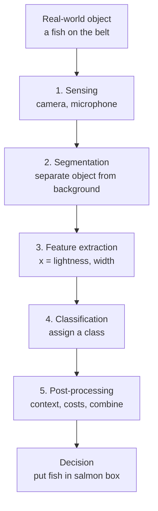
*Fig. 1: Stages of a pattern recognition system.*

**Stages.**
1. **Sensing.** A transducer (camera, microphone, scanner) turns the object into a signal or image. Sensor quality (resolution, noise) limits the whole system.
2. **Segmentation.** Finds where one object ends and the next begins: separates two touching fish, or the letters of a handwritten word. Often the hardest step.
3. **Feature extraction.** Measures properties that are similar inside a class and different across classes. Good features are discriminating, reliable, invariant (to position, rotation, scale), independent and few.
4. **Classification.** Uses the feature vector x to assign a class. Bayes decision theory gives the best rule when features are noisy: choose the class with the largest posterior P(ωi|x).
5. **Post-processing.** Uses extra information for the final action: context (in "T?E" the middle letter is probably H), the cost of errors (sea bass in a salmon can upsets customers), or the votes of several classifiers.

**Design cycle.** Collect data → choose features → choose model → train → evaluate → (go back if the error is high).

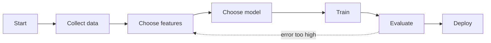
*Fig. 2: Design cycle of a pattern recognition system.*

**Examples of classifiers.**

| Classifier | Idea | Boundary |
|---|---|---|
| Bayes classifier | Largest posterior P(ωi\|x) | Optimal, any shape |
| Naive Bayes | Bayes with independent features | Usually simple |
| Minimum-distance | Nearest class mean | Linear |
| k-nearest neighbour | Majority of k nearest samples | Any shape |
| Linear discriminant / perceptron | Sign of w·x + b | Straight line |
| Decision tree | Chain of yes/no questions | Axis-parallel pieces |
| SVM | Maximum-margin line, kernels for curves | Linear or curved |
| MLP | Layers of neurons | Any shape |

**Applications.** OCR and handwriting, face and fingerprint recognition, speech recognition, medical diagnosis from scans, spam filtering, fault detection.

**Conclusion.** A pattern recognition system turns raw sensor data into a decision through five stages; the features chosen matter as much as the classifier.
:::

## Q1 (b) Confusion matrix: spam filter  ⭐ (Mid-2 Q3)

::: ans Answer

**Definition.** <u>A confusion matrix is a table that compares the actual classes with the classes predicted by a classifier. For two classes it contains the counts of true positives (TP), false negatives (FN), false positives (FP) and true negatives (TN).</u>

Positive class = **spam**. Total = 85 + 15 + 10 + 90 = **200 emails** (95 really spam, 105 really genuine).

| | Predicted: Spam | Predicted: Not spam | Total |
|---|---|---|---|
| **Actual: Spam** | TP = 85 | FN = 10 (Type II) | 95 |
| **Actual: Not spam** | FP = 15 (Type I) | TN = 90 | 105 |
| **Total** | 100 | 100 | 200 |

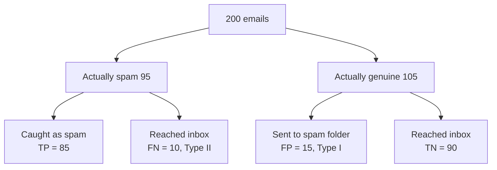
*Fig. 3: Where the 200 emails went.*

**Formulas and working.**

| Measure | Formula | Working | Value |
|---|---|---|---|
| Accuracy | (TP + TN) / total | (85 + 90) / 200 = 175/200 | **0.875** |
| Error rate | 1 − accuracy | 25/200 | 0.125 |
| Precision | TP / (TP + FP) | 85 / 100 | **0.850** |
| Recall (sensitivity) | TP / (TP + FN) | 85 / 95 | **0.8947** |
| Specificity | TN / (TN + FP) | 90 / 105 | **0.8571** |
| F1-score | 2PR / (P + R) | 2 × 0.85 × 0.8947 / (0.85 + 0.8947) | **0.8718** |
| Type I error rate (FPR) | FP / (FP + TN) | 15 / 105 | 0.1429 |
| Type II error rate (FNR) | FN / (FN + TP) | 10 / 95 | 0.1053 |

*Check:* F1 = 2TP / (2TP + FP + FN) = 170/195 = 0.8718 ✓.

**Type I and Type II errors.**
- <u>Type I error (false positive): predicting positive when the actual class is negative.</u> Here: a **genuine email sent to the spam folder** (15 emails, rate 14.29%). The user may miss an interview letter or a bank OTP.
- <u>Type II error (false negative): predicting negative when the actual class is positive.</u> Here: a **spam email reaching the inbox** (10 emails, rate 10.53%). Only a small nuisance.

| | Type I | Type II |
|---|---|---|
| Also called | False positive, false alarm | False negative, miss |
| In spam filter | Good mail marked spam | Spam reaches inbox |
| Rate | FP/(FP + TN) = 1 − specificity | FN/(FN + TP) = 1 − recall |
| Worse for spam? | **Yes**: watch precision | Less serious |
| Worse for cancer test? | Less serious | **Yes**: watch recall |

**Conclusion.** The filter is 87.5% accurate, but for a spam filter Type I errors cost more, so the designer should raise the spam threshold to push precision above 0.85, accepting a slightly lower recall. Mnemonic: Type I = "crying wolf", Type II = "missing the wolf".
:::

## Q2 (a) Linear discriminant functions, decision regions, linear machine  (not asked yet)

::: ans Answer

**Introduction.** A discriminant function is a score. The classifier computes one score per class and picks the class with the highest score. The simplest score is a weighted sum of the features.

**Definitions.**
- <u>A discriminant function gi(x) is a function computed for each class ωi; the classifier assigns x to ωi if gi(x) > gj(x) for all j ≠ i.</u>
- <u>A linear discriminant function is a linear combination of the features plus a constant: g(x) = wTx + w0, where w is the weight vector and w0 is the bias (threshold weight).</u>

**Two-class case.** Decide ω1 if g(x) > 0 and ω2 if g(x) < 0. The decision surface g(x) = 0 is a **hyperplane** (a line in 2-D).

**Geometry.**
1. w is **normal** (perpendicular) to the hyperplane and points into region R1.
2. The signed distance of any point x from the hyperplane is r = g(x) / ‖w‖.
3. The distance of the origin is w0 / ‖w‖.

*Example:* g(x) = 3x1 + 4x2 − 12, ‖w‖ = 5. Point (4, 3): g = 12, r = 2.4 (ω1 side). Point (1, 1): g = −5, r = −1.0 (ω2 side). Point (0, 3): g = 0, on the line. Origin: w0/‖w‖ = −2.4.

**Decision regions and boundaries.** <u>A decision region Ri is the set of points the classifier assigns to class ωi. A decision boundary separates two adjacent regions; on it the two top discriminants are equal: gi(x) = gj(x).</u> Linear discriminants give flat boundaries (lines, planes); non-linear ones (quadratic Bayes, k-NN, MLP) give curved boundaries.

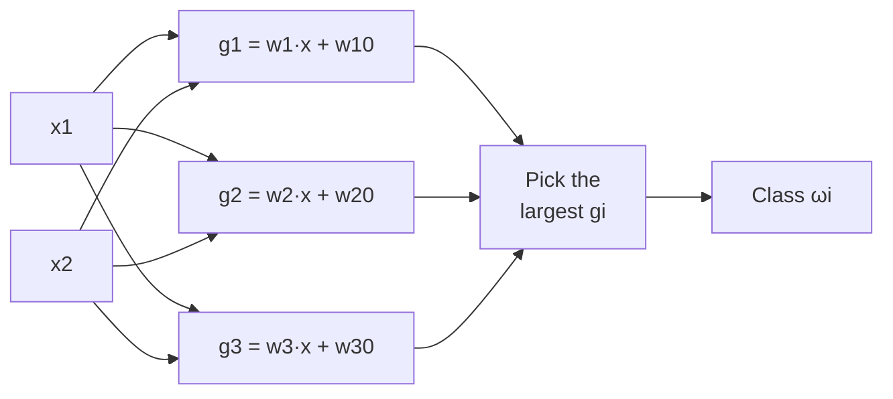
*Fig. 4: A linear machine for three classes.*

**Multi-class: three ways.**

| Point | One-vs-rest | One-vs-one | Linear machine |
|---|---|---|---|
| Classifiers needed | c | c(c − 1)/2 | c discriminants |
| For c = 4 | 4 | 6 | 4 |
| Rule | The one that says "yes" | Majority vote | Largest gi(x) |
| Ambiguous regions | Yes | Possible ties | **No** |

**Linear machine.** <u>A linear machine for c classes uses c linear discriminants gi(x) = wiTx + wi0 and assigns x to the class with the largest gi(x).</u>
- Boundary between Ri and Rj: (wi − wj)Tx + (wi0 − wj0) = 0. Only differences of weight vectors matter.
- Every region is **convex** and in one piece, so a class split into two clusters cannot be captured.

*Example:* g1 = x1, g2 = x2, g3 = −x1 − x2.

| x | g1 | g2 | g3 | Class |
|---|---|---|---|---|
| (2, 1) | 2 | 1 | −3 | ω1 |
| (−1, −2) | −1 | −2 | 3 | ω3 |
| (−1, 3) | −1 | 3 | −2 | ω2 |

Boundary R1/R2: x1 = x2.

**Training.** Weights are learned by the perceptron rule, LMS (Widrow–Hoff) or Fisher's discriminant. **Limit:** cannot solve problems that are not linearly separable (XOR).

**Conclusion.** Linear discriminants cut feature space with hyperplanes; the linear machine extends this to c classes without ambiguous regions.
:::

## Q2 (b) Gradient descent for linear regression  ⭐⭐ (End Q8, Mid-2 Q4)

::: ans Answer

**Definition.** <u>Gradient descent is an iterative optimisation method that minimises a cost function J by moving the parameters a small step in the direction of the negative gradient: θ ← θ − η ∂J/∂θ, where η is the learning rate.</u>

**Linear regression model.** ŷ = wx + b, with m training pairs (xi, yi).

**Cost (mean squared error):** J(w, b) = (1/2m) Σ (ŷi − yi)2

**Gradients:** ∂J/∂w = (1/m) Σ (ŷi − yi) xi  ∂J/∂b = (1/m) Σ (ŷi − yi)

**Update rules (simultaneous):** w ← w − η ∂J/∂w  b ← b − η ∂J/∂b

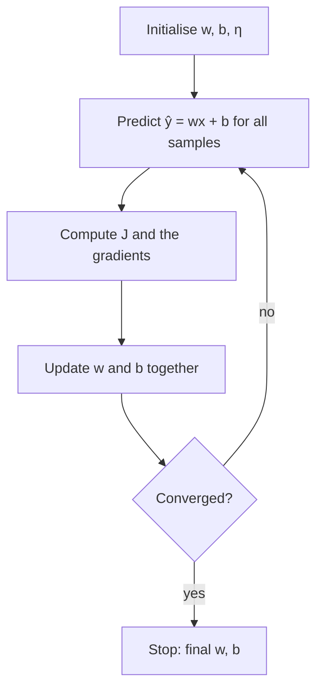
*Fig. 5: Batch gradient descent loop.*

**Numerical.** Data (1, 2), (2, 4), (3, 6), m = 3, w = 0, b = 0, η = 0.1. (Batch: all three samples in each update.)

Initial cost: errors −2, −4, −6; squares 4, 16, 36; J0 = 56/6 = **9.3333**.

**Iteration 1** (w = 0, b = 0):

| x | y | ŷ | e = ŷ − y | e·x |
|---|---|---|---|---|
| 1 | 2 | 0 | −2 | −2 |
| 2 | 4 | 0 | −4 | −8 |
| 3 | 6 | 0 | −6 | −18 |
| | | | Σ = −12 | Σ = −28 |

∂J/∂w = −28/3 = **−9.3333**; ∂J/∂b = −12/3 = **−4.0000** 
w = 0 − 0.1(−9.3333) = **0.9333**; b = 0 − 0.1(−4) = **0.4000**

New cost: ŷ = 1.3333, 2.2667, 3.2; errors −0.6667, −1.7333, −2.8; squares 0.4444, 3.0044, 7.84 (sum 11.2889); J1 = 11.2889/6 = **1.8815**.

**Iteration 2** (w = 0.9333, b = 0.4):

| x | y | ŷ | e = ŷ − y | e·x |
|---|---|---|---|---|
| 1 | 2 | 1.3333 | −0.6667 | −0.6667 |
| 2 | 4 | 2.2667 | −1.7333 | −3.4667 |
| 3 | 6 | 3.2000 | −2.8000 | −8.4000 |
| | | | Σ = −5.2 | Σ = −12.5333 |

∂J/∂w = −12.5333/3 = **−4.1778**; ∂J/∂b = −5.2/3 = **−1.7333** 
w = 0.9333 + 0.41778 = **1.3511**; b = 0.4 + 0.17333 = **0.5733**

New cost: ŷ = 1.9244, 3.2756, 4.6267; squares 0.0057, 0.5248, 1.8860 (sum 2.4166); J2 = **0.4028**.

| Iteration | w | b | J |
|---|---|---|---|
| 0 | 0 | 0 | 9.3333 |
| 1 | 0.9333 | 0.4000 | 1.8815 |
| 2 | 1.3511 | 0.5733 | 0.4028 |

The cost falls each step and w moves toward the true line y = 2x (w = 2, b = 0, J = 0).

**Conditions for applying gradient descent to linear regression.**
1. The cost must be **differentiable** (MSE is) and preferably **convex** (MSE for linear regression is a bowl, one global minimum).
2. The learning rate η must be **small enough** to avoid overshoot but large enough to move.
3. **Features should be scaled** to similar ranges, otherwise the bowl is a long valley and descent zig-zags.
4. Updates of w and b must be **simultaneous**.
5. A **stopping rule**: small change in J, small gradient, or a maximum number of iterations.

**Difficulties.**
- Choosing η: too large diverges, too small is very slow.
- Local minima, plateaus and saddle points in non-convex costs (neural networks).
- Slow on huge datasets (batch uses all m samples per step).
- Sensitive to feature scaling and to the starting point (non-convex case).

**Types:** batch (all samples, smooth), stochastic (one sample, noisy and fast: on (1, 2) from w = b = 0, one SGD step gives w = 0.2, b = 0.2), mini-batch (small groups, the usual choice).

**Conclusion.** Two batch iterations reduce J from 9.3333 to 0.4028; continued iterations converge to w = 2, b = 0.
:::

## Q3 (a) Perceptron for the AND gate  ⭐ (MCQ Q1; numerical not asked yet)

::: ans Answer

**Definition.** <u>The perceptron learning algorithm is an error-correcting rule for a single threshold neuron. For each sample (x, t) it computes y = step(wTx + b) and updates only when y ≠ t: wi ← wi + η(t − y)xi, b ← b + η(t − y).</u>

**Convention:** y = 1 if net > 0, else 0 (net = 0 gives 0). Start w1 = 0.5, w2 = −0.5, b = −0.3, η = 0.2. Each update changes b by ±0.2, and wi by ±0.2 only when xi = 1.

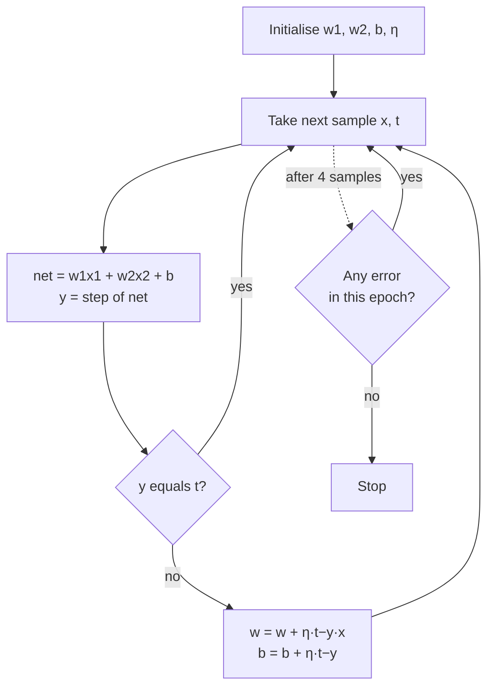
*Fig. 6: Perceptron training.*

| Ep | x1 | x2 | t | w1 | w2 | b | net | y | t − y | new w1 | new w2 | new b |
|---|---|---|---|---|---|---|---|---|---|---|---|---|
| 1 | 0 | 0 | 0 | 0.5 | −0.5 | −0.3 | −0.3 | 0 | 0 | 0.5 | −0.5 | −0.3 |
| 1 | 0 | 1 | 0 | 0.5 | −0.5 | −0.3 | −0.8 | 0 | 0 | 0.5 | −0.5 | −0.3 |
| 1 | 1 | 0 | 0 | 0.5 | −0.5 | −0.3 | 0.2 | 1 | **−1** | 0.3 | −0.5 | −0.5 |
| 1 | 1 | 1 | 1 | 0.3 | −0.5 | −0.5 | −0.7 | 0 | **+1** | 0.5 | −0.3 | −0.3 |
| 2 | 0 | 0 | 0 | 0.5 | −0.3 | −0.3 | −0.3 | 0 | 0 | 0.5 | −0.3 | −0.3 |
| 2 | 0 | 1 | 0 | 0.5 | −0.3 | −0.3 | −0.6 | 0 | 0 | 0.5 | −0.3 | −0.3 |
| 2 | 1 | 0 | 0 | 0.5 | −0.3 | −0.3 | 0.2 | 1 | **−1** | 0.3 | −0.3 | −0.5 |
| 2 | 1 | 1 | 1 | 0.3 | −0.3 | −0.5 | −0.5 | 0 | **+1** | 0.5 | −0.1 | −0.3 |
| 3 | 0 | 0 | 0 | 0.5 | −0.1 | −0.3 | −0.3 | 0 | 0 | 0.5 | −0.1 | −0.3 |
| 3 | 0 | 1 | 0 | 0.5 | −0.1 | −0.3 | −0.4 | 0 | 0 | 0.5 | −0.1 | −0.3 |
| 3 | 1 | 0 | 0 | 0.5 | −0.1 | −0.3 | 0.2 | 1 | **−1** | 0.3 | −0.1 | −0.5 |
| 3 | 1 | 1 | 1 | 0.3 | −0.1 | −0.5 | −0.3 | 0 | **+1** | 0.5 | 0.1 | −0.3 |
| 4 | 0 | 0 | 0 | 0.5 | 0.1 | −0.3 | −0.3 | 0 | 0 | 0.5 | 0.1 | −0.3 |
| 4 | 0 | 1 | 0 | 0.5 | 0.1 | −0.3 | −0.2 | 0 | 0 | 0.5 | 0.1 | −0.3 |
| 4 | 1 | 0 | 0 | 0.5 | 0.1 | −0.3 | 0.2 | 1 | **−1** | 0.3 | 0.1 | −0.5 |
| 4 | 1 | 1 | 1 | 0.3 | 0.1 | −0.5 | −0.1 | 0 | **+1** | 0.5 | 0.3 | −0.3 |
| 5 | 0 | 0 | 0 | 0.5 | 0.3 | −0.3 | −0.3 | 0 | 0 | 0.5 | 0.3 | −0.3 |
| 5 | 0 | 1 | 0 | 0.5 | 0.3 | −0.3 | 0.0 | 0 | 0 | 0.5 | 0.3 | −0.3 |
| 5 | 1 | 0 | 0 | 0.5 | 0.3 | −0.3 | 0.2 | 1 | **−1** | 0.3 | 0.3 | −0.5 |
| 5 | 1 | 1 | 1 | 0.3 | 0.3 | −0.5 | 0.1 | 1 | 0 | 0.3 | 0.3 | −0.5 |
| 6 | 0 | 0 | 0 | 0.3 | 0.3 | −0.5 | −0.5 | 0 | 0 | 0.3 | 0.3 | −0.5 |
| 6 | 0 | 1 | 0 | 0.3 | 0.3 | −0.5 | −0.2 | 0 | 0 | 0.3 | 0.3 | −0.5 |
| 6 | 1 | 0 | 0 | 0.3 | 0.3 | −0.5 | −0.2 | 0 | 0 | 0.3 | 0.3 | −0.5 |
| 6 | 1 | 1 | 1 | 0.3 | 0.3 | −0.5 | 0.1 | 1 | 0 | 0.3 | 0.3 | −0.5 |

*Working of the first update (epoch 1, x = (1, 0), t = 0):* net = 0.5(1) + (−0.5)(0) − 0.3 = 0.2 > 0, so y = 1; error −1. w1 = 0.5 + 0.2(−1)(1) = 0.3; w2 = −0.5 + 0.2(−1)(0) = −0.5; b = −0.3 + 0.2(−1) = −0.5.

*Pattern:* in epochs 1–4 the same two samples are wrong; each pair of corrections leaves w1 and b unchanged and raises w2 by 0.2, until w2 is large enough for (1, 1) to fire. In epoch 5, x = (0, 1) gives net = 0.0 exactly, so y = 0 by our convention (correct).

**Final answer.** **w1 = 0.3, w2 = 0.3, b = −0.5**, converged in **6 epochs** (epoch 6 error-free) after **9 updates**. Boundary: 0.3x1 + 0.3x2 − 0.5 = 0, i.e. x1 + x2 = 1.667. 
Check: nets −0.5, −0.2, −0.2, 0.1 → outputs 0, 0, 0, 1 = AND ✓.

**Perceptron convergence theorem.** <u>If the training samples are linearly separable, the fixed-increment perceptron rule finds a separating weight vector in a finite number of updates, whatever the starting weights.</u>
- Each mistake turns w a little towards a true solution vector; the angle cannot keep shrinking forever, so mistakes stop.
- Novikoff's bound: number of updates ≤ (R/γ)2, R = largest sample length, γ = margin of the best separating line.
- If the data is not separable (XOR), the weights cycle for ever: stop after a fixed number of epochs or use the pocket algorithm.
- The line found is *a* separating line, not the best one (SVM finds the best).

**Conclusion.** AND is linearly separable, so the perceptron converged, as the theorem guarantees.
:::

## Q3 (b) Two-layer MLPs as universal approximators; error surface, local minima, momentum  ⭐⭐⭐ (End Q5a, Mid-2 Q1, MCQ)

::: ans Answer

**Introduction.** A single perceptron draws only one straight line and fails on XOR. Adding one hidden layer removes this limit.

**Definition.** <u>A multi-layer perceptron (MLP) is a feed-forward network with an input layer, one or more hidden layers of non-linear neurons, and an output layer, trained by backpropagation.</u>

**Universal approximation theorem.** <u>A two-layer network (one hidden layer of sigmoid-type units and a linear output) with enough hidden units can approximate any continuous function on a bounded region to any desired accuracy</u> (Cybenko 1989, Hornik 1991).
- "Two-layer" = two layers of weights: input→hidden, hidden→output.
- Each hidden unit makes one soft step or ridge; the output adds them up, like building a curve from many small steps.
- For classification, hidden units draw lines and the output combines them; with enough hidden units any decision region, convex or non-convex, can be approximated as closely as we like.
- The theorem says such a network **exists**; it does not say how many units are needed or that backpropagation will find the weights.

**Example: XOR with two hidden units.** h1 = step(x1 + x2 − 0.5) (OR), h2 = step(−x1 − x2 + 1.5) (NAND), y = step(h1 + h2 − 1.5) (AND).

| x1 | x2 | net1 | h1 | net2 | h2 | netout | y = XOR |
|---|---|---|---|---|---|---|---|
| 0 | 0 | −0.5 | 0 | 1.5 | 1 | −0.5 | 0 |
| 0 | 1 | 0.5 | 1 | 0.5 | 1 | 0.5 | 1 |
| 1 | 0 | 0.5 | 1 | 0.5 | 1 | 0.5 | 1 |
| 1 | 1 | 1.5 | 1 | −0.5 | 0 | −0.5 | 0 |

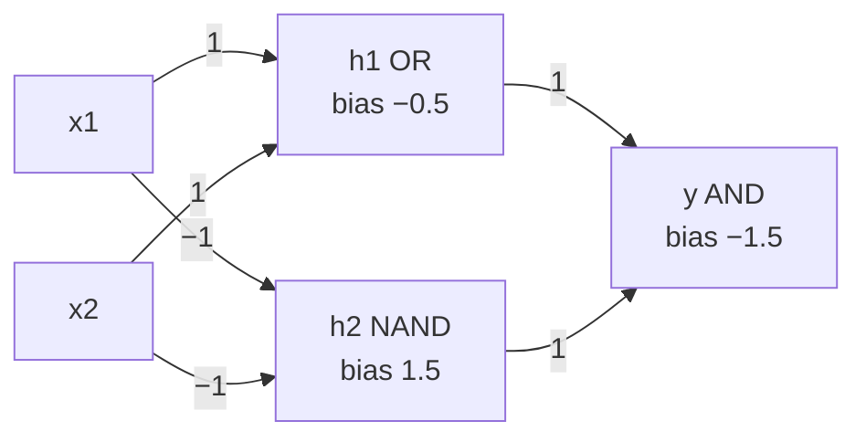
*Fig. 7: A two-layer MLP that computes XOR.*

**Error surface.** <u>The error surface is the graph of the training error J(w) over all possible weight values.</u> Gradient descent (backpropagation) walks downhill on it. For an MLP it is not a simple bowl:
- **Local minima:** valleys lower than their neighbours but higher than the global minimum; training can get stuck there.
- **Plateaus:** flat areas (saturated sigmoids) where the gradient is near zero and learning crawls.
- **Saddle points and ravines:** downhill in one direction, uphill in another; descent zig-zags across narrow valleys.
- **Symmetry:** swapping hidden units gives the same error, so many equal minima exist.

*Fig. 8: Gradient descent on an MLP error surface.*

**Remedies for local minima:** several random starts, stochastic (on-line) updates whose noise shakes the weights out, momentum, adaptive learning rates.

**Momentum.** Δw(t) = −η ∂J/∂w + α Δw(t − 1), with momentum constant 0 ≤ α < 1 (typically 0.9).
- The step remembers the previous step, like a ball rolling downhill.
- On a plateau with a constant slope the steps grow: with η = 0.1, α = 0.9 and ∂J/∂w = −4, the steps are 0.4, 0.76, 1.084, 1.3756, …, approaching 0.4/(1 − 0.9) = 4.0 (ten times larger).
- In ravines, alternating gradients cancel, so zig-zag is damped.
- It can roll through small local minima.

**Important parameters:** learning rate η, momentum α, number of hidden units, weight initialisation (small random), number of epochs (early stopping), on-line vs off-line (batch) updating.

**Conclusion.** One hidden layer is enough in theory to approximate any function, but the error surface has plateaus and local minima; momentum and good parameter choices make training practical.
:::

## Q4 (a) Decision trees: inference model, symbolic trees, consistency, top-down induction; mutual information  ⭐⭐ (End Q3b, MCQ Q3)

::: ans Answer

**Definition.** <u>A decision tree is a classifier in the form of a tree. Each internal node tests one attribute, each branch is one outcome of the test, and each leaf gives a class label.</u>

**Inference model.** To classify an example, start at the root and follow the branch that matches its attribute value until a leaf is reached. Only attributes on the path are used. A tree equals a set of if-then rules (a disjunction of conjunctions).

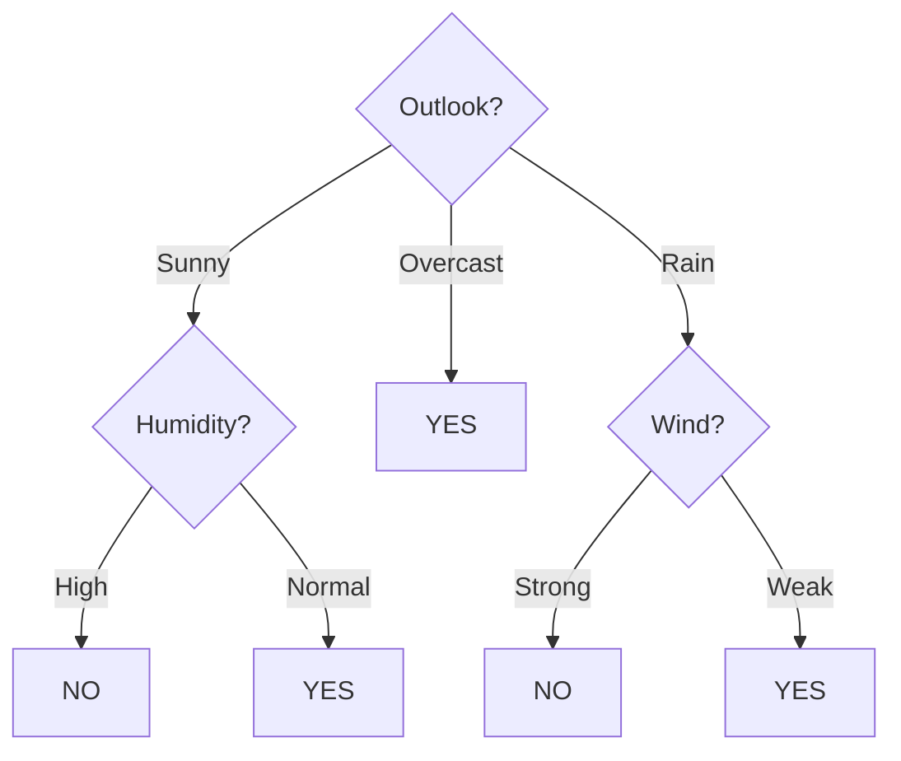
*Fig. 9: The PlayTennis tree: root, internal nodes, branches and leaves.*

*Example:* (Sunny, Hot, Normal, Strong) → Outlook = Sunny → Humidity = Normal → **YES**.

**General domains (when trees suit).** Attribute–value data; discrete target; disjunctive concepts; noisy labels; missing values. Applications: medical diagnosis, loan approval, fault diagnosis.

**Symbolic decision tree.** <u>A tree whose node tests are on symbolic (categorical) attribute values, one branch per value; it can be read directly as if-then rules.</u> Example rule: IF Outlook = Sunny AND Humidity = High THEN Play = No.

**Consistency.** <u>A tree h is consistent with training set D if h(x) = c(x) for every training example, i.e. zero training error.</u> On noise-free data ID3 always finds a consistent tree. But a tree consistent with noisy data has learned the noise: **overfitting**. Many consistent trees exist; ID3 prefers short ones (Occam's razor).

**Top-down induction (TDIDT).**
1. Put all training examples at the root.
2. If all have the same class, make a leaf. Stop.
3. If no attributes remain, make a leaf with the majority class.
4. Choose the best attribute A (ID3: highest information gain).
5. Make a branch for each value of A and split the examples.
6. Empty branch → leaf with the parent's majority class.
7. Repeat on each branch without reusing A on that path.

It is a **greedy** search with no backtracking.

**Entropy.** Entropy(S) = −Σ pi log2 pi (0 for a pure set, 1 for a 50/50 two-class set).

**Information gain.** Gain(S, A) = Entropy(S) − Σv (|Sv|/|S|) Entropy(Sv).

**Mutual information.** <u>The mutual information between attribute A and class C is I(A; C) = H(C) − H(C|A) = Σa Σc p(a, c) log2 [p(a, c) / (p(a) p(c))]. On a training set, information gain is exactly the mutual information between the attribute and the class.</u>
- It is symmetric, never negative, and 0 only when A and C are independent.
- In Q4(b), I(Credit; Approved) = 0.5954 bits = Gain(S, Credit).

**Conclusion.** A tree is learned top-down by repeatedly asking the question with the largest mutual information with the class; consistency on noisy data must be controlled by pruning.
:::

## Q4 (b) ID3 numerical: loan approval  ⭐ (End Q3b asked ID3 in theory)

::: ans Answer

**Data** (12 applicants, log base 2):

| # | Credit | Income | Employed | Approved |
|---|---|---|---|---|
| 1 | Good | High | Yes | Yes |
| 2 | Good | Low | No | Yes |
| 3 | Good | High | No | Yes |
| 4 | Average | High | Yes | Yes |
| 5 | Average | Low | Yes | Yes |
| 6 | Average | High | Yes | Yes |
| 7 | Average | High | No | No |
| 8 | Average | Low | No | No |
| 9 | Bad | High | Yes | No |
| 10 | Bad | Low | Yes | No |
| 11 | Bad | High | No | No |
| 12 | Bad | Low | No | No |

**Step 1: entropy of S.** S = [6+, 6−]. Entropy(S) = −(6/12) log2(6/12) − (6/12) log2(6/12) = **1.000**.

**Step 2: gain of each attribute.**

| Attribute | Value | Subset | Entropy | Weighted entropy | Gain |
|---|---|---|---|---|---|
| Credit | Good | [3+, 0−] | 0.000 | | |
| | Average | [3+, 2−] | 0.971 | (5/12)(0.971) = 0.4046 | **0.5954** |
| | Bad | [0+, 4−] | 0.000 | | |
| Income | High | [4+, 3−] | 0.9852 | (7/12)(0.9852) + (5/12)(0.971) | |
| | Low | [2+, 3−] | 0.971 | = 0.9793 | 0.0207 |
| Employed | Yes | [4+, 2−] | 0.9183 | (6/12)(0.9183) + (6/12)(0.9183) | |
| | No | [2+, 4−] | 0.9183 | = 0.9183 | 0.0817 |

Credit has the highest gain → **root = Credit**.
- Credit = Good → [3+, 0−] → leaf **Yes**.
- Credit = Bad → [0+, 4−] → leaf **No**.
- Credit = Average → [3+, 2−], entropy 0.971 → split further.

**Step 3: second level inside Credit = Average** (rows 4–8).

| Attribute | Value | Subset | Entropy | Weighted | Gain |
|---|---|---|---|---|---|
| Income | High | [2+, 1−] | 0.9183 | (3/5)(0.9183) + (2/5)(1.0) | |
| | Low | [1+, 1−] | 1.000 | = 0.951 | 0.020 |
| Employed | Yes | [3+, 0−] | 0.000 | 0 | **0.971** |
| | No | [0+, 2−] | 0.000 | | |

Employed splits perfectly → **Employed** is the second-level node. Yes → Approved; No → Not approved.

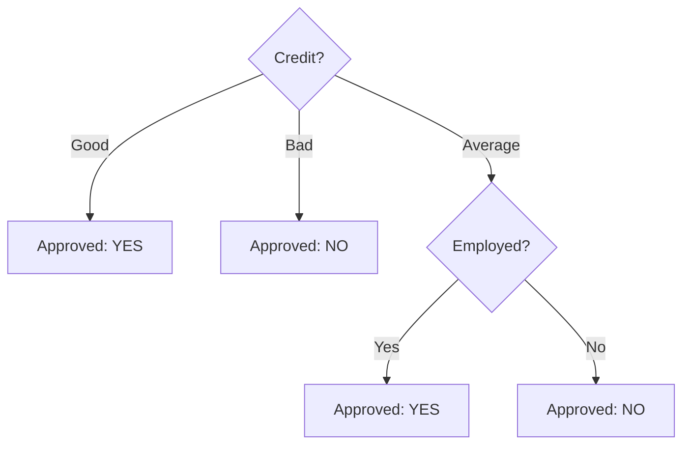
*Fig. 10: Final ID3 tree.*

**Final answer.** Root = **Credit** (gain 0.5954). Second level under Average = **Employed** (gain 0.971). Income is never used (gains 0.0207 and 0.020). 
Rules: IF Credit = Good THEN Yes. IF Credit = Bad THEN No. IF Credit = Average AND Employed = Yes THEN Yes. IF Credit = Average AND Employed = No THEN No. The tree is consistent with all 12 rows.
:::

## Q5 (a) k-NN where feature scaling changes the answer  ⭐ (End Q2, 14 marks)

::: ans Answer

**Question data.** Will an employee be promoted? Features: Experience (years, range 0–10) and Monthly salary (₹ thousand, range 20–120). Query Q = (8, 60). k = 3, Euclidean distance.

| Employee | Experience | Salary | Promoted |
|---|---|---|---|
| A | 1 | 62 | No |
| B | 2 | 58 | No |
| C | 3 | 63 | No |
| D | 8 | 75 | Yes |
| E | 9 | 72 | Yes |
| F | 7 | 45 | Yes |
| G | 0 | 20 | No |
| H | 10 | 120 | Yes |

**Algorithm.** 1. Choose k and the distance. 2. Compute the distance from Q to every sample. 3. Sort. 4. Take the k nearest. 5. Majority vote.

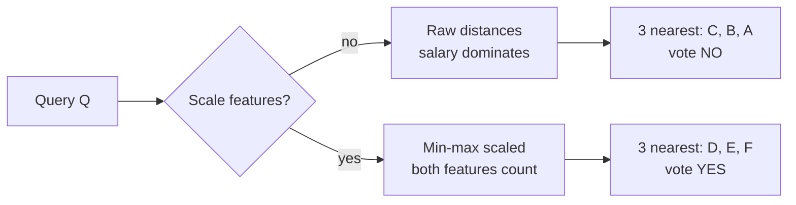
*Fig. 11: The same query, two different answers.*

**Case 1: raw features.** d = √[(x1 − 8)2 + (x2 − 60)2]

| Emp. | Δexp | Δsal | d2 | d | Rank |
|---|---|---|---|---|---|
| A | −7 | 2 | 53 | 7.280 | 3 |
| B | −6 | −2 | 40 | 6.325 | 2 |
| C | −5 | 3 | 34 | 5.831 | **1** |
| D | 0 | 15 | 225 | 15.000 | 5 |
| E | 1 | 12 | 145 | 12.042 | 4 |
| F | −1 | −15 | 226 | 15.033 | 6 |
| G | −8 | −40 | 1664 | 40.792 | 7 |
| H | 2 | 60 | 3604 | 60.033 | 8 |

3 nearest: C, B, A → No, No, No → **Not promoted**.

**Case 2: min–max normalised.** x' = (x − min)/(max − min): Experience' = x/10, Salary' = (x − 20)/100. Q' = (0.8, 0.4).

| Emp. | Exp' | Sal' | d' | Rank |
|---|---|---|---|---|
| A | 0.1 | 0.42 | 0.700 | 7 |
| B | 0.2 | 0.38 | 0.600 | 5 |
| C | 0.3 | 0.43 | 0.501 | 4 |
| D | 0.8 | 0.55 | 0.150 | **1** |
| E | 0.9 | 0.52 | 0.156 | 2 |
| F | 0.7 | 0.25 | 0.180 | 3 |
| G | 0.0 | 0.00 | 0.894 | 8 |
| H | 1.0 | 1.00 | 0.632 | 6 |

*Sample working (D):* d' = √[(0.8 − 0.8)2 + (0.55 − 0.4)2] = 0.150.

3 nearest: D, E, F → Yes, Yes, Yes → **Promoted**.

**Final answer.** Raw features: **No** (C, B, A). Normalised features: **Yes** (D, E, F). The normalised answer is the one to trust.

**Why the answers differ.** Salary is spread over 100 units, experience over only 10. In raw distance a 5-year gap in experience (huge, half the range) counts less than a ₹15 thousand gap in salary (small, 15% of the range). So raw k-NN picked juniors with similar salaries. After scaling, each feature has range 0–1 and counts equally, so the employees with similar experience (D, E, F) are nearest. **Always scale features before k-NN** (min–max or z-score).

**Choosing k:** small k is noisy (overfits), large k over-smooths; take an odd k for two classes, about √n, or choose by cross-validation. k-NN is a **lazy learner**: it does no work at training time and searches all samples at query time.
:::

## Q5 (b) Instance-based learning; distance metrics  ⭐ (End Q2)

::: ans Answer

**Definition.** <u>Instance-based (lazy) learning stores the training examples and postpones generalisation until a query is classified, using a similarity (distance) measure between the query and the stored instances.</u>

**Examples:** nearest neighbour (1-NN), k-NN, distance-weighted k-NN (weight 1/d2), locally weighted regression, case-based reasoning.

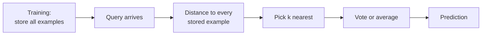
*Fig. 12: Instance-based learning.*

| Lazy (k-NN) | Eager (tree, perceptron) |
|---|---|
| Training: just store | Training: build a model |
| Slow prediction | Fast prediction |
| Local decision per query | One global model |
| Needs memory for all data | Keeps only the model |

**Nearest-neighbour facts.** 1-NN regions form a **Voronoi diagram**; with many samples the 1-NN error is at most **twice the Bayes error**.

**Distance metrics.** Take x = (2, 5, 1) and y = (5, 1, 3). Differences |xi − yi| = 3, 4, 2.

| Metric | Formula | Working | Value |
|---|---|---|---|
| Euclidean | √Σ(xi − yi)2 | √(9 + 16 + 4) = √29 | **5.3852** |
| Manhattan | Σ\|xi − yi\| | 3 + 4 + 2 | **9** |
| Minkowski (p = 3) | (Σ\|xi − yi\|p)1/p | (27 + 64 + 8)1/3 = 991/3 | **4.6261** |
| Chebyshev (p → ∞) | max \|xi − yi\| | max(3, 4, 2) | 4 |

Minkowski with p = 1 is Manhattan, p = 2 is Euclidean. As p grows the distance falls toward the largest difference: 9 > 5.3852 > 4.6261 > 4.

**Hamming distance** = number of positions where two equal-length strings differ (for binary or categorical data).
- 1011001 vs 1001101: positions 3 and 5 differ → **2**.
- "karolin" vs "kathrin": r/t, o/h, l/r differ → **3**.

**Which to use:** Euclidean for continuous scaled features, Manhattan for grid-like or outlier-prone data, Hamming for binary or categorical attributes.

**Conclusion.** Instance-based learners depend entirely on the distance measure, so choosing and scaling it correctly is the main design step.
:::

## Q6 (a) SVM numerical: maximal-margin hyperplane  ⭐⭐ (End Q4a, MCQ Q6)

::: ans Answer

**Data.** Positive (+1): (4, 4), (5, 5), (4, 6), (6, 4). Negative (−1): (2, 0), (0, 2), (0, 0), (−1, 1).

**Maximal margin classifier.** <u>Minimise ½‖w‖2 subject to yi(w·xi + b) ≥ 1 for every i. Margin width = 2/‖w‖.</u>

**Step 1: plot and spot support vectors.** The positive point nearest the negatives is (4, 4) (x1 + x2 = 8). The negatives nearest the positives are (2, 0) and (0, 2) (x1 + x2 = 2). The other points have larger or smaller sums. The gap runs along the direction (1, 1), so take w = (a, a).

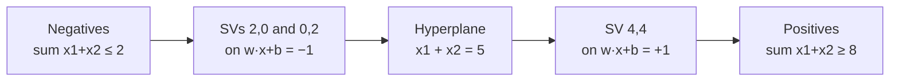
*Fig. 13: Support vectors and the hyperplane x1 + x2 = 5 (draw the 8 points on graph paper in the exam).*

**Step 2: solve w·x + b = y on the support vectors.**
- (2, 0): 2a + b = −1
- (0, 2): 2a + b = −1 (same equation)
- (4, 4): 8a + b = +1

Subtract: 6a = 2 → **a = 1/3**, b = −1 − 2/3 = **−5/3**.

w = (1/3, 1/3) = (0.3333, 0.3333), b = −1.6667. Hyperplane: x1/3 + x2/3 − 5/3 = 0, i.e. **x1 + x2 = 5**.

**Step 3: margin.** ‖w‖ = √(1/9 + 1/9) = √2/3 = 0.4714. Margin width = 2/‖w‖ = **4.2426** (= 3√2); each side 1/‖w‖ = 2.1213. *Check:* the distance from (4, 4) to the line x1 + x2 = 2 is |8 − 2|/√2 = 4.2426 ✓.

**Step 4: verify all constraints.**

| Point | y | w·x + b | y(w·x + b) | Support vector? |
|---|---|---|---|---|
| (4, 4) | +1 | 1.0000 | 1.0000 | **yes** |
| (5, 5) | +1 | 1.6667 | 1.6667 | no |
| (4, 6) | +1 | 1.6667 | 1.6667 | no |
| (6, 4) | +1 | 1.6667 | 1.6667 | no |
| (2, 0) | −1 | −1.0000 | 1.0000 | **yes** |
| (0, 2) | −1 | −1.0000 | 1.0000 | **yes** |
| (0, 0) | −1 | −1.6667 | 1.6667 | no |
| (−1, 1) | −1 | −1.6667 | 1.6667 | no |

All y(w·x + b) ≥ 1 ✓.

**Step 5: dual check.** w = Σ αiyixi with α = 1/18 for (2, 0), 1/18 for (0, 2), 1/9 for (4, 4): Σαiyi = 1/9 − 1/18 − 1/18 = 0 ✓; w = (1/9)(4, 4) − (1/18)(2, 0) − (1/18)(0, 2) = (1/3, 1/3) ✓; Σα = 2/9 = ‖w‖2 ✓.

**Computer check.** Searching all directions in steps of 0.001° gives the widest gap 4.24264 at 45°, i.e. along (1, 1) ✓.

**Classify new points:** (5, 1): 1/3·6 − 5/3 = +0.3333 → **positive**. (3, 1): −0.3333 → **negative**.

**Final answer.** w = (1/3, 1/3), b = −5/3, hyperplane x1 + x2 = 5, support vectors (4, 4), (2, 0), (0, 2), margin width 2/‖w‖ = 4.2426.
:::

## Q6 (b) Hard vs soft margin, slack variables, C, hinge loss  ⭐ (End Q4b)

::: ans Answer

**Hard-margin SVM.** <u>Finds the hyperplane that separates the classes with no error and the largest margin: minimise ½‖w‖2 subject to yi(w·xi + b) ≥ 1.</u> It works only for linearly separable data and is very sensitive to outliers: one stray point can tilt the line or make the problem impossible.

**Soft-margin SVM.** <u>Allows some points inside the margin or on the wrong side by adding slack variables ξi ≥ 0: minimise ½‖w‖2 + C Σξi subject to yi(w·xi + b) ≥ 1 − ξi.</u>

**Slack variable ξi.**

| ξi | Meaning |
|---|---|
| 0 | On or outside the margin, correct |
| 0 < ξi < 1 | Inside the margin, still correct |
| ξi = 1 | Exactly on the decision boundary |
| ξi > 1 | Misclassified |

**Parameter C** (trade-off between a wide margin and few errors):
- **Large C:** errors are costly → narrow margin, fits training data closely, risk of overfitting (C → ∞ gives the hard margin).
- **Small C:** errors are cheap → wide margin, more training errors, smoother, may underfit.
- C is chosen by cross-validation.

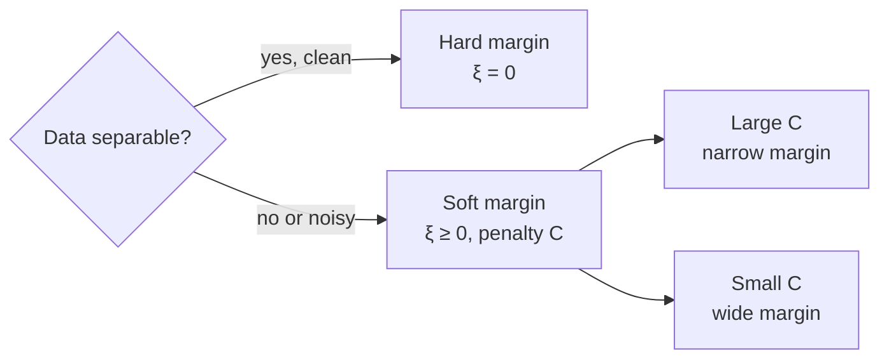
*Fig. 14: Choosing hard or soft margin.*

**Hinge loss.** The soft-margin problem equals minimising ½‖w‖2 + C Σ max(0, 1 − yi f(xi)), f(x) = w·x + b. <u>Hinge loss L = max(0, 1 − y f(x)) is zero for points beyond the margin and grows linearly for points inside the margin or misclassified.</u> At the optimum ξi = hinge loss of point i.

*Example (using Q6(a) w = (1/3, 1/3), b = −5/3):*

| Point | y | f(x) | y f(x) | Hinge = ξ | Status |
|---|---|---|---|---|---|
| (5, 5) | +1 | 1.6667 | 1.6667 | 0 | Safe |
| (4, 4) | +1 | 1.0000 | 1.0000 | 0 | On the margin |
| (2, 2) | −1 | −0.3333 | 0.3333 | 0.6667 | Inside margin, correct |
| (3, 1) | +1 (noisy) | −0.3333 | −0.3333 | 1.3333 | Misclassified |

| Point | Hard margin | Soft margin |
|---|---|---|
| Data | Separable only | Any |
| Errors allowed | None | Yes, via ξ |
| Outliers | Very sensitive | Robust |
| Parameter | None | C |
| Loss view | Infinite penalty | Hinge loss |

**Conclusion.** Real data is noisy, so the soft-margin SVM with a well-chosen C (plus the kernel trick for curved boundaries) is the practical form.
:::

## Q7 (a) PAC learning and sample complexity  (not asked yet)

::: ans Answer

**Introduction.** Learning theory asks: how many examples are enough to be sure that a learned hypothesis is good? The PAC model (Valiant, 1984) gives a precise answer.

**Formal model of the learnable.**
- X: instance space. C: target concept class. H: hypothesis class. D: an unknown distribution over X.
- Training examples are drawn independently from D and labelled by the target c ∈ C.
- True error: errorD(h) = Px∼D[h(x) ≠ c(x)].

**Definition.** <u>A concept class C is PAC-learnable by learner L using H if, for every c ∈ C, every distribution D, every ε (0 < ε < ½) and every δ (0 < δ < ½), L outputs with probability at least 1 − δ a hypothesis h with errorD(h) ≤ ε, in time polynomial in 1/ε, 1/δ, n and size(c).</u>
- **Probably** (probability ≥ 1 − δ) **Approximately Correct** (error ≤ ε).

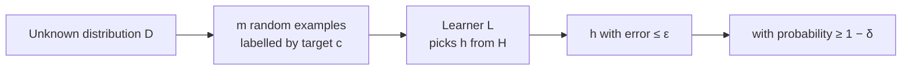
*Fig. 15: The PAC learning model.*

**Sample complexity (finite H, realizable / zero-Bayes case).** <u>The sample complexity is the number of training examples needed for PAC learning.</u> For a consistent learner:

m ≥ (1/ε) (ln|H| + ln(1/δ))

**Numerical:** |H| = 210, ε = 0.1, δ = 0.05.

| Term | Working | Value |
|---|---|---|
| ln\|H\| | 10 ln 2 = 10 × 0.6931 | 6.9315 |
| ln(1/δ) | ln 20 | 2.9957 |
| Sum | 6.9315 + 2.9957 | 9.9272 |
| 1/ε | 1/0.1 | 10 |
| m | 10 × 9.9272 | 99.272 |

**Final answer.** m ≥ 99.27, so **m = 100 examples** guarantee that any consistent hypothesis has error ≤ 10% with probability ≥ 95%.

**What changes m.**

| Change | m | Lesson |
|---|---|---|
| ε = 0.1 (base case) | 100 | |
| ε = 0.05 | 199 | Halving ε doubles m |
| \|H\| = 220 | 169 | m grows only with ln\|H\| |
| Agnostic case: m ≥ (1/2ε2)(ln\|H\| + ln(1/δ)) | 497 | No consistent h → far more data |

**Realizable vs agnostic.** In the realizable (zero-Bayes) case the target is in H and a consistent h exists. In the agnostic case it may not; we bound the gap between training and true error, which needs 1/ε2 examples instead of 1/ε.

**Conclusion.** PAC learning makes "learnable" precise; sample complexity grows linearly in 1/ε, but only logarithmically in |H| and 1/δ.
:::

## Q7 (b) VC dimension  (not asked yet)

::: ans Answer

**Why needed.** The PAC bound uses ln|H|, which is infinite for lines, intervals or neural networks. The VC dimension measures the capacity of an infinite H.

**Shattering.** <u>A set S of points is shattered by H if, for every one of the 2|S| possible labellings of S, some h ∈ H classifies S exactly that way.</u>

**Definition.** <u>The VC dimension VC(H) is the size of the largest set of points that H can shatter. If arbitrarily large sets can be shattered, VC(H) = ∞.</u>

To prove VC(H) = d: (1) show **some** set of d points is shattered; (2) show **no** set of d + 1 points is shattered.

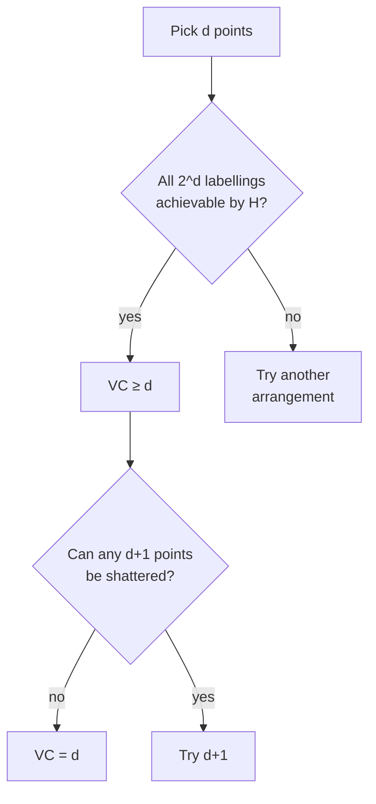
*Fig. 16: How to find the VC dimension.*

**Examples.**

| Hypothesis class | VC dimension | Reason |
|---|---|---|
| Thresholds on a line (x ≥ a → +) | 1 | 2 points: labelling (+, −) with the left one + fails |
| Intervals on a line [a, b] | 2 | 3 points: (+, −, +) fails |
| Lines (perceptrons) in 2-D | 3 | 3 non-collinear points: all 8 labellings work; any 4 points: XOR labelling (or "inner point vs the other three") fails |
| Axis-parallel rectangles in 2-D | 4 | 4 points in a diamond shattered; for 5, the inner point cannot be excluded |
| Hyperplanes in Rd | d + 1 | d + 1 points in general position can be shattered, no d + 2 points can (here it equals the number of parameters w and b, but not always) |
| sin(ωx) on a line | ∞ | One parameter but infinite capacity |

**Lines in 2-D, worked.** Three points in a triangle: 23 = 8 labellings, each separable by a line ✓. Four points: of 24 = 16 labellings, at most 14 are linearly separable. If the 4 points form a quadrilateral, the XOR pattern (diagonal corners same class) fails. If one point lies inside the triangle of the other three, labelling the inner point + and the rest − fails. No set of 4 is shattered, so VC = 3.

**VC-based sample complexity:** m ≥ (1/ε)[4 log2(2/δ) + 8 VC(H) log2(13/ε)]. For lines (VC = 3), ε = 0.1, δ = 0.05: 10 × (21.288 + 168.537) = 1898.2 → **m = 1899**.

**Uses.** Bounds the gap between training and true error; basis of **structural risk minimisation** (choose the class with the best balance of training error and VC dimension). High VC = more capacity = more data needed and higher overfitting risk.

**Conclusion.** VC dimension replaces ln|H| for infinite classes: it is the largest number of points the class can label in every possible way.
:::

## Q8 Short notes (write any four)

::: ans (a) Activation function  ⭐⭐ (End Q6, Mid-2 Q2)
<u>An activation function decides a neuron's output from its net input: y = f(net), net = Σwixi + b.</u> It adds **non-linearity**; without it a deep network collapses to one linear layer. **Step:** 1 if net > 0 else 0 (perceptron). **Sigmoid:** σ(z) = 1/(1 + e−z), range (0, 1), σ' = σ(1 − σ), saturates (vanishing gradient). **Tanh:** range (−1, 1), zero-centred, also saturates. **ReLU:** max(0, z), cheap, no saturation for z > 0, used in hidden layers of deep nets; "dying ReLU" when z < 0. **Softmax:** turns output scores into class probabilities. Backpropagation needs a differentiable activation, so the step function is replaced by sigmoid, tanh or ReLU in MLPs.
:::

::: ans (b) Feature selection  ⭐ (End Q6)
<u>Feature selection chooses a subset of the original features that are most useful for classification and discards the rest.</u> It removes irrelevant and redundant features, reduces overfitting, speeds training and keeps the model readable (the features keep their meaning). **Filter methods:** score each feature independently (correlation, information gain, chi-square). **Wrapper methods:** train the classifier on candidate subsets: forward selection (add the best feature one at a time) or backward elimination. **Embedded methods:** selection happens inside training (decision trees, L1/Lasso). Differs from feature extraction (PCA), which creates new combined features.
:::

::: ans (c) Dimensionality reduction  ⭐ (End Q6)
<u>Dimensionality reduction maps data from d features to k < d features while keeping as much useful information as possible.</u> Motivation: the **curse of dimensionality**: data become sparse and distances lose meaning in high dimensions, so k-NN and density estimates need huge data. **Two routes:** selection (keep some original features) and extraction (build new ones). **PCA** (unsupervised): centre the data, compute the covariance matrix, take eigenvectors with the largest eigenvalues, project. **LDA / Fisher** (supervised): project to separate class means and shrink within-class spread (at most c − 1 dimensions). Benefits: less storage, faster training, less overfitting, 2-D/3-D visualisation.
:::

::: ans (d) Hypothesis class  ⭐ (End Q6)
<u>The hypothesis class (space) H is the set of all functions the learning algorithm can choose from.</u> Examples: all straight lines (perceptron), all decision trees, all networks of a fixed architecture. The learner picks h ∈ H that minimises the empirical risk. The **target class** C is the set of functions the true concept may come from. If H is too small → high bias, approximation error, underfitting; too large → high variance, estimation error, overfitting. Size is measured by |H| (finite) or the VC dimension (infinite), which set the sample complexity. Choosing H is part of the inductive bias.
:::

::: ans (e) Cost function vs loss function  ⭐ (End Q7b)
| Point | Loss function | Cost function |
|---|---|---|
| Scope | One training example | Whole training set (average) |
| Formula | L(ŷ, y), e.g. (ŷ − y)2 | J = (1/m) Σ L(ŷi, yi) (+ regularisation) |
| Example | Squared error, hinge max(0, 1 − yf), cross-entropy | MSE, mean hinge loss + ½‖w‖2 |
| Used for | Measuring one mistake | Optimised by gradient descent |

In Q2(b), (ŷ − y)2 for one point is the loss; J(w, b) = (1/2m) Σ(ŷ − y)2 is the cost. In practice the words are often used loosely.
:::

::: ans (f) Inductive bias and Occam's razor
<u>Inductive bias is the set of assumptions a learner uses to predict outputs for inputs it has not seen.</u> Without some bias, learning beyond the training data is impossible. **Restriction bias** limits H (a perceptron assumes a linear boundary). **Preference bias** orders hypotheses (ID3 prefers short trees with high-gain attributes near the root; k-NN assumes nearby points share a class; SVM prefers the widest margin). <u>Occam's razor: prefer the simplest hypothesis that fits the data.</u> Reason: there are few simple hypotheses, so a simple one that fits is unlikely to fit by chance; complex ones can fit noise and overfit. It underlies pruning, regularisation, small VC dimension and structural risk minimisation.
:::

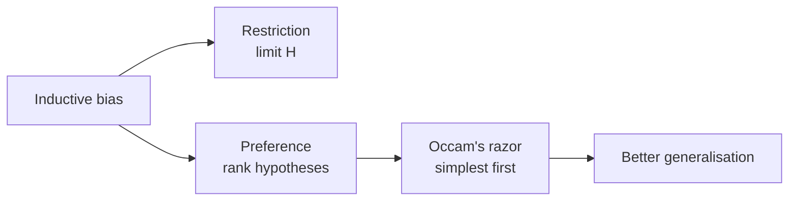
*Fig. 17: Inductive bias and Occam's razor.*
