# Mock Paper 3

**B.Tech (Seventh Semester) Examination 2026-27 · CS-401T · Machine Learning** 
**Time: Three Hours · Maximum Marks: 70** 
**Note:** Attempt any **five** questions. All questions carry equal marks (14 each).

The rest of the syllabus: machine intelligence and learning approaches, minimum-risk classification, the three kinds of gradient descent, LMS, a full backpropagation pass, C4.5 thresholds and pruning, missing values, the nearest-neighbour error bound, bagging and boosting, model selection, the learning-theory words of Unit 4, the dual perceptron, margin bounds and kernels. Every numerical was checked by computer.

## Question paper

| Q | (a) 7 marks | (b) 7 marks |
|---|---|---|
| 1 | What is machine intelligence? Give its applications. Explain the learning classification approaches: generative vs discriminative, parametric vs non-parametric, eager vs lazy. | Explain minimum-risk classification. At a point x, P(ω1\|x) = 0.7 and P(ω2\|x) = 0.3, with λ11 = λ22 = 0, λ12 = 3, λ21 = 1. Find the conditional risks and the decision. Show that zero-one loss gives the minimum-error rule. |
| 2 | Explain general gradient descent. Compare batch, stochastic and mini-batch gradient descent. | Explain the mean-square criterion and the Widrow–Hoff (LMS) rule. Do two LMS updates for a linear unit with w = (0.1, 0.2, −0.1), η = 0.1 and samples (1, 2) → 1, (2, 1) → −1. |
| 3 | Do one complete forward and backward pass of backpropagation on the 2-2-1 sigmoid network given below (x = (1, 0), t = 1, η = 0.5). | Differentiate on-line and off-line learning. What are the important parameters of MLP training? |
| 4 | A numeric attribute Temperature has the values 60 N, 64 N, 68 Y, 70 Y, 72 Y, 75 N, 80 Y, 85 Y. Find the best C4.5 threshold. Explain confidence-based (pessimistic) pruning and reduced-error pruning. | How does a decision tree learn with incomplete data (missing attribute values)? |
| 5 | Explain the nearest-neighbour error probability (Cover–Hart bound) and the effect of k. | What are bootstrapping and bagging? Explain random forest. |
| 6 | Explain AdaBoost. Do one round on the six points x = 1…6 with labels +, +, −, −, +, − using decision stumps. | Explain statistical model selection: hold-out and k-fold cross-validation. What is structural risk minimisation? |
| 7 | Explain the zero-Bayes (realizable) case, ERM and empirical risk, inductive bias, Occam's razor and the limitations of inference machines. | Explain the dual perceptron algorithm. How can a perceptron learn nonlinear hypotheses through an implicit feature space? |
| 8 | Explain margin-based bounds on risk, finite covering and learning with a realizable infinite hypothesis class. | Show that K(x, z) = (x·z + 1)2 for x = (1, 2), z = (3, 1) equals φ(x)·φ(z) for the explicit 6-dimensional φ. Find the RBF kernel value with σ = 1. |

**Network for Q3 (a):** hidden unit h1: w11 = 0.2 (from x1), w21 = 0.4 (from x2), bias b1 = −0.4 · hidden unit h2: w12 = −0.3, w22 = 0.1, bias b2 = 0.2 · output o: v1 = −0.3 (from h1), v2 = −0.2 (from h2), bias bo = 0.1. All units sigmoid.

---

## Q1 (a) Machine intelligence; learning classification approaches  ⭐ (End Q1a)

::: ans Answer

**Introduction.** A machine is called intelligent when it can do tasks that need human intelligence: recognising faces, understanding speech, making decisions. Machine learning is the main route to machine intelligence today, because the machine **learns the rules from data** instead of being given them.

**Definition.** <u>Machine intelligence is the ability of a computer system to perceive, learn, reason and act so as to achieve goals, improving its performance with experience.</u> <u>Machine learning: a program learns from experience E with respect to a task T and performance measure P if its performance at T, measured by P, improves with E (Mitchell).</u>

**Applications.**

| Area | Example |
|---|---|
| Vision | Face unlock, number-plate reading, medical X-ray screening |
| Speech and language | Voice assistants, translation, spam filtering |
| Finance | Credit scoring, fraud detection |
| Health | Disease prediction from test results |
| E-commerce | Recommendations, demand forecasting |
| Agriculture | Crop disease detection from leaf photos |
| Transport | Self-driving cars, route time prediction |

**Learning classification approaches.**

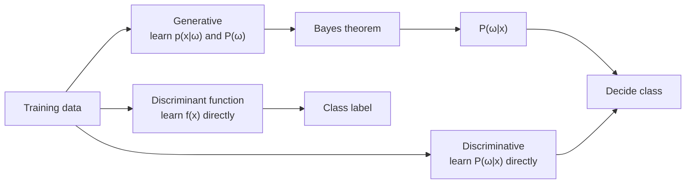
*Fig. 1: The three ways to build a classifier.*

<u>Generative approach: model the class-conditional densities p(x|ωk) and the priors P(ωk), then get the posterior by Bayes theorem.</u> <u>Discriminative approach: model the posterior P(ωk|x) directly, without modelling how x is generated.</u>

| Point | Generative | Discriminative |
|---|---|---|
| What is learned | p(x\|ωk) and P(ωk) | P(ωk\|x) or the boundary |
| Examples | Gaussian Bayes, Naive Bayes, GMM | Logistic regression, perceptron, SVM |
| Can generate new data? | Yes | No |
| Data needed | Reaches its best error with less data (if the assumed model is right) | Usually needs more data, but has lower final error |
| Detects outliers? | Yes (low p(x)) | No |
| Changed priors or costs | Easy: change P(ωk) or λ | Needs re-training |

**Parametric vs non-parametric.**

| Point | Parametric | Non-parametric |
|---|---|---|
| Idea | Assume a fixed form (e.g. Gaussian) and learn its few parameters | No fixed form; the data decides |
| Number of parameters | Fixed | Grows with the data |
| Examples | Gaussian Bayes (μ, Σ), logistic regression | k-NN, Parzen window, decision tree |
| Risk | Wrong assumption → poor results | Overfitting, curse of dimensionality |

**Eager vs lazy.**

| Point | Eager (decision tree, Bayes, perceptron) | Lazy (k-NN) |
|---|---|---|
| Training | Builds a model | Only stores the data |
| Classification | Fast | Slow (compare with all samples) |
| Model | One global model | Local decision for each query |
| Memory | Keeps only the model | Keeps all examples |

**Conclusion.** Generative models explain the data, discriminative models only separate it. Parametric models are fast but assume a shape; non-parametric ones are flexible but need more data. Eager learners work at training time, lazy learners at query time.
:::

## Q1 (b) Minimum-risk classification: numerical

::: ans Answer

**Introduction.** Not all mistakes cost the same. Calling a sick patient healthy is worse than sending a healthy person for one more test. Minimum-risk classification attaches a cost to each mistake.

**Definition.** <u>Let αi be the action "decide ωi" and λij the loss for taking αi when the true class is ωj. The conditional risk is R(αi|x) = Σj λij P(ωj|x). The Bayes rule for minimum risk takes the action with the smallest conditional risk; the resulting overall risk is the Bayes risk.</u>

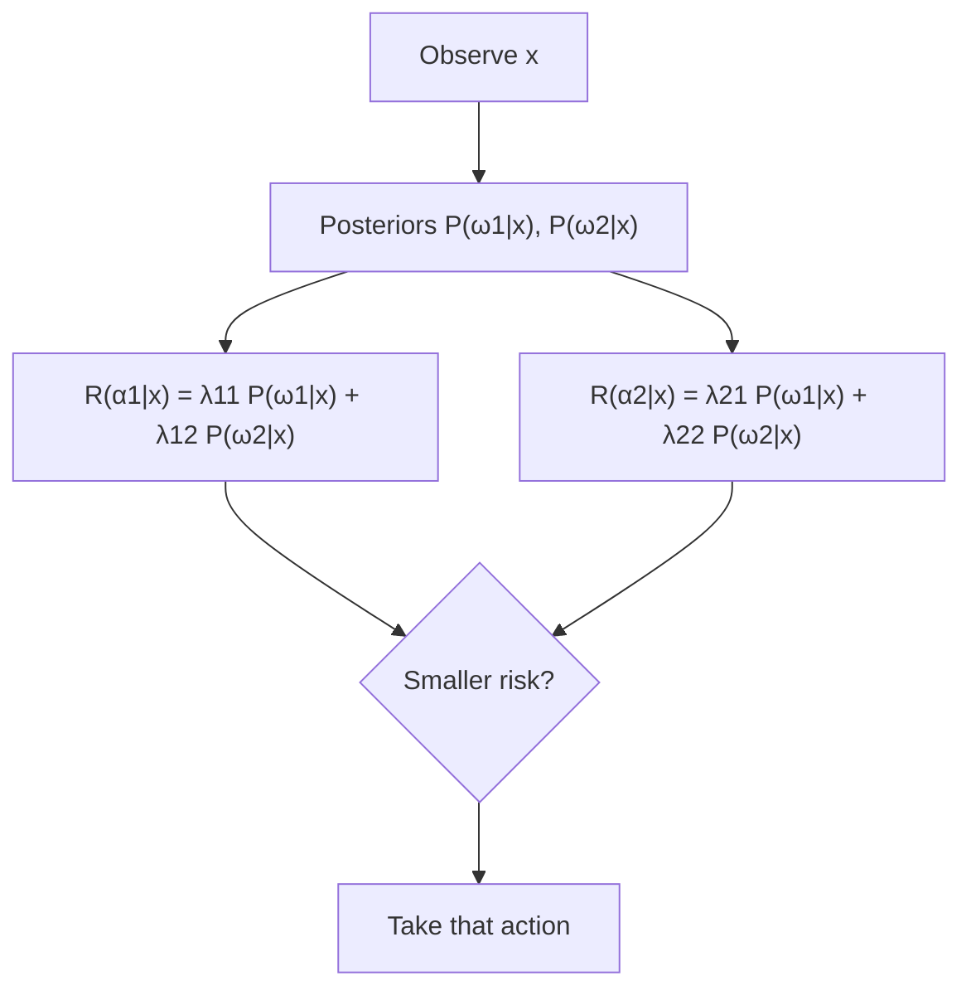
*Fig. 2: Minimum-risk decision.*

**Loss matrix** (ω1 = healthy, ω2 = sick):

| | True ω1 | True ω2 |
|---|---|---|
| α1 (decide ω1) | λ11 = 0 | λ12 = 3 (miss a sick person) |
| α2 (decide ω2) | λ21 = 1 (false alarm) | λ22 = 0 |

**Working** (P(ω1|x) = 0.7, P(ω2|x) = 0.3):
1. R(α1|x) = 0 × 0.7 + 3 × 0.3 = **0.9**.
2. R(α2|x) = 1 × 0.7 + 0 × 0.3 = **0.7**.
3. 0.7 < 0.9, so take **α2: decide ω2 (sick)**.
4. The minimum-error rule would choose ω1 because 0.7 > 0.3. The high cost of a miss changes the decision.

**Effect of the loss value:**

| λ12 | R(α1\|x) | R(α2\|x) | Decision |
|---|---|---|---|
| 2 | 0.6 | 0.7 | ω1 |
| 3 | 0.9 | 0.7 | ω2 |

The decision flips when λ12 × 0.3 > 1 × 0.7, i.e. λ12 > 0.7/0.3 = 2.33.

**Rule in posterior form:** decide ω1 if (λ21 − λ11) P(ω1|x) > (λ12 − λ22) P(ω2|x). Here 0.7 > 0.9 is false, so ω1 is rejected ✓.

**Zero-one loss gives minimum error.** Put λij = 0 if i = j and 1 if i ≠ j. Then

R(αi|x) = Σj≠i P(ωj|x) = 1 − P(ωi|x).

Minimising 1 − P(ωi|x) is the same as maximising P(ωi|x). So the maximum-posterior (minimum-error) rule is the special case of minimum risk with zero-one loss. Here: R(α1|x) = 0.3, R(α2|x) = 0.7 → ω1.

**Final answer:** R(α1|x) = 0.9, R(α2|x) = 0.7 → **decide ω2**. With zero-one loss the risks are 0.3 and 0.7 → ω1.
:::

## Q2 (a) General gradient descent and its types  ⭐⭐ (End Q8, Mid-2 Q4)

::: ans Answer

**Introduction.** Training a model means finding the weights that make a cost J(w) small. When we cannot solve for the minimum directly, we walk downhill step by step. This is gradient descent.

**Definition.** <u>Gradient descent is an iterative method that minimises a cost function J(w) by repeatedly moving the weights a small step in the direction of the negative gradient: w ← w − η ∇J(w).</u>

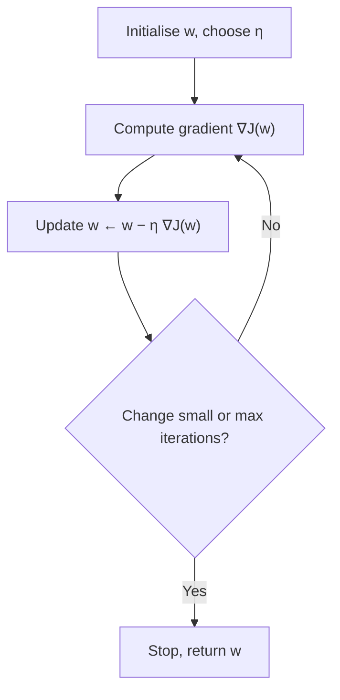
*Fig. 3: General gradient descent.*

**Algorithm.**
1. Initialise w (zeros or small random values); choose the learning rate η.
2. Compute the gradient ∇J(w) = (∂J/∂w1, …, ∂J/∂wn).
3. Update w ← w − η ∇J(w).
4. Repeat until |ΔJ| or ||∇J|| is below a tolerance, or a maximum number of iterations.

η = learning rate (step size). Too small → very slow; too large → overshoots and diverges.

**Small example:** J(w) = (w − 3)2, dJ/dw = 2(w − 3), w0 = 0, η = 0.1.

| Step | w | dJ/dw | new w | J(new w) |
|---|---|---|---|---|
| 1 | 0 | −6 | 0.6 | 5.76 |
| 2 | 0.6 | −4.8 | 1.08 | 3.6864 |
| 3 | 1.08 | −3.84 | 1.464 | 2.3593 |

w moves towards the minimum w = 3 and J falls every step.

**Types.**

| Point | Batch GD | Stochastic GD (SGD) | Mini-batch GD |
|---|---|---|---|
| Samples per update | All N | 1 | b (e.g. 32, 64) |
| Updates per epoch | 1 | N | N/b |
| Gradient | Exact | Very noisy | Slightly noisy |
| Path to minimum | Smooth | Zig-zag | Fairly smooth |
| Speed on big data | Slow | Fast per step | Fast (uses vector hardware) |
| Memory | Whole data set | One sample | One batch |
| Local minima | Can get stuck | Noise helps escape | Some help |
| Use | Small data sets | On-line / streaming data | Default in deep learning |

**Difficulties:** choosing η; local minima and saddle points; plateaus; features on different scales (scale them); slow near the minimum. Remedies: learning-rate decay, momentum, feature scaling.

**Conclusion.** All three use the same update w ← w − η∇J; they differ only in how many samples estimate the gradient. Mini-batch is the usual compromise.
:::

## Q2 (b) Mean-square criterion and Widrow–Hoff (LMS)  ⭐ (End Q5b)

::: ans Answer

**Introduction.** The perceptron rule stops only when data is separable. Widrow and Hoff (1960, ADALINE) instead minimise the squared error of the **linear output**, which works even when the classes overlap.

**Definition.** <u>Mean-square criterion: J(w) = ½ Σd (td − od)2, where od = w·xd is the linear output. The Widrow–Hoff (LMS, delta) rule minimises it by stochastic gradient descent: w ← w + η (t − o) x, one sample at a time.</u>

**Derivation.** For one sample, E = ½(t − o)2, o = Σ wixi. ∂E/∂wi = −(t − o)xi. So Δwi = −η ∂E/∂wi = η(t − o)xi.

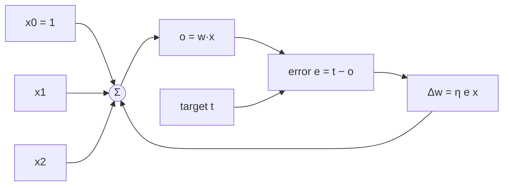
*Fig. 4: ADALINE with the LMS rule.*

**Numerical.** Linear unit o = w0 + w1x1 + w2x2 (bias input x0 = 1), w = (0.1, 0.2, −0.1), η = 0.1.

| Step | x = (x0, x1, x2) | t | o = w·x | e = t − o | E = ½e2 | Δw = η e x | new w |
|---|---|---|---|---|---|---|---|
| 1 | (1, 1, 2) | 1 | 0.1 + 0.2 − 0.2 = 0.1 | 0.9 | 0.405 | (0.09, 0.09, 0.18) | (0.19, 0.29, 0.08) |
| 2 | (1, 2, 1) | −1 | 0.19 + 0.58 + 0.08 = 0.85 | −1.85 | 1.7113 | (−0.185, −0.37, −0.185) | (0.005, −0.08, −0.105) |

After step 2, sample 2 gives o = −0.26 (error energy 0.2738 instead of 1.7113). Sample 1 now gives o = −0.285; further epochs balance the two, which is how LMS reaches the least-squares solution.

**Final answer:** w after update 1 = (0.19, 0.29, 0.08); after update 2 = **(0.005, −0.08, −0.105)**.

**Perceptron vs LMS:** the perceptron uses the thresholded output and updates only on mistakes; LMS uses the linear output and updates on every sample, converging to minimum squared error even for non-separable data.
:::

## Q3 (a) Backpropagation: one full pass on a 2-2-1 network  ⭐⭐⭐ (End Q5a, Mid-2 Q1, MCQ)

::: ans Answer

**Definition.** <u>Backpropagation trains a multilayer network by gradient descent: a forward pass computes the outputs, the output error is propagated backwards to find a δ (error term) for every unit, and each weight is changed by Δw = η δj xi.</u>

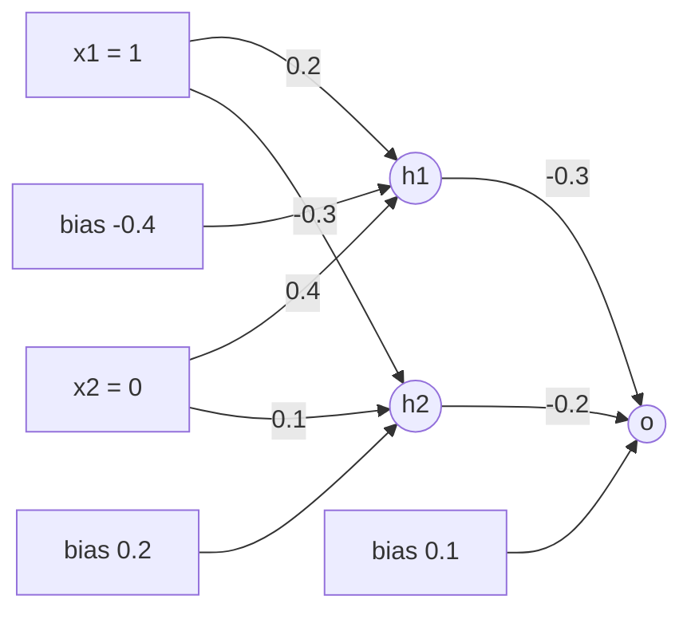
*Fig. 5: The 2-2-1 network with initial weights.*

**Formulas** (sigmoid σ(z) = 1/(1 + e−z), σ′ = σ(1 − σ)):
- Output unit: δo = o(1 − o)(t − o).
- Hidden unit: δh = h(1 − h) vh δo.
- Update: w ← w + η δ (input on that weight); bias input = 1. η = 0.5, x = (1, 0), t = 1.

**Step 1: forward pass.**

| Unit | net | output = σ(net) |
|---|---|---|
| h1 | 0.2(1) + 0.4(0) − 0.4 = −0.2 | 0.4502 |
| h2 | −0.3(1) + 0.1(0) + 0.2 = −0.1 | 0.4750 |
| o | −0.3(0.4502) − 0.2(0.4750) + 0.1 = −0.1301 | **0.4675** |

Error E = ½(1 − 0.4675)2 = **0.1418**.

**Step 2: δ values (backward pass).**

| Unit | Formula | Value |
|---|---|---|
| o | 0.4675 × 0.5325 × (1 − 0.4675) = 0.2489 × 0.5325 | **δo = 0.1326** |
| h1 | 0.4502 × 0.5498 × (−0.3) × 0.1326 = 0.2475 × (−0.0398) | **δ1 = −0.0098** |
| h2 | 0.4750 × 0.5250 × (−0.2) × 0.1326 = 0.2494 × (−0.0265) | **δ2 = −0.0066** |

**Step 3: weight updates (Δw = 0.5 × δ × input).**

| Weight | Old | Δw | New |
|---|---|---|---|
| v1 (h1→o) | −0.3 | 0.5 × 0.1326 × 0.4502 = 0.0298 | **−0.2702** |
| v2 (h2→o) | −0.2 | 0.5 × 0.1326 × 0.4750 = 0.0315 | **−0.1685** |
| bo | 0.1 | 0.5 × 0.1326 × 1 = 0.0663 | **0.1663** |
| w11 (x1→h1) | 0.2 | 0.5 × (−0.0098) × 1 = −0.0049 | **0.1951** |
| w21 (x2→h1) | 0.4 | 0 (x2 = 0) | **0.4** |
| b1 | −0.4 | −0.0049 | **−0.4049** |
| w12 (x1→h2) | −0.3 | 0.5 × (−0.0066) × 1 = −0.0033 | **−0.3033** |
| w22 (x2→h2) | 0.1 | 0 | **0.1** |
| b2 | 0.2 | −0.0033 | **0.1967** |

**Check:** with the new weights the output is 0.4914 and E = 0.1293 (was 0.1418). The error fell, so the step was in the right direction.

**Final answer:** o = 0.4675, δo = 0.1326, δ1 = −0.0098, δ2 = −0.0066. New output weights −0.2702, −0.1685, bias 0.1663; new hidden weights listed above. New output 0.4914.

**Common mistakes:** Use the **old** vh when computing δh (update after all δ are found). Do not forget the biases. Write η = 0.5 next to every Δw line.
:::

## Q3 (b) On-line vs off-line learning; important parameters of MLP training

::: ans Answer

**Definition.** <u>On-line (incremental, stochastic) learning updates the weights after every training sample; off-line (batch) learning sums the gradient over the whole training set and updates once per epoch.</u>

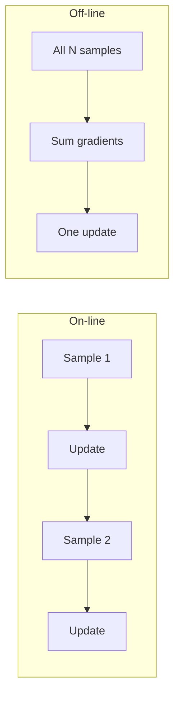
*Fig. 6: On-line vs off-line weight updates.*

| Point | On-line | Off-line (batch) |
|---|---|---|
| Update | After each sample | After each epoch |
| Error surface seen | Error of one sample (changes each step) | Total error surface (fixed) |
| Path | Noisy, can escape shallow local minima | Smooth, true gradient descent |
| Memory | Low | Stores gradient over all samples |
| Speed with redundant data | Fast | Slow |
| Order of samples | Shuffle each epoch | Does not matter |
| Use | Streaming data, large sets | Small sets, second-order methods |

**Error surface.** The total error E(w) is a surface over weight space. For an MLP it is non-convex: it has local minima, flat plateaus and long narrow valleys. Off-line learning walks down this surface exactly; on-line learning walks down a slightly different surface each step, and the noise acts like a random shake.

**Important parameters of MLP training.**
1. **Number of hidden layers and units:** too few → underfitting; too many → overfitting and slow training. One hidden layer is a universal approximator.
2. **Learning rate η:** typical 0.01–0.5. Too high oscillates, too low crawls. Use decay schedules.
3. **Momentum α:** Δw(n) = −η∂E/∂w + αΔw(n − 1), α ≈ 0.9, speeds up valleys and damps oscillation.
4. **Initial weights:** small random values (e.g. ±0.5 or Xavier) to break symmetry and avoid saturating sigmoids.
5. **Activation function:** sigmoid, tanh (zero-centred, faster), ReLU (no vanishing gradient).
6. **Input scaling:** normalise inputs to similar ranges.
7. **Stopping criterion:** maximum epochs, error threshold or **early stopping** on a validation set.
8. **Batch size, number of epochs, regularisation** (weight decay, dropout).

**Conclusion.** On-line learning is fast and noisy, off-line is exact and smooth. Good MLP training depends on a sensible architecture, learning rate, momentum, initial weights and stopping rule.
:::

## Q4 (a) C4.5 continuous test node; pessimistic and reduced-error pruning  ⭐ (End Q3b)

::: ans Answer

**Introduction.** ID3 handles only symbolic attributes. C4.5 (Quinlan, 1993) adds gain ratio, numeric attributes, missing values and pruning.

**Definition.** <u>A continuous test node tests a numeric attribute A against a threshold t (A ≤ t or A > t); t is chosen from the midpoints where the class changes in the sorted data, to give the highest information gain.</u>

**Method.**
1. Sort the examples by the attribute.
2. Candidate thresholds = midpoints between neighbouring values where the class changes.
3. For each t, split into ≤ t and > t and compute the gain (log base 2).
4. Choose the t with the highest gain.

**Data (sorted):**

| Temp | 60 | 64 | 68 | 70 | 72 | 75 | 80 | 85 |
|---|---|---|---|---|---|---|---|---|
| Class | N | N | Y | Y | Y | N | Y | Y |

Entropy(S) for [5Y, 3N] = −(5/8)log2(5/8) − (3/8)log2(3/8) = **0.9544**.

The class changes between 64–68, 72–75 and 75–80, so the candidates are **66, 73.5 and 77.5**.

| t | ≤ t | H(≤) | > t | H(>) | Gain = 0.9544 − weighted H |
|---|---|---|---|---|---|
| 66 | [0Y, 2N] | 0 | [5Y, 1N] | 0.6500 | 0.9544 − (6/8)(0.6500) = **0.4669** |
| 73.5 | [3Y, 2N] | 0.9710 | [2Y, 1N] | 0.9183 | 0.9544 − (5/8)(0.9710) − (3/8)(0.9183) = 0.0032 |
| 77.5 | [3Y, 3N] | 1.0000 | [2Y, 0N] | 0 | 0.9544 − (6/8)(1.0) = 0.2044 |

(The non-boundary midpoints give smaller gains, e.g. 62 → 0.1992, 71 → 0.0488, which confirms the boundary rule.)

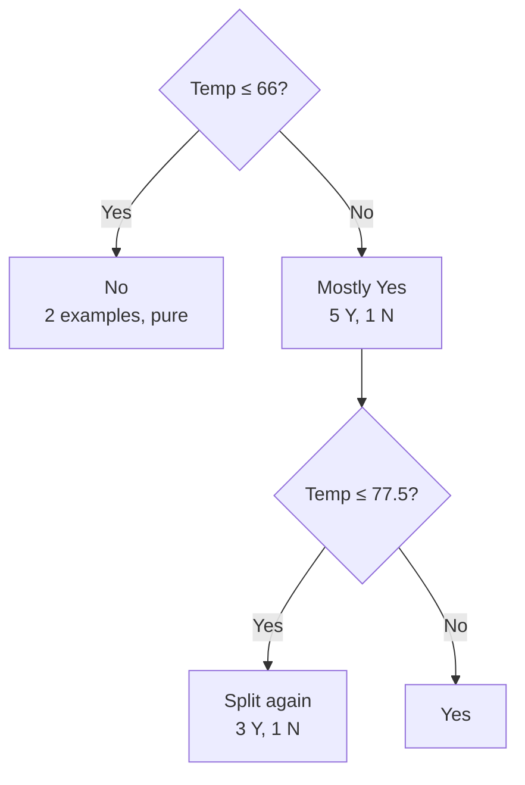
*Fig. 7: The best test node; a numeric attribute can be tested again lower down.*

**Final answer:** Best threshold **Temp ≤ 66** with gain **0.4669** (gain ratio 0.4669 / 0.8113 = 0.5755 is also the highest).

**Pruning.** A fully grown tree overfits. <u>Pruning replaces a subtree by a leaf when this is not expected to increase the error on new data.</u>

**1. Reduced-error pruning (Quinlan 1987, Mitchell).**
1. Split the data into a training set and a separate **validation (pruning) set**.
2. Grow the tree on the training set.
3. For each internal node, replace the subtree by a leaf with the majority class and measure validation accuracy.
4. Remove the node whose removal increases validation accuracy the most.
5. Repeat until further pruning lowers validation accuracy.

Simple and effective, but it uses up data for validation.

**2. Confidence-based (pessimistic) pruning (C4.5).** No separate set: the training error at a leaf is too optimistic, so C4.5 uses the **upper confidence limit** of the error rate (default confidence CF = 25%, z = 0.69):

e = [ f + z2/2N + z √( f/N − f2/N + z2/4N2 ) ] / (1 + z2/N),

where f = E/N is the observed error at the node, N the number of examples.

*Example:* a node with 14 examples (5 errors if it were a leaf) has three leaves with errors 2/6, 1/2, 2/6.

| Node | f | Pessimistic e | Expected errors |
|---|---|---|---|
| Leaf 1 | 2/6 | 0.4740 | 6 × 0.4740 |
| Leaf 2 | 1/2 | 0.7192 | 2 × 0.7192 |
| Leaf 3 | 2/6 | 0.4740 | 6 × 0.4740 |
| Subtree total | — | 0.5090 | **7.126** |
| As one leaf | 5/14 | 0.4489 | **6.284** |

6.284 < 7.126, so the subtree is **replaced by a leaf**. C4.5 also uses **subtree raising** and converts trees to **rules** before pruning (rule post-pruning).

| Point | Reduced-error | Pessimistic |
|---|---|---|
| Extra data | Needs a validation set | No |
| Error estimate | Validation error | Upper confidence bound of training error |
| Used in | Mitchell's ID3 discussion | C4.5 |
:::

## Q4 (b) Learning with incomplete data (missing attribute values)

::: ans Answer

**Introduction.** Real data has gaps: a patient's blood test was not done, a survey field was left blank. A decision tree must learn from such examples and also classify new examples with missing values.

**Definition.** <u>Learning with incomplete data means building and using a decision tree when some examples have unknown values for some attributes, without throwing those examples away.</u>

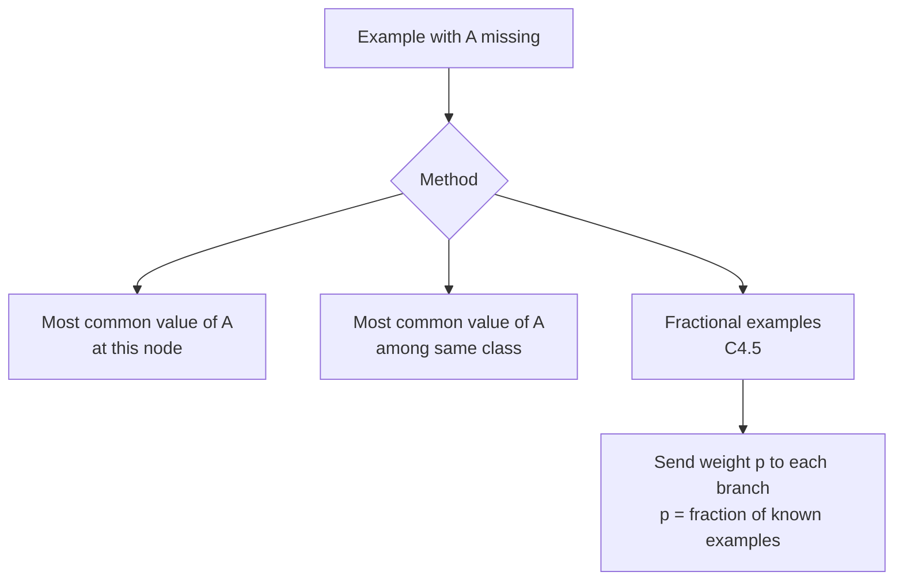
*Fig. 8: Ways to handle a missing value.*

**Methods (Mitchell, Quinlan).**
1. **Ignore the example:** simplest, but wastes data and can bias the tree.
2. **Most common value:** fill A(x) with the most common value of A among examples at node n.
3. **Most common value in the same class:** fill with the most common value among examples at n with class c(x).
4. **Probabilistic (fractional) method of C4.5:**
   - **Choosing the test:** compute the gain using only examples with A known, then multiply by F = fraction of examples with A known: Gain = F × (Entropy(Sknown) − Σ … ).
   - **Splitting:** an example with A missing goes down **every** branch with weight equal to the fraction of known examples in that branch. *Example:* if 6 of 10 known examples have A = High and 4 have A = Low, an example with A missing is sent as 0.6 of an example to High and 0.4 to Low.
   - **Classifying a new example:** follow all branches with these weights and add the class distributions at the leaves; output the class with the largest total probability.
5. **Surrogate splits (CART):** use another attribute that splits the data in nearly the same way.

**Small illustration.** At a node with 10 examples, Outlook is known for 8. If Gain on those 8 is 0.40, the C4.5 gain is (8/10) × 0.40 = 0.32, so attributes with many gaps are penalised.

**Conclusion.** Simple filling is quick; C4.5's fractional examples use all the data and give probability-weighted predictions, which is why C4.5 handles missing values well.
:::

## Q5 (a) Nearest-neighbour error probability and the effect of k

::: ans Answer

**Introduction.** The 1-NN rule is very simple, yet with enough data it is never much worse than the best possible classifier. Cover and Hart (1967) proved this.

**Definition.** <u>Let P* be the Bayes (minimum possible) error and P the asymptotic error of the 1-NN rule as the number of samples n → ∞. For c classes, P* ≤ P ≤ P* (2 − c P*/(c − 1)) ≤ 2P*. So the nearest-neighbour error is at most twice the Bayes error.</u>

**Why (two-class sketch).**
1. As n → ∞, the nearest neighbour x′ of x is so close that P(ωi|x′) ≈ P(ωi|x).
2. 1-NN errs when the labels of x and x′ differ: P(e|x) = 1 − Σi P(ωi|x)2.
3. Two classes, p = P(ω1|x): P(e|x) = 2p(1 − p), while the Bayes error at x is min(p, 1 − p).
4. With m = min(p, 1 − p), P(e|x) = 2m(1 − m) ≤ 2m, so averaging over x gives P ≤ 2P*. Because the average of m2 is at least (P*)2, the tighter form is P ≤ 2P*(1 − P*).

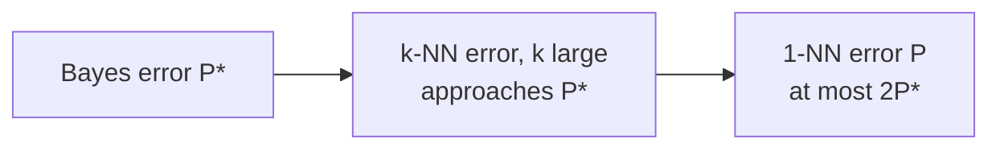
*Fig. 9: Ordering of the asymptotic errors.*

**Numbers** (two classes, bound P*(2 − 2P*)):

| P* | Upper bound on 1-NN error |
|---|---|
| 0.05 | 0.095 |
| 0.10 | 0.18 |
| 0.20 | 0.32 |

For c = 3 and P* = 0.10 the bound is 0.10 × (2 − 1.5 × 0.10) = 0.185.

**Meaning.** Half of all the classification information in an infinite sample is in the nearest neighbour.

**Effect of k.**

| k | Effect |
|---|---|
| k = 1 | Zero training error, very sensitive to noise, jagged boundary (high variance) |
| Small k (3, 5) | Smoother boundary, less noise |
| Large k | Very smooth, may blur real class borders (high bias); slower |
| k → ∞ with k/n → 0 | Error approaches the Bayes error P* |

Choose k by cross-validation; use odd k for two classes to avoid ties; distance-weighted voting reduces the effect of a poor k.

**Conclusion.** The Cover–Hart bound shows 1-NN is at worst twice the optimum; increasing k (with enough data) brings the error down towards the Bayes error.
:::

## Q5 (b) Bootstrapping, bagging and random forest

::: ans Answer

**Definition.** <u>Bootstrapping draws a sample of size n from n training examples with replacement. Bagging (bootstrap aggregating, Breiman 1996) trains one model on each of B bootstrap samples and combines them by majority vote (classification) or averaging (regression).</u>

**How many distinct examples does a bootstrap sample contain?** An example is missed with probability (1 − 1/n)n.

| n | P(example in sample) = 1 − (1 − 1/n)n | Left out (out-of-bag) |
|---|---|---|
| 5 | 0.6723 | 0.3277 |
| 10 | 0.6513 | 0.3487 |
| 100 | 0.6340 | 0.3660 |
| 1000 | 0.6323 | 0.3677 |
| ∞ | 1 − 1/e = **0.6321** | 0.3679 |

So each bootstrap sample has about 63.2% of the distinct examples; the remaining 36.8% (out-of-bag) can test that model for free. The **.632 bootstrap** estimate combines the two: error = 0.368 × training error + 0.632 × out-of-bag error.

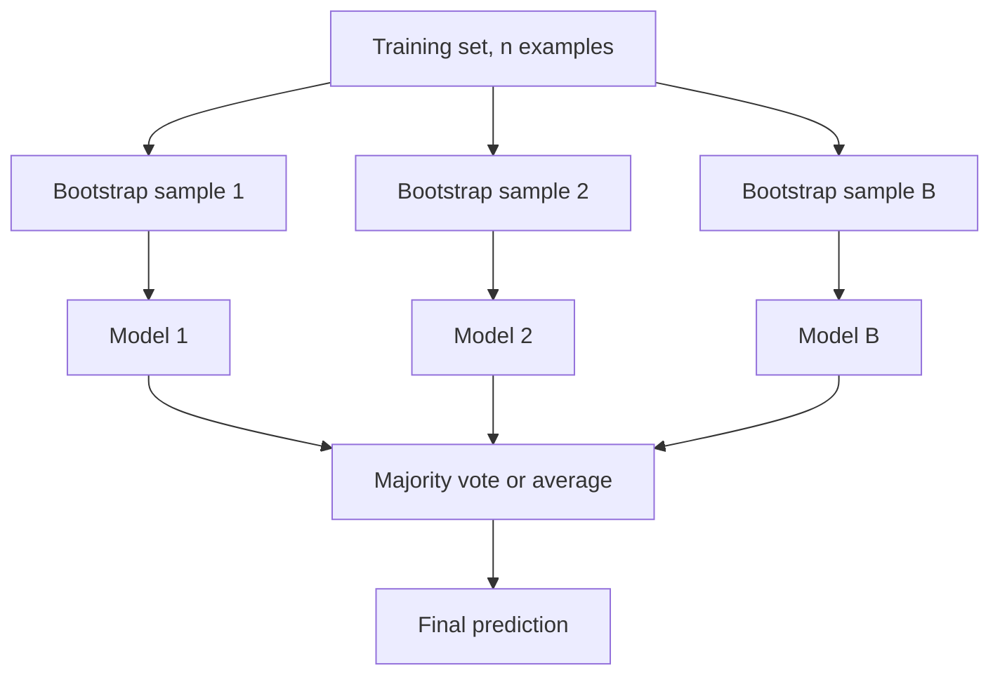
*Fig. 10: Bagging.*

**Bagging algorithm.**
1. For b = 1 … B: draw a bootstrap sample Db; train classifier hb on it.
2. Predict: H(x) = majority vote of h1(x), …, hB(x).

**Why it works:** averaging B models with variance σ2 and small correlation lowers the variance without raising bias. It helps **unstable** learners (decision trees, neural nets), not stable ones (k-NN, linear models).

**Random forest (Breiman 2001).** Bagging of decision trees **plus random feature selection**: at each split, only a random subset of m features (often m ≈ √d) is considered. This makes the trees less correlated, so the vote reduces variance even more.
- Trees are grown deep and not pruned.
- Out-of-bag error estimates the test error.
- Gives feature importance.
- *Advantages:* accurate, robust to noise, few parameters. *Disadvantages:* less interpretable, larger models.

**Conclusion.** Bootstrapping makes many training sets from one; bagging averages models built on them; random forest adds feature randomness to make bagging of trees very strong.
:::

## Q6 (a) AdaBoost: one numeric round

::: ans Answer

**Definition.** <u>Boosting combines many weak learners (slightly better than chance) into a strong learner by training them in sequence, each one focusing on the examples the previous ones got wrong. AdaBoost (Freund and Schapire, 1995) does this by re-weighting the examples.</u>

**Algorithm (labels y ∈ {−1, +1}).**
1. Start with weights wi = 1/n.
2. For t = 1 … T:
   - Train weak learner ht to minimise the weighted error εt = Σwrong wi.
   - αt = ½ ln((1 − εt)/εt).
   - wi ← wi e−αt yi ht(xi), then divide by Zt so they sum to 1.
3. Final classifier H(x) = sign(Σt αt ht(x)).

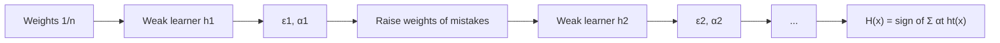
*Fig. 11: AdaBoost.*

**Data:** x = 1, 2, 3, 4, 5, 6 with y = +, +, −, −, +, −. Initial weights 1/6 = 0.1667 each. Weak learners are stumps "x ≤ θ → +1, else −1" (or the reverse).

**Step 1: weighted error of each stump** (rule x ≤ θ → +):

| θ | 0.5 | 1.5 | 2.5 | 3.5 | 4.5 | 5.5 |
|---|---|---|---|---|---|---|
| ε | 0.5 | 0.3333 | **0.1667** | 0.3333 | 0.5 | 0.3333 |

(The reversed rules have error 1 − ε, never better.) Best stump **h1: x ≤ 2.5 → +, else −**. It misclassifies only x = 5. ε1 = 1/6 = 0.1667.

**Step 2:** α1 = ½ ln(0.8333/0.1667) = ½ ln 5 = **0.8047**.

**Step 3: new weights.** Correct: w × e−0.8047 = 0.1667 × 0.4472 = 0.0745. Wrong: w × e0.8047 = 0.1667 × 2.2361 = 0.3727. Z = 5 × 0.0745 + 0.3727 = 0.7454.

| x | y | h1(x) | Correct? | Old w | Unnormalised | New w |
|---|---|---|---|---|---|---|
| 1 | + | + | ✓ | 0.1667 | 0.0745 | 0.1 |
| 2 | + | + | ✓ | 0.1667 | 0.0745 | 0.1 |
| 3 | − | − | ✓ | 0.1667 | 0.0745 | 0.1 |
| 4 | − | − | ✓ | 0.1667 | 0.0745 | 0.1 |
| 5 | + | − | ✗ | 0.1667 | 0.3727 | **0.5** |
| 6 | − | − | ✓ | 0.1667 | 0.0745 | 0.1 |

**Final answer:** ε1 = 0.1667, α1 = 0.8047; the misclassified point x = 5 gets weight 0.5, the others 0.1 each. The next stump must get x = 5 right.

After re-weighting, the mistakes carry exactly half the total weight, so h1 would now have error 0.5: the next learner is forced to be different.

**Bagging vs boosting:** bagging trains in parallel on random samples and reduces variance; boosting trains in sequence on re-weighted data and reduces bias (and variance). Boosting is sensitive to noisy labels.
:::

## Q6 (b) Statistical model selection; structural risk minimisation

::: ans Answer

**Introduction.** We must choose between models (degree of polynomial, k in k-NN, tree depth, C in SVM). Training error always prefers the most complex model, so we need an honest estimate of the **test** error.

**Definition.** <u>Statistical model selection is choosing, from a set of candidate models or hyperparameters, the one with the lowest estimated generalisation error, using data not used for fitting.</u>

**1. Hold-out method.** Split the data, e.g. 70% training, 30% test (or train / validation / test). Train on one part, measure error on the other. *Simple, but* the estimate depends on one random split and wastes data.

**2. k-fold cross-validation.**
1. Divide the data into k equal folds (k = 5 or 10).
2. For i = 1 … k: train on k − 1 folds, test on fold i, record error ei.
3. CV error = (1/k) Σ ei. Choose the model with the lowest CV error, then retrain it on all data.

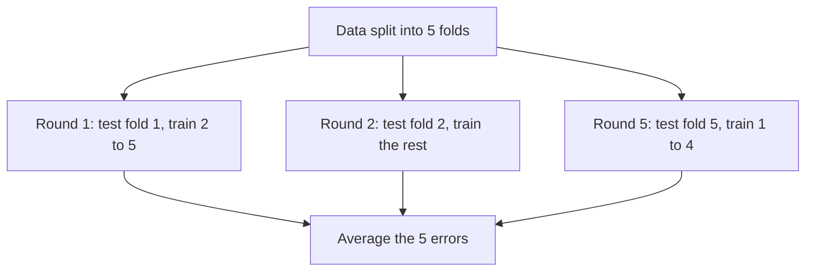
*Fig. 12: 5-fold cross-validation.*

Special case: **leave-one-out** (k = n), nearly unbiased but expensive. **Stratified** CV keeps class proportions in each fold.

| Point | Hold-out | k-fold CV |
|---|---|---|
| Training runs | 1 | k |
| Data use | Part of the data never trains | Every example tests once, trains k − 1 times |
| Variance of estimate | High | Low |
| Cost | Cheap | k times more |

**3. Structural risk minimisation (Vapnik).** <u>SRM arranges hypothesis classes in a nested sequence H1 ⊂ H2 ⊂ … of increasing VC dimension h1 ≤ h2 ≤ …, and chooses the class and hypothesis that minimise the bound: empirical risk + confidence term Φ(h, N, δ).</u>

R(f) ≤ Remp(f) + √{ [h(ln(2N/h) + 1) − ln(δ/4)] / N }

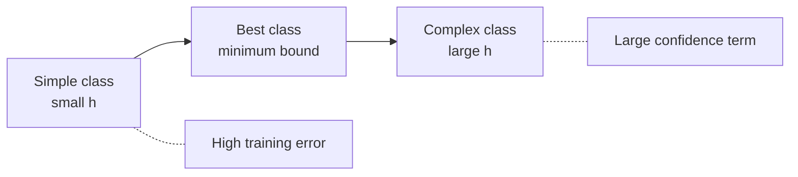
*Fig. 13: SRM picks the class where the sum of the two terms is smallest.*

As h grows, the training error falls but the confidence term rises; the bound has a U-shape and SRM picks its bottom. The SVM is an SRM machine: maximising the margin keeps h small.

**Conclusion.** Hold-out and cross-validation estimate test error from data; SRM controls it from theory by trading training error against capacity.
:::

## Q7 (a) Zero-Bayes case, ERM, inductive bias, Occam's razor, limitations

::: ans Answer

**1. Empirical risk and ERM.** <u>The true risk of h is LD(h) = P(x,y)~D[h(x) ≠ y]. The empirical risk is the training error LS(h) = (1/m) |{i : h(xi) ≠ yi}|. Empirical risk minimisation (ERM) outputs a hypothesis in H with the smallest empirical risk.</u> The danger: with a rich H, ERM can memorise the data (zero training error, high true error), i.e. overfit.

**2. Zero-Bayes (realizable) case.** <u>The realizable assumption: there is h* in H with LD(h*) = 0, so the labels are a deterministic function in H and the Bayes error is zero.</u> Then ERM always finds a consistent hypothesis (zero training error). For a **finite** H, with probability at least 1 − δ, ERM gives error ≤ ε when

m ≥ (1/ε)(ln|H| + ln(1/δ)).

*Example:* |H| = 1000, ε = 0.05, δ = 0.01 → m ≥ 20 × (6.9078 + 4.6052) = 230.26, so **231 examples** suffice.

In the **agnostic** (non-zero Bayes) case no h is perfect, and the bound needs about 1/ε2 examples instead of 1/ε.

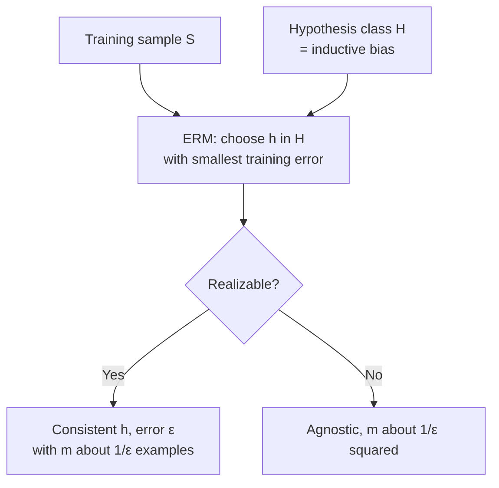
*Fig. 14: ERM in the realizable and agnostic cases.*

**3. Inductive bias.** <u>The inductive bias of a learner is the set of assumptions it uses to predict outputs for inputs it has not seen.</u> Without bias, learning is impossible (no-free-lunch). Examples: ID3 prefers short trees with high-gain attributes near the root (preference bias); the perceptron assumes a linear boundary (restriction bias); k-NN assumes nearby points share a class.

**4. Occam's razor.** <u>Prefer the simplest hypothesis that fits the data.</u> Reason: there are few simple hypotheses, so a simple one that fits is unlikely to fit by chance; complex ones can fit anything. Formally, a short description length means small |H| in the bound above. Used in tree pruning, MDL and SRM.

**5. Limitations of inference machines.**
- **No free lunch:** no learner is best for all problems; averaged over all targets every learner is equal.
- **Approximation error:** if the target is not in H, even infinite data cannot remove the error.
- **Estimation error:** with finite data we may not find the best h in H.
- **Computational limits:** ERM is NP-hard for many classes (e.g. finding the best halfspace in the agnostic case).
- **Data limits:** noise, sampling bias, changed distributions between training and use.

**Conclusion.** Learning needs a biased hypothesis class, a rule like ERM to pick from it, and enough data. Occam's razor and the realizable bounds explain why simple, consistent hypotheses generalise.
:::

## Q7 (b) Dual perceptron; nonlinear hypotheses via an implicit feature space

::: ans Answer

**Introduction.** In the perceptron every update adds yixi to w. So the final w is a weighted sum of training points, and we can store the counts instead of w.

**Definition.** <u>The dual perceptron represents the weight vector as w = Σi αi yi xi, where αi counts the mistakes made on example i, and classifies with f(x) = sign(Σi αi yi (xi·x) + b). The data appear only in dot products.</u>

**Algorithm.**
1. Set all αi = 0, b = 0.
2. For each example (xj, yj): compute f = Σi αi yi K(xi, xj) + b.
3. If yj f ≤ 0 (mistake): αj ← αj + 1 (and b ← b + yjR2 if a bias is used).
4. Repeat epochs until no mistakes.

With K(x, z) = x·z this is the ordinary perceptron. **Replacing x·z by a kernel K(x, z) = φ(x)·φ(z)** makes the perceptron linear in the feature space φ but nonlinear in the input space, without ever computing φ: the **implicit feature space**.

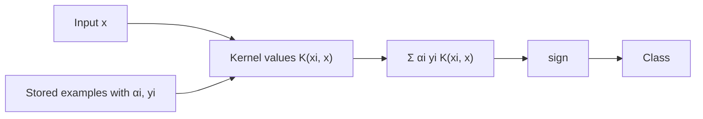
*Fig. 15: Kernel (dual) perceptron.*

**Example: XOR with K(x, z) = (x·z + 1)2** (no separate bias, a mistake when y f ≤ 0). Points: (1, 1) −, (−1, −1) −, (1, −1) +, (−1, 1) +. Kernel matrix: 9 on the diagonal, 1 elsewhere.

| Epoch | Point | y | f before | Mistake? | α after |
|---|---|---|---|---|---|
| 1 | (1, 1) | − | 0 | Yes | (1, 0, 0, 0) |
| 1 | (−1, −1) | − | −1 | No | (1, 0, 0, 0) |
| 1 | (1, −1) | + | −1 | Yes | (1, 0, 1, 0) |
| 1 | (−1, 1) | + | 0 | Yes | (1, 0, 1, 1) |
| 2 | (1, 1) | − | −7 | No | |
| 2 | (−1, −1) | − | 1 | Yes | (1, 1, 1, 1) |
| 2 | (1, −1), (−1, 1) | + | 8, 8 | No | |
| 3 | all four | | −8, −8, 8, 8 | No | (1, 1, 1, 1) |

Final rule: f(x) = Σ yi K(xi, x), which simplifies to **f(x) = −8 x1x2**. It classifies XOR perfectly, though no line in the input plane can. The kernel has added the feature x1x2 implicitly.

**Advantages:** nonlinear boundaries with a linear algorithm; cost depends on the number of examples, not the (possibly infinite) feature dimension. **Disadvantage:** must store the examples with αi > 0; finds any separator, not the maximum-margin one (the SVM fixes that).
:::

## Q8 (a) Margin-based bounds; finite covering; realizable infinite class

::: ans Answer

**Introduction.** For a finite H the bound uses ln|H|. Linear classifiers form an **infinite** class, so we need another measure of complexity: the VC dimension, a covering number, or the margin.

**1. Realizable infinite hypothesis class.** <u>If H is infinite but has finite VC dimension d, and the realizable assumption holds, ERM learns H with sample complexity m = O((d ln(1/ε) + ln(1/δ))/ε).</u> Halfspaces in Rn have d = n + 1. The idea: on m points H can produce at most (em/d)d different labellings (Sauer's lemma), so it behaves like a finite class of that size.

**2. Finite covering.** <u>A γ-cover of H is a finite set of hypotheses C such that every h in H is within distance γ of some member of C. The covering number N(γ) is the size of the smallest such set.</u> We apply the finite-class bound to the cover and replace ln|H| by ln N(γ): an infinite class is "effectively finite" at resolution γ.

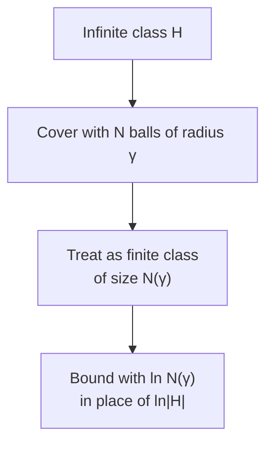
*Fig. 16: Finite covering of an infinite class.*

**3. Margin-based bounds on risk.** <u>A margin-based bound limits the true error of a classifier by a quantity that depends on the margin γ it achieves on the training data relative to the radius R of the data, not on the input dimension.</u>

For linear classifiers with margin γ on data inside a ball of radius R, the effective VC dimension is

h ≤ min(⌈R2/γ2⌉, n) + 1,

and with probability at least 1 − δ,

R(f) ≤ Remp(f) + √{ [h(ln(2N/h) + 1) − ln(δ/4)] / N }.

The covering number of large-margin classifiers also depends on R2/γ2, which gives the same message.

**Consequences.**
1. Larger margin → smaller h → tighter bound → better generalisation. This is why the SVM maximises the margin (maximal margin classifier).
2. The bound does not grow with the dimension of the feature space, so kernel SVMs can work in very high (even infinite) dimensions.
3. Soft-margin version: R(f) ≤ (margin violations)/N + O(√(R2/(γ2N))).

**Conclusion.** Covering numbers and VC dimension make infinite classes learnable; the margin bound shows that a wide margin, not a small number of features, is what controls the risk.
:::

## Q8 (b) Kernel functions: numerical  ⭐ (End Q4b)

::: ans Answer

**Definition.** <u>A kernel function K(x, z) = φ(x)·φ(z) gives the dot product of two points after a feature mapping φ, without computing φ explicitly. Mercer's condition: the kernel matrix must be symmetric and positive semi-definite.</u>

**1. Polynomial kernel K(x, z) = (x·z + 1)2, x = (1, 2), z = (3, 1).**

*Kernel side:* x·z = 1 × 3 + 2 × 1 = 5, so K = (5 + 1)2 = **36**.

*Feature side:* expanding (x1z1 + x2z2 + 1)2 gives

φ(x) = (x12, x22, √2 x1x2, √2 x1, √2 x2, 1).

| Component | φ(x) | φ(z) | Product |
|---|---|---|---|
| x12 | 1 | 9 | 9 |
| x22 | 4 | 1 | 4 |
| √2 x1x2 | 2√2 = 2.8284 | 3√2 = 4.2426 | 12 |
| √2 x1 | √2 = 1.4142 | 3√2 = 4.2426 | 6 |
| √2 x2 | 2√2 = 2.8284 | √2 = 1.4142 | 4 |
| 1 | 1 | 1 | 1 |
| **Sum** | | | **36** |

φ(x)·φ(z) = 36 = K(x, z) ✓. The kernel needed one 2-D dot product; the explicit route needed a 6-D map.

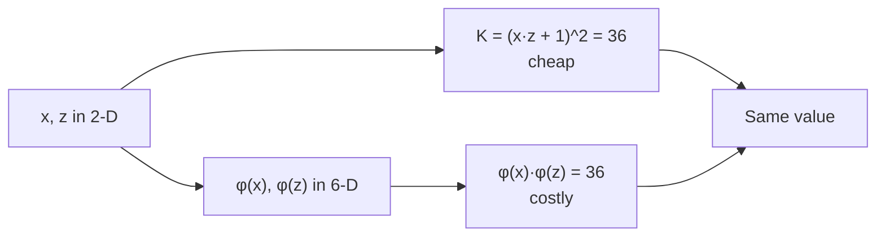
*Fig. 17: Map high, compute low.*

**2. RBF kernel** K(x, z) = exp(−||x − z||2 / 2σ2), σ = 1.

||x − z||2 = (1 − 3)2 + (2 − 1)2 = 4 + 1 = 5.

K = exp(−5/2) = e−2.5 = **0.0821**. (With σ = 2: exp(−5/8) = 0.5353; a wider σ treats the points as more similar.)

**Final answer:** (x·z + 1)2 = 36 = φ(x)·φ(z). RBF (σ = 1) = **0.0821**.

**Common kernels.**

| Kernel | Formula | Feature space |
|---|---|---|
| Linear | x·z | Input space |
| Polynomial | (x·z + c)d | All monomials up to degree d |
| RBF | exp(−‖x − z‖2/2σ2) | Infinite-dimensional |
| Sigmoid | tanh(κ x·z + θ) | Like a neural network (valid for some κ, θ) |

**Conclusion.** The kernel gives the high-dimensional dot product at low-dimensional cost; this is the kernel trick used by SVMs and the kernel perceptron.
:::
