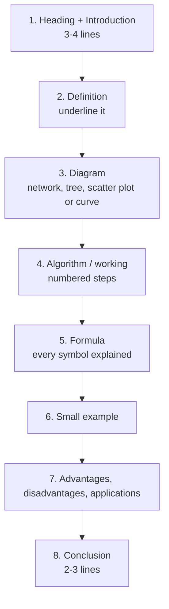
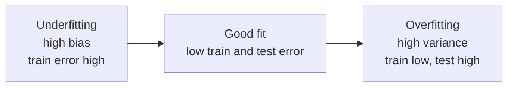

# How to write an MJPRU answer

MJPRU examiners mark long answers by **length, structure and a diagram**. A 14-mark question (two 7-mark parts) is expected to fill **4–5 pages**, with **at least one diagram**. Machine learning gives you easy diagrams: a neuron, an MLP with input/hidden/output layers, a decision tree, a 2-D scatter with a separating line and margin, a U-shaped bias–variance curve, a loss surface with gradient-descent steps.

## The template for a long answer (7-mark part ≈ 2–2.5 pages)

1. **Introduction (3–4 lines):** where the topic fits and what problem it solves.
2. **Definition:** one crisp sentence, underlined.
3. **Diagram:** labelled, with a caption ("Fig. 1: Architecture of an MLP").
4. **Algorithm steps:** numbered, as in a textbook ("Step 1: initialise weights to small random values…").
5. **Formula:** for example w ← w + η(t − o)x, with η, t, o, x explained underneath.
6. **Small example:** two or three numbers worked through.
7. **Advantages / disadvantages / applications:** 3–4 each.
8. **Conclusion (2–3 lines).**

## "Differentiate between" questions (3.5 marks each)

A **table of 5–6 rows** (definition, cause, effect on training/test error, example, remedy) plus a one-line diagram where it helps (the bias–variance U-curve, an underfit line vs an overfit wiggle). Half a page each.

*Fig.: Model complexity increases from left to right.*

## For numericals

- **Write the formula first**, then a **table**, then the **answer in a box**.
- **k-NN:** distance formula; a table of distances; sort; pick k nearest; majority vote; say whether you scaled the features.
- **Entropy / ID3:** Entropy(S) = −Σ p log2 p; a table per attribute; information gain; choose the highest; draw the tree.
- **Perceptron / LMS:** a table per epoch: inputs, net, output, error, new weights; stop when an epoch has no errors.
- **Bayes:** P(ω|x) = p(x|ω)P(ω)/p(x); compute both posteriors; choose the larger.

## Time plan (3 hours, 5 questions)

| Activity | Time |
|---|---|
| Reading the paper and choosing 5 questions | 5 min |
| Each 14-mark question | 33 min |
| Checking numericals and underlining | 10 min |

::: tip Choosing questions
Take the numerical question first (k-NN in 2025-26): full marks in 25 minutes. Then the Unit 2 questions you have rehearsed (backpropagation, gradient descent), then SVM, then the "differentiate" or short-notes question.
:::

::: warn Common ways students lose marks
- No diagram in backpropagation, SVM or decision-tree answers.
- k-NN without a distance table, or forgetting to sort before choosing k.
- Entropy with natural log in one place and log2 in another.
- Gradient descent without the update formula w ← w − η ∂J/∂w.
- Mixing up bias/variance with underfitting/overfitting directions.
:::
