# Unit 1 · Introduction to ML and Bayes Decision Theory

> **Exam weight:** 28 of the 112 marks on the 2025-26 end-sem paper: AI vs ML vs DL (Q1a), supervised vs unsupervised vs reinforcement (Q1b), class-conditional density and Bayes decision theory (Q3a), and short notes on feature selection and dimensionality reduction (Q6). Mid-2 2025 asked the confusion matrix with Type I and Type II errors (Q3), and the earlier mid asked classification vs prediction and concept learning.

**Prefer to watch first?** [Video lectures for Unit 1 →](#videos/unit1)

Notation follows Duda, Hart and Stork: classes are written ω1, ω2, … (read "omega one"). Some books write C1, C2; both mean the same. Every number on this page was checked by computer.

## 1.1 What is machine learning

In normal programming a person writes the rules and the computer follows them. In machine learning (ML) we give the computer many examples, and it finds the rules by itself, the way a child learns what a dog is by seeing many dogs.

**Definitions.**
- **Arthur Samuel (1959):** <u>Machine learning is the field of study that gives computers the ability to learn without being explicitly programmed.</u>
- **Tom Mitchell (1997):** <u>A computer program is said to learn from experience E with respect to some class of tasks T and performance measure P, if its performance at tasks in T, as measured by P, improves with experience E.</u>

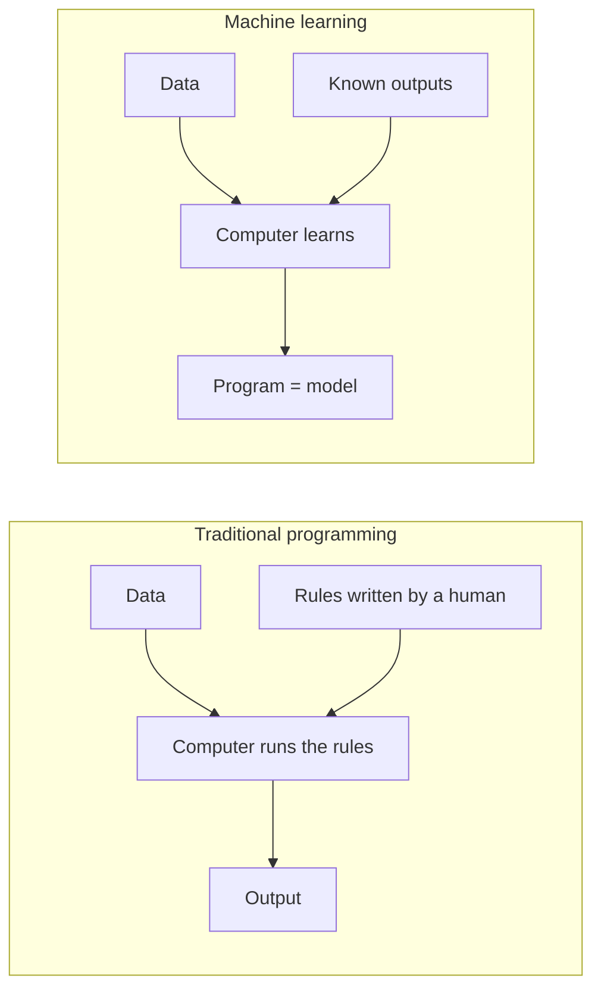
*Fig. 1.1: Traditional programming vs machine learning.*

| Problem | Task T | Performance P | Experience E |
|---|---|---|---|
| Checkers (Mitchell) | Playing checkers | % of games won | Practice games against itself |
| Handwriting recognition | Classifying handwritten words | % of words correct | Database of labelled words |
| Robot driving | Driving on highways using cameras | Average distance before an error | Recorded images and steering of a human driver |
| Spam filter | Marking emails spam / not spam | % of emails marked correctly | Emails already marked by users |

**When to use ML:** rules are too hard to write (faces, speech); rules keep changing (spam tricks); each user is different (music suggestions); data is too large for humans (fraud in millions of transactions). ML is **not** needed when a fixed formula works (salary tax).

**Basic terms:** *dataset* (all examples), *sample / instance / pattern* (one example), *feature* (one measurable property), *feature vector* **x** (all features of a sample), *label* y (the correct answer), *model / hypothesis* h (the learned rule), *training* (learning h), *testing* (checking h on unseen data).

**Steps of an ML project:** (1) define T and P, (2) collect data, (3) pre-process (clean, fill missing values, scale), (4) choose features, (5) choose and train a model, (6) evaluate on test data, (7) deploy and re-train when data changes.

## 1.2 Machine intelligence and applications

<u>Machine intelligence is the ability of a machine to perform tasks that normally require human intelligence, such as perception, learning, reasoning, problem solving and decision making. Machine learning is the part of machine intelligence that improves this ability automatically from data and experience.</u>

| Ability | Meaning | Example |
|---|---|---|
| Perception | Getting information through sensors | Camera sees a road |
| Learning | Improving with data | Spam filter improves as users mark emails |
| Reasoning | Drawing conclusions from facts | "fever + rash → check for measles" |
| Decision making | Choosing the best action | Self-driving car brakes |
| Language | Understanding human language | Chatbots, translation |
| Acting | Doing physical work | Robot arm picks an object |

**Applications of ML (write 6–8 with real products):**

| Domain | Applications | ML task |
|---|---|---|
| Computer vision | Face unlock, number-plate reading, X-ray diagnosis | Classification |
| Speech | Alexa, Siri, Google Assistant, speech-to-text | Classification |
| Language (NLP) | Spam filtering, translation, review sentiment | Classification |
| Healthcare | Disease prediction, cancer detection in scans | Classification / regression |
| Banking | Loan approval, card-fraud detection, stock forecasting | Classification / regression |
| E-commerce | Amazon, Netflix, Spotify recommendations; customer segments | Recommendation / clustering |
| Transport | Self-driving cars, traffic prediction in Google Maps | Regression / reinforcement |
| Agriculture | Crop disease from leaf photos, yield prediction | Classification / regression |
| Cyber security | Intrusion, malware and phishing detection | Classification / anomaly detection |
| Games and robotics | Chess, Go (AlphaGo), robots that learn to walk | Reinforcement learning |

| Advantages of ML | Limitations of ML |
|---|---|
| Solves problems whose rules are too complex to write | Needs a lot of good-quality data |
| Improves as more data arrives | Biased data gives biased results |
| Finds hidden patterns | Deep models are hard to explain ("black box") |
| Fast on huge data; personalises for each user | Costly hardware; risk of overfitting |

## 1.3 AI vs ML vs Deep Learning  ⭐ (End Q1a)

AI is the big goal (make machines act smart). ML is one way to reach it (learn from data). DL is one kind of ML (very large neural networks with many layers). They fit inside each other like Russian dolls: **AI ⊃ ML ⊃ DL**.

- <u>Artificial Intelligence: the branch of computer science that builds machines able to perform tasks that normally need human intelligence, such as reasoning, planning, perception and language understanding.</u>
- <u>Machine Learning: a subset of AI in which systems learn patterns from data and improve with experience, without being explicitly programmed with rules.</u>
- <u>Deep Learning: a subset of ML that uses artificial neural networks with many hidden layers to learn features automatically from raw data such as images, sound and text.</u>

```mermaid
flowchart TB
  subgraph AI[Artificial Intelligence: expert systems, search, planning]
    subgraph ML[Machine Learning: Bayes, k-NN, decision tree, SVM]
      DL[Deep Learning: CNN, RNN, transformers]
    end
  end
```
*Fig. 1.2: AI contains ML, and ML contains DL. Draw three nested circles in the exam.*

| Point | Artificial Intelligence | Machine Learning | Deep Learning |
|---|---|---|---|
| Meaning | Machines behaving intelligently | Machines learning from data | Learning with many-layer neural networks |
| Scope | Widest field | Subset of AI | Subset of ML |
| Main idea | Rules, logic, search, planning and learning | Statistical models learned from examples | Layers of neurons learn features themselves |
| Knowledge from | Hand-written rules or learning | Data | Very large data |
| Feature engineering | Not always needed | Usually done by a human | Automatic |
| Data needed | Can work with little data | Small to medium | Very large |
| Hardware | Ordinary computer | Ordinary CPU | GPUs |
| Training time | Little or none (rules) | Seconds to hours | Hours to weeks |
| Explainability | Rules easy to explain | Trees and Bayes fairly easy | Hard ("black box") |
| Examples | Chess search program, medical expert system | Spam filter, loan approval, price prediction | Face recognition, speech recognition, ChatGPT |

**Example — one self-driving car has all three:** the whole car that plans a route and obeys traffic rules is an **AI** system; the module that predicts trip time from past trips is **ML** (regression); the module that finds people and signboards in camera images is **DL** (a CNN).

**Conclusion:** all DL is ML and all ML is AI, but not all AI is ML. ML is the data-driven part of AI; DL is the neural-network part of ML.

## 1.4 Types of learning: supervised, unsupervised, reinforcement  ⭐ (End Q1b)

Learning methods are grouped by the **feedback** the learner gets. Memory trick: **teacher, no teacher, coach**.

- <u>Supervised learning: learning a mapping from inputs to outputs using a training set in which every input xi has a known correct output (label) yi.</u>
- <u>Unsupervised learning: learning the hidden structure of data (groups, patterns, lower-dimensional form) from inputs only, with no labels.</u>
- <u>Semi-supervised learning: learning from a small amount of labelled data together with a large amount of unlabelled data.</u>
- <u>Reinforcement learning: learning by interaction, in which an agent takes actions in an environment and learns a policy that maximises the total reward it receives over time.</u>

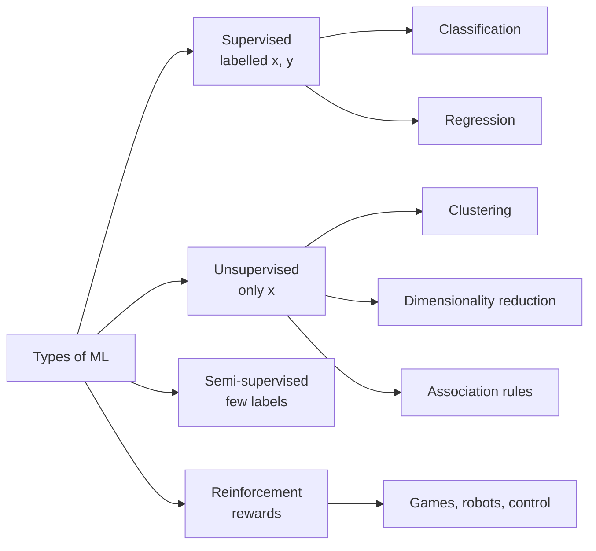
*Fig. 1.3: Types of machine learning.*

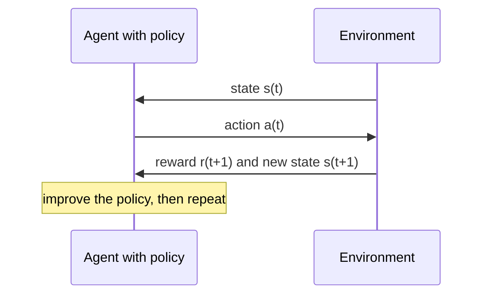
*Fig. 1.4: The reinforcement learning loop.*

**Examples:** *supervised* — 1,000 X-rays marked "pneumonia" or "normal" by a doctor, the model labels new X-rays; *unsupervised* — 50,000 shop customers with no labels, clustering finds "students", "families", "bulk buyers"; *semi-supervised* — you name a person in 3 photos and the app finds that face in 500 more; *reinforcement* — AlphaGo, a robot learning to walk, traffic-light control (+1 for a win, −1 for a crash). The RL agent balances **exploration** (try new actions) and **exploitation** (use known good ones).

| Point | Supervised | Unsupervised | Reinforcement |
|---|---|---|---|
| Input data | Labelled pairs (x, y) | Unlabelled x only | Experience from interaction |
| Feedback | Correct answer for every example | None | Reward or penalty, often delayed |
| Goal | Predict labels of new inputs | Find groups or structure | Learn the best sequence of actions |
| Main tasks | Classification, regression | Clustering, dimensionality reduction, association | Control, games, decision making |
| Algorithms | Naive Bayes, k-NN, decision tree, SVM, linear regression | k-means, hierarchical clustering, PCA, Apriori | Q-learning, SARSA, policy gradient |
| Analogy | Student with a teacher | Student sorting things alone | Pet trained with treats |
| Example | Spam detection, house price | Customer segmentation | Chess or Go program |
| Evaluation | Accuracy, test error | Cluster quality (hard to judge) | Total reward collected |

## 1.5 Pattern recognition concepts

<u>Pattern recognition is the act of taking in raw data and taking an action based on the category of the pattern (Duda, Hart and Stork); that is, the automatic assignment of an object, described by a set of measured features, to one of a number of classes.</u>

| Concept | Meaning | Fish example |
|---|---|---|
| Pattern | The object we want to recognise | One fish on the conveyor belt |
| Class / state of nature ω | A group of patterns with common properties | ω1 = sea bass, ω2 = salmon |
| Feature | A measurable property that separates classes | Length, lightness, width |
| Feature vector **x** | All d features: x = (x1, …, xd)T | (lightness, width) = (5.2, 11.0) |
| Feature space | d-dimensional space, each pattern is a point | Lightness–width graph |
| Decision boundary | Surface separating the class regions | A line in that graph |
| Decision region | Part of the space given one class | R1: "call it sea bass" |

**The fish example.** A plant sorts sea bass and salmon with a camera. *Length* alone gives overlapping histograms (many errors); *lightness* overlaps less; using *lightness and width* together, a straight line separates the groups better. If salmon cans containing sea bass upset customers, move the threshold to make that mistake rarer (this becomes minimum-risk classification, §1.14). A very wiggly boundary fits every training fish but fails on new fish: the aim is **generalisation**.

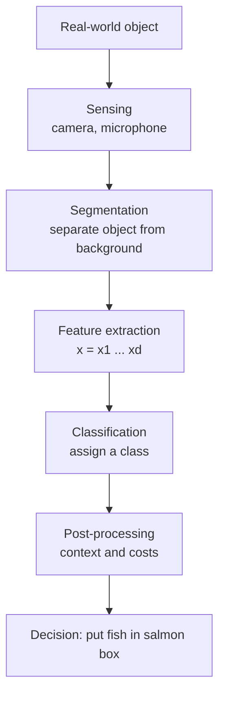
*Fig. 1.5: Components of a pattern recognition system.*

1. **Sensing:** a transducer turns the object into data; sensor quality limits everything.
2. **Segmentation:** finds where one object ends (overlapping fish, letters in a word). Often the hardest step.
3. **Feature extraction:** measures properties similar within a class and different across classes, ideally invariant to position, rotation and size.
4. **Classification:** assigns the class; Bayes decision theory (§1.11) tells how to do it best.
5. **Post-processing:** uses context ("T?E" is probably "THE"), combines classifiers, considers costs.

**Good features are** discriminating, reliable (little noise), invariant, independent of each other, and few and cheap.

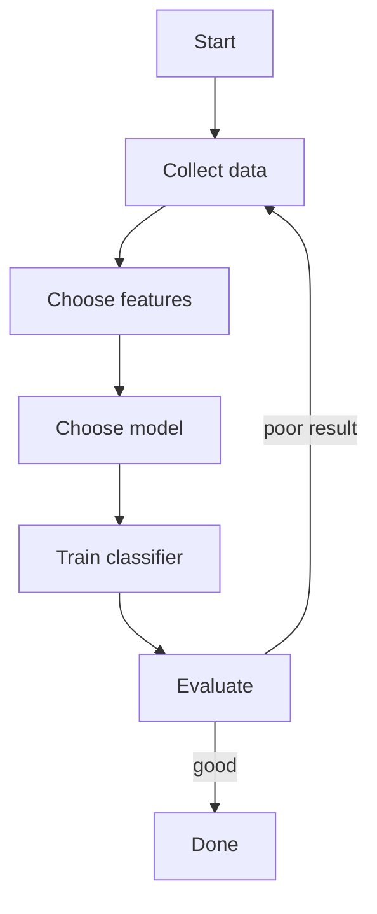
*Fig. 1.6: The design cycle (after Duda, Hart and Stork).*

## 1.6 Classification, regression and prediction  ⭐ (earlier mid Q7 ii)

- <u>Classification: assigning an input pattern x to one of a finite set of discrete classes {ω1, …, ωc} by learning a mapping from labelled examples.</u>
- <u>Regression: learning a function that maps an input x to a continuous real-valued output y.</u>
- <u>Prediction (numeric prediction): building a model that estimates a continuous or ordered value, such as next month's sales, for new or future data.</u>

**Classification kinds:** binary (disease / no disease), multi-class (digits 0–9), multi-label (a photo tagged "beach", "sunset"). Measured by accuracy, precision, recall, F1 (§1.18).
**Regression:** fits y = w0 + w1x (or w0 + w1x1 + … + wdxd) by minimising squared error. Measured by MAE = (1/n) Σ |yi − ŷi|, MSE = (1/n) Σ (yi − ŷi)2, RMSE = √MSE.

**Numerical 1 (regression errors).** Actual y = (3, 5, 7), predicted ŷ = (2, 5, 9).

| i | yi | ŷi | ŷ − y | \|error\| | error2 |
|---|---|---|---|---|---|
| 1 | 3 | 2 | −1 | 1 | 1 |
| 2 | 5 | 5 | 0 | 0 | 0 |
| 3 | 7 | 9 | 2 | 2 | 4 |
| Sum | | | | 3 | 5 |

::: tip Answer
MAE = 3/3 = **1.0**, MSE = 5/3 = **1.667**, RMSE = √1.667 = **1.291**. RMSE > MAE because squaring punishes the big error (2) more.
:::

| Point | Classification | Regression / prediction |
|---|---|---|
| Output | Discrete label | Continuous number |
| Question | "Which class?" | "How much? How many?" |
| Example | Is this loan applicant safe or risky? | How much will this customer spend next month? |
| Model learns | A decision boundary | A curve through the data |
| Typical loss | 0-1 loss, cross-entropy | Squared or absolute error |
| Evaluation | Accuracy, precision, recall, F1 | MAE, MSE, RMSE, R2 |
| Algorithms | Naive Bayes, k-NN, decision tree, SVM | Linear / polynomial regression, regression tree |
| Mango example | Grade it "export" or "local" | Predict its weight in grams |

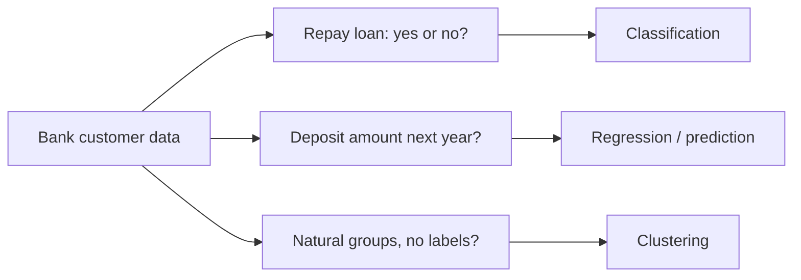
*Fig. 1.7: One dataset, three kinds of question.*

### Concept learning  ⭐ (earlier mid MCQ Q4)

<u>Concept learning is acquiring the definition of a general category from given positive and negative training examples of that category; it searches a hypothesis space for a boolean-valued function that says whether an instance belongs to the concept.</u> It is a special case of binary classification. Example (Mitchell): learning "days on which Aldo enjoys sport" from days described by six attributes (sky, air temperature, humidity, wind, water, forecast), each day marked yes or no. A hypothesis such as ⟨Sunny, Warm, ?, ?, ?, ?⟩ means "sunny and warm, anything else" (? = any value, ∅ = no value). Algorithms: Find-S (most specific hypothesis) and Candidate-Elimination (version space). The MCQ answer is **TRUE**.

## 1.7 Feature selection, feature extraction and dimensionality reduction  ⭐ (End Q6)

Not every feature is useful: some are noise, some repeat information. Too many features confuse the learner and need much more data.

- <u>Feature selection: choosing a subset of the most relevant original features and discarding irrelevant or redundant ones, so that the model is simpler, faster and generalises better.</u>
- <u>Feature extraction: creating a smaller set of new features by transforming or combining the original features (for example by PCA).</u>
- <u>Dimensionality reduction: any method that reduces the number of features while keeping as much useful information as possible; feature selection and feature extraction are its two forms.</u>

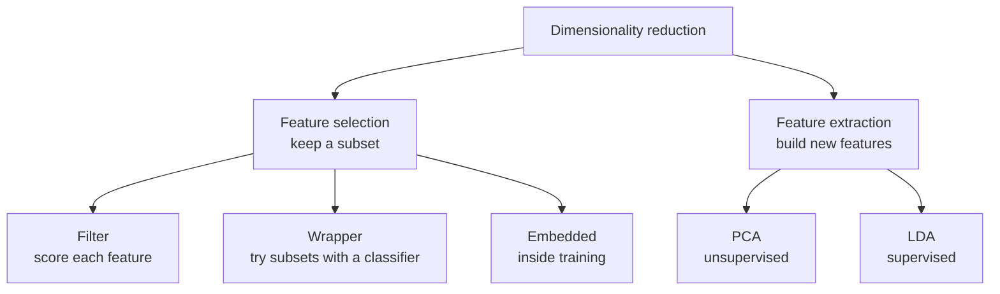
*Fig. 1.8: The two forms of dimensionality reduction.*

**Why reduce features:** better accuracy on new data (less overfitting), less time and memory, simpler models a doctor can trust, cheaper data collection, plotting in 2-D/3-D, and avoiding the curse of dimensionality.

**Curse of dimensionality.** As d grows, the space becomes huge and the data sparse. If each feature is cut into 10 intervals:

| Features d | 1 | 2 | 3 | 10 |
|---|---|---|---|---|
| Cells | 10 | 100 | 1,000 | 10,000,000,000 |

With 1,000 samples and 10 features almost every cell is empty. **Peaking (Hughes) phenomenon:** with fixed data, adding features first helps, then accuracy falls. Distances also lose meaning in high dimensions, which hurts k-NN.

| Method | How it works | Examples | Good | Weak |
|---|---|---|---|---|
| Filter | Scores each feature by a statistic, no classifier | Correlation, chi-square, information gain, variance threshold | Very fast | Ignores feature interaction |
| Wrapper | Trains a classifier on different subsets, keeps the best | Forward selection, backward elimination, RFE | Most accurate subset | Slow, can overfit |
| Embedded | Selection happens inside training | Lasso (L1) sets weights to 0, decision-tree splits | Faster than wrapper | Tied to one model |

**Sequential forward selection:** start with no features → try adding each remaining feature and test the classifier → keep the one that helps most → repeat until accuracy stops improving. *Backward elimination* starts with all features and removes the least useful one each time.

### PCA in short

1. Centre the data (subtract each feature's mean).
2. Compute the covariance matrix.
3. Find its eigenvalues and eigenvectors; each eigenvector is a principal component, its eigenvalue the variance along it.
4. Keep the top k components.
5. Project each sample onto them; the projections are the new features.

**Numerical 2 (PCA, 2-D to 1-D).** Points (2, 1), (3, 3), (4, 3), (5, 5). Covariance uses divisor n − 1 = 3.

| Step | Result |
|---|---|
| Means | x̄ = 3.5, ȳ = 3.0 |
| Centred points | (−1.5, −2), (−0.5, 0), (0.5, 0), (1.5, 2) |
| Covariance | sxx = 1.667, syy = 2.667, sxy = 2.0 |
| Eigenvalues | λ1 = 4.228, λ2 = 0.105 |
| First component | v1 = (0.615, 0.788) |
| 1-D features | −2.5, −0.308, 0.308, 2.5 |

::: tip Answer
PC1 keeps 4.228 / (4.228 + 0.105) = **97.6 %** of the variance, so one new feature replaces two with almost no loss.
:::

PCA ignores class labels, so its directions are not always best for separating classes. **LDA (Fisher)** uses labels: it pushes class means apart and keeps each class tight, giving at most c − 1 features.

| Point | Feature selection | Feature extraction |
|---|---|---|
| What it does | Picks a subset of original features | Builds new features from combinations |
| Meaning | Kept features keep their real meaning | New features are mixtures, harder to explain |
| Information | Dropped features are lost completely | Each new feature can carry information from all |
| Methods | Filter, wrapper, embedded (Lasso) | PCA, LDA, autoencoders |
| Example | Keep "blood sugar" and "age" out of 30 tests | Replace 64 pixels by 10 principal components |

## 1.8 Supervised learning and generalisation

<u>Supervised learning: given a training set D = {(x1, y1), …, (xn, yn)} drawn from an unknown distribution, find a hypothesis h from a hypothesis class H such that h(x) is a good estimate of y for new, unseen x.</u> <u>Generalisation is the ability of a learned model to perform well on new data not used in training.</u>

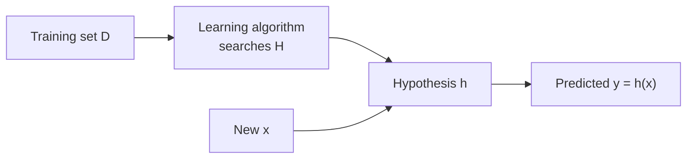
*Fig. 1.9: The supervised learning set-up.*

| Term | Meaning |
|---|---|
| Training set | Labelled examples used to learn the parameters |
| Validation set | Used to choose settings (k in k-NN) and to stop overfitting |
| Test set | Kept aside, used once to report final performance |
| Hypothesis class H | All hypotheses the algorithm may choose from (e.g. all straight lines) |
| Training / test error | Error on training data / expected error on new data |
| Generalisation gap | Test error − training error; large gap = overfitting |

**Overfitting vs underfitting** (a student who memorises vs one who studied too little): underfitting = too simple, high training and test error, high bias; overfitting = learns noise, very low training error but high test error, high variance. Cures for overfitting: more data, simpler model, feature selection, regularisation, pruning, early stopping, **k-fold cross-validation** (split into k folds, train on k − 1, test on 1, repeat k times, average). Full details are in [Unit 4](#unit4).

## 1.9 Bayes theorem

<u>Bayes theorem: P(ωj|x) = p(x|ωj) P(ωj) / p(x), where p(x) = Σk p(x|ωk) P(ωk). In words: posterior = likelihood × prior / evidence.</u>

| Term | Meaning | Example |
|---|---|---|
| Prior P(ωj) | Probability of a class before seeing features | 1 % of people have the disease |
| Likelihood p(x\|ωj) | How probable x is if the class is ωj | 95 % of sick people test positive |
| Evidence p(x) | Total probability of x over all classes (a normaliser) | Overall chance of a positive test |
| Posterior P(ωj\|x) | Probability of the class after seeing x | Chance of disease given a positive test |

**Derivation (2 lines):** product rule P(ωj, x) = P(ωj|x) p(x) = p(x|ωj) P(ωj). Divide by p(x); p(x) comes from the total probability rule.

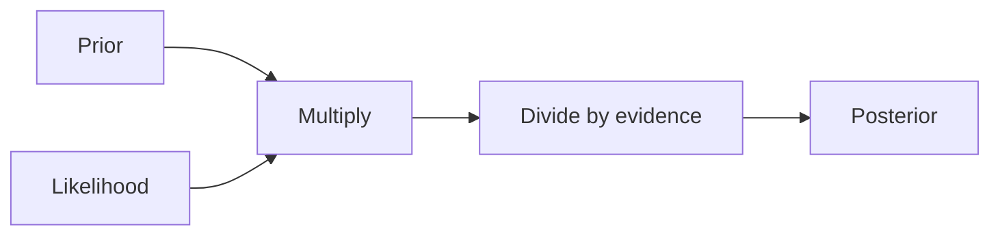
*Fig. 1.10: Bayes theorem as a pipeline.*

**Numerical 3 (medical test).** 1 % of people have disease D. The test is positive for 95 % of sick people and wrongly positive for 10 % of healthy people (ND). A person tests positive. Find P(D|+).

| Step | Working | Value |
|---|---|---|
| Data | P(D) = 0.01, P(ND) = 0.99, P(+\|D) = 0.95, P(+\|ND) = 0.10 | |
| Sick and positive | 0.95 × 0.01 | 0.0095 |
| Healthy and positive | 0.10 × 0.99 | 0.0990 |
| Evidence P(+) | 0.0095 + 0.0990 | 0.1085 |
| Posterior P(D\|+) | 0.0095 / 0.1085 | **0.0876** |
| Extra: P(D\|−) | (0.05 × 0.01) / 0.8915 | 0.00056 |

::: tip Answer
P(disease | positive) = **0.0876 ≈ 8.8 %**. The person is still more likely healthy, because the disease is rare and false positives come from the huge healthy group. Check with 10,000 people: 95 sick positives, 990 healthy positives, 95 / 1085 = 0.0876.
:::

## 1.10 Class-conditional probability density  ⭐ (End Q3a)

<u>The class-conditional probability density function p(x|ωi) is the probability density of the feature vector x given that the true class (state of nature) is ωi. It describes how feature values are distributed within class ωi. For a fixed observed x, p(x|ωi) as a function of i is called the likelihood of ωi.</u>

It answers "if I know the fish is a salmon, how likely is this lightness?" — not the reverse. The reverse question needs Bayes theorem.

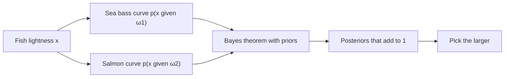
*Fig. 1.11: From class-conditional densities to a decision. In the exam, draw two overlapping bell curves labelled p(x|ω1) and p(x|ω2).*

**Fish example, step by step:**
1. Each fish is ω1 (sea bass) or ω2 (salmon); ω is a random variable.
2. **Priors only** (2/3 sea bass, 1/3 salmon): always say sea bass, error = 1/3, same decision for every fish.
3. **Add a feature** lightness x: measuring many fish of each kind gives the two class-conditional curves.
4. **Combine with Bayes** to get P(ωj|x) for each fish.
5. **Decide** the class with the larger posterior; the boundary is where the posterior curves cross.

**Properties:** one density per class; each has area 1 (∫ p(x|ωi) dx = 1), but densities of different classes at one x need **not** add to 1 — only posteriors do; discrete x uses P(x|ωi); more overlap means more unavoidable error.

**Gaussian form:** p(x|ωi) = [1 / (√(2π) σi)] exp[−(x − μi)2 / (2σi2)]. In d dimensions: [1 / ((2π)d/2 |Σi|1/2)] exp[−½ (x − μi)T Σi−1 (x − μi)].

**How they are obtained:** *parametric* (assume Gaussian, estimate mean and variance by maximum likelihood), *non-parametric* (histogram, Parzen window, k-NN density), or the *Naive Bayes* shortcut p(x|ωi) = Πk p(xk|ωi).

## 1.11 Bayes decision rule for minimum error  ⭐ (End Q3a)

<u>Bayes decision theory is a fundamental statistical approach to pattern classification that uses probabilities (priors and class-conditional densities) and the costs of decisions to make the decision with the least expected cost.</u> <u>Bayes decision rule for minimum error: decide ωi if P(ωi|x) > P(ωj|x) for all j ≠ i.</u>

**Two classes:** decide ω1 if P(ω1|x) > P(ω2|x), i.e. if p(x|ω1)P(ω1) > p(x|ω2)P(ω2) (p(x) cancels).
**Likelihood ratio test:** decide ω1 if p(x|ω1) / p(x|ω2) > P(ω2) / P(ω1). Equal priors → larger likelihood wins; useless feature → priors decide.

**Why it gives minimum error:**
1. If we decide ω1, P(error|x) = P(ω2|x); if ω2, P(error|x) = P(ω1|x).
2. Average error P(error) = ∫ P(error|x) p(x) dx.
3. p(x) ≥ 0 does not depend on our choice, so the integral is least when P(error|x) is least at every x.
4. Choosing the larger posterior gives P(error|x) = min[P(ω1|x), P(ω2|x)], the smallest possible.

With c classes: choose the i that maximises p(x|ωi)P(ωi); P(error|x) = 1 − maxi P(ωi|x).

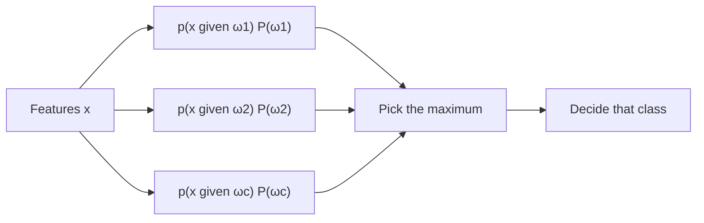
*Fig. 1.12: The Bayes classifier as a block diagram.*

**Numerical 4 (two classes).** P(ω1) = P(ω2) = 0.5, P(x|ω1) = 0.6, P(x|ω2) = 0.3.
Products: 0.6 × 0.5 = 0.30 and 0.3 × 0.5 = 0.15; evidence = 0.45; posteriors 0.30/0.45 = **0.667** and 0.15/0.45 = **0.333**. LRT: 0.6/0.3 = 2 > 1. **Decide ω1**, P(error|x) = 0.333.

**Numerical 5 (three classes).**

| Class | Prior | Likelihood | Product | Posterior = product / 0.32 |
|---|---|---|---|---|
| ω1 | 0.5 | 0.2 | 0.10 | 0.3125 |
| ω2 | 0.3 | 0.4 | 0.12 | **0.375** |
| ω3 | 0.2 | 0.5 | 0.10 | 0.3125 |
| Total | 1.0 | | 0.32 | 1.000 |

::: tip Answer
**Decide ω2** (posterior 0.375). Priors alone would pick ω1; likelihoods alone would pick ω3. Bayes combines both.
:::

## 1.12 Bayes optimal classifier and Bayes error

- <u>Bayes optimal classifier: the classifier that assigns every input x to the class with the maximum posterior probability P(ωi|x) computed from the true distributions. No other classifier using the same features has a lower average probability of error.</u>
- <u>Bayes error: the probability of error of the Bayes optimal classifier; the lowest error achievable for the given features, caused by the overlap of the classes.</u>

**Error formula (two classes, regions R1, R2):** P(error) = ∫R2 p(x|ω1)P(ω1) dx + ∫R1 p(x|ω2)P(ω2) dx. For a discrete x: **P(error) = Σx min[p(x|ω1)P(ω1), p(x|ω2)P(ω2)]**.

**Why it is lowest:** the error is the area under the *lower* of the two curves p(x|ωi)P(ωi). The Bayes boundary sits where the curves cross. Moving it anywhere else means that, between the old and new boundary, we choose the lower curve and pay the higher one — an extra "reducible error" area.

**What decides its size:** overlap of the densities (means far apart and small spread → small error), the features used (a better feature lowers it), and the priors. It is zero only if the classes do not overlap.

**Mitchell's version (combining hypotheses):** vOB = argmaxvj Σhi P(vj|hi) P(hi|D). Example: P(h1|D) = 0.4 says "+", h2 and h3 (0.3 each) say "−". The MAP hypothesis says "+", but the weighted vote is P(+) = 0.4, P(−) = 0.6, so the Bayes optimal answer is **"−"**.

**Limitation:** it needs the true priors and densities, which are unknown in practice, so it is mainly a **benchmark**.

## 1.13 Full worked Bayes numerical (priors → posteriors → decision → Bayes error)

**Question.** Fruits are of two classes, ω1 (export grade) and ω2 (local grade), with P(ω1) = 0.6 and P(ω2) = 0.4. A sensor reads a colour feature x as Low, Medium or High with

| x | Low | Medium | High |
|---|---|---|---|
| P(x\|ω1) | 0.5 | 0.3 | 0.2 |
| P(x\|ω2) | 0.1 | 0.3 | 0.6 |

Find the posteriors, the Bayes decision for each x, and the Bayes error.

**Step 1 — joint probabilities P(x|ω)P(ω) and evidence.**

| x | P(x\|ω1)P(ω1) | P(x\|ω2)P(ω2) | Evidence P(x) |
|---|---|---|---|
| Low | 0.5 × 0.6 = 0.30 | 0.1 × 0.4 = 0.04 | 0.34 |
| Medium | 0.3 × 0.6 = 0.18 | 0.3 × 0.4 = 0.12 | 0.30 |
| High | 0.2 × 0.6 = 0.12 | 0.6 × 0.4 = 0.24 | 0.36 |
| Total | | | 1.00 |

**Step 2 — posteriors, decision and error at each x.**

| x | P(ω1\|x) | P(ω2\|x) | Decision | P(error\|x) | Error mass min(joint) |
|---|---|---|---|---|---|
| Low | 0.30/0.34 = 0.882 | 0.04/0.34 = 0.118 | ω1 | 0.118 | 0.04 |
| Medium | 0.18/0.30 = 0.600 | 0.12/0.30 = 0.400 | ω1 | 0.400 | 0.12 |
| High | 0.12/0.36 = 0.333 | 0.24/0.36 = 0.667 | ω2 | 0.333 | 0.12 |

**Step 3 — LRT check.** Threshold P(ω2)/P(ω1) = 0.4/0.6 = 0.667. Likelihood ratios: Low 0.5/0.1 = 5, Medium 0.3/0.3 = 1, High 0.2/0.6 = 0.333. Low and Medium exceed 0.667 → ω1; High does not → ω2. ✓

**Step 4 — Bayes error.** P(error) = 0.04 + 0.12 + 0.12 = **0.28**.

::: tip Answer
Decide **ω1 for Low and Medium, ω2 for High**. Bayes error = **0.28** (correct 72 % of the time at best). Compare: using priors only (always ω1) gives error 0.40; deciding ω2 at Medium gives 0.04 + 0.18 + 0.12 = 0.34. Both are worse than 0.28, as theory says.
:::

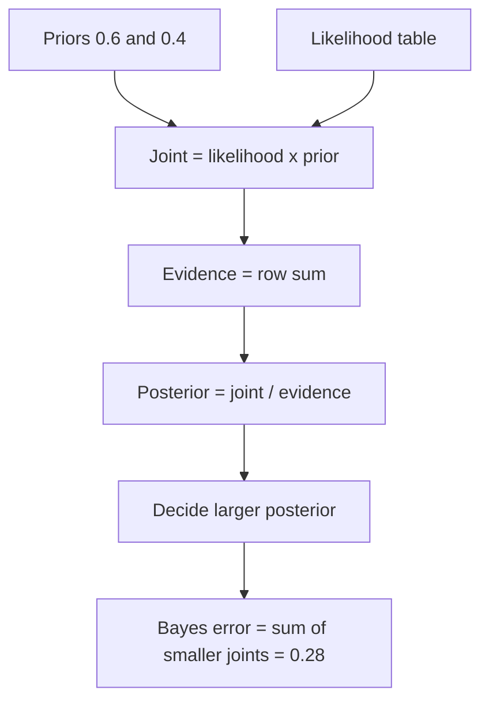
*Fig. 1.13: Order of working for any Bayes numerical.*

## 1.14 Minimum-risk classification and the loss matrix

Not all mistakes cost the same: telling a sick patient "you are healthy" is far worse than one extra test.

<u>Let αi be the action "decide ωi" and λij = λ(αi|ωj) the loss for taking αi when the true class is ωj. The conditional risk is R(αi|x) = Σj λij P(ωj|x). The Bayes minimum-risk rule takes, for every x, the action with the smallest conditional risk; the resulting minimum overall risk is the Bayes risk.</u>

| Loss matrix | True ω1 | True ω2 |
|---|---|---|
| α1 (decide ω1) | λ11 (correct, usually 0) | λ12 (wrong) |
| α2 (decide ω2) | λ21 (wrong) | λ22 (correct, usually 0) |

R(α1|x) = λ11P(ω1|x) + λ12P(ω2|x) and R(α2|x) = λ21P(ω1|x) + λ22P(ω2|x). Decide ω1 if R(α1|x) < R(α2|x). As an LRT: decide ω1 if p(x|ω1)/p(x|ω2) > [(λ12 − λ22)/(λ21 − λ11)] × [P(ω2)/P(ω1)].

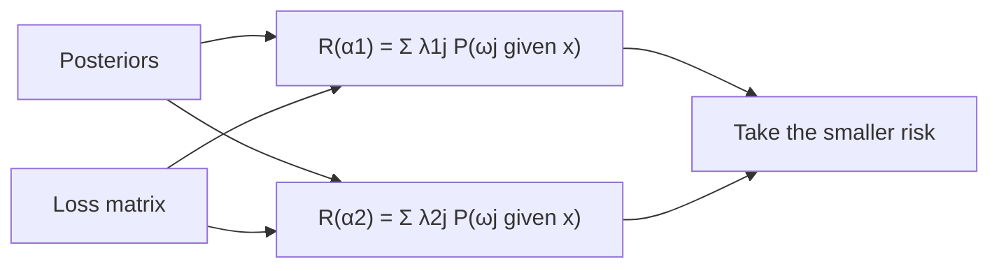
*Fig. 1.14: Minimum-risk decision.*

**Numerical 6 (patient).** P(ω1|x) = 0.6 (healthy), P(ω2|x) = 0.4 (sick); λ11 = λ22 = 0, λ12 = 2 (calling a sick person healthy), λ21 = 1.

| Action | Working | Risk |
|---|---|---|
| α1: say healthy | 0 × 0.6 + 2 × 0.4 | 0.8 |
| α2: say sick | 1 × 0.6 + 0 × 0.4 | **0.6** |

::: tip Answer
Take **α2 (decide sick)**, risk 0.6 < 0.8. The minimum-error rule would say healthy (0.6 > 0.4); the higher cost of missing a sick person changes the decision.
:::

**Numerical 7 (loss matrix on the fruit example of §1.13).** Take λ12 = 3 (calling local fruit export), λ21 = 1, λ11 = λ22 = 0. New LRT threshold = (3/1) × (0.4/0.6) = 2.

| x | R(α1\|x) = 3 P(ω2\|x) | R(α2\|x) = 1 P(ω1\|x) | Decision |
|---|---|---|---|
| Low | 3 × 0.118 = 0.353 | 0.882 | ω1 |
| Medium | 3 × 0.400 = 1.200 | 0.600 | **ω2** (changed) |
| High | 3 × 0.667 = 2.000 | 0.333 | ω2 |

Overall risk: minimum-error rule = 3(0.04) + 3(0.12) + 1(0.12) = 0.60; minimum-risk rule = 3(0.04) + 1(0.18) + 1(0.12) = **0.42**. Its error rises to 0.34, but its cost falls.

**Zero-one loss gives the minimum-error rule.** If λij = 0 for i = j and 1 otherwise, R(αi|x) = 1 − P(ωi|x). Minimising this is maximising the posterior, so §1.11 is a special case of minimum risk.

## 1.15 Discriminant functions and the Gaussian case

<u>A classifier can be represented by discriminant functions gi(x), i = 1, …, c; it assigns x to ωi if gi(x) > gj(x) for all j ≠ i. The decision boundaries are where the two largest discriminants are equal.</u>

**Choices for Bayes:** gi = P(ωi|x), or p(x|ωi)P(ωi), or ln p(x|ωi) + ln P(ωi) (easiest for Gaussians); any increasing function gives the same decisions. For minimum risk, gi = −R(αi|x). **Two classes (dichotomizer):** g(x) = g1(x) − g2(x), decide ω1 if g(x) > 0.

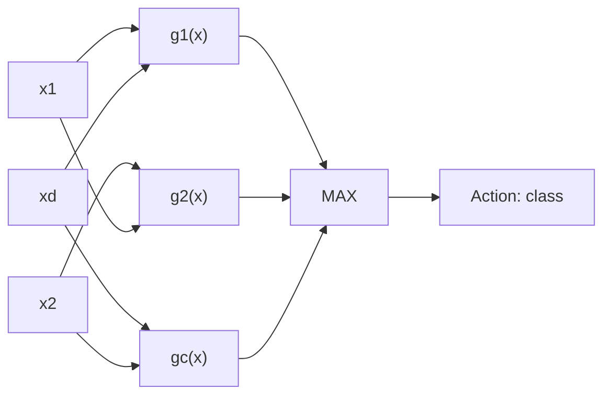
*Fig. 1.15: A classifier as a network of discriminant functions (every input feeds every gi).*

**Gaussian discriminant:** gi(x) = −½ (x − μi)T Σi−1 (x − μi) − (d/2) ln 2π − ½ ln |Σi| + ln P(ωi).

| Case | Covariance | gi(x) | Boundary | Name |
|---|---|---|---|---|
| 1 | Σi = σ2I | Linear: wi = μi/σ2, wi0 = −μiTμi/(2σ2) + ln P(ωi) | Hyperplane ⟂ line of means | Minimum Euclidean distance if priors equal |
| 2 | Same Σ for all | Linear | Hyperplane, not always ⟂ | Mahalanobis minimum distance if priors equal |
| 3 | Different Σi | Quadratic | Hyperquadric (circle, ellipse, parabola, hyperbola) | Quadratic classifier |

Unequal priors push the boundary **away from the more probable class**, enlarging its region.

**Numerical 8 (1-D Gaussian).** μ1 = 2, μ2 = 4, σ1 = σ2 = 1, P(ω1) = 0.7, P(ω2) = 0.3. (a) Boundary; (b) classify x = 3.2; (c) Bayes error. Natural log used.

1. gi(x) = −(x − μi)2/2 + ln P(ωi).
2. Set g1 = g2: [(x − 4)2 − (x − 2)2]/2 = ln 0.3 − ln 0.7.
3. (x − 4)2 − (x − 2)2 = −4x + 12, so −2x + 6 = ln(3/7).
4. x* = 3 + ln(7/3)/2 = 3 + 0.8473/2 = **3.42**. Decide ω1 if x < 3.42.

| x = 3.2 | ω1 | ω2 |
|---|---|---|
| p(x\|ωi) = 0.3989 e−(x−μ)²/2 | 0.3989 × 0.4868 = 0.1942 | 0.3989 × 0.7261 = 0.2897 |
| × prior | 0.7 × 0.1942 = 0.136 | 0.3 × 0.2897 = 0.087 |
| Posterior | 0.136/0.223 = **0.61** | 0.39 |
| Linear gi = μix − μi2/2 + ln P(ωi) | 6.4 − 2 − 0.357 = 4.043 | 12.8 − 8 − 1.204 = 3.596 |

Error with boundary t = 0.7 × P(z > t − 2) + 0.3 × P(z < t − 4):

| Boundary t | 0.7 × P(z > t − 2) | 0.3 × P(z < t − 4) | Total error |
|---|---|---|---|
| 3.42 (Bayes) | 0.7 × 0.0773 = 0.0541 | 0.3 × 0.2822 = 0.0847 | **0.139** |
| 3.0 (midpoint) | 0.7 × 0.1587 | 0.3 × 0.1587 | 0.159 |
| 3.8 | 0.7 × 0.0359 | 0.3 × 0.4207 | 0.151 |

::: tip Answer
Boundary **x* = 3.42** (moved from the midpoint 3 toward μ2 because ω1 is more probable). x = 3.2 → **ω1**, posterior **0.61**. Bayes error **0.139**; any other boundary gives more.
:::

**Numerical 9 (minimum-distance, 2-D).** Σ = σ2I, equal priors, m1 = (2, 2), m2 = (6, 5), classify x = (3, 4).
- d(x, m1) = √(1 + 4) = 2.236; d(x, m2) = √(9 + 1) = 3.162 → nearer m1.
- Linear form gi = miTx − ½‖mi‖2: g1 = 14 − 4 = 10, g2 = 38 − 30.5 = 7.5.
- Boundary g1 = g2: **4x1 + 3x2 = 26.5**, the perpendicular bisector (midpoint (4, 3.5) gives 16 + 10.5 = 26.5 ✓).

::: tip Answer
x = (3, 4) → **ω1**; boundary 4x1 + 3x2 = 26.5.
:::

## 1.16 Examples of classifiers

<u>A classifier is a function that maps a feature vector x to one of the classes ω1, …, ωc; equivalently, it divides the feature space into decision regions.</u>

| Classifier | Main idea | Boundary | Training |
|---|---|---|---|
| Bayes | Largest posterior from known densities | Any shape | Needs priors and densities |
| Naive Bayes | Bayes with features independent within a class | Depends on data | Counts / estimates |
| Minimum distance | Nearest class mean | Perpendicular bisectors | Only class means |
| k-nearest neighbour | Majority vote of k closest samples | Flexible, piecewise | None: lazy learner |
| Linear discriminant | g(x) = wTx + w0, sign gives class | Hyperplane | Weights (perceptron, LMS in [Unit 2](#unit2)) |
| Decision tree | Chain of feature tests, root to leaf | Axis-parallel pieces | Builds the tree (ID3 in [Unit 3](#unit3)) |
| SVM | Separating hyperplane with the largest margin | Hyperplane or kernel curve | Quadratic optimisation ([Unit 5](#unit5)) |

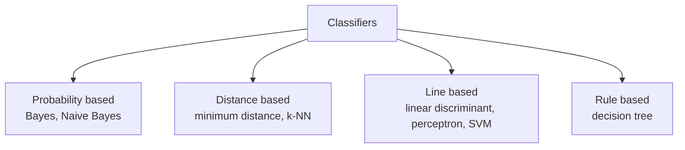
*Fig. 1.16: Families of classifiers.*

**Naive Bayes:** assumes P(x1, …, xd|ωj) = Πk P(xk|ωj), so vNB = argmaxvj P(vj) Πi P(ai|vj). "Naive" because the assumption is rarely true, yet it works well for spam and text.

**Numerical 10 (Naive Bayes, PlayTennis, Mitchell's 14 days: 9 Yes, 5 No).** Classify Outlook = Sunny, Temperature = Cool, Humidity = High, Wind = Strong.

| Value | Count in 9 Yes | P(·\|Yes) | Count in 5 No | P(·\|No) |
|---|---|---|---|---|
| Sunny | 2 | 0.222 | 3 | 0.600 |
| Cool | 3 | 0.333 | 1 | 0.200 |
| High | 3 | 0.333 | 4 | 0.800 |
| Strong | 3 | 0.333 | 3 | 0.600 |

- Yes: (9/14)(2/9)(3/9)(3/9)(3/9) = **0.0053**
- No: (5/14)(3/5)(1/5)(4/5)(3/5) = **0.0206**

::: tip Answer
**PlayTennis = No**, with normalised probability 0.0206 / (0.0206 + 0.0053) = **0.795** (Yes 0.205). Zero counts are fixed by Laplace smoothing (count + 1)/(n + k).
:::

**Minimum-distance:** compute class means, assign x to the nearest (Numerical 9). Fast, but fails when classes are not round blobs. **k-NN:** store all samples, find the k nearest, majority vote; k odd for two classes; scale features; 1-NN error ≤ 2 × Bayes error for very large data (Cover and Hart). Worked k-NN numericals are in [Unit 3](#unit3).

## 1.17 Learning classification approaches

- <u>Generative approach: model the class-conditional densities p(x|ωk) and priors P(ωk), then obtain P(ωk|x) by Bayes theorem.</u>
- <u>Discriminative approach: model the posterior P(ωk|x) directly from data.</u>
- <u>Discriminant-function approach: learn a function f(x) that maps each input directly to a class label, without probabilities.</u> (Bishop §1.5.4)

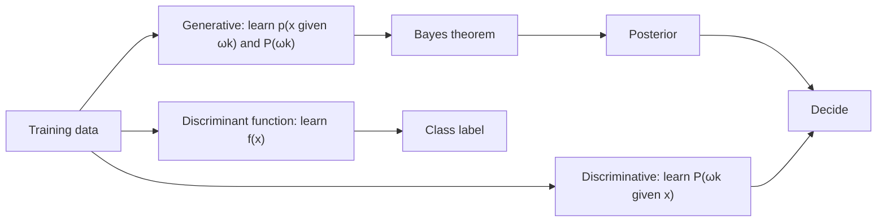
*Fig. 1.17: Three learning approaches for classification.*

| Point | Generative | Discriminative | Discriminant function |
|---|---|---|---|
| Learns | p(x\|ωk), P(ωk) | P(ωk\|x) | f(x) → class |
| Examples | Gaussian Bayes, Naive Bayes, Gaussian mixtures | Logistic regression | Perceptron, Fisher discriminant, SVM |
| Can generate data? | Yes | No | No |
| Data needed | Most | Less | Least |
| Gives probabilities? | Yes | Yes | No |
| Detects outliers? | Yes (low p(x)) | No | No |
| Changed priors or costs | Easy | Fairly easy | Must re-train |

| Point | Parametric | Non-parametric |
|---|---|---|
| Idea | Assume a form (Gaussian), learn its few parameters | No fixed form, data decides |
| Parameters | Fixed number | Grow with data |
| Examples | Gaussian Bayes, Naive Bayes, logistic regression | k-NN, Parzen windows, histograms, decision trees |
| Risk | Wrong assumption | Overfitting, curse of dimensionality |

**Learning the parameters:** *maximum-likelihood estimation* (choose values that make the data most probable; for a Gaussian, sample mean and variance) or *Bayesian estimation* (parameters have a prior, updated by data). **Eager** learners (Bayes, decision tree) build a model during training; **lazy** learners (k-NN) wait until a query arrives.

## 1.18 Evaluating a classifier: confusion matrix, Type I and Type II errors  ⭐ (Mid-2 Q3)

<u>A confusion matrix is a table that compares the actual classes with the classes predicted by a classifier; for two classes it holds the counts of true positives (TP), false negatives (FN), false positives (FP) and true negatives (TN).</u> <u>Type I error (false positive): predicting positive when the actual class is negative. Type II error (false negative): predicting negative when the actual class is positive.</u>

| | Predicted positive | Predicted negative |
|---|---|---|
| **Actual positive** | TP: sick person found sick | FN = **Type II error**: sick person told healthy (a miss) |
| **Actual negative** | FP = **Type I error**: healthy person told sick (false alarm) | TN: healthy person found healthy |

**Formulas:** Accuracy = (TP + TN)/(TP + TN + FP + FN); Precision = TP/(TP + FP); Recall (sensitivity) = TP/(TP + FN); Specificity = TN/(TN + FP); F1 = 2 × Precision × Recall / (Precision + Recall); Type I rate α = FP/(FP + TN); Type II rate β = FN/(FN + TP).

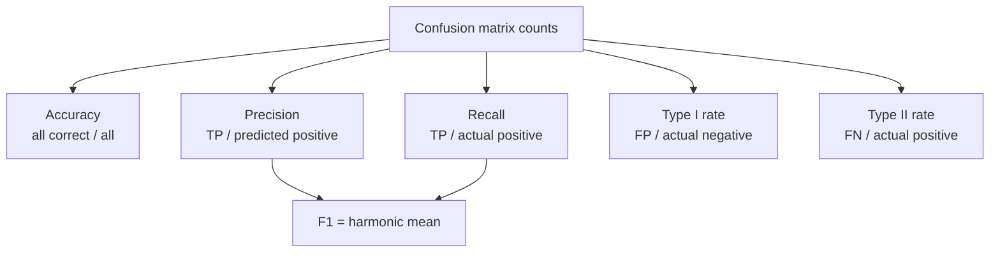
*Fig. 1.18: Measures derived from the confusion matrix.*

**Numerical 11.** 100 people: 50 sick, 50 healthy. The test finds 40 sick (TP = 40, FN = 10) and wrongly flags 5 healthy (FP = 5, TN = 45).

| Measure | Working | Value |
|---|---|---|
| Accuracy | (40 + 45)/100 | 0.85 |
| Error rate | (5 + 10)/100 | 0.15 |
| Precision | 40/45 | 0.889 |
| Recall | 40/50 | 0.80 |
| Specificity | 45/50 | 0.90 |
| F1-score | 2 × 0.889 × 0.80 / (0.889 + 0.80) | 0.842 |
| Type I rate | 5/50 | 0.10 |
| Type II rate | 10/50 | 0.20 |

::: tip Answer
Accuracy **0.85**, precision **0.889**, recall **0.80**, F1 **0.842**, Type I rate **0.10**, Type II rate **0.20**. Check: F1 = 2TP/(2TP + FP + FN) = 80/95 = 0.842.
:::

::: warn Accuracy can fool you
If 1 % of 1,000 people are sick, a "classifier" that always says healthy has accuracy 990/1000 = 0.99 but recall 0. Always report precision and recall too.
:::

| Situation | Worse error | Watch |
|---|---|---|
| Cancer or COVID screening | Type II (missing a sick person) | High recall |
| Spam filter | Type I (real email to spam) | High precision |
| Court verdict (null = not guilty) | Type I (punishing an innocent) | Low false-positive rate |
| Airport security | Type II (missing a weapon) | High recall |

Lowering the threshold gives fewer Type II but more Type I errors — the same trade-off as the loss values of §1.14. For c classes the matrix is c × c with correct counts on the diagonal. **Memory trick:** Type I = "crying wolf" (false alarm); Type II = "missing the wolf".

## Exam checklist for Unit 1
- [ ] Samuel and Mitchell definitions; T, E, P table; traditional programming vs ML diagram
- [ ] Machine intelligence definition and an applications table with real products
- [ ] AI vs ML vs DL: nested circles, 8-row table, self-driving car example (End Q1a)
- [ ] Supervised vs unsupervised vs reinforcement: definitions, RL loop, 8-row table, examples (End Q1b)
- [ ] Pattern recognition: fish example, system block diagram, design cycle
- [ ] Classification vs regression vs prediction table; MAE/MSE/RMSE numerical (1.0, 1.667, 1.291); concept learning
- [ ] Feature selection (filter, wrapper, embedded) vs extraction; curse of dimensionality; PCA steps (End Q6)
- [ ] Bayes theorem with derivation; medical test numerical (0.0876)
- [ ] Class-conditional density definition, fish curves, Gaussian form (End Q3a)
- [ ] Minimum-error Bayes rule, LRT and the 4-line proof; three-class numerical (ω2, 0.375)
- [ ] Bayes optimal classifier and Bayes error; full fruit numerical (decisions ω1, ω1, ω2, error 0.28)
- [ ] Minimum risk with a loss matrix (patient: risk 0.6 vs 0.8; fruit: Medium flips to ω2, risk 0.42); zero-one loss
- [ ] Discriminant functions; Gaussian cases 1–3; boundary x* = 3.42, Bayes error 0.139; 4x1 + 3x2 = 26.5
- [ ] Examples of classifiers table; Naive Bayes PlayTennis (No, 0.795)
- [ ] Generative vs discriminative vs discriminant function; parametric vs non-parametric
- [ ] Confusion matrix, Type I / Type II, accuracy, precision, recall, F1 numerical (Mid-2 Q3)
