# Unit 2 · Linear Machines, Perceptron, Gradient Descent and MLPs

> **Exam weight:** the heaviest unit: **35 of 112 marks** in the 2025-26 end-sem. Backpropagation in MLPs (Q5a, 10 marks), Widrow–Hoff/LMS (Q5b, 4), gradient descent and its types (Q8, a full 14), activation function short note (Q6) and cost vs loss (Q7b). Three of the four Mid-2 2025 questions were from this unit (MLP, activation functions, gradient descent), and the earlier mid had perceptron MCQs.

**Prefer to watch first?** [Video lectures for Unit 2 →](#videos/unit2)

Follows Duda, Hart and Stork, *Pattern Classification* (chapters 5–6) and Mitchell, chapter 4. Every number on this page was computed by a program.

**Notation used on this whole page:** x = input vector, w = weight vector, b (or w0) = bias, net = w·x + b, η (eta) = learning rate, t = target, y or o = output, e = error.

## 2.1 General and linear discriminant functions

A discriminant function is a **scoring rule**: one score per class, and the sample goes to the class with the highest score. A linear discriminant makes the score in the simplest way: multiply each feature by a weight, add them up, add a constant. Like an exam total: 0.3 × internal + 0.7 × external + grace marks.

**Definition.** <u>A discriminant function gi(x) is a function the classifier computes for each class ωi; it assigns x to ωi if gi(x) > gj(x) for all j ≠ i. A linear discriminant function is g(x) = wTx + w0, where w is the weight vector and w0 is the bias (threshold weight).</u>

### General discriminants (any shape)
From Unit 1 (Bayes), any of these gives the same decisions: gi(x) = P(ωi|x), or p(x|ωi)P(ωi), or ln p(x|ωi) + ln P(ωi). Replacing every gi by an increasing function f(gi) changes nothing. The Bayes approach needs the full densities. **Linear machines** take a different road: fix the form of g (linear) and learn its weights directly from samples, without estimating any density.

### Two classes
Use one function g(x) = g1(x) − g2(x) = w1x1 + … + wdxd + w0. **Decide ω1 if g(x) > 0, ω2 if g(x) < 0**; g(x) = 0 is the boundary.

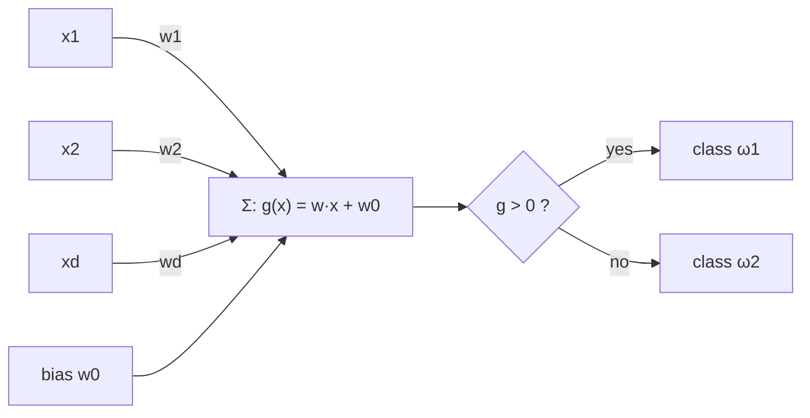
*Fig. 2.1: A two-class linear discriminant drawn as a unit.*

**Example (pass/fail):** w1 = 0.6 (study hours), w2 = 0.4 (test score), w0 = −5. Student (6, 4): g = 3.6 + 1.6 − 5 = 0.2 > 0 → pass. Student (2, 5): g = 1.2 + 2.0 − 5 = −1.8 < 0 → fail, and more confidently (|−1.8| > |0.2|).

**Why linear?** Fast (one multiply-add per feature), only d + 1 parameters (less data, less overfitting), easy to train (perceptron, LMS), and Bayes-optimal for Gaussian classes with equal covariance. **Limitation:** only straight-line (flat) boundaries; fails on XOR (Section 2.5).

### Generalised linear discriminant
Make new features yi = φi(x) and use a linear function of them: g(x) = Σ aiφi(x) = aTy. Example: g(x) = 4 − x2 is linear in y = (1, x, x2) with a = (4, 0, −1). It gives R1 = (−2, 2) and R2 in two pieces, which no single threshold on x can do. **Augmented form:** y = (1, x1, …, xd), a = (w0, w1, …, wd), so g = aTy: the bias becomes one more weight.

### Geometry
The boundary H: wTx + w0 = 0 is a **hyperplane**. **w is normal to H** (take x1, x2 on H, subtract: wT(x1 − x2) = 0). The signed distance of x from H is **r = g(x)/‖w‖**; the origin is at distance w0/‖w‖.

**Numerical:** g(x) = 3x1 + 4x2 − 12, so w = (3, 4), ‖w‖ = √(9 + 16) = 5.

| Point | g(x) | r = g/5 | Decision |
|---|---|---|---|
| (4, 3) | 12 + 12 − 12 = 12 | +2.4 | ω1 |
| (0, 0) | −12 | −2.4 | ω2 |
| (1, 1) | 3 + 4 − 12 = −5 | −1 | ω2 |
| (2, 1.5) | 6 + 6 − 12 = 0 | 0 | on the boundary |

Distance of origin = |−12|/5 = **2.4**, on the negative side.

## 2.2 Decision regions

**Definition.** <u>A decision region Ri is the set of all points that the classifier assigns to class ωi. A decision boundary separates two adjacent regions; on it the two top discriminants are equal, gi(x) = gj(x).</u>

- Regions cover the whole space and do not overlap. A region need not be one piece (the 4 − x2 example).
- Linear discriminants give flat boundaries (wi − wj)Tx + (wi0 − wj0) = 0. Non-linear ones give curves (circles, ellipses).

### Multi-class: the linear machine
**Definition.** <u>A linear machine uses c linear discriminants gi(x) = wiTx + wi0 and assigns x to the class with the largest gi(x).</u>

| Point | One-vs-rest | One-vs-one | Linear machine |
|---|---|---|---|
| Number of classifiers | c | c(c − 1)/2 | c |
| For c = 4 | 4 | 6 | 4 |
| Rule | the one that says "yes" | majority vote | largest gi |
| Ambiguous regions? | yes | yes (ties) | **no** |

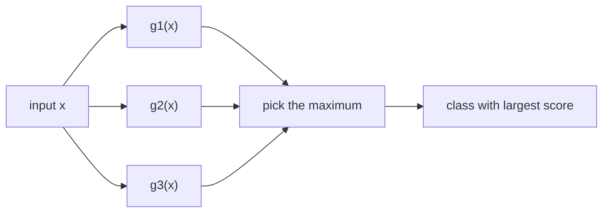
*Fig. 2.2: A linear machine for three classes. Every region it makes is convex.*

**Numerical:** g1 = x1, g2 = x2, g3 = −x1 − x2.

| x | g1 | g2 | g3 | Class |
|---|---|---|---|---|
| (2, 1) | 2 | 1 | −3 | ω1 |
| (−1, −2) | −1 | −2 | 3 | ω3 |
| (−1, 3) | −1 | 3 | −2 | ω2 |

Boundary R1/R2: g1 = g2 → x1 = x2, normal w1 − w2 = (1, −1).

## 2.3 Single-layer neural network  ⭐ (MCQ Q1, Q2)

**Definition.** <u>An artificial neuron computes a weighted sum of its inputs plus a bias, net = Σ wixi + b, and outputs y = f(net), where f is the activation function. A single-layer neural network connects the inputs directly to a layer of output neurons through one layer of adjustable weights; it has no hidden layer.</u>

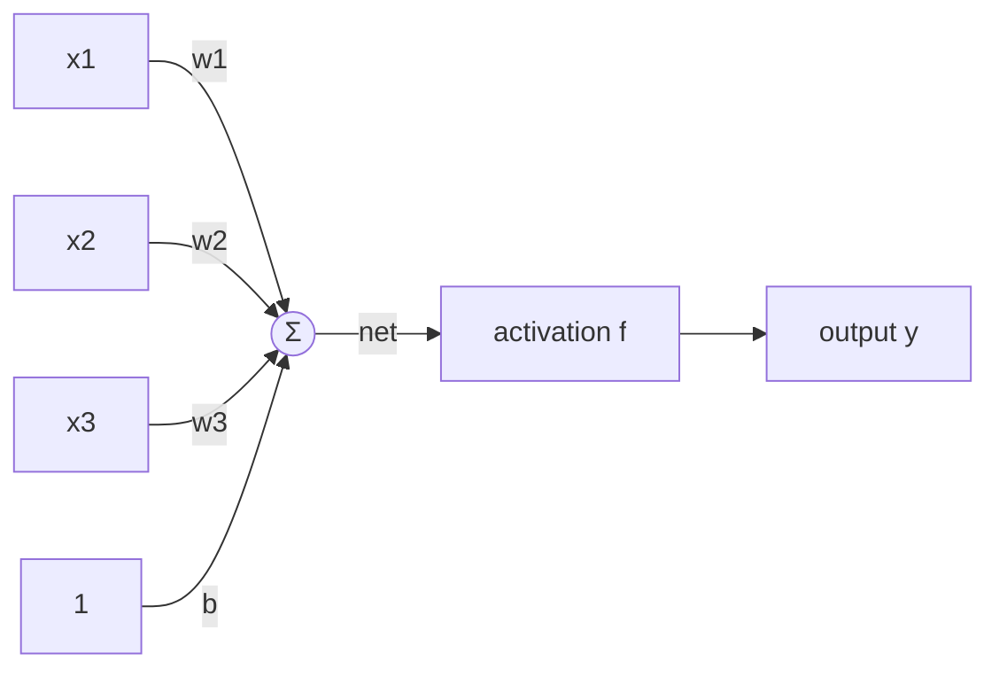
*Fig. 2.3: Model of one artificial neuron (perceptron unit).*

| Biological neuron | Artificial neuron | Job |
|---|---|---|
| Dendrites | inputs x1 … xn | receive signals |
| Synapse strength | weights wi | make some inputs more important |
| Cell body | summing junction Σ | adds weighted signals: net |
| Firing threshold | bias b = −θ and activation f | decides whether it fires |
| Axon | output y | sends the result on |

**History:** McCulloch–Pitts neuron (1943); Rosenblatt's perceptron (1958); Widrow–Hoff ADALINE and LMS (1960); Minsky–Papert showed a single layer cannot learn XOR (1969); backpropagation popularised by Rumelhart, Hinton and Williams (1986).

**Role of bias:** without b the boundary must pass through the origin; b shifts it, like c in y = mx + c.

**Example: one neuron as a logic gate** (y = 1 if net > 0): AND: w = (0.5, 0.5), b = −0.7 → nets −0.7, −0.2, −0.2, 0.3 → outputs 0, 0, 0, 1. OR: same w, b = −0.2 → nets −0.2, 0.3, 0.3, 0.8 → 0, 1, 1, 1.

Each output neuron is one linear discriminant, so a single-layer network can solve **only linearly separable** problems. MCQ answers: a perceptron is "a single layer feed-forward neural network with pre-processing"; a neural network has nodes and connections, each node computes its weighted input, nodes are excited or not (all of the above).

## 2.4 Activation functions  ⭐⭐ (Mid-2 Q2, End Q6)

**Definition.** <u>An activation (transfer) function f is applied to a neuron's net input to give its output, y = f(net). It decides whether and how strongly the neuron fires and introduces non-linearity into the network.</u>

**Why non-linear?** Two linear layers W2(W1x) = (W2W1)x are just one linear layer. Without non-linearity, extra layers add nothing.

| Name | Formula f(z) | Range | Derivative f′(z) | Where used |
|---|---|---|---|---|
| Step (binary) | 1 if z ≥ 0, else 0 | {0, 1} | 0 (undefined at 0) | perceptron |
| Sign (bipolar) | +1 if z ≥ 0, else −1 | {−1, +1} | 0 | perceptron with ±1 targets, ADALINE output |
| Linear | z | (−∞, ∞) | 1 | ADALINE training, regression output |
| Sigmoid | 1/(1 + e−z) | (0, 1) | f(1 − f), max 0.25 at z = 0 | probability output, backprop |
| Tanh | (ez − e−z)/(ez + e−z) | (−1, 1) | 1 − f2, max 1 at z = 0 | hidden layers (zero-centred) |
| ReLU | max(0, z) | [0, ∞) | 1 if z > 0, 0 if z < 0 | default for deep hidden layers |

**Values at a few points:**

| z | step | sigmoid | sigmoid′ | tanh | tanh′ | ReLU | ReLU′ |
|---|---|---|---|---|---|---|---|
| −2 | 0 | 0.1192 | 0.1050 | −0.9640 | 0.0707 | 0 | 0 |
| 0 | 1 | 0.5 | 0.25 | 0 | 1 | 0 | — |
| 2 | 1 | 0.8808 | 0.1050 | 0.9640 | 0.0707 | 2 | 1 |

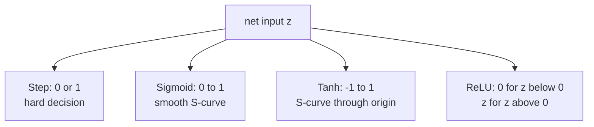
*Fig. 2.4: The four activation functions. Draw the three small graphs in the exam: S from 0 to 1, S from −1 to 1, and the hinge.*

| Function | Advantages | Disadvantages |
|---|---|---|
| Step / sign | simple, gives a class label directly | derivative 0, so gradient descent cannot be used |
| Sigmoid | smooth, differentiable, output looks like a probability | vanishing gradient, not zero-centred, exp() is slow |
| Tanh | zero-centred, stronger gradient than sigmoid | still saturates for large \|z\| |
| ReLU | very cheap, no saturation for z > 0, fast training, sparse outputs | dying ReLU, unbounded, not differentiable at 0 |

- **Vanishing gradient:** sigmoid′(2) = 0.105 and tanh′(2) = 0.0707: the curves are flat for large |z|, so deep networks learn slowly.
- **Dying ReLU:** if net is always negative, output and gradient are 0 for ever. **Leaky ReLU** f(z) = 0.01z for z ≤ 0 fixes it.
- **Softmax** (multi-class output): fi = ezi/Σj ezj, outputs add to 1.
- tanh(z) = 2·sigmoid(2z) − 1.

::: tip Mnemonic
"S, T, R" = **S**quash, **T**ilt, **R**ectify. Sigmoid squashes to (0, 1), tanh is the tilted S through the origin, ReLU rectifies negatives to 0.
:::

## 2.5 Linear separability: AND, OR and XOR

**Definition.** <u>Two sets of samples are linearly separable if there exist a weight vector w and bias w0 such that wTx + w0 > 0 for every sample of ω1 and wTx + w0 < 0 for every sample of ω2.</u>

| x1 | x2 | AND | OR | XOR |
|---|---|---|---|---|
| 0 | 0 | 0 | 0 | 0 |
| 0 | 1 | 0 | 1 | 1 |
| 1 | 0 | 0 | 1 | 1 |
| 1 | 1 | 1 | 1 | 0 |
| one separating line | x1 + x2 − 1.5 = 0 | | x1 + x2 − 0.5 = 0 | **none exists** |

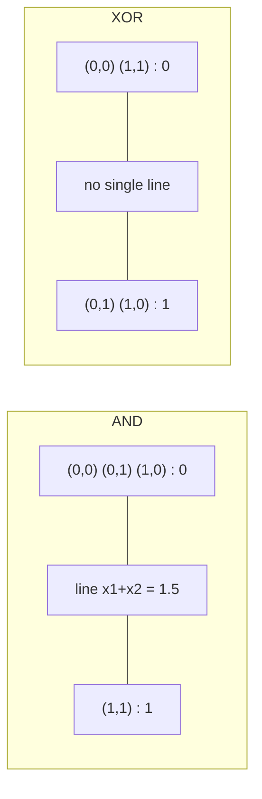
*Fig. 2.5: AND is cut by one line. XOR's 1s and 0s sit on the two diagonals of the square (an X), so no line separates them.*

**Proof that XOR is not linearly separable.** Suppose y = 1 if w1x1 + w2x2 + b > 0 computes XOR. Then:
1. (0, 0) → 0: b ≤ 0
2. (0, 1) → 1: w2 + b > 0
3. (1, 0) → 1: w1 + b > 0
4. (1, 1) → 0: w1 + w2 + b ≤ 0

Adding (2) and (3): w1 + w2 + 2b > 0, so w1 + w2 + b > −b ≥ 0, which contradicts (4). ∎ Of the 16 Boolean functions of two inputs, only XOR and XNOR are not linearly separable.

**Ways out:** (1) add a feature x3 = x1x2: g = x1 + x2 − 2x1x2 − 0.5 gives −0.5, 0.5, 0.5, −0.5 (sign = XOR); (2) add a **hidden layer** (MLP, Section 2.11); (3) kernels (SVM, Unit 5, Cover's theorem). We checked: the perceptron on XOR (zero start, η = 1) still makes **4 errors in epoch 100**: it never converges.

## 2.6 Perceptron learning algorithm  ⭐ (MCQ Q1, numerical predicted)

**Definition.** <u>The perceptron learning algorithm (Rosenblatt) is an error-correcting rule for a single threshold neuron: for each sample (x, t) it computes y = step(w·x + b) and, only when y ≠ t, updates wi ← wi + η(t − y)xi and b ← b + η(t − y).</u>

**Perceptron criterion (Duda):** Jp(a) = Σmisclassified (−aTy), where y are the augmented samples with the ω2 samples multiplied by −1 (so a correct sample has aTy > 0). Its gradient is −Σ y, so gradient descent gives a ← a + η Σmisclassified y. The plain error count cannot be used because its gradient is zero almost everywhere.

| Case | t − y | Update | Effect |
|---|---|---|---|
| correct | 0 | none | boundary stays |
| t = 1, y = 0 | +1 | w ← w + ηx, b ← b + η | net for x grows |
| t = 0, y = 1 | −1 | w ← w − ηx, b ← b − η | net for x shrinks |

**Steps:**
1. Initialise w and b (zero or small random). Choose 0 < η ≤ 1.
2. For each sample: net = Σ wixi + b, y = step(net).
3. If y ≠ t: wi ← wi + η(t − y)xi, b ← b + η(t − y).
4. After one epoch (all samples), stop if there was no error. Else repeat (with a maximum epoch limit).

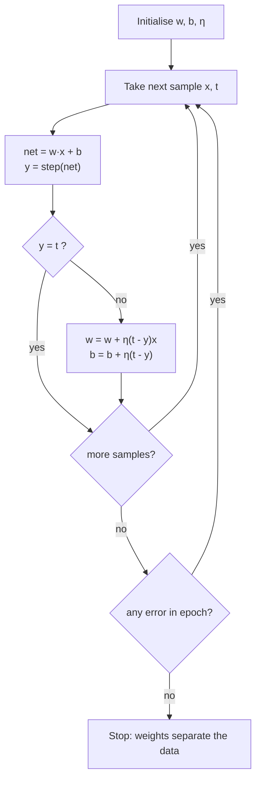
*Fig. 2.6: Perceptron learning algorithm.*

### Numerical: perceptron for the AND gate
**Given:** w1 = 0.3, w2 = −0.1, b = −0.2, η = 0.1. **Step function: y = 1 if net > 0, else 0** (net = 0 gives 0). Rows show the weights *before* the sample; the last three columns are the weights after it.

| Ep | x1 | x2 | t | w1 | w2 | b | net | y | t − y | new w1 | new w2 | new b |
|---|---|---|---|---|---|---|---|---|---|---|---|---|
| 1 | 0 | 0 | 0 | 0.3 | −0.1 | −0.2 | −0.2 | 0 | 0 | 0.3 | −0.1 | −0.2 |
| 1 | 0 | 1 | 0 | 0.3 | −0.1 | −0.2 | −0.3 | 0 | 0 | 0.3 | −0.1 | −0.2 |
| 1 | 1 | 0 | 0 | 0.3 | −0.1 | −0.2 | 0.1 | 1 | **−1** | 0.2 | −0.1 | −0.3 |
| 1 | 1 | 1 | 1 | 0.2 | −0.1 | −0.3 | −0.2 | 0 | **+1** | 0.3 | 0.0 | −0.2 |
| 2 | 0 | 0 | 0 | 0.3 | 0.0 | −0.2 | −0.2 | 0 | 0 | 0.3 | 0.0 | −0.2 |
| 2 | 0 | 1 | 0 | 0.3 | 0.0 | −0.2 | −0.2 | 0 | 0 | 0.3 | 0.0 | −0.2 |
| 2 | 1 | 0 | 0 | 0.3 | 0.0 | −0.2 | 0.1 | 1 | **−1** | 0.2 | 0.0 | −0.3 |
| 2 | 1 | 1 | 1 | 0.2 | 0.0 | −0.3 | −0.1 | 0 | **+1** | 0.3 | 0.1 | −0.2 |
| 3 | 0 | 0 | 0 | 0.3 | 0.1 | −0.2 | −0.2 | 0 | 0 | 0.3 | 0.1 | −0.2 |
| 3 | 0 | 1 | 0 | 0.3 | 0.1 | −0.2 | −0.1 | 0 | 0 | 0.3 | 0.1 | −0.2 |
| 3 | 1 | 0 | 0 | 0.3 | 0.1 | −0.2 | 0.1 | 1 | **−1** | 0.2 | 0.1 | −0.3 |
| 3 | 1 | 1 | 1 | 0.2 | 0.1 | −0.3 | 0.0 | 0 | **+1** | 0.3 | 0.2 | −0.2 |
| 4 | 0 | 0 | 0 | 0.3 | 0.2 | −0.2 | −0.2 | 0 | 0 | 0.3 | 0.2 | −0.2 |
| 4 | 0 | 1 | 0 | 0.3 | 0.2 | −0.2 | 0.0 | 0 | 0 | 0.3 | 0.2 | −0.2 |
| 4 | 1 | 0 | 0 | 0.3 | 0.2 | −0.2 | 0.1 | 1 | **−1** | 0.2 | 0.2 | −0.3 |
| 4 | 1 | 1 | 1 | 0.2 | 0.2 | −0.3 | 0.1 | 1 | 0 | 0.2 | 0.2 | −0.3 |
| 5 | 0 | 0 | 0 | 0.2 | 0.2 | −0.3 | −0.3 | 0 | 0 | 0.2 | 0.2 | −0.3 |
| 5 | 0 | 1 | 0 | 0.2 | 0.2 | −0.3 | −0.1 | 0 | 0 | 0.2 | 0.2 | −0.3 |
| 5 | 1 | 0 | 0 | 0.2 | 0.2 | −0.3 | −0.1 | 0 | 0 | 0.2 | 0.2 | −0.3 |
| 5 | 1 | 1 | 1 | 0.2 | 0.2 | −0.3 | 0.1 | 1 | 0 | 0.2 | 0.2 | −0.3 |

*Working for the first update (epoch 1, x = (1, 0)):* net = 0.3(1) + (−0.1)(0) − 0.2 = 0.1 > 0 → y = 1, t − y = −1. w1 = 0.3 + 0.1(−1)(1) = 0.2, w2 = −0.1 + 0 = −0.1, b = −0.2 + 0.1(−1) = −0.3.

::: tip Answer
Errors per epoch: 2, 2, 2, 1, **0**. Converged after **5 epochs** with **7 updates**. Final **w1 = 0.2, w2 = 0.2, b = −0.3**; boundary 0.2x1 + 0.2x2 − 0.3 = 0, i.e. x1 + x2 = 1.5. Check: nets −0.3, −0.1, −0.1, +0.1 → outputs 0, 0, 0, 1 = AND ✓
:::

**Practice (OR gate, w = b = 0, η = 1, y = 1 if net > 0):** updates at epoch 1 x = (0, 1) → w = (0, 1), b = 1; epoch 2 x = (0, 0) → b = 0; epoch 2 x = (1, 0) → w = (1, 1), b = 1; epoch 3 x = (0, 0) → b = 0. **Final w = (1, 1), b = 0** after 4 updates; epoch 4 is error-free. Nets 0, 1, 1, 2 → 0, 1, 1, 1 ✓

**Perceptron convergence theorem.** <u>If the training samples are linearly separable, the perceptron rule finds a separating weight vector in a finite number of updates, whatever the starting weights.</u> Number of updates ≤ (R/γ)2 (R = largest sample length, γ = margin). On non-separable data (XOR) it never stops; use an epoch limit or the pocket algorithm.

| Advantages | Limitations |
|---|---|
| very simple, fast | only linearly separable data |
| guaranteed convergence on separable data | never settles on XOR |
| on-line, one sample at a time | hard 0/1 output, no confidence |
| updates only on mistakes | the line found is not unique or best |

## 2.7 General gradient descent  ⭐⭐ (Mid-2 Q4, End Q8 = 14 marks)

The idea: you stand on a hill in fog and want to reach the valley. Feel the slope under your feet and take a small step downhill. Repeat. The slope is the **gradient**; the step size is the **learning rate**.

**Definition.** <u>Gradient descent is an iterative optimisation algorithm that minimises a cost function J(θ) by repeatedly moving the parameters a small step in the direction of the negative gradient: θ ← θ − η ∇J(θ), where η is the learning rate.</u>

**Update formula (one weight):** wj ← wj − η ∂J/∂wj

- ∂J/∂wj > 0 (cost rising to the right) → wj decreases. ∂J/∂wj < 0 → wj increases. At a minimum ∂J/∂w = 0, so steps stop.

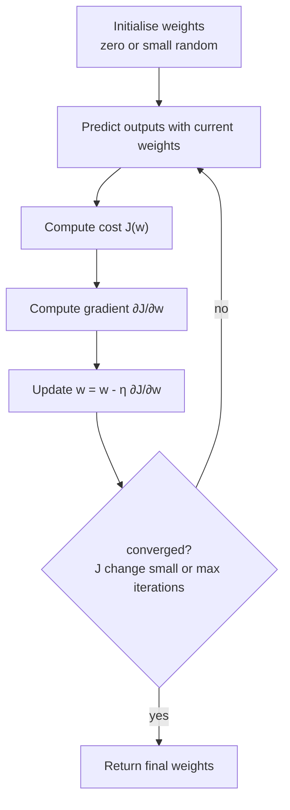
*Fig. 2.7: Working of gradient descent.*

### Gradient descent for linear regression
Model: ŷ = w x + b. Cost (MSE, with ½ for a clean derivative): **J(w, b) = (1/2m) Σ (ŷi − yi)2**.
- ∂J/∂w = (1/m) Σ (ŷi − yi) xi
- ∂J/∂b = (1/m) Σ (ŷi − yi)
- w ← w − η ∂J/∂w, b ← b − η ∂J/∂b, both updated **simultaneously**.

For linear regression the MSE surface is a **convex bowl**, so there is one global minimum and gradient descent reaches it with a suitable η.

### Conditions for applying gradient descent (linear regression)
1. **Differentiable cost:** J must have a gradient (MSE does; a step-function error count does not).
2. **Convex cost** (ideally): a bowl-shaped J guarantees one global minimum. MSE for linear regression is convex.
3. **Suitable learning rate:** small enough not to overshoot (η < 2/λmax of the Hessian), large enough to finish.
4. **Scaled features:** features on similar ranges (standardise or min–max) so the bowl is round, not a long thin valley.
5. **Enough data and no perfect multicollinearity** so that the minimum is well defined.
6. **A stopping rule:** maximum iterations or a small change in J.
7. Preferred when there are **many features or a large dataset**, where the closed-form normal equation w = (XTX)−1XTy is too costly (matrix inversion is about O(d3)).

### Difficulties in applying gradient descent
| Difficulty | What happens | Remedy |
|---|---|---|
| Choice of learning rate | too small: very slow. too large: overshoots and diverges | tune η, learning-rate schedules, Adam |
| Local minima | stuck in a non-global valley (non-convex J, e.g. neural nets) | random restarts, momentum, SGD noise |
| Saddle points | gradient 0 but not a minimum, progress stalls | momentum, SGD noise |
| Plateaus | flat regions, tiny gradients, slow | momentum, adaptive η |
| Vanishing / exploding gradients | in deep nets gradients shrink or blow up through layers | ReLU, good initialisation, batch norm, clipping |
| Feature scaling | unscaled features give a zig-zag path | standardise features |
| Cost per step | batch GD on huge data is slow | stochastic / mini-batch GD |

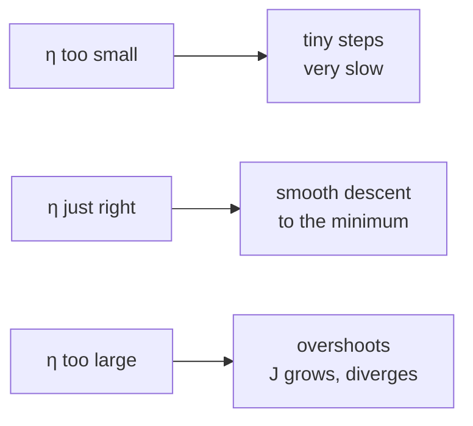
*Fig. 2.8: Effect of the learning rate.*

### Numerical: two iterations of batch gradient descent
**Data:** x = (1, 2, 3), y = (2, 4, 6), m = 3. Start w = 0, b = 0, **η = 0.1**, J = (1/2m)Σ(ŷ − y)2. Initial cost J0 = (4 + 16 + 36)/6 = **9.3333**.

**Iteration 1** (w = 0, b = 0):

| x | y | ŷ = wx + b | e = ŷ − y | e·x |
|---|---|---|---|---|
| 1 | 2 | 0 | −2 | −2 |
| 2 | 4 | 0 | −4 | −8 |
| 3 | 6 | 0 | −6 | −18 |
| Σ | | | −12 | −28 |

∂J/∂w = −28/3 = −9.3333, ∂J/∂b = −12/3 = −4. w = 0 − 0.1(−9.3333) = **0.9333**, b = 0 − 0.1(−4) = **0.4**. J = **1.8815**.

**Iteration 2** (w = 0.9333, b = 0.4):

| x | y | ŷ | e = ŷ − y | e·x |
|---|---|---|---|---|
| 1 | 2 | 1.3333 | −0.6667 | −0.6667 |
| 2 | 4 | 2.2667 | −1.7333 | −3.4667 |
| 3 | 6 | 3.2 | −2.8 | −8.4 |
| Σ | | | −5.2 | −12.5333 |

∂J/∂w = −12.5333/3 = −4.1778, ∂J/∂b = −5.2/3 = −1.7333. w = 0.9333 + 0.41778 = **1.3511**, b = 0.4 + 0.17333 = **0.5733**. J = **0.4028**.

::: tip Answer
Cost falls 9.3333 → 1.8815 → 0.4028. After two iterations **w = 1.3511, b = 0.5733**. Continued, it approaches the true line **w = 2, b = 0** (after about 1000 iterations w = 2.0000, b ≈ 0).
:::

::: warn What a too-large η does
Same data with **η = 0.5**: J goes 29.26 → 91.92 → 288.97 → 908.58 over the first four iterations, and w swings 4.67, −3.56, 11.07, −14.82. Gradient descent **diverges**.
:::

## 2.8 Types of gradient descent  ⭐ (End Q8b)

| Point | Batch GD | Stochastic GD (SGD) | Mini-batch GD |
|---|---|---|---|
| Samples per update | all m | 1 | b (e.g. 32, 64, 128) |
| Updates per epoch | 1 | m | m/b |
| Speed per update | slow | very fast | fast |
| Path to minimum | smooth, direct | noisy, zig-zag | moderately smooth |
| Memory | whole dataset | one sample | one batch |
| Escaping local minima | poor | good (noise helps) | fairly good |
| Convergence | exact minimum (convex J) | fluctuates near it, needs decaying η | close, stable |
| Use | small datasets | huge or streaming data, on-line | default in deep learning (GPU friendly) |

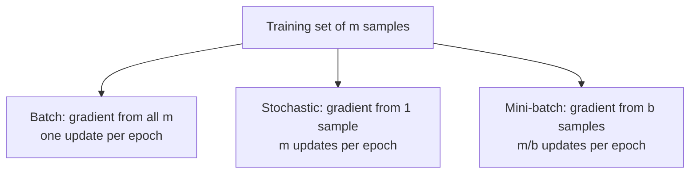
*Fig. 2.9: The three types of gradient descent.*

**SGD on the same data** (η = 0.1, loss ½e2 per sample, w = b = 0): sample (1, 2): e = −2 → w = 0.2, b = 0.2. Sample (2, 4): e = 0.2(2) + 0.2 − 4 = −3.4 → w = 0.2 + 0.1(3.4)(2) = **0.88**, b = 0.2 + 0.34 = **0.54**. Two updates already, from just two samples.

## 2.9 Mean square criterion and Widrow–Hoff (LMS) learning  ⭐ (End Q5b)

The perceptron uses the thresholded output and only fixes mistakes. **ADALINE** (Widrow and Hoff, 1960) uses the **linear output** yin = w·x + b during training and minimises the **squared error** on every sample, even correct ones. The threshold is applied only when classifying.

**Definition.** <u>The mean square criterion is J(w) = ½ Σ (tk − w·xk)2. The Widrow–Hoff (LMS, delta) rule minimises it by stochastic gradient descent, one sample at a time: w ← w + η(t − yin)x and b ← b + η(t − yin), where yin = w·x + b is the linear (un-thresholded) output.</u>

**Derivation:** for one sample E = ½(t − yin)2, ∂E/∂wi = −(t − yin)xi, so wi ← wi − η ∂E/∂wi = wi + η(t − yin)xi.

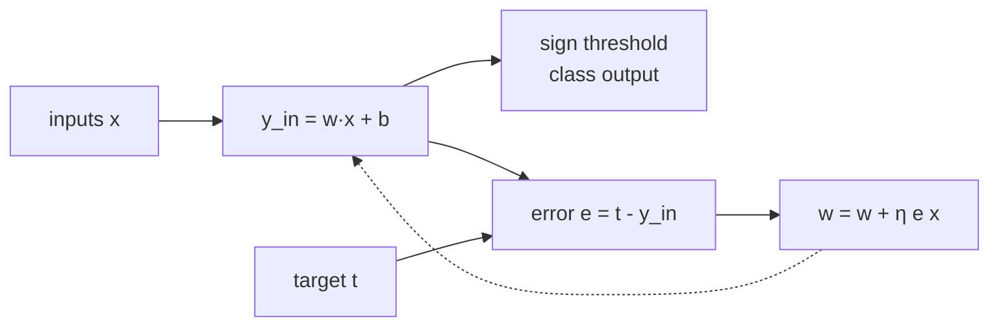
*Fig. 2.10: ADALINE. The error is taken before the threshold.*

**Steps:**
1. Initialise weights to small values, choose small η (0.01–0.1).
2. For each sample: yin = Σ wixi + b.
3. e = t − yin; wi ← wi + η e xi; b ← b + η e.
4. Repeat epochs until the total squared error stops falling (or is below a tolerance).

### Numerical: one LMS epoch for bipolar AND
**Given:** inputs and targets in ±1 form, w1 = w2 = b = 0.1, **η = 0.1**, linear output yin.

| x1 | x2 | t | w1, w2, b (before) | yin | e = t − yin | Δw1 | Δw2 | Δb | new w1, w2, b |
|---|---|---|---|---|---|---|---|---|---|
| 1 | 1 | 1 | 0.1, 0.1, 0.1 | 0.3 | 0.7 | 0.07 | 0.07 | 0.07 | 0.17, 0.17, 0.17 |
| 1 | −1 | −1 | 0.17, 0.17, 0.17 | 0.17 | −1.17 | −0.117 | 0.117 | −0.117 | 0.053, 0.287, 0.053 |
| −1 | 1 | −1 | 0.053, 0.287, 0.053 | 0.287 | −1.287 | 0.1287 | −0.1287 | −0.1287 | 0.1817, 0.1583, −0.0757 |
| −1 | −1 | −1 | 0.1817, 0.1583, −0.0757 | −0.4157 | −0.5843 | 0.05843 | 0.05843 | −0.05843 | 0.24013, 0.21673, −0.13413 |

*Working for row 1:* yin = 0.1(1) + 0.1(1) + 0.1 = 0.3; e = 1 − 0.3 = 0.7; Δw1 = 0.1 × 0.7 × 1 = 0.07.

::: tip Answer
After one epoch **w1 = 0.24013, w2 = 0.21673, b = −0.13413**. Total squared error Σe2 on the four samples fell from **3.72 to 2.1265**, and the signs of yin already give AND (+1, −1, −1, −1). With more epochs the weights move towards the least-squares solution **w1 = w2 = 0.5, b = −0.5** (minimum Σe2 = 1).
:::

| Point | Perceptron rule | Widrow–Hoff (LMS) rule |
|---|---|---|
| Error used | t − y, y after the step function | t − yin, linear output |
| Updates when | only on mistakes | on every sample |
| Minimises | perceptron criterion | mean squared error |
| Non-separable data | never converges | settles near the least-squares solution (exactly, if η decreases over time) |
| Separable data | always finds a separating line | may not separate even if possible |
| Generalises to | — | the delta rule of backpropagation |

**Applications of LMS:** adaptive filters, echo and noise cancellation, channel equalisation in modems, ADALINE/MADALINE.

## 2.10 Cost function vs loss function  ⭐ (End Q7b)

| Point | Loss function | Cost function |
|---|---|---|
| Defined on | **one** training example | the **whole** training set (or a batch) |
| Formula (regression) | L = ½(ŷ − y)2 | J = (1/m) Σ Li, plus a regularisation term if used |
| Purpose | measures error of a single prediction | the objective that the optimiser minimises |
| Used in | SGD update (one sample) | batch GD, model comparison |
| Examples | squared loss, absolute loss, hinge loss, cross-entropy (log) loss | MSE, MAE, mean cross-entropy, SVM objective |

**Example** (model w = 0.9333, b = 0.4 from iteration 1 of Section 2.7): losses for the three samples are **0.2222, 1.5022, 3.92**. Cost J = (0.2222 + 1.5022 + 3.92)/3 = **1.8815**, the same J we got there.

## 2.11 Multi-layer perceptron (MLP)  ⭐⭐⭐ (Mid-2 Q1, End Q5a, MCQ)

**Definition.** <u>A multi-layer perceptron is a feed-forward neural network with an input layer, one or more hidden layers of neurons with non-linear (usually differentiable) activation functions, and an output layer; every neuron in one layer is connected to every neuron in the next layer, and it is trained by backpropagation.</u>

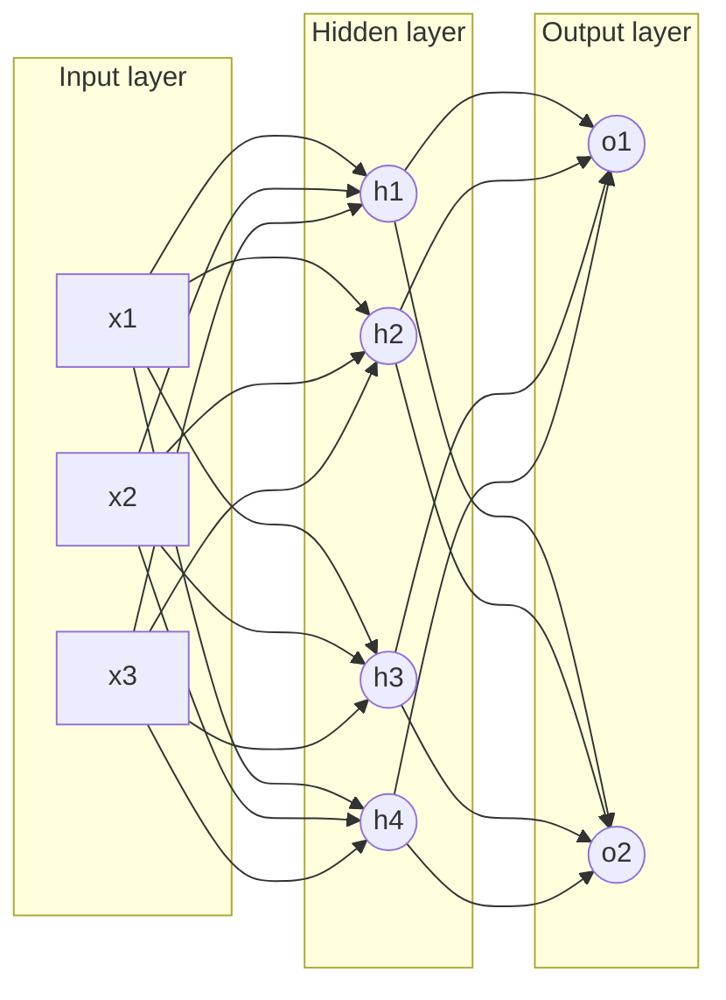
*Fig. 2.11: Architecture of an MLP (3-4-2). Weights vij join input → hidden, wjk join hidden → output. Signals flow forward, errors flow backward.*

### Working
1. **Input layer** only passes the features on (no computation).
2. **Hidden layer:** each neuron computes netj = Σi vijxi + bj and hj = f(netj). Each hidden neuron draws one boundary; together they build new features.
3. **Output layer:** netk = Σj wjkhj + bk, ok = f(netk) (sigmoid or softmax for classes, linear for regression).
4. **Error** E = ½ Σk (tk − ok)2 is computed and **backpropagation** adjusts all weights (Section 2.13).

**XOR with two hidden neurons:** h1 = OR (x1 + x2 − 0.5 > 0), h2 = AND (x1 + x2 − 1.5 > 0), output = h1 AND NOT h2 (h1 − h2 − 0.5 > 0). The output is 1 only in the strip between the two lines.

### Advantages of an MLP over a single perceptron (Mid-2 Q1)
| Single perceptron | MLP |
|---|---|
| one straight-line boundary | any curved boundary (combines many lines) |
| cannot learn XOR | learns XOR and any non-linear problem |
| step activation, hard 0/1 output | smooth activations, probability-like outputs |
| perceptron rule only | trained by backpropagation (gradient descent) |
| one output decision | many outputs: multi-class, regression |
| no feature learning | hidden layers learn useful features automatically |
| — | universal approximator (Section 2.12) |

**Disadvantages of MLP:** many weights (needs more data), slow training, local minima, many hyper-parameters, a "black box".

## 2.12 Two-layer networks as universal approximators

**Universal approximation theorem** (Cybenko 1989, Hornik 1991). <u>A feed-forward network with one hidden layer containing enough neurons with a non-linear, bounded, continuous activation (such as sigmoid), and a linear output layer, can approximate any continuous function on a closed, bounded region to any desired accuracy.</u>

- "Two-layer" = two layers of weights (input → hidden → output).
- **Idea:** each pair of steep sigmoids makes a "bump"; adding many bumps of the right heights draws any curve, like building a shape from Lego bricks.
- For classification with hard threshold units: two layers of weights can form **any convex (polygon-shaped) region** (each hidden unit is one side), three layers can form **any region** (unions of convex regions). With smooth sigmoid units and enough hidden units, even two layers can approximate any region (the theorem above).
- **Limits:** the theorem says such a network *exists*. It does not say how many hidden units are needed (may be very many) or that backpropagation will *find* the weights, or that it will generalise.

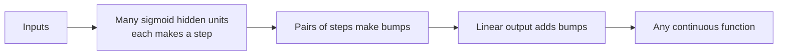
*Fig. 2.12: Why one hidden layer is enough in principle.*

## 2.13 Backpropagation learning  ⭐⭐⭐ (End Q5a, 10 marks)

**Definition.** <u>Backpropagation (backward propagation of errors) is a supervised learning algorithm for multi-layer feed-forward networks that computes the gradient of the error with respect to every weight by applying the chain rule backwards from the output layer to the input layer, and updates the weights by gradient descent.</u>

It is the **generalised delta rule**: the LMS rule extended to hidden layers.

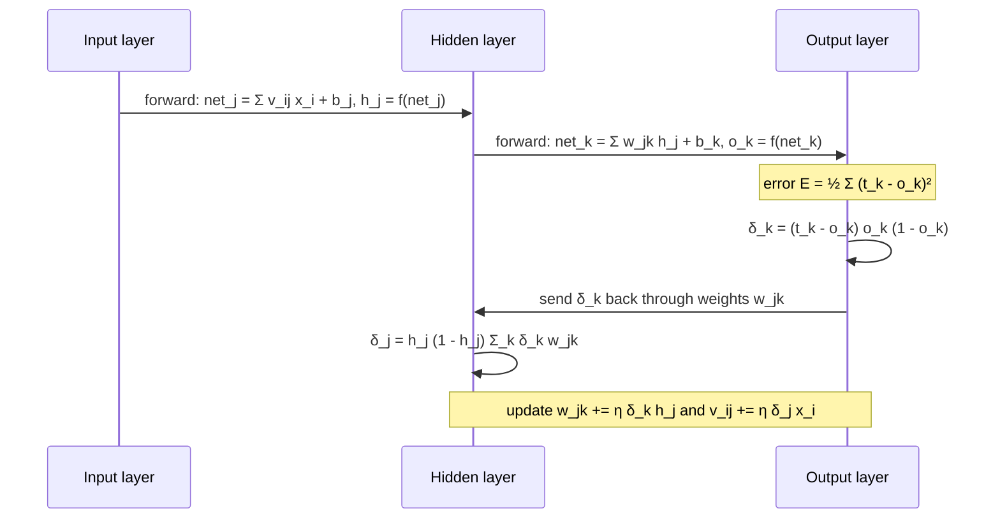
*Fig. 2.13: Forward pass and backward pass of backpropagation.*

### Algorithm (sigmoid units, E = ½ Σ (tk − ok)2)
1. **Initialise** all weights and biases to small random numbers. Choose η.
2. **Forward pass:** for each training pattern, compute hidden outputs hj = σ(Σ vijxi + bj) and outputs ok = σ(Σ wjkhj + bk).
3. **Output error term:** δk = (tk − ok) · ok(1 − ok).
4. **Hidden error term:** δj = hj(1 − hj) · Σk δkwjk (uses the old wjk).
5. **Update weights:** wjk ← wjk + η δk hj, bk ← bk + η δk; vij ← vij + η δj xi, bj ← bj + η δj.
6. **Repeat** for all patterns (one epoch) and for many epochs until E is small or a maximum epoch count is reached.

**Where δk comes from (chain rule):** ∂E/∂wjk = ∂E/∂ok · ∂ok/∂netk · ∂netk/∂wjk = −(tk − ok) · ok(1 − ok) · hj = −δkhj. Gradient descent Δw = −η ∂E/∂w gives η δk hj. A hidden unit has no target, so it collects blame from every output it feeds: Σ δkwjk.

### Significance of backpropagation
- Made **training of multi-layer networks practical** (Rumelhart, Hinton, Williams 1986), solving XOR-type problems that a perceptron cannot.
- **Efficient:** all gradients in one backward pass, about the same cost as the forward pass.
- **General:** works for any differentiable activation and cost, any number of layers. It is the basis of all deep learning (CNNs, RNNs).
- **Learns hidden features** automatically.
- **Drawbacks:** local minima, slow convergence, vanishing gradients with sigmoid in deep nets, sensitive to η and initialisation, overfitting.

### Numerical: one forward and backward pass on a 2-2-1 sigmoid network
**Given:** x1 = 0.5, x2 = 1.0, target t = 1, **η = 0.5**, sigmoid everywhere, E = ½(t − o)2.

| Weight | Value | Weight | Value |
|---|---|---|---|
| v11 (x1→h1) | 0.2 | v12 (x1→h2) | 0.4 |
| v21 (x2→h1) | −0.3 | v22 (x2→h2) | 0.1 |
| b1 (bias h1) | 0.1 | b2 (bias h2) | −0.1 |
| w1 (h1→o) | 0.5 | w2 (h2→o) | −0.4 |
| bo (bias o) | 0.2 | | |

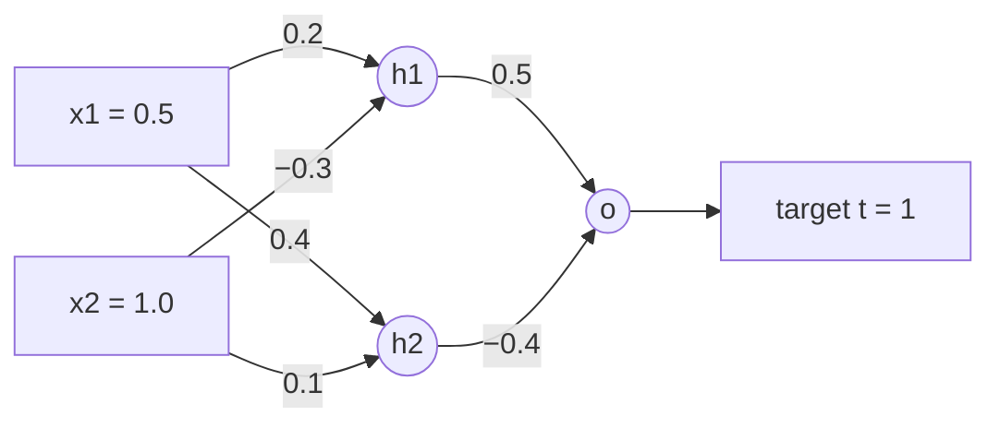
*Fig. 2.14: The 2-2-1 network (biases 0.1, −0.1 on hidden units, 0.2 on output).*

**Step 1: forward pass**

| Unit | net | output = σ(net) |
|---|---|---|
| h1 | 0.2(0.5) + (−0.3)(1.0) + 0.1 = −0.1 | 0.4750 |
| h2 | 0.4(0.5) + 0.1(1.0) − 0.1 = 0.2 | 0.5498 |
| o | 0.5(0.4750) − 0.4(0.5498) + 0.2 = 0.2375 − 0.2199 + 0.2 = 0.2176 | **0.5542** |

Error E = ½(1 − 0.5542)2 = **0.09938**.

**Step 2: error terms**

| Term | Formula | Value |
|---|---|---|
| δo | (t − o) o(1 − o) = 0.44582 × 0.24706 | **0.11015** |
| δh1 | h1(1 − h1) w1 δo = 0.24938 × 0.5 × 0.11015 | **0.01373** |
| δh2 | h2(1 − h2) w2 δo = 0.24752 × (−0.4) × 0.11015 | **−0.01091** |

**Step 3: weight updates** (Δ = η δ × input to that weight)

| Weight | Δ | Old | New |
|---|---|---|---|
| w1 | 0.5 × 0.11015 × 0.4750 = 0.02616 | 0.5 | **0.5262** |
| w2 | 0.5 × 0.11015 × 0.5498 = 0.03028 | −0.4 | **−0.3697** |
| bo | 0.5 × 0.11015 = 0.05507 | 0.2 | **0.2551** |
| v11 | 0.5 × 0.01373 × 0.5 = 0.00343 | 0.2 | **0.2034** |
| v21 | 0.5 × 0.01373 × 1.0 = 0.00687 | −0.3 | **−0.2931** |
| b1 | 0.5 × 0.01373 = 0.00687 | 0.1 | **0.1069** |
| v12 | 0.5 × (−0.01091) × 0.5 = −0.00273 | 0.4 | **0.3973** |
| v22 | 0.5 × (−0.01091) × 1.0 = −0.00545 | 0.1 | **0.0945** |
| b2 | 0.5 × (−0.01091) = −0.00545 | −0.1 | **−0.1055** |

::: tip Answer
Forward pass: h1 = 0.4750, h2 = 0.5498, **o = 0.5542**, E = 0.09938. After one backpropagation step, a new forward pass gives **o = 0.5756** and **E = 0.09004**: the output moved towards the target 1 and the error fell.
:::

## 2.14 On-line and off-line (batch) learning

**Definition.** <u>In on-line (incremental, pattern) learning the weights are updated after every training pattern. In off-line (batch) learning the weight changes for all patterns of an epoch are added up and the weights are updated once per epoch.</u>

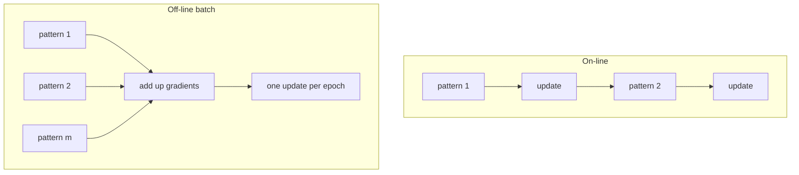
*Fig. 2.15: On-line vs off-line learning.*

| Point | On-line learning | Off-line (batch) learning |
|---|---|---|
| Update | after every pattern | once per epoch |
| Gradient | of one pattern's error (noisy) | of the total error (true gradient) |
| Same as | stochastic GD, LMS, perceptron rule | batch GD |
| Memory | low, data can stream in | needs the whole set |
| Speed on redundant data | faster | slower |
| Local minima | noise can help escape | can get stuck |
| Order of patterns | matters, shuffle each epoch | does not matter |
| Suits | real-time, changing data (adaptive filters) | small fixed datasets, parallel computing |

## 2.15 Error surface

**Definition.** <u>The error surface is the plot of the network error E as a function of all its weights; training is a search for the lowest point on this surface, and gradient descent moves downhill along it.</u>

- **Single linear unit (LMS):** E is quadratic in w, so the surface is a **bowl (paraboloid)** with one global minimum.
- **MLP with non-linear units:** the surface is **non-convex**: many **local minima**, **saddle points**, long **flat plateaus** and narrow **ravines**.
- **Symmetries:** swapping two hidden units gives the same error, so many equivalent minima exist.
- In ravines plain gradient descent zig-zags across the walls; **momentum** smooths this out.

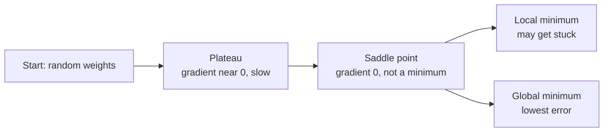
*Fig. 2.16: Features of an MLP error surface met during gradient descent.*

## 2.16 Important parameters of backpropagation training

| Parameter | Typical choice | Too small | Too large |
|---|---|---|---|
| **Learning rate η** | 0.01–0.5, often decayed | very slow training | oscillation, divergence |
| **Momentum α** | 0.5–0.9 | little smoothing | overshooting |
| **Number of epochs** | until validation error rises (early stopping) | underfitting | overfitting |
| **Initial weights** | small random, e.g. Xavier or He (never all equal or all zero: identical units stay identical) | signals and gradients too weak, slow start | saturated sigmoids, vanishing gradients |
| **Number of hidden units** | between input and output size, tuned by validation | underfitting | overfitting, slow |
| **Number of hidden layers** | 1–2 for simple problems | cannot fit complex shapes | vanishing gradients, overfit |
| **Activation function** | ReLU (hidden), sigmoid/softmax (output) | — | — |
| **Batch size** | 32–256 | noisy steps | slow, poor generalisation |

**Momentum:** Δw(n) = −η ∂E/∂w + α Δw(n − 1). It adds a fraction of the previous step, so the weights keep rolling through flat regions and small dips. *Example:* η = 0.5, gradient 0.2, previous step −0.1, α = 0.9: Δw = −0.5(0.2) + 0.9(−0.1) = **−0.19** (instead of −0.1 without momentum).

**Other tips:** scale inputs to similar ranges, shuffle patterns each epoch, use a validation set, and regularise (weight decay, dropout) to avoid overfitting.

::: warn Common mistakes
- Using the step function in backpropagation: its derivative is 0, so nothing learns.
- Updating wjk before computing δj (use the old weights for δj).
- Forgetting the sign: gradient **descent** is w − η∂E/∂w, which equals w + ηδh for E = ½(t − o)2.
- Initialising all weights to zero: every hidden unit stays identical.
:::

## Exam checklist for Unit 2
- [ ] Definition of discriminant and linear discriminant; g(x) = w·x + w0; w normal to H; r = g/‖w‖ (3x1 + 4x2 − 12 example)
- [ ] Decision regions; linear machine vs one-vs-rest vs one-vs-one table
- [ ] Neuron diagram with inputs, weights, bias, Σ, f, y; single-layer network
- [ ] Activation functions: step, sigmoid, tanh, ReLU with formula, range, derivative, pros and cons; vanishing gradient
- [ ] Linear separability definition; AND/OR lines; 4-line XOR proof
- [ ] Perceptron rule and flowchart; AND numerical (final 0.2, 0.2, −0.3 in 5 epochs); convergence theorem
- [ ] Gradient descent definition, update formula, flowchart; linear regression gradients
- [ ] Conditions and difficulties of gradient descent; 2-iteration numerical (w = 1.3511, b = 0.5733)
- [ ] Batch vs stochastic vs mini-batch comparison table
- [ ] Mean square criterion, Widrow–Hoff/LMS rule and its derivation; LMS epoch numerical; perceptron vs LMS
- [ ] Cost function vs loss function table
- [ ] MLP architecture diagram, working, advantages over a single perceptron; XOR with two hidden units
- [ ] Universal approximation theorem and its limits
- [ ] Backpropagation steps, δ formulas, significance; 2-2-1 numerical (o = 0.5542 → 0.5756)
- [ ] On-line vs off-line learning; error surface; learning rate, momentum, epochs, initialisation, hidden units
