# Unit 3 · Decision Trees and Instance-Based Learning

> **Exam weight:** 21 of 112 marks in the 2025-26 end-sem (about 19%): the k-NN numerical with "lazy learner" and "choosing k" (Q2, a full 14 marks) and "decision trees, ID3, C4.5, continuous attributes" (Q3b, 7 marks). The earlier mid also asked an MCQ on the main disadvantage of decision trees (overfitting). Not yet asked: an entropy/ID3 numerical, pruning and the nearest-neighbour error probability, so expect one of them.

**Prefer to watch first?** [Video lectures for Unit 3 →](#videos/unit3)

Follows Mitchell, *Machine Learning*, chapters 3 and 8, and Duda–Hart for the error bound. Every number on this page was computed by a program. Conventions: **log base 2** for entropy, **Euclidean distance** for k-NN unless stated, answers rounded to 3 decimals (2 for the k-NN distances).

## 3.1 Decision trees: the inference model  ⭐⭐ (End Q3b, MCQ Q3)

A decision tree is a flow chart of questions. To decide whether to play tennis, first ask "What is the outlook?". If it is sunny, ask "Is the humidity high?". Keep asking until you reach an answer at the bottom (a leaf). The computer learns **which** questions to ask, and in **which order**, from a table of past examples.

**Definition.** <u>A decision tree is a classifier in the form of a tree. Each internal node tests one attribute, each branch is one outcome of that test, and each leaf node gives a class label. A new example is classified by starting at the root and following the branches that match its attribute values until a leaf is reached.</u>

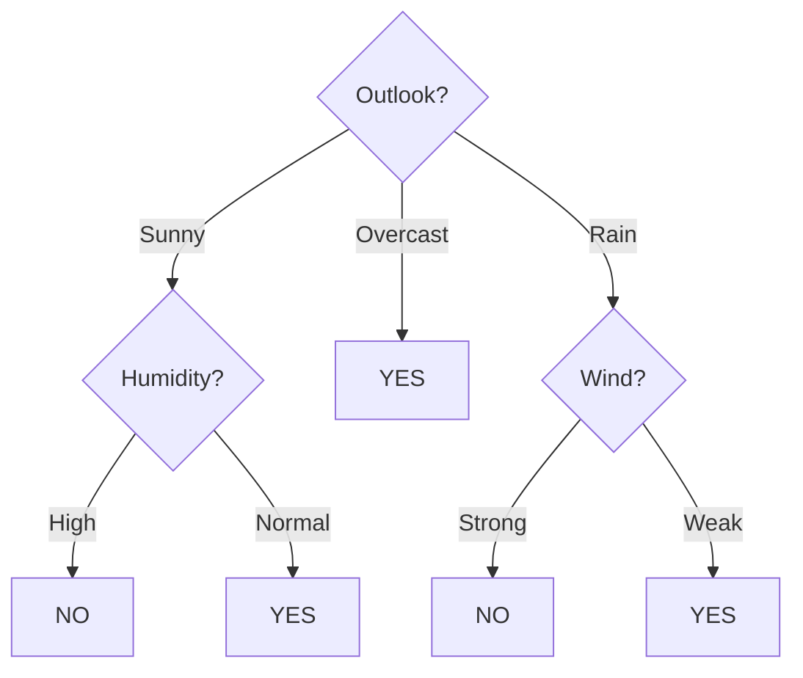
*Fig. 3.1: The PlayTennis tree. Root and internal nodes test attributes, leaves give the class. It is learned step by step in Section 3.9.*

**Inference = using the learned tree to classify.** Example: (Outlook = Sunny, Temperature = Hot, Humidity = Normal, Wind = Strong).
1. Root: Outlook = Sunny, so take the Sunny branch.
2. Next node: Humidity = Normal, so take the Normal branch.
3. Leaf: **YES**.

Only the attributes on the path are used: Temperature and Wind were never asked for this example.

A tree is a **set of if-then rules**, one rule per root-to-leaf path. It is a **disjunction of conjunctions**:
Play = (Sunny AND Normal) OR (Overcast) OR (Rain AND Weak).

## 3.2 General domains: when is a decision tree a good choice?

Mitchell lists five properties of problems where decision trees work well:

1. Examples are described by **attribute–value pairs** (Outlook = Sunny, Age = 35).
2. The target is **discrete-valued** (Yes/No, or a few classes).
3. A **disjunctive** description may be needed (several paths lead to the same class).
4. The training data may contain **errors** (wrong labels or wrong values).
5. The training data may contain **missing attribute values**.

| Kind of attribute | Example | Test at a node |
|---|---|---|
| Symbolic (nominal) | Outlook ∈ {Sunny, Overcast, Rain} | one branch per value |
| Boolean | Student ∈ {Yes, No} | two branches |
| Continuous (numeric) | Temperature = 72 | threshold test: Temperature ≤ 54? (Section 3.11) |

**Applications:** medical diagnosis, loan and credit-risk approval, fault diagnosis of machines, spam filtering, customer churn prediction.

## 3.3 Symbolic decision trees

A symbolic tree asks questions about **named values** (Sunny, High, Weak), not numbers, so a person can read it directly as rules.

**Definition.** <u>A symbolic decision tree is a decision tree whose node tests are on symbolic (categorical) attribute values, with one branch for each value; it can be read directly as a set of if-then rules.</u>

Rules from Fig. 3.1:

| Rule | IF | THEN |
|---|---|---|
| R1 | Outlook = Sunny AND Humidity = High | Play = No |
| R2 | Outlook = Sunny AND Humidity = Normal | Play = Yes |
| R3 | Outlook = Overcast | Play = Yes |
| R4 | Outlook = Rain AND Wind = Strong | Play = No |
| R5 | Outlook = Rain AND Wind = Weak | Play = Yes |

## 3.4 Consistency

**Definition.** <u>A tree (hypothesis) h is consistent with a training set D if h(x) = c(x) for every training example (x, c(x)) in D, that is, it makes no error on the training data.</u>

- If the data has **no noise** (no two identical examples with different labels), ID3 always builds a tree that is consistent with all training examples.
- Usually **many** consistent trees exist. ID3 prefers **shorter** trees, with high-information attributes near the root. This preference is its **inductive bias** (Occam's razor: prefer the simplest hypothesis that fits the data).
- **Consistent is not always good.** With noisy data, a tree that fits every training example also fits the noise and does worse on new data. This is **overfitting** (Section 3.14).

::: warn Do not write this
"A consistent tree is always the best tree." Consistent = zero **training** error. The real aim is low error on **new** data.
:::

## 3.5 Learning trees from training examples (top-down induction)

To build the tree: pick the best question first, split the table into smaller tables (one per answer), then repeat on each small table. Stop when a table has only one class.

**Definition.** <u>Top-down induction of decision trees (TDIDT) learns a tree from training examples by recursively choosing the attribute that best separates the classes, creating one branch per value, partitioning the examples, and repeating on each partition until a stopping condition is met. It is a greedy search with no backtracking.</u>

1. Start with all training examples at the root.
2. If all examples have the same class, make a leaf with that class. Stop.
3. If no attributes are left, make a leaf with the majority class. Stop.
4. Otherwise choose the best attribute A (ID3: highest information gain).
5. Make one branch for each value v of A and send the examples with A = v down that branch.
6. If a branch receives no examples, make a leaf with the majority class of the parent.
7. Repeat steps 2–6 on every branch, without using A again on that path.

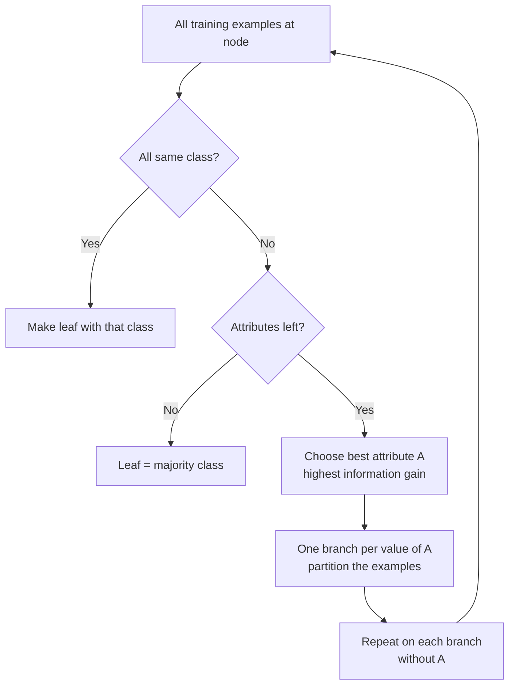
*Fig. 3.2: Top-down induction of a decision tree.*

| Property of the search | Meaning |
|---|---|
| Complete hypothesis space | Every discrete function can be written as some tree. |
| Greedy (hill climbing) | Picks the best attribute now and never goes back. |
| Uses all examples at each step | Statistical choice, so a few noisy examples do less harm. |
| Keeps one hypothesis | Builds one tree, does not list all consistent trees. |

## 3.6 Entropy

Entropy measures how **mixed (impure)** a set is. A box of only red balls has entropy 0 (no surprise). Half red, half blue has entropy 1 (most surprise). A good question makes the smaller groups less mixed.

**Definition.** <u>For a set S with c classes, Entropy(S) = − Σ<sub>i=1..c</sub> p<sub>i</sub> log<sub>2</sub> p<sub>i</sub>, where p<sub>i</sub> is the fraction of examples of class i. For two classes, Entropy(S) = − p<sub>+</sub> log<sub>2</sub> p<sub>+</sub> − p<sub>−</sub> log<sub>2</sub> p<sub>−</sub>. We take 0 · log<sub>2</sub> 0 = 0.</u>

| Set | Working | Entropy |
|---|---|---|
| [9+, 5−] | −(9/14) log<sub>2</sub>(9/14) − (5/14) log<sub>2</sub>(5/14) | 0.940 |
| [7+, 7−] | −(1/2) log<sub>2</sub>(1/2) − (1/2) log<sub>2</sub>(1/2) | 1.000 |
| [14+, 0−] | pure set | 0.000 |
| [3+, 1−] | −(3/4) log<sub>2</sub>(3/4) − (1/4) log<sub>2</sub>(1/4) | 0.811 |
| [2+, 3−] | −(2/5) log<sub>2</sub>(2/5) − (3/5) log<sub>2</sub>(3/5) | 0.971 |
| [8+, 2−] | −(0.8) log<sub>2</sub>(0.8) − (0.2) log<sub>2</sub>(0.2) | 0.722 |

- Range for two classes: **0 ≤ Entropy ≤ 1**. 0 when pure, 1 when the classes are equal (p = 0.5). With c classes the maximum is log<sub>2</sub> c.
- Meaning: the average number of **bits** needed to send the class of a random example from S.

::: tip Calculator help
log<sub>2</sub> x = log<sub>10</sub> x / 0.3010. Useful values: log<sub>2</sub>(3/4) = −0.415, log<sub>2</sub>(1/3) = −1.585, log<sub>2</sub>(2/3) = −0.585, log<sub>2</sub>(2/5) = −1.322, log<sub>2</sub>(3/5) = −0.737, log<sub>2</sub>(9/14) = −0.637, log<sub>2</sub>(5/14) = −1.485. Keep the minus sign: the logs are negative, so entropy comes out positive.
:::

## 3.7 Information gain and mutual information

**Information gain** = how much the mixing drops after we ask a question. Before the split there is one mixed group. After the split there are smaller groups; take their average entropy weighted by size. The drop is the gain.

**Definition.** <u>Gain(S, A) = Entropy(S) − Σ<sub>v ∈ Values(A)</sub> (|S<sub>v</sub>| / |S|) · Entropy(S<sub>v</sub>), where S<sub>v</sub> is the subset of S for which attribute A has value v.</u>

**Mutual information.** <u>The mutual information between attribute A and class C is I(A; C) = H(C) − H(C | A) = Σ<sub>a</sub> Σ<sub>c</sub> p(a, c) log<sub>2</sub> [ p(a, c) / (p(a) p(c)) ]. On a training set, information gain is exactly the mutual information between the attribute and the class.</u>

Why they are equal: H(C) is Entropy(S), and H(C | A) is the weighted entropy of the children. So **Gain(S, A) = H(C) − H(C | A) = I(A; C)**.

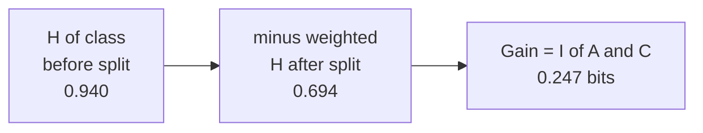
*Fig. 3.3: "Before minus weighted after" for Outlook on PlayTennis.*

**Check on PlayTennis (Outlook, 14 days):**

| Outlook | Play | count | p(a, c) · log<sub>2</sub>[p(a, c) / (p(a) p(c))] |
|---|---|---|---|
| Sunny | Yes | 2 | −0.098 |
| Sunny | No | 3 | 0.160 |
| Overcast | Yes | 4 | 0.182 |
| Overcast | No | 0 | 0.000 |
| Rain | Yes | 3 | −0.021 |
| Rain | No | 2 | 0.023 |
| | | **Sum** | **0.247 = Gain(S, Outlook)** |

Properties: I(A; C) = I(C; A) (symmetric), never negative, and 0 only when the attribute and class are independent (the question tells us nothing).

## 3.8 The ID3 algorithm and its criterion  ⭐ (End Q3b)

**Definition.** <u>ID3 (Iterative Dichotomiser 3, Quinlan 1986) builds a decision tree top-down, greedily choosing at each node the attribute with the maximum information gain (the ID3 criterion), until every leaf is pure or no attributes remain.</u>

```
ID3(Examples, Target, Attributes)
  create a Root node
  if all Examples are +       : return leaf '+'
  if all Examples are -       : return leaf '-'
  if Attributes is empty      : return leaf = majority class of Examples
  A <- attribute in Attributes with the HIGHEST Gain(Examples, A)
  Root tests A
  for each value v of A:
      add branch A = v ;  Ex_v <- examples with A = v
      if Ex_v is empty : add leaf = majority class of Examples
      else             : add subtree ID3(Ex_v, Target, Attributes - {A})
  return Root
```

**ID3 criterion:** maximise Gain(S, A) = maximise I(A; C) = minimise the weighted entropy of the children.

| Strengths | Limitations |
|---|---|
| Simple and fast; readable rules | Greedy: no backtracking, may miss a smaller tree |
| Always consistent on noise-free data | Prefers attributes with many values (Date, Roll no.): fixed by gain ratio in C4.5 |
| Uses all examples, so fairly robust | Handles only symbolic attributes: C4.5 adds thresholds |
| Prefers short trees (Occam's razor) | Overfits noisy data if grown until every leaf is pure; no pruning, no missing values |

## 3.9 Worked example: ID3 on PlayTennis (numerical)

**Question.** Build the decision tree for the PlayTennis data using ID3. Show entropy and gain at every node.

| Day | Outlook | Temp. | Humidity | Wind | Play |
|---|---|---|---|---|---|
| D1 | Sunny | Hot | High | Weak | No |
| D2 | Sunny | Hot | High | Strong | No |
| D3 | Overcast | Hot | High | Weak | Yes |
| D4 | Rain | Mild | High | Weak | Yes |
| D5 | Rain | Cool | Normal | Weak | Yes |
| D6 | Rain | Cool | Normal | Strong | No |
| D7 | Overcast | Cool | Normal | Strong | Yes |
| D8 | Sunny | Mild | High | Weak | No |
| D9 | Sunny | Cool | Normal | Weak | Yes |
| D10 | Rain | Mild | Normal | Weak | Yes |
| D11 | Sunny | Mild | Normal | Strong | Yes |
| D12 | Overcast | Mild | High | Strong | Yes |
| D13 | Overcast | Hot | Normal | Weak | Yes |
| D14 | Rain | Mild | High | Strong | No |

**Step 1: entropy of the whole set.** S = [9+, 5−].
Entropy(S) = −(9/14) log<sub>2</sub>(9/14) − (5/14) log<sub>2</sub>(5/14) = 0.643 × 0.637 + 0.357 × 1.485 = **0.940**.

**Step 2: gain of every attribute at the root.**

| Attribute | Subsets [Yes+, No−] and entropy | Weighted entropy | Gain |
|---|---|---|---|
| **Outlook** | Sunny [2+, 3−] 0.971 · Overcast [4+, 0−] 0.000 · Rain [3+, 2−] 0.971 | 0.694 | **0.247** |
| Temperature | Hot [2+, 2−] 1.000 · Mild [4+, 2−] 0.918 · Cool [3+, 1−] 0.811 | 0.911 | 0.029 |
| Humidity | High [3+, 4−] 0.985 · Normal [6+, 1−] 0.592 | 0.788 | 0.152 |
| Wind | Weak [6+, 2−] 0.811 · Strong [3+, 3−] 1.000 | 0.892 | 0.048 |

Example working: Gain(S, Outlook) = 0.940 − [(5/14)(0.971) + (4/14)(0) + (5/14)(0.971)] = 0.940 − 0.694 = 0.247.

**Outlook has the highest gain, so Outlook is the root.** Overcast = [4+, 0−] is pure: leaf **Yes**. Sunny and Rain are mixed and are split again.

::: tip Rounding
Many books print 0.246 and 0.151 for Outlook and Humidity because they round entropies first. Without early rounding they are 0.247 and 0.152. Either is accepted; the chosen attribute is the same.
:::

**Step 3: Sunny branch.** S<sub>Sunny</sub> = {D1, D2, D8, D9, D11} = [2+, 3−], Entropy = 0.971.

| Attribute | Subsets | Weighted entropy | Gain |
|---|---|---|---|
| **Humidity** | High [0+, 3−] · Normal [2+, 0−] | 0.000 | **0.971** |
| Temperature | Hot [0+, 2−] · Mild [1+, 1−] · Cool [1+, 0−] | 0.400 | 0.571 |
| Wind | Weak [1+, 2−] · Strong [1+, 1−] | 0.951 | 0.020 |

Humidity wins: High → **No**, Normal → **Yes** (both pure).

**Step 4: Rain branch.** S<sub>Rain</sub> = {D4, D5, D6, D10, D14} = [3+, 2−], Entropy = 0.971.

| Attribute | Subsets | Weighted entropy | Gain |
|---|---|---|---|
| **Wind** | Weak [3+, 0−] · Strong [0+, 2−] | 0.000 | **0.971** |
| Humidity | High [1+, 1−] · Normal [2+, 1−] | 0.951 | 0.020 |
| Temperature | Mild [2+, 1−] · Cool [1+, 1−] | 0.951 | 0.020 |

Wind wins: Weak → **Yes**, Strong → **No**. All leaves are pure, so ID3 stops.

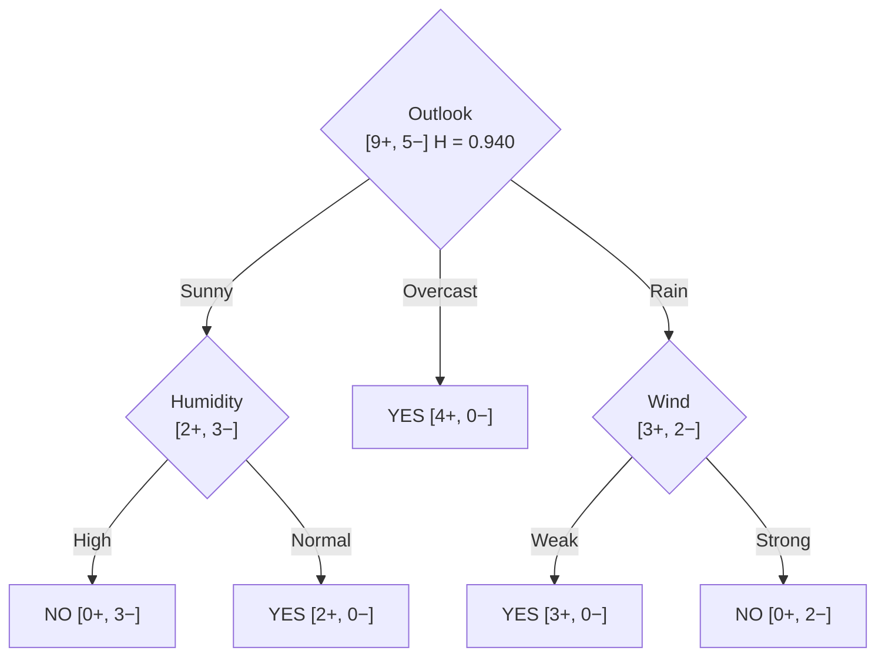
*Fig. 3.4: Final ID3 tree for PlayTennis.*

::: ans Answer
Root = Outlook (gain 0.247). Sunny → Humidity (gain 0.971), Rain → Wind (gain 0.971), Overcast → Yes. Temperature never appears: ID3 found it is not needed. Rules: R1–R5 in Section 3.3.
:::

::: tip Exam-size practice (Buys Laptop, 10 rows)
S = [8+, 2−], H = 0.722. Gains: Age 0.171, Income 0.000, **Student 0.322** → root = Student. Student = Yes → [6+, 0−] leaf Yes. Inside Student = No ([2+, 2−], H = 1): Age gain 1.000, Income 0.000 → Old → Yes, Young → No. Full table in the class notes.
:::

## 3.10 The C4.5 algorithm: gain ratio  ⭐ (End Q3b)

C4.5 (Quinlan, 1993) is the improved successor of ID3 by the same author. What it adds:

| Problem with ID3 | C4.5 fix |
|---|---|
| Prefers attributes with many values | **Gain ratio** (this section) |
| Only symbolic attributes | **Continuous test nodes** with thresholds (3.11) |
| Grows until pure, so it overfits | **Pruning** with a confidence level (3.12) |
| Cannot handle missing values | **Fractional examples** (3.13) |
| Tree only | Can convert the tree to **rule sets** |

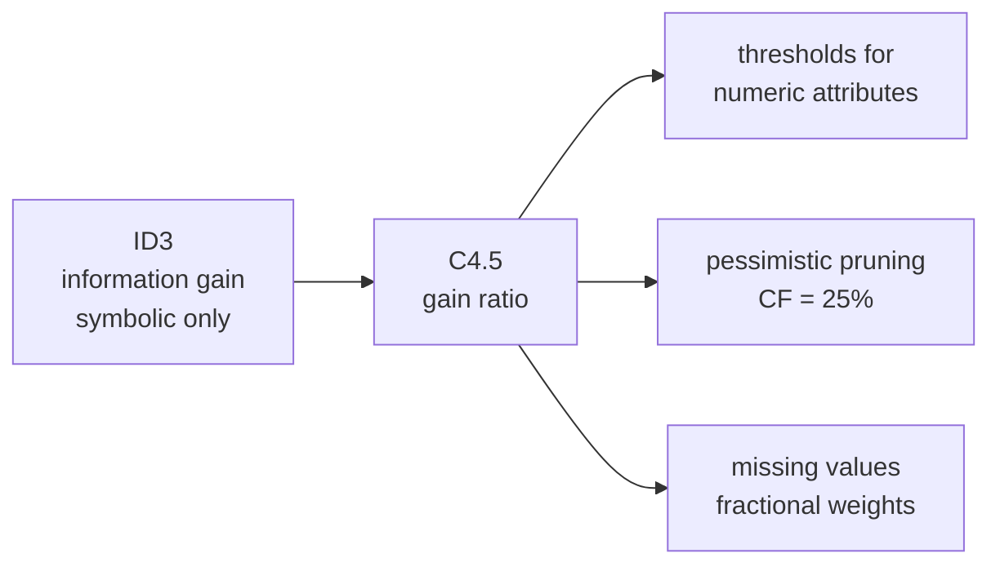
*Fig. 3.5: What C4.5 adds to ID3.*

**Why gain ratio?** An attribute like Date or Roll number splits 14 days into 14 pure groups of one. Its gain is the full 0.940, the maximum possible, yet it is useless for new days. C4.5 divides the gain by how finely the attribute splits the data.

**Definition.** <u>SplitInfo(S, A) = − Σ<sub>v</sub> (|S<sub>v</sub>| / |S|) log<sub>2</sub>(|S<sub>v</sub>| / |S|) and GainRatio(S, A) = Gain(S, A) / SplitInfo(S, A). C4.5 chooses the attribute with the highest gain ratio.</u>

**Gain ratio on PlayTennis (root):**

| Attribute | Subset sizes | SplitInfo | Gain | Gain ratio |
|---|---|---|---|---|
| **Outlook** | 5 / 4 / 5 | 1.577 | 0.247 | **0.156** |
| Temperature | 4 / 6 / 4 | 1.557 | 0.029 | 0.019 |
| Humidity | 7 / 7 | 1.000 | 0.152 | 0.152 |
| Wind | 8 / 6 | 0.985 | 0.048 | 0.049 |

Working: SplitInfo(Outlook) = −(5/14) log<sub>2</sub>(5/14) − (4/14) log<sub>2</sub>(4/14) − (5/14) log<sub>2</sub>(5/14) = 1.577; GainRatio = 0.247 / 1.577 = **0.156**. Outlook is still the root, but Humidity (a 2-way split) is now very close.

- SplitInfo is the entropy of the **split sizes** (it ignores the classes). A 2-way equal split has SplitInfo 1. A 14-way split into single days has log<sub>2</sub> 14 = 3.807, so its gain is divided by a much bigger number.
- If SplitInfo is very small, the ratio blows up. So C4.5 only compares gain ratios of attributes whose gain is at least the average gain.

## 3.11 Continuous test nodes  ⭐ (End Q3b)

**Definition.** <u>A continuous test node tests a numeric attribute A against a threshold t (A ≤ t or A > t). The threshold is chosen from candidate cut points to give the highest information gain (or gain ratio).</u>

**How continuous attributes are handled:**
1. **Sort** the examples by the numeric attribute.
2. **Candidate thresholds** = midpoints between neighbouring values where the **class changes**. (Fayyad and Irani proved the best cut always lies at such a boundary, so other midpoints need not be tested.)
3. For each candidate t, split into A ≤ t and A > t and compute the gain.
4. Choose the t with the highest gain. The node becomes the binary test "A ≤ t?".
5. The numeric attribute stays available: it can be tested **again** lower in the tree with a different threshold.

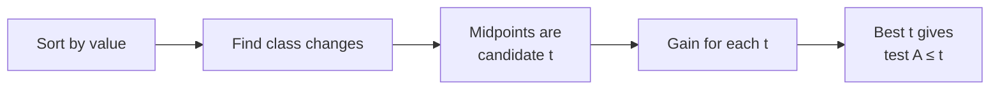
*Fig. 3.6: Choosing a threshold for a numeric attribute.*

**Numerical.** Temperature and PlayTennis for six days: 40 No, 48 No, 60 Yes, 72 Yes, 80 Yes, 90 No. Find the best threshold.

Entropy(S) = H([3+, 3−]) = 1.000. Sorted values: 40 No | 48 No | 60 Yes | 72 Yes | 80 Yes | 90 No.

| Midpoint t | Temp ≤ t | Temp > t | Gain | Class changes here? |
|---|---|---|---|---|
| 44 | [0+, 1−] | [3+, 2−] | 0.191 | no |
| **54** | [0+, 2−] | [3+, 1−] | **0.459** | **yes (candidate)** |
| 66 | [1+, 2−] | [2+, 1−] | 0.082 | no |
| 76 | [2+, 2−] | [1+, 1−] | 0.000 | no |
| 85 | [3+, 2−] | [0+, 1−] | 0.191 | yes (candidate) |

Working for t = 54: Gain = 1.000 − (2/6)(0) − (4/6)(0.811) = 0.459.

::: ans Answer
Only 54 and 85 are candidates (class changes 48→60 and 80→90). Gain(54) = 0.459 > Gain(85) = 0.191, so the test node is **Temperature ≤ 54?** (≤ 54 → No, > 54 → mostly Yes). The non-candidate midpoints all give a smaller gain, which confirms the rule.
:::

::: tip Midpoint or data value?
Mitchell uses the midpoint (54). The C4.5 program uses the largest data value below the cut (48), so the threshold is a value seen in the data. Both give the same split.
:::

## 3.12 Confidence and pruning

**Overfitting** in trees: a tree grown until every leaf is pure also learns the noise. Training error keeps falling, but test error rises. **Pruning** removes branches that do not help on new data.

**Definition.** <u>Pruning replaces a subtree by a leaf (labelled with the majority class) when doing so does not increase the estimated error on unseen data. Pre-pruning stops growth early; post-pruning grows the full tree and then cuts it back.</u>

| Type | How | Example rules |
|---|---|---|
| Pre-pruning (early stopping) | Stop splitting a node early | min examples per node, max depth, gain below a threshold, chi-square test |
| Post-pruning | Grow fully, then cut back | reduced-error pruning, pessimistic (C4.5) pruning, rule post-pruning |

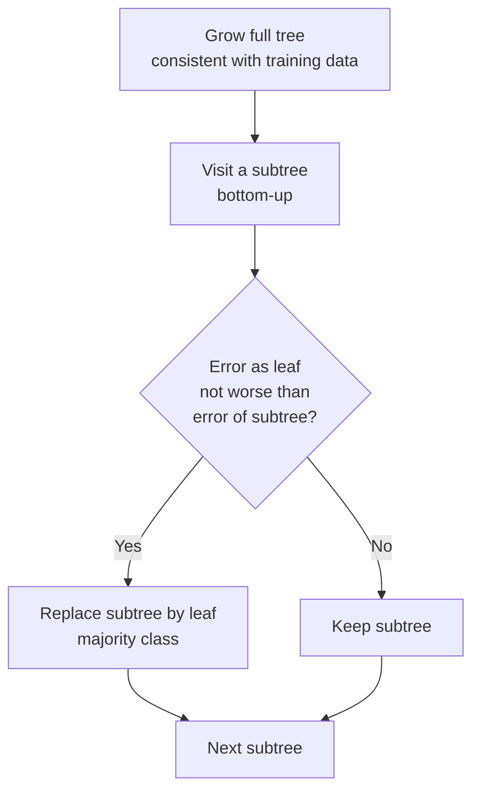
*Fig. 3.7: Post-pruning loop.*

### Reduced-error pruning (Quinlan, Mitchell)
1. Split the data into a **training set** and a separate **validation set**.
2. Grow the tree on the training set.
3. For each internal node, count the validation errors with the subtree, and with the subtree replaced by a leaf.
4. Remove the node whose removal most improves (or does not hurt) validation accuracy.
5. Repeat until further pruning hurts validation accuracy.

*Drawback:* it needs extra data for the validation set, which is costly when data is small.

### Pessimistic pruning with a confidence level (C4.5)
C4.5 does **not** need a validation set. At a leaf that covers N training examples with E errors, the observed error rate f = E/N is too optimistic (the tree was built on this data). So C4.5 uses the **upper limit of a confidence interval** on the true error. The confidence factor **CF = 25%** is the default (z = 0.69, the value used in the Witten–Frank textbook; the exact one-sided normal value for 25% is 0.674, and the decision below is the same).

<u>Pessimistic error estimate: e = [ f + z<sup>2</sup>/2N + z √( f/N − f<sup>2</sup>/N + z<sup>2</sup>/4N<sup>2</sup> ) ] / (1 + z<sup>2</sup>/N). A subtree is replaced by a leaf if the leaf's estimated errors are not more than the sum of the estimated errors of its leaves.</u>

Smaller CF → larger estimates → **more pruning**.

**Numerical (CF = 25%, z = 0.69).** A node has 14 examples [9 of one class, 5 of the other] and three leaves below it:

| Leaf | E / N | f | Estimate e | Estimated errors N × e |
|---|---|---|---|---|
| 1 | 2 / 6 | 0.333 | 0.474 | 2.844 |
| 2 | 1 / 2 | 0.500 | 0.719 | 1.438 |
| 3 | 2 / 6 | 0.333 | 0.474 | 2.844 |
| **Subtree total** | 5 / 14 | | | **7.126** (rate 0.509) |
| **Node as one leaf** | 5 / 14 | 0.357 | 0.449 | **6.284** |

::: ans Answer
The single leaf has fewer estimated errors (6.284 < 7.126), so the subtree is **pruned** and replaced by a leaf with the majority class. Note that both versions make 5 training errors: only the pessimistic estimate shows that the small leaves are unreliable.
:::

**Rule post-pruning** (C4.5rules): convert the tree to rules, drop any precondition whose removal does not worsen the estimated accuracy, then sort the rules by accuracy.

## 3.13 Learning with incomplete data (missing values)

Real data has blanks (a patient's test not done). C4.5 handles a missing value in three places:

| Stage | What C4.5 does |
|---|---|
| Choosing the attribute | Compute the gain using only examples whose value is known, then multiply by F = fraction known: Gain = F × [Entropy(S<sub>known</sub>) − weighted entropy]. |
| Splitting the examples | An example with a missing value goes down **every** branch with a fractional weight = share of known examples in that branch. |
| Classifying a new example | If the tested value is missing, follow all branches and combine the class probabilities, weighted by branch size. |

Simpler alternatives: fill in the **most common value** of that attribute at the node, or the most common value among examples of the **same class**.

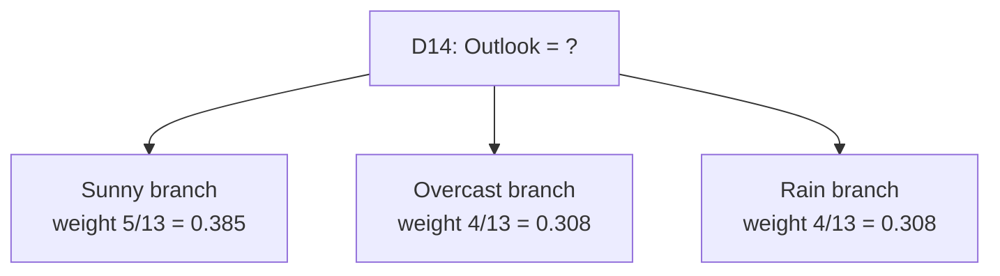
*Fig. 3.8: A missing value is split into fractional examples.*

**Numerical.** In PlayTennis, suppose Outlook of D14 (Rain, No) is missing.

| Step | Working | Value |
|---|---|---|
| Known examples | 13 rows: [9+, 4−] | Entropy = 0.890 |
| Subsets | Sunny [2+, 3−] 0.971 · Overcast [4+, 0−] 0 · Rain [3+, 1−] 0.811 | weighted = 0.623 |
| Gain on known rows | 0.890 − 0.623 | 0.267 |
| F | 13 / 14 | 0.929 |
| **Gain(S, Outlook)** | 0.929 × 0.267 | **0.248** |
| SplitInfo (missing as its own group, sizes 5/4/4/1) | | 1.835 |
| Gain ratio | 0.248 / 1.835 | 0.135 |

## 3.14 Advantages and disadvantages of decision trees  ⭐ (MCQ Q3)

::: tip Earlier mid MCQ
"Which of the following is a disadvantage of decision trees?" Answer: **(C) Decision trees are prone to be overfit.** A tree grown until it is consistent with every noisy example becomes too detailed.
:::

| Advantages | Disadvantages |
|---|---|
| Easy to read and explain; converts to if-then rules | **Prone to overfitting** (deep trees fit noise); needs pruning |
| Fast to classify (a few tests per example) | **Unstable:** a small change in data can give a very different tree |
| Little data preparation; no feature scaling needed | Greedy: may not find the smallest or best tree |
| Handles symbolic and numeric attributes (C4.5) | Axis-parallel splits: poor for diagonal boundaries |
| Handles missing values and noise (C4.5) | Information gain is biased to many-valued attributes |
| Selects relevant attributes automatically | Building an optimal tree is NP-hard |

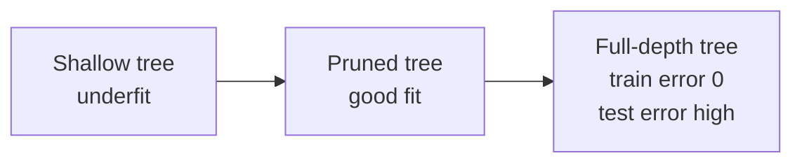
*Fig. 3.9: Tree size and overfitting. Pruning moves a full tree back to the middle.*

## 3.15 Instance-based learning: nearest-neighbour classification

Instance-based learning does almost no work while training: it just **stores** the examples. When a new example comes, it finds the most similar stored examples and copies their answer. Like asking: "Which old customers look most like this new one, and what did they do?"

**Definition.** <u>Instance-based (lazy) learning stores the training examples and postpones generalisation until a query must be classified, using a similarity (distance) measure between the query and the stored instances. The nearest-neighbour (1-NN) rule assigns to a query x<sub>q</sub> the class of the training example closest to it.</u>

| Distance | Formula |
|---|---|
| Euclidean | d(x, y) = √[ Σ<sub>i</sub> (x<sub>i</sub> − y<sub>i</sub>)<sup>2</sup> ] |
| Manhattan (city block) | d(x, y) = Σ<sub>i</sub> abs(x<sub>i</sub> − y<sub>i</sub>) |
| Minkowski | d = ( Σ abs(x<sub>i</sub> − y<sub>i</sub>)<sup>p</sup> )<sup>1/p</sup> (p = 1 Manhattan, p = 2 Euclidean) |

- **Decision regions of 1-NN:** each training point owns the region of space closer to it than to any other point. These cells form a **Voronoi diagram**; the boundary runs along cell edges between points of different classes.
- 1-NN has zero training error (unless two identical points carry different labels) but is sensitive to noise: one wrong label creates a wrong "island".
- **Scale the features first.** If Age is 20–60 and Salary is 20,000–100,000, salary differences swamp age. Use min–max scaling x' = (x − min) / (max − min).

## 3.16 k-nearest neighbour (k-NN)  ⭐ (End Q2)

**Definition.** <u>The k-nearest-neighbour algorithm classifies a query x<sub>q</sub> by finding the k training examples nearest to it (by a distance measure) and assigning the majority class among them. For regression it returns the mean of their values. In distance-weighted k-NN each neighbour votes with weight w = 1/d<sup>2</sup>.</u>

**Algorithm**
1. Choose k and a distance measure (scale the features if needed).
2. Compute the distance from x<sub>q</sub> to **every** training example.
3. **Sort** the distances and take the k smallest.
4. Classification: majority vote of their classes. Regression: average of their values.

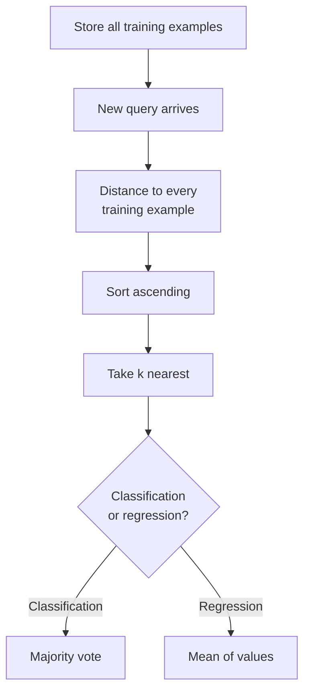
*Fig. 3.10: The k-NN algorithm. Training = storing; all work happens at query time.*

### Why k-NN is called a lazy learner
<u>k-NN is a lazy learner because it builds no model during training: it only stores the training data, and all the computation (distances, sorting, voting) is postponed until a query has to be classified.</u>

| Lazy learner (k-NN) | Eager learner (decision tree, perceptron, SVM) |
|---|---|
| Training: just store the data | Training: builds a model (tree, weights) |
| Classification slow (compare with all examples) | Classification fast |
| Local decision for each query | One global model for all queries |
| Needs memory for all examples | Keeps only the model |
| New data added instantly | Must retrain |

### Points to consider when choosing k

| Point | Why |
|---|---|
| **Odd k** for two classes | Avoids ties in the vote (k = 3, 5, 7). |
| **Rule of thumb k ≈ √n** | n = training size; round to an odd number. For n = 5: √5 = 2.24 → k = 3. |
| **Cross-validation** | Try k = 1, 3, 5, … on validation folds; keep the k with lowest error. |
| **Small k (k = 1)** | Follows every point, sensitive to noise and outliers: high variance, overfitting. |
| **Large k** | Smoother boundary, but includes far-away points of other classes: high bias, underfitting. k = n always predicts the majority class. |
| **k not a multiple of the number of classes** | Reduces ties with 3+ classes. |
| **Feature scaling** | Without it, the feature with the largest range decides the neighbours. |
| **Distance metric** | Euclidean, Manhattan or Minkowski can pick different neighbours. |
| **Weighting** | Distance-weighted voting (1/d<sup>2</sup>) reduces sensitivity to k. |

### Small example (tissue grading, k = 3)
Training: (7, 7) Bad, (7, 4) Bad, (3, 4) Good, (1, 4) Good. Query (3, 7).

| Point | Class | d<sup>2</sup> | d | Rank |
|---|---|---|---|---|
| (3, 4) | Good | 9 | 3.000 | 1 |
| (1, 4) | Good | 13 | 3.606 | 2 |
| (7, 7) | Bad | 16 | 4.000 | 3 |
| (7, 4) | Bad | 25 | 5.000 | 4 |

3 nearest: Good, Good, Bad → **Good**.

| Advantages of k-NN | Disadvantages of k-NN |
|---|---|
| No training time; simple | Slow and memory-hungry at query time |
| Works for any number of classes and for regression | Needs feature scaling and a good k |
| Boundary can take any shape | Irrelevant features spoil the distance (curse of dimensionality) |
| New data added at once | Sensitive to noise when k is small |

## 3.17 End-sem 2025-26 Q2 solved  ⭐ (End Q2, 14 marks)

**Question.** Explain the k-NN algorithm. Why is it also called a lazy learner? What points must be considered when choosing k? Predict the class of Davis using k-NN with k = 3.

| Candidate | Age | Income | Points | Response |
|---|---|---|---|---|
| John | 35 | 35 | 3 | Yes |
| Alex | 22 | 50 | 2 | No |
| Rio | 63 | 200 | 1 | No |
| Tim | 59 | 170 | 1 | No |
| Noa | 25 | 40 | 4 | Yes |
| Davis | 37 | 50 | 2 | ? |

::: ans Answer
**Theory parts:** write the definition, Fig. 3.10 and the 4 algorithm steps (Section 3.16), the lazy-learner definition with the lazy vs eager table, and the "choosing k" table.

**Distance used:** Euclidean, on the raw values, d = √[(Age − 37)<sup>2</sup> + (Income − 50)<sup>2</sup> + (Points − 2)<sup>2</sup>].

**Step 1: differences and squared differences from Davis (37, 50, 2)**

| Candidate | ΔAge | ΔIncome | ΔPoints | (ΔAge)<sup>2</sup> | (ΔIncome)<sup>2</sup> | (ΔPoints)<sup>2</sup> | Sum | d = √Sum |
|---|---|---|---|---|---|---|---|---|
| John | −2 | −15 | 1 | 4 | 225 | 1 | 230 | 15.17 |
| Alex | −15 | 0 | 0 | 225 | 0 | 0 | 225 | 15.00 |
| Rio | 26 | 150 | −1 | 676 | 22500 | 1 | 23177 | 152.24 |
| Tim | 22 | 120 | −1 | 484 | 14400 | 1 | 14885 | 122.00 |
| Noa | −12 | −10 | 2 | 144 | 100 | 4 | 248 | 15.75 |

**Step 2: sort by distance**

| Rank | Candidate | d | Response |
|---|---|---|---|
| 1 | Alex | 15.00 | No |
| 2 | John | 15.17 | Yes |
| 3 | Noa | 15.75 | Yes |
| 4 | Tim | 122.00 | No |
| 5 | Rio | 152.24 | No |

**Step 3: k = 3 nearest** = Alex (No), John (Yes), Noa (Yes).

**Step 4: majority vote** = 2 Yes vs 1 No → **Davis = Yes**.

**Check with scaling.** Min–max normalisation over the five training rows (Age 22–63, Income 35–200, Points 1–4) gives Davis = (0.366, 0.091, 0.333) and distances John 0.349, Alex 0.366, Noa 0.731, Tim 0.963, Rio 1.157. The same three neighbours (John, Alex, Noa) are chosen, only in a different order, so the vote is still 2 Yes vs 1 No → **Yes**. (Manhattan distance also picks Alex 15, John 18, Noa 24.)

**Why k = 3 is sensible here:** n = 5, √5 = 2.24 → nearest odd number 3, and an odd k avoids a tie between Yes and No.
:::

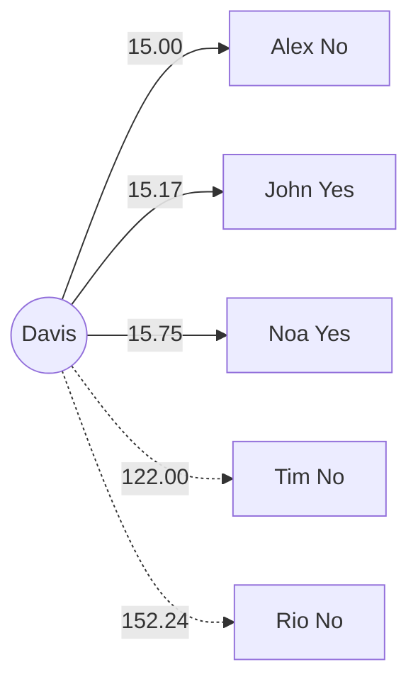
*Fig. 3.11: The three solid edges are the k = 3 nearest neighbours. Vote 2 Yes : 1 No.*

::: warn Common mistakes in this question
- Choosing neighbours before sorting, or sorting on squared distance in one row and distance in another.
- Forgetting the theory parts: lazy learner and choosing k carry about half the marks.
- Not saying whether you scaled. Write one line: "Distances on raw values; min–max scaling gives the same neighbours."
:::

## 3.18 Nearest-neighbour error probability

How good is the simple 1-NN rule? Cover and Hart (1967) answered this for a very large training set.

Let **R*** be the **Bayes error** (the lowest possible error, from Unit 1) and **R** the asymptotic error of the 1-NN rule as the number of training samples n → ∞.

**Definition (Cover–Hart bound).** <u>For two classes, R* ≤ R ≤ 2R*(1 − R*) ≤ 2R*. For c classes, R* ≤ R ≤ R*(2 − c R*/(c − 1)). So with unlimited data the error of the nearest-neighbour rule is never more than twice the Bayes error.</u>

**Why (idea):** for a huge n, the nearest neighbour x' of a query x is almost at x, so it has the same posteriors P(ω|x). The 1-NN rule then picks a class at random with these probabilities instead of always picking the most probable one. For two classes with P(ω<sub>1</sub>|x) = p, error at x = p(1 − p) + (1 − p)p = 2p(1 − p), which is at most twice min(p, 1 − p), the Bayes error at x.

| Bayes error R* | Upper bound 2R*(1 − R*) (two classes) | Simple bound 2R* |
|---|---|---|
| 0.05 | 0.095 | 0.10 |
| 0.10 | 0.180 | 0.20 |
| 0.20 | 0.320 | 0.40 |

Example for three classes, R* = 0.1: R ≤ 0.1 × (2 − 1.5 × 0.1) = 0.185.

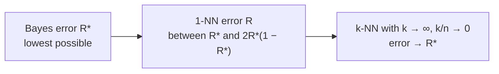
*Fig. 3.12: Where the nearest-neighbour error lies.*

- "**Half the information is in the nearest neighbour**" (Cover and Hart): with an infinite training set, the single nearest neighbour already carries at least half of the classification information, because the 1-NN error is never more than twice the best possible (Bayes) error.
- If R* = 0 (classes do not overlap), the 1-NN error also tends to 0.
- For k-NN, as k → ∞ and k/n → 0, the error approaches R* itself.
- The bound holds only **asymptotically** (n → ∞). With small n, the error can be much worse.

## Exam checklist for Unit 3
- [ ] Decision tree definition, PlayTennis tree diagram, inference path for one example, tree as if-then rules
- [ ] Five "general domains" properties; symbolic, Boolean and numeric attributes
- [ ] Consistency definition; why a consistent tree can still overfit
- [ ] Top-down induction steps and flowchart
- [ ] Entropy formula (log base 2); [9+, 5−] = 0.940, [2+, 3−] = 0.971
- [ ] Information gain = mutual information; Gain(Outlook) = 0.247 both ways
- [ ] ID3 pseudocode and criterion; full PlayTennis tree: Outlook 0.247 → Humidity 0.971 / Wind 0.971
- [ ] C4.5: SplitInfo(Outlook) = 1.577, GainRatio = 0.156; what C4.5 adds over ID3
- [ ] Continuous attribute: sort, midpoints at class changes, Temperature ≤ 54 with gain 0.459
- [ ] Pruning: pre vs post, reduced-error pruning, pessimistic pruning with CF = 25% (6.284 < 7.126 → prune)
- [ ] Missing values: Gain × F (0.248), fractional examples 5/13, 4/13, 4/13
- [ ] Advantages and disadvantages of trees; "prone to overfit" MCQ
- [ ] Lazy vs eager learner; distance formulas; feature scaling; Voronoi regions
- [ ] k-NN algorithm and "choosing k" table (odd k, √n, cross-validation, small vs large k, scaling, metric)
- [ ] End Q2: Davis distances 15.17 / 15.00 / 152.24 / 122.00 / 15.75 → Alex, John, Noa → **Yes**
- [ ] Cover–Hart: R* ≤ R ≤ 2R*(1 − R*) ≤ 2R*; R* = 0.1 gives R ≤ 0.18
