# Unit 4 · Learning Theory, Model Selection and Ensembles

> **Exam weight:** about 12.5% of the 2025-26 end-sem (14 marks): three of the four "differentiate" pairs in Q7 (approximation vs estimation error, bias vs variance, overfitting vs underfitting) and the short note on hypothesis class in Q6. Overfitting vs underfitting was also asked in the earlier mid (Q7 i). PAC learning, VC dimension, Occam's razor, bagging and boosting have **never been asked**, so the theory half of this unit is overdue.

**Prefer to watch first?** [Video lectures for Unit 4 →](#videos/unit4)

Unit 1 asked "how do we build a classifier?". Unit 4 asks the deeper questions: **when can a machine learn at all, how much data does it need, why does it fail, and how do we measure and improve it?** Every number on this page was checked by computer.

**Notation used on this page:** D = training set of m (or N) examples, H = hypothesis class, h = one hypothesis, L(h) = true error (risk) of h on new data, LD(h) = training (empirical) error, ε = accuracy parameter, δ = confidence parameter, ln = natural log.

## 4.1 Learning theory: what it studies

<u>Computational learning theory is the branch of machine learning that studies, mathematically, which concepts can be learned, how many training examples are needed, how much computation is needed, and how close the learned hypothesis will be to the true concept.</u>

It answers four questions:

| Question | Answered by |
|---|---|
| Can this kind of concept be learned at all? | PAC learnability (4.2) |
| How many examples are enough? | Sample complexity (4.3, 4.5) |
| How rich is my hypothesis class? | VC dimension (4.5) |
| Why does my learner fail, and what can I trade? | Approximation vs estimation error, bias vs variance (4.8, 4.9) |

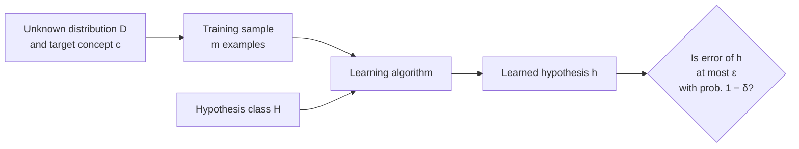
*Fig. 4.1: The learning-theory set-up.*

**Concept learning ⭐ (Mid MCQ Q4).** <u>Concept learning is acquiring the definition of a general category (a boolean function) from given positive and negative training examples of that category.</u> (The mid MCQ answer is TRUE.) Example: learn "days on which Aldo enjoys sport" from labelled days.

## 4.2 Formal model of the learnable: PAC learning

**Idea in simple words.** We cannot demand that the learner be *perfect* (the sample may be unlucky) or *always* right (it sees only m examples). So we ask for the next best thing: with **high probability** (1 − δ) the learner outputs a hypothesis that is **approximately correct** (error ≤ ε). Hence the name **Probably Approximately Correct** (Valiant, 1984).

<u>A concept class C is PAC-learnable by learner L using hypothesis class H if, for every target concept c in C, every distribution D over the inputs, and every ε and δ between 0 and ½, L outputs, with probability at least 1 − δ, a hypothesis h in H with true error L(h) ≤ ε, using a number of examples and amount of time polynomial in 1/ε, 1/δ, n (input size) and size(c).</u>

| Symbol | Name | Meaning |
|---|---|---|
| ε | accuracy (error) parameter | "approximately correct": error at most ε |
| δ | confidence parameter | "probably": failure chance at most δ |
| 1 − δ | confidence | e.g. δ = 0.05 means 95% sure |
| m | sample size | number of i.i.d. training examples |
| L(h) = Px∼D[h(x) ≠ c(x)] | true error | chance h is wrong on a new random example |

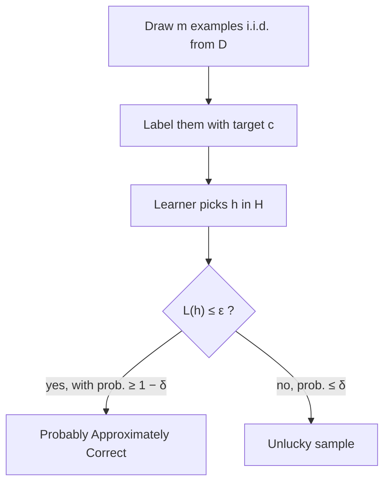
*Fig. 4.2: The PAC criterion.*

**Two assumptions of PAC:** (1) training and test examples come from the **same** distribution D, and (2) they are drawn **independently** (i.i.d.). PAC is **distribution-free**: the guarantee must hold for every D.

## 4.3 Sample complexity

<u>Sample complexity is the number of training examples a learner needs so that, with probability at least 1 − δ, its learned hypothesis has true error at most ε.</u>

Sample complexity grows when we want **more accuracy** (smaller ε), **more confidence** (smaller δ), or use a **bigger hypothesis class** H.

### 4.3.1 Finite hypothesis class, realizable case: the bound

For a **consistent learner** (one that outputs any h in H with zero training error) and a finite H that contains the target:

**m ≥ (1/ε) (ln|H| + ln(1/δ))**

**Why (proof sketch, 5 lines).**
1. Call h "bad" if L(h) > ε. A bad h agrees with one random example with probability < 1 − ε.
2. It agrees with all m examples (so looks perfect) with probability < (1 − ε)m ≤ e−εm.
3. There are at most |H| bad hypotheses, so P(some bad h looks perfect) ≤ |H| e−εm (union bound).
4. Make this ≤ δ: |H| e−εm ≤ δ.
5. Take logs: m ≥ (1/ε)(ln|H| + ln(1/δ)).

### 4.3.2 Numerical: PAC sample size

**Question.** A consistent learner uses a finite hypothesis class with |H| = 1000. How many examples guarantee true error at most ε = 0.1 with confidence 95% (δ = 0.05)? Also find m when ε = 0.05, when δ = 0.01, and when |H| = 106.

**Formula:** m ≥ (1/ε)(ln|H| + ln(1/δ)), natural logarithm, round **up**.

| Case | ε | δ | \|H\| | ln\|H\| | ln(1/δ) | Sum | (1/ε) × sum | **m** |
|---|---|---|---|---|---|---|---|---|
| Base | 0.1 | 0.05 | 1000 | 6.9078 | 2.9957 | 9.9035 | 99.035 | **100** |
| Halve ε | 0.05 | 0.05 | 1000 | 6.9078 | 2.9957 | 9.9035 | 198.070 | **199** |
| More confidence | 0.1 | 0.01 | 1000 | 6.9078 | 4.6052 | 11.5129 | 115.129 | **116** |
| Bigger H | 0.1 | 0.05 | 106 | 13.8155 | 2.9957 | 16.8112 | 168.112 | **169** |
| Conjunctions of 10 boolean literals | 0.1 | 0.05 | 310 = 59049 | 10.9861 | 2.9957 | 13.9819 | 139.819 | **140** |

::: tip Answer
**m = 100 examples** for ε = 0.1, δ = 0.05, |H| = 1000. Read the table: halving ε **doubles** m (1/ε), but making H a thousand times bigger only adds 69 examples (ln|H|), and going from 95% to 99% confidence adds 16 (ln(1/δ)).
:::

**Reverse use.** With m = 200 examples (|H| = 1000, δ = 0.05): ε = (ln 1000 + ln 20)/200 = 9.9035/200 = **0.0495**, so the error is guaranteed below about 5%.

**Agnostic (non-realizable) case.** If no h in H is perfect, the bound becomes m ≥ (1/(2ε2))(ln(2|H|) + ln(1/δ)). For ε = 0.1, δ = 0.05, |H| = 1000 this gives (7.6009 + 2.9957)/0.02 = 529.83, so **530** examples, far more, because of the 1/ε2. (This m makes every training error within ε of its true error, so ERM's h is within 2ε of the best h in H.)

## 4.4 Learning in the zero-Bayes (realizable) case

<u>The realizable (zero-Bayes) case is the situation where the target concept itself belongs to the hypothesis class H, so some h* in H has zero true error and the Bayes error is zero (labels are a deterministic function of x, with no noise).</u>

| Point | Realizable (zero-Bayes) case | Agnostic (non-realizable) case |
|---|---|---|
| Target c in H? | Yes | Not necessarily |
| Noise in labels | None (Bayes error = 0) | Possible (Bayes error ≥ 0) |
| Best achievable error | 0 | min over H of L(h), usually > 0 |
| What the learner does | Output any **consistent** h (training error 0) | Output h with **smallest** training error (ERM) |
| Sample complexity | ∝ 1/ε | ∝ 1/ε2 |
| Example | Separable data and a perceptron | Overlapping classes |

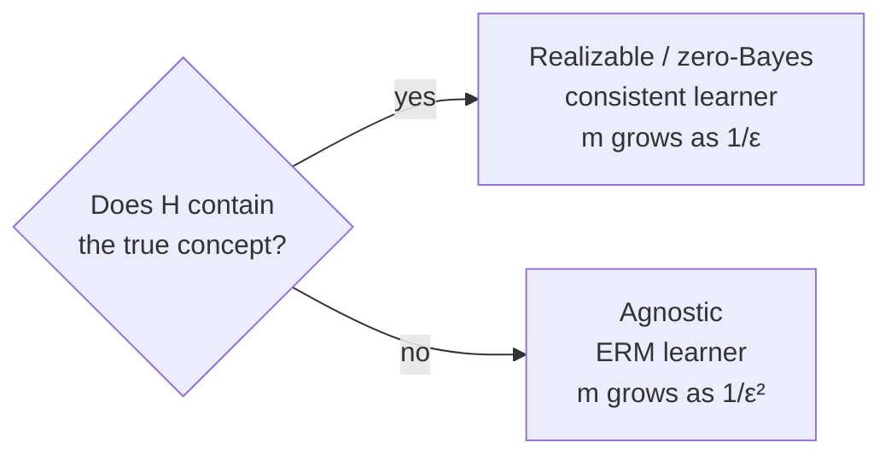
*Fig. 4.3: Realizable vs agnostic learning.*

**Version space.** In the realizable case, the set of all hypotheses in H consistent with the training data is the **version space**. Any member of it is a valid output, and the PAC bound of 4.3 says that after enough examples every member of the version space has error ≤ ε (the version space is "ε-exhausted").

## 4.5 VC dimension

The bound in 4.3 uses ln|H|. But a perceptron or an SVM has **infinitely many** hypotheses (every real w). We need another way to measure the size (capacity) of H: the **VC dimension** (Vapnik and Chervonenkis).

**Shattering.** <u>A set of n points is shattered by H if, for every one of the 2n ways of labelling the points + and −, some hypothesis in H separates them exactly.</u>

**VC dimension.** <u>The VC dimension of H, VC(H), is the size of the largest set of points that H can shatter. If arbitrarily large sets can be shattered, VC(H) = ∞.</u>

::: warn How to prove VC(H) = d (two halves)
1. **≥ d:** show **one** set of d points that H shatters (you may choose the points).
2. **< d + 1:** show that **no** set of d + 1 points can be shattered (one bad labelling for every placement).
:::

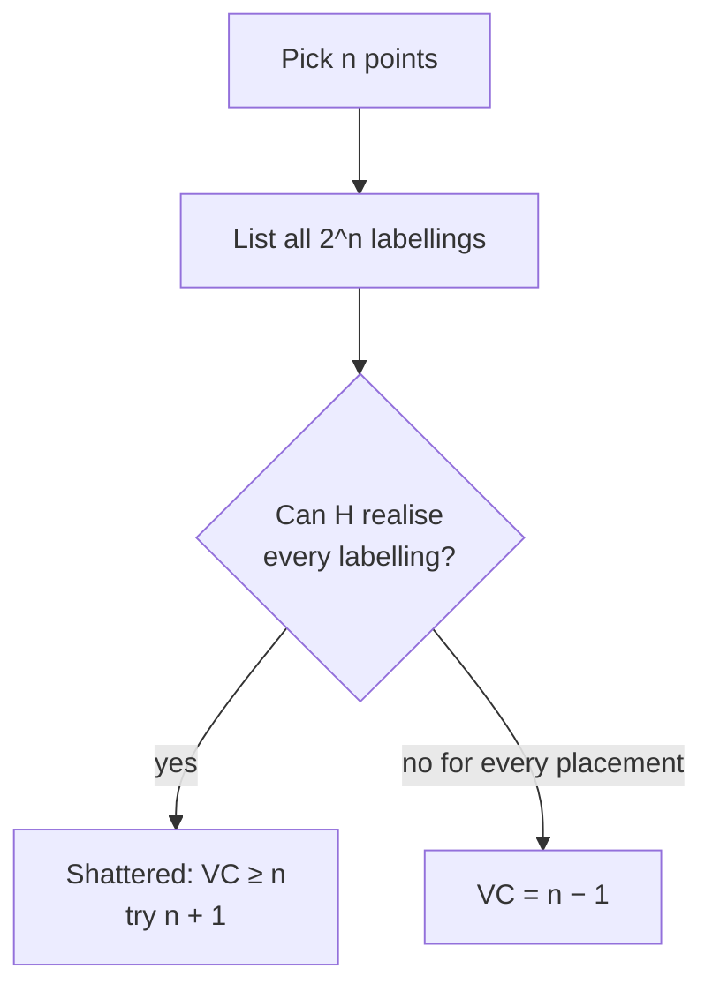
*Fig. 4.4: Finding the VC dimension.*

### 4.5.1 Thresholds on a line: VC = 1

H = { ht(x) = + if x ≥ t, else − }.
- **1 point is shattered:** put t left of it (+) or right of it (−). Both labellings ✓.
- **2 points x1 < x2 cannot be shattered:** the labelling (x1 = +, x2 = −) is impossible, because if x1 ≥ t then x2 ≥ t too.
- **VC = 1.**

### 4.5.2 Intervals on a line: VC = 2

H = { h(x) = + if a ≤ x ≤ b, else − }.
- **2 points shattered:** (−,−) empty interval, (+,−), (−,+), (+,+) each by a suitable interval ✓.
- **3 points x1 < x2 < x3 cannot be shattered:** (+, −, +) is impossible, because an interval containing x1 and x3 must contain x2.
- **VC = 2.**

### 4.5.3 Lines (half-planes) in 2-D: VC = 3

H = { h(x) = sign(w1x1 + w2x2 + b) }, the perceptron of Unit 2.
- **3 points (not on one line) are shattered:** all 23 = 8 labellings work. The all-same labellings use a line with all points on one side; each "one point different" labelling cuts off that single corner of the triangle.
- **No 4 points can be shattered:**
  - If the 4 points form a convex quadrilateral, label the diagonals alike: A, C = + and B, D = −. This is the **XOR pattern** of Unit 2, and no single line separates it.
  - If one point lies inside the triangle of the other three, label the inside point − and the three corners +. Any half-plane containing the three corners contains the whole triangle, so it contains the inside point too.
- **VC = 3.** In general, half-spaces in d dimensions have **VC = d + 1** (the number of weights including the bias).

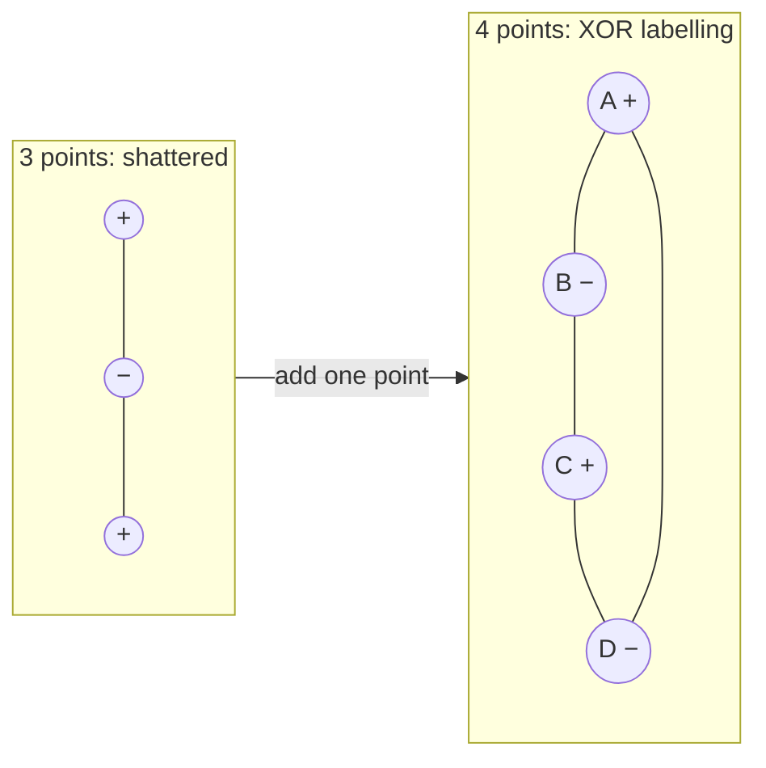
*Fig. 4.5: With 4 points, the diagonal (XOR) labelling cannot be split by one line.*

### 4.5.4 Counting labellings (growth function)

| n points | All labellings 2n | Thresholds can make (n + 1) | Intervals can make (n(n+1)/2 + 1) |
|---|---|---|---|
| 1 | 2 | 2 | 2 |
| 2 | 4 | 3 | 4 |
| 3 | 8 | 4 | 7 |
| 4 | 16 | 5 | 11 |
| 5 | 32 | 6 | 16 |

Thresholds fall short of 2n from n = 2 (so VC = 1); intervals from n = 3 (so VC = 2). Once n passes the VC dimension, the number of labellings grows only **polynomially**, and that is what makes learning possible.

### 4.5.5 VC dimension and sample complexity

For an infinite class with VC(H) = d, the realizable-case bound becomes
**m ≥ (1/ε)(4 log2(2/δ) + 8d log2(13/ε))** (Blumer et al.). Do not memorise the constants. Remember: **sample complexity grows roughly linearly with the VC dimension**, which plays the role ln|H| played for finite classes.

| Hypothesis class | VC dimension |
|---|---|
| Thresholds on a line | 1 |
| Intervals on a line | 2 |
| Lines (half-planes) in 2-D | 3 |
| Hyperplanes in d dimensions | d + 1 |
| Axis-aligned rectangles in 2-D | 4 |
| Finite class H | at most log2\|H\| |
| sin(ωx) classifiers, 1-NN | ∞ |

## 4.6 Fundamental algorithm-independent concepts

These ideas hold for **every** learning algorithm, whether tree, network or SVM.

| Concept | One-line meaning |
|---|---|
| Hypothesis class H | the menu of rules the learner may choose from |
| Target class C | the set of possible true concepts nature may use |
| Inductive bias | the assumptions that let the learner go beyond the data |
| Occam's razor | prefer the simplest hypothesis that fits |
| Empirical risk | error measured on the training data |
| No Free Lunch | no learner is best on all possible problems |
| Bias–variance, approx.–estimation trade-off | richer H fits better but needs more data |

**No Free Lunch theorem.** <u>Averaged over all possible target functions, every learning algorithm has the same expected error on unseen data.</u> So a learner is good only because its **inductive bias matches the problem**. This is why we need prior assumptions and model selection.

### 4.6.1 Hypothesis class  ⭐ (End Q6)

<u>A hypothesis h is one candidate function that maps an input x to an output y. The hypothesis class (hypothesis space) H is the set of all hypotheses the learning algorithm is allowed to choose from, fixed before seeing the data.</u>

**Short note (3.5 marks):**
- H is the learner's "menu". The algorithm searches H for the h with the lowest cost on the training data.
- **Examples:** linear regression: all straight lines h(x) = w1x + w0; perceptron: all half-planes; decision trees: all trees of depth ≤ 3; k-NN: no fixed formula, the data itself.
- **Choosing H is a trade-off.** Too small (only lines for a curved pattern): no h fits, high **approximation error**, underfitting. Too large (degree-9 polynomials): fits noise, high **estimation error**, needs more data, overfitting.
- **Size of H** is measured by |H| (finite) or by its **VC dimension** (infinite), and decides the sample complexity.
- Choosing H is the learner's **inductive bias** (restriction bias).

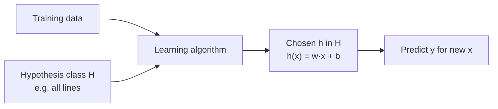
*Fig. 4.6: The hypothesis class is fixed first, the data picks h from it.*

### 4.6.2 Target class

<u>The target concept c is the true (unknown) function that labels the data. The target class (concept class) C is the set of all target concepts that nature might be using.</u>

| Hypothesis class H | Target class C |
|---|---|
| Chosen by **us** (the designer) | Chosen by **nature** (unknown) |
| What the learner can output | What the truth could be |
| Example: all lines | Example: all circles |

- If **C ⊆ H**: the realizable case (4.4), zero approximation error.
- If C is not inside H: some error remains however much data we have (approximation error, 4.8).

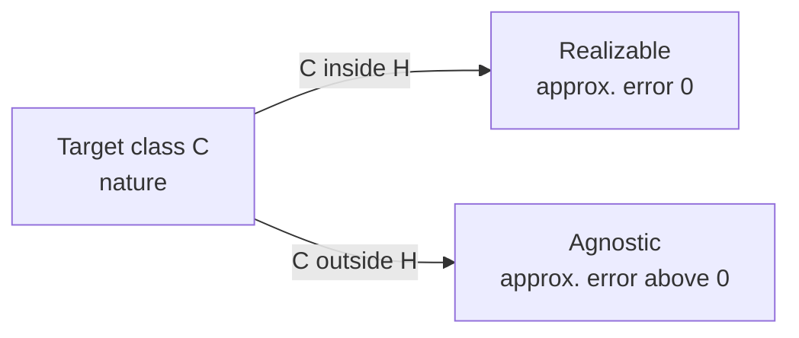
*Fig. 4.7: The relation between C and H decides the case.*

### 4.6.3 Inductive bias

<u>The inductive bias of a learning algorithm is the set of assumptions the learner uses to predict outputs for inputs it has never seen.</u>

Without some bias, a learner can only memorise; it has no reason to prefer one label over another for a new x (No Free Lunch).

| Type | Meaning | Example |
|---|---|---|
| **Restriction (language) bias** | limits **which** hypotheses are allowed | perceptron: only linear boundaries |
| **Preference (search) bias** | allowed to consider all, but **prefers** some | ID3: prefers short trees, high-gain attributes near the root |

| Algorithm | Its inductive bias |
|---|---|
| Perceptron / linear SVM | classes are linearly separable |
| SVM | the maximum-margin boundary is best |
| ID3 (Unit 3) | shorter trees are better (Occam) |
| k-NN (Unit 3) | nearby points have the same class |
| Naive Bayes | features are independent given the class |

### 4.6.4 Occam's razor

<u>Occam's razor: among all hypotheses that are consistent with the data, prefer the simplest one.</u>

**Why it works (learning-theory reason):** there are few simple hypotheses, so ln|H| is small. A short hypothesis that fits the data is unlikely to fit by **coincidence**, so it probably generalises. A complex one can fit almost anything, including noise.

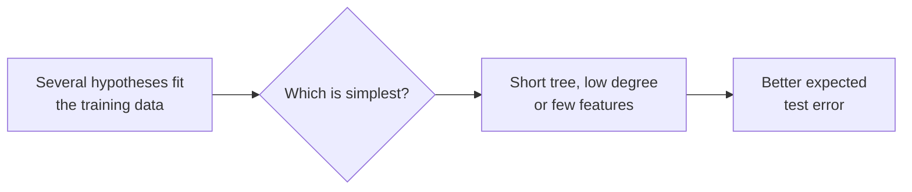
*Fig. 4.8: Occam's razor as a selection rule.*

**Used in:** ID3 (short trees), tree pruning, regularisation, MDL (minimum description length), SRM (4.11). **Caution:** "simple" depends on the representation, and the simplest model can underfit if it is too simple.

### 4.6.5 Empirical risk and ERM

<u>The empirical risk of a hypothesis h is its average loss on the training set: LD(h) = (1/m) Σi=1m ℓ(h(xi), yi). The true risk is its expected loss on new data: L(h) = E[ℓ(h(x), y)].</u>

<u>Empirical Risk Minimisation (ERM) is the learning rule that chooses the hypothesis in H with the smallest empirical risk: hERM = argminh∈H LD(h).</u>

| Empirical risk LD(h) | True risk L(h) |
|---|---|
| measured on the training set | expected over the whole distribution |
| can be computed | unknown, only estimated |
| optimistic (too low) when H is rich | what we actually care about |

**ERM can overfit.** If H contains "memorise the training set", ERM picks it (empirical risk 0, true risk high). Remedies: restrict H (inductive bias), or add a complexity penalty (**SRM**, 4.11, regularisation).

## 4.7 Limitations of inference machines

<u>An inference machine (a learner) can only generalise as well as its data, its hypothesis class and its assumptions allow: no learner can be correct on all problems, learn from too few examples, or remove noise that is in the data.</u>

| Limitation | What it means |
|---|---|
| **No Free Lunch** | no algorithm is best for all problems |
| **Bayes error** | noise and overlapping classes give an error floor no learner can beat |
| **Finite data** | estimation error, overfitting, need for large m |
| **Wrong hypothesis class** | approximation error, underfitting |
| **Curse of dimensionality** | data needed grows exponentially with features |
| **Computational limits** | some ERM problems are NP-hard (e.g. best small decision tree) |
| **Distribution shift** | PAC assumes test data = training distribution |
| **Garbage in, garbage out** | biased or wrong labels give biased results |

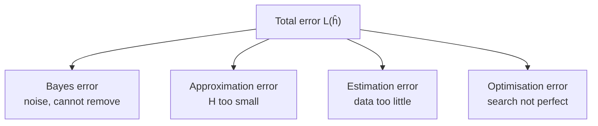
*Fig. 4.9: Where the error of any learner comes from.*

## 4.8 Approximation error vs estimation error  ⭐ (End Q7a)

Let **hB** = the Bayes (best possible) classifier, **h\*** = the best hypothesis **inside** H, **ĥ** = the hypothesis actually learned from the m examples. Then

**L(ĥ) = L(hB) + [L(h\*) − L(hB)] + [L(ĥ) − L(h\*)]**
**= Bayes error + approximation error + estimation error**

(Shalev-Shwartz writes it as L(ĥ) = εapp + εest, with the Bayes error inside εapp.)

<u>Approximation error is the error of the best hypothesis in H over the best possible error: it is caused by the hypothesis class being too restricted.</u>
<u>Estimation error is the extra error of the learned hypothesis over the best in H: it is caused by learning from a finite training sample.</u>

| Point | Approximation error | Estimation error |
|---|---|---|
| Definition | L(h\*) − L(hB) | L(ĥ) − L(h\*) |
| Cause | H too small or too simple | finite, noisy training set |
| Depends on | choice of H only | m (data) and size / VC of H |
| Bigger (richer) H | **decreases** | **increases** |
| More training data | no change | **decreases** |
| Linked to | bias, underfitting | variance, overfitting |
| Fixed by | richer model, better features | more data, simpler H, regularisation |

**Small example (illustrative numbers).** Bayes error 0.05, best line in H has error 0.12, learned line has error 0.18. Approximation error = 0.12 − 0.05 = **0.07**, estimation error = 0.18 − 0.12 = **0.06**, total excess error = **0.13**.

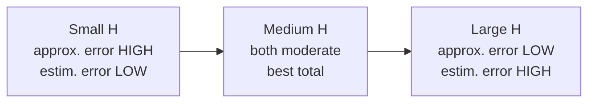
*Fig. 4.10: Hypothesis-class size trades the two errors.*

## 4.9 The trade-off

<u>The approximation–estimation (bias–complexity) trade-off: enlarging the hypothesis class reduces approximation error but increases estimation error, so the best class is one of intermediate complexity for the amount of data available.</u>

| Model complexity → | Low | Medium | High |
|---|---|---|---|
| Training error | high | low | very low |
| Test error | high | **lowest** | high |
| Approximation error / bias | high | moderate | low |
| Estimation error / variance | low | moderate | high |
| Diagnosis | underfitting | good fit | overfitting |

The total test error is therefore **U-shaped** in model complexity. Tools that find the bottom of the U: **cross-validation (4.10)** and **SRM (4.11)**.

### 4.9.1 Bias vs variance  ⭐ (End Q7c)

<u>Bias is the error from wrong or too simple assumptions: how far the average prediction (over many training sets) is from the truth.</u>
<u>Variance is the error from sensitivity to the particular training set: how much the prediction changes when the training set changes.</u>

For squared-error loss: **Expected test error = Bias2 + Variance + Irreducible noise σ2**

| Point | Bias | Variance |
|---|---|---|
| Meaning | systematic error of the average model | spread of models over different training sets |
| Archer analogy | sight set wrong: misses the same way every time | shaky hands: arrows scattered |
| Comes from | too simple model, strong assumptions | too complex model, too little data |
| High value gives | underfitting | overfitting |
| Training error | high | low |
| Gap train vs test | small | large |
| More complexity | decreases | increases |
| More data | no change | decreases |
| Example | straight line on curved data | degree-15 polynomial, 1-NN, deep tree |
| Reduce by | richer model, more features | more data, regularisation, pruning, **bagging** |

| | Low variance | High variance |
|---|---|---|
| **Low bias** | Ideal: accurate and stable | Overfitting: right on average, changes a lot |
| **High bias** | Underfitting: stable but wrong | Worst: wrong and unstable |

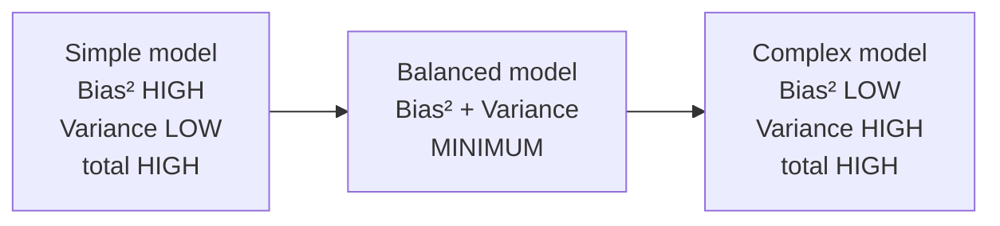
*Fig. 4.11: The U-shaped total-error curve. Bias² falls and variance rises as complexity grows. In the exam, draw x-axis = model complexity, y-axis = error, a falling Bias² curve, a rising Variance curve, and their sum as a U with the optimum at the bottom.*

### 4.9.2 Overfitting vs underfitting  ⭐⭐ (End Q7d, Mid Q7 i)

<u>Overfitting: the model learns the noise and details of the training data, so training error is very low but test error is high.</u>
<u>Underfitting: the model is too simple to capture the real pattern, so both training and test error are high.</u>

| Point | Underfitting | Overfitting |
|---|---|---|
| Meaning | too simple, misses the pattern | too complex, memorises noise |
| Training error | **high** | **very low** (near 0) |
| Test error | **high** | **high** (much higher than training) |
| Generalisation gap | small | large |
| Bias / variance | high bias, low variance | low bias, high variance |
| Causes | too few features, too simple model, too little training, too much regularisation | too complex model, too many features, too little data, noisy data, training too long |
| Example | straight line through curved data | deep decision tree with one leaf per sample, 1-NN |
| Remedies | richer model, better features, train longer, less regularisation | more data, simpler model, feature selection, regularisation, pruning, early stopping, cross-validation, bagging |

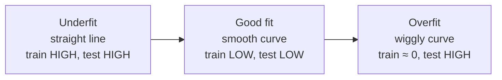
*Fig. 4.12: Model complexity increases from left to right. Draw the three small curves through the same noisy points in the exam.*

::: warn Do not mix the directions
Underfitting ↔ **high bias** ↔ high **approximation** error. Overfitting ↔ **high variance** ↔ high **estimation** error. Bigger H moves you to the right in every diagram above.
:::

## 4.10 Statistical model selection

<u>Model selection is choosing, using data, the best hypothesis class or hyper-parameter (degree of polynomial, k in k-NN, depth of tree, C in SVM) by estimating the generalisation error of each candidate on data not used for training.</u>

**Golden rule:** never judge a model on the data it was trained on. Training error is optimistic.

### 4.10.1 Hold-out method

1. Shuffle the labelled data.
2. Split it into a **training set** (e.g. 70%) and a **validation/test set** (30%). For 1000 examples: 700 train, 300 test.
3. Train each candidate model on the training part.
4. Measure the error on the hold-out part and choose the model with the lowest error.
5. (Optional) retrain the chosen model on all data.

**Good:** simple and fast. **Bad:** wastes data, and the estimate depends on one lucky or unlucky split (high variance).

For a fair final report use **three** parts: train (fit weights), validation (choose model), test (report once).

### 4.10.2 k-fold cross-validation

1. Split the data into k equal folds (k = 5 or 10).
2. For i = 1 … k: train on the other k − 1 folds, test on fold i, record error ei.
3. CV error = (1/k) Σ ei.
4. Repeat for every candidate model and choose the lowest CV error.

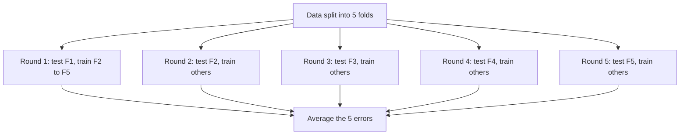
*Fig. 4.13: 5-fold cross-validation.*

**Example.** Fold errors 0.12, 0.10, 0.15, 0.11, 0.12. CV error = 0.60/5 = **0.12** (sample standard deviation, dividing by k − 1 = 4: 0.0187).

| Method | Data used for training | Cost | Reliability |
|---|---|---|---|
| Hold-out | ~70% once | 1 training | low (one split) |
| k-fold CV | (k − 1)/k each round | k trainings | high |
| Leave-one-out (k = m) | m − 1 each round | m trainings | almost unbiased, expensive |

## 4.11 Structural risk minimisation (SRM)

**Idea.** ERM alone overfits; a richer class always has lower training error. SRM (Vapnik) adds a **complexity penalty** and picks the class where **training error + penalty** is smallest.

<u>Structural risk minimisation chooses a hypothesis by minimising an upper bound on the true risk, equal to the empirical risk plus a capacity (VC-dimension) term, over a nested sequence of hypothesis classes H1 ⊂ H2 ⊂ H3 ⊂ … of increasing VC dimension.</u>

**Vapnik bound** (with probability ≥ 1 − η):
R(h) ≤ Remp(h) + √{ [ d (ln(2N/d) + 1) − ln(η/4) ] / N }, with d = VC dimension, N = number of examples.

**Steps:**
1. Build nested classes H1 ⊂ H2 ⊂ … (e.g. polynomials of degree 1, 2, 3, …).
2. In each class, find the ERM hypothesis (lowest training error).
3. Add the confidence (capacity) term for that class's VC dimension.
4. Choose the class with the **smallest bound**.

**Numerical (illustrative).** N = 1000, η = 0.05, polynomial threshold classifiers in 1-D (VC = degree + 1); training errors are assumed.

| Degree | VC d | Training error | Confidence term | **Bound** |
|---|---|---|---|---|
| 1 | 2 | 0.30 | 0.1421 | 0.4421 |
| 2 | 3 | 0.18 | 0.1640 | 0.3440 |
| 3 | 4 | 0.10 | 0.1823 | 0.2823 |
| 5 | 6 | 0.06 | 0.2127 | **0.2727** |
| 10 | 11 | 0.04 | 0.2695 | 0.3095 |
| 20 | 21 | 0.02 | 0.3479 | 0.3679 |

::: tip Answer
SRM picks **degree 5** (bound 0.2727). ERM alone would pick degree 20 (lowest training error 0.02), which overfits.
:::

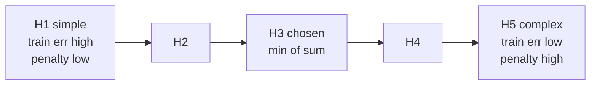
*Fig. 4.14: SRM over nested classes. The SVM does SRM by maximising the margin (Unit 5).*

| ERM | SRM |
|---|---|
| minimises training error only | minimises training error + capacity term |
| one fixed H | nested sequence of H's |
| may overfit with rich H | controls overfitting |
| e.g. plain least squares | e.g. SVM, ridge regression, pruning |

## 4.12 Bootstrapping

<u>Bootstrapping is a resampling method that creates many new training sets, each of the same size m, by drawing examples from the original data uniformly at random with replacement, and uses them to estimate the accuracy or variability of a statistic or model.</u>

**Steps:**
1. From data of size m, draw m examples **with replacement** (a bootstrap sample; some repeat, some are missing).
2. Train the model (or compute the statistic) on it.
3. The examples **not drawn** are the **out-of-bag (OOB)** set: test on them.
4. Repeat B times (e.g. 100) and average.

**How much is missed?** P(an example is never drawn) = (1 − 1/m)m → 1/e = **0.368**.

| m | (1 − 1/m)m = left out | Included (unique) |
|---|---|---|
| 5 | 0.3277 | 0.6723 |
| 10 | 0.3487 | 0.6513 |
| 100 | 0.3660 | 0.6340 |
| 1000 | 0.3677 | 0.6323 |

So each bootstrap sample contains about **63.2%** of the distinct examples; the other **36.8%** are a free (out-of-bag) test set. The ".632 bootstrap" error estimate uses these numbers: error = 0.368 × training error + 0.632 × out-of-bag error.

**Small example.** Data {4, 7, 5, 9, 10}, mean = **7**.

| Bootstrap sample | Mean | Out-of-bag |
|---|---|---|
| 7, 4, 7, 10, 5 | 6.6 | 9 |
| 9, 9, 4, 5, 10 | 7.4 | 7 |
| 5, 10, 10, 7, 4 | 7.2 | 9 |
| 4, 4, 9, 7, 7 | 6.2 | 5, 10 |

Average of bootstrap means = **6.85**, their sample standard deviation (divide by B − 1 = 3) = **0.551**: an estimate of how much the mean would vary with a new sample.

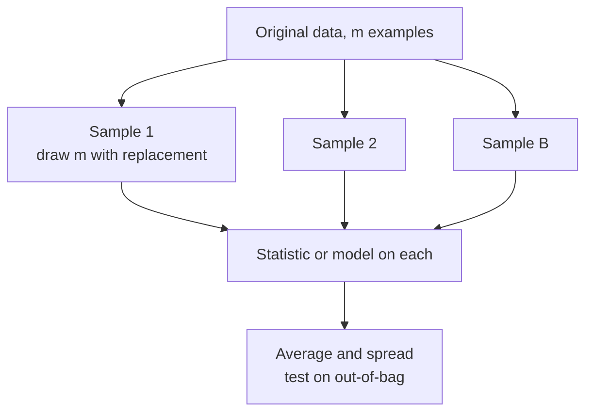
*Fig. 4.15: Bootstrapping.*

## 4.13 Bagging (bootstrap aggregating)

<u>Bagging (Breiman, 1996) trains T copies of the same learner on T bootstrap samples of the training data and combines them by majority vote (classification) or averaging (regression).</u>

**Algorithm:**
1. For t = 1 … T: draw bootstrap sample Dt, train classifier ht on it.
2. Predict: H(x) = majority vote of h1(x), …, hT(x) (or the average).

**Why it works:** averaging many **unstable, high-variance** models (deep trees) **reduces variance** without raising bias. Example: if each of T independent classifiers has error 0.3, the majority vote is wrong only when more than half are wrong:

| T classifiers | Majority-vote error |
|---|---|
| 1 | 0.300 |
| 3 | 0.216 |
| 5 | 0.163 |
| 11 | 0.078 |
| 21 | 0.026 |

(Real bagged models are correlated, so the gain is smaller, but the direction is the same.) **Random forest** = bagging of decision trees + random feature subsets at each split.

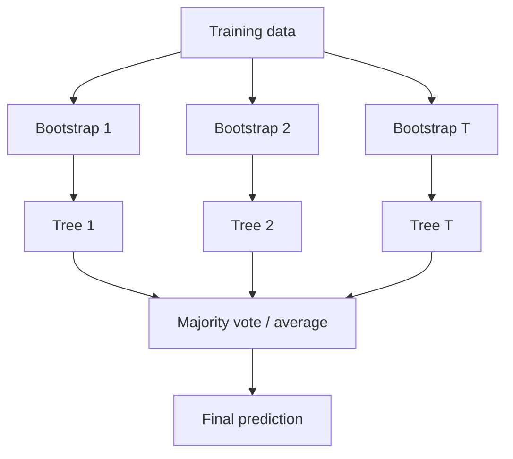
*Fig. 4.16: Bagging trains in parallel.*

## 4.14 Boosting and AdaBoost

<u>Boosting is an ensemble method that trains weak learners one after another, each one focusing on the examples the previous ones got wrong, and combines them by a weighted vote into a strong learner.</u> A **weak learner** is only slightly better than random guessing (error < 0.5), e.g. a decision stump (a one-level tree).

### 4.14.1 AdaBoost algorithm (Freund and Schapire, 1995)

Labels yi ∈ {+1, −1}.
1. Initialise weights wi = 1/m for every example.
2. For t = 1 … T:
   - Train weak learner ht to minimise the **weighted error** εt = Σi: ht(xi) ≠ yi wi.
   - Classifier weight **αt = ½ ln((1 − εt)/εt)** (bigger when εt is small).
   - Re-weight: **wi ← wi · e−αt yi ht(xi)**: multiply by e−α if correct, e+α if wrong.
   - Normalise: divide every wi by Zt = Σ wi so they add to 1.
3. Final classifier: **H(x) = sign( Σt αt ht(x) )**.

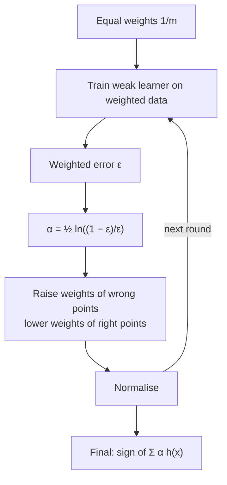
*Fig. 4.17: AdaBoost trains in sequence.*

### 4.14.2 Numerical: AdaBoost rounds

**Data:** 10 points on a line, x = 1 … 10, labels **+ + + − − − + + + −**. Weak learners: decision stumps "x < t → s, else −s". Ties broken by the first (leftmost) threshold found.

**Round 1.** All weights = 0.1. Best stump h1: **x < 3.5 → +1, else −1**. It misclassifies x = 7, 8, 9.

| Quantity | Working | Value |
|---|---|---|
| ε1 | 0.1 + 0.1 + 0.1 | **0.30** |
| α1 | ½ ln(0.7/0.3) | **0.4236** |
| factor if correct | e−0.4236 | 0.6547 |
| factor if wrong | e+0.4236 | 1.5275 |

| x | 1 | 2 | 3 | 4 | 5 | 6 | 7 | 8 | 9 | 10 |
|---|---|---|---|---|---|---|---|---|---|---|
| y | + | + | + | − | − | − | + | + | + | − |
| h1(x) | + | + | + | − | − | − | − | − | − | − |
| Correct? | ✓ | ✓ | ✓ | ✓ | ✓ | ✓ | ✗ | ✗ | ✗ | ✓ |
| Old w | 0.1 | 0.1 | 0.1 | 0.1 | 0.1 | 0.1 | 0.1 | 0.1 | 0.1 | 0.1 |
| w × factor | 0.0655 | 0.0655 | 0.0655 | 0.0655 | 0.0655 | 0.0655 | 0.1528 | 0.1528 | 0.1528 | 0.0655 |
| New w (÷ Z = 0.9165) | 0.0714 | 0.0714 | 0.0714 | 0.0714 | 0.0714 | 0.0714 | **0.1667** | **0.1667** | **0.1667** | 0.0714 |

Check: the misclassified points now carry 3 × 0.1667 = **0.5** of the total weight (always true after an AdaBoost update), so the next learner is forced to look at them.

**Round 2.** Best stump h2: **x < 9.5 → +1, else −1** (wrong on x = 4, 5, 6).
ε2 = 3 × 0.0714 = **0.2143**, α2 = ½ ln(0.7857/0.2143) = **0.6496**. New weights: x = 4, 5, 6 → **0.1667** each, x = 7, 8, 9 → 0.1061, x = 1, 2, 3, 10 → 0.0455.

**Round 3.** Best stump h3: **x < 6.5 → −1, else +1** (wrong on x = 1, 2, 3, 10).
ε3 = 4 × 0.0455 = **0.1818**, α3 = ½ ln(0.8182/0.1818) = **0.7520**.

**Final classifier** H(x) = sign(0.4236 h1 + 0.6496 h2 + 0.7520 h3):

| x | 1–3 | 4–6 | 7–9 | 10 |
|---|---|---|---|---|
| Σ α h(x) | +0.3213 | −0.5260 | +0.9780 | −0.3213 |
| H(x) | + | − | + | − |
| True y | + | − | + | − |

::: tip Answer
After 3 rounds the training error is **0** (each single stump had 3 or 4 mistakes). α1 = 0.4236, α2 = 0.6496, α3 = 0.7520: better learners get bigger votes.
:::

**Advantages:** high accuracy from very simple learners, few parameters (only T), reduces bias and variance. **Disadvantages:** sensitive to noisy labels and outliers (their weights keep growing), sequential so it cannot be parallelised, can overfit with very many rounds on noisy data.

### 4.14.3 Bagging vs boosting

| Point | Bagging | Boosting (AdaBoost) |
|---|---|---|
| Training | **parallel**, independent | **sequential**, each depends on the last |
| Data for each learner | bootstrap sample, equal weights | all data, **re-weighted** (wrong points up) |
| Combining | simple majority vote / average | **weighted** vote with αt |
| Mainly reduces | **variance** | **bias** (and variance) |
| Best base learner | unstable, complex (deep trees) | weak, simple (stumps) |
| Noise / outliers | robust | sensitive |
| Overfitting risk | low | higher on noisy data |
| Example | Random forest | AdaBoost, gradient boosting, XGBoost |

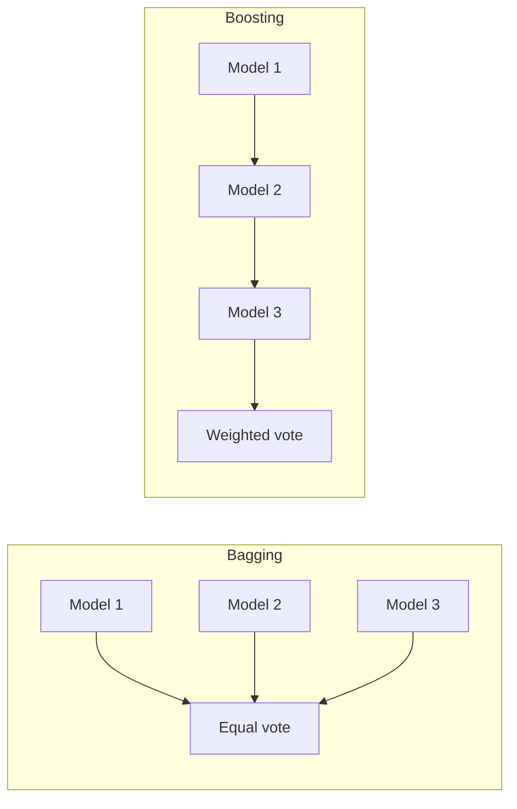
*Fig. 4.18: Bagging is parallel, boosting is a chain.*

## Exam checklist for Unit 4
- [ ] Definitions: learning theory, concept learning, PAC-learnable, sample complexity (underlined)
- [ ] PAC bound m ≥ (1/ε)(ln|H| + ln(1/δ)) with its 5-line proof; ε = 0.1, δ = 0.05, |H| = 1000 gives **m = 100**
- [ ] Realizable (zero-Bayes) vs agnostic case table; version space
- [ ] Shattering and VC dimension: thresholds = 1, intervals = 2, half-planes in 2-D = 3 (XOR and inside-point arguments), d-dim hyperplanes = d + 1
- [ ] Hypothesis class short note with diagram (End Q6); target class; C inside H
- [ ] Inductive bias (restriction vs preference) with algorithm examples; Occam's razor; No Free Lunch
- [ ] Empirical risk, true risk and ERM; why ERM overfits
- [ ] Limitations of inference machines table and the error-sources diagram
- [ ] L(ĥ) = Bayes + approximation + estimation; approximation vs estimation table (End Q7a)
- [ ] Bias vs variance table, Bias² + Variance + noise, U-shaped curve (End Q7c)
- [ ] Overfitting vs underfitting table with three-curve diagram (End Q7d, Mid Q7 i)
- [ ] Hold-out and k-fold cross-validation steps with the fold diagram
- [ ] SRM: nested classes, Vapnik bound, ERM vs SRM; degree-5 example
- [ ] Bootstrap: with replacement, 63.2% / 36.8% out-of-bag
- [ ] Bagging algorithm and why it cuts variance; random forest
- [ ] AdaBoost steps, α = ½ ln((1 − ε)/ε), one round by hand (ε = 0.3, α = 0.4236, new weights 0.0714 / 0.1667)
- [ ] Bagging vs boosting table
