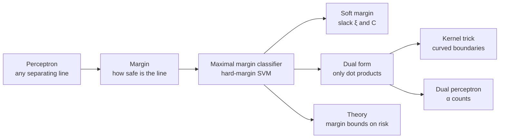
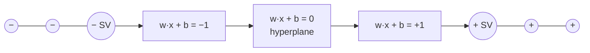
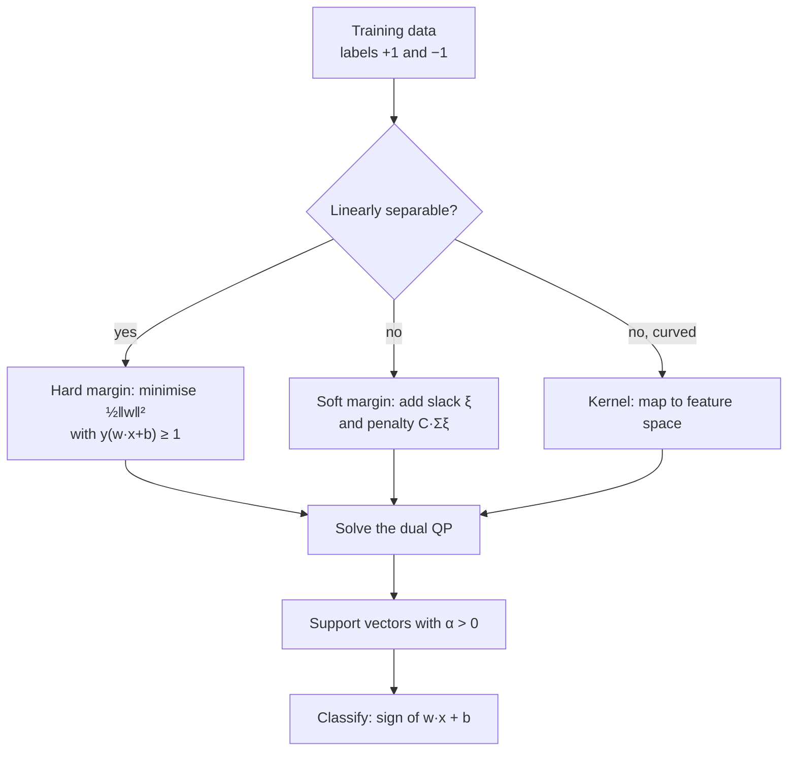
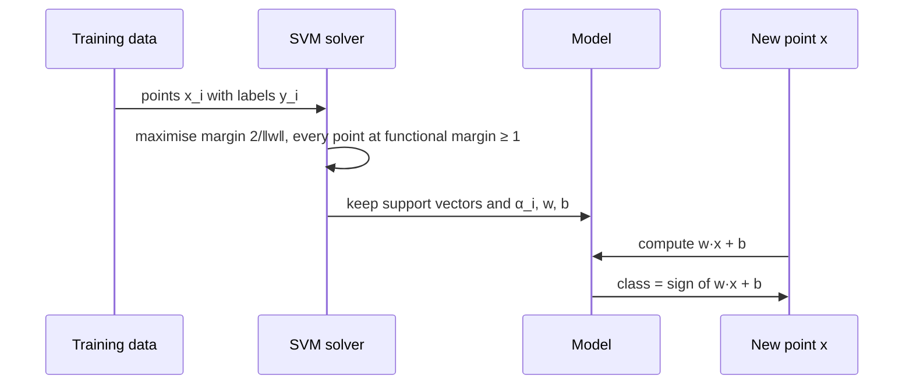
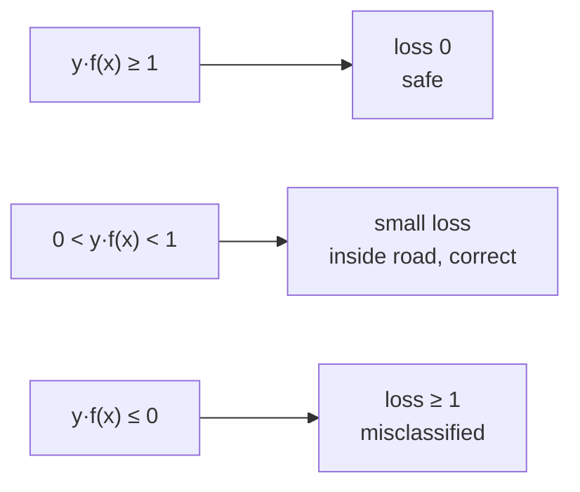
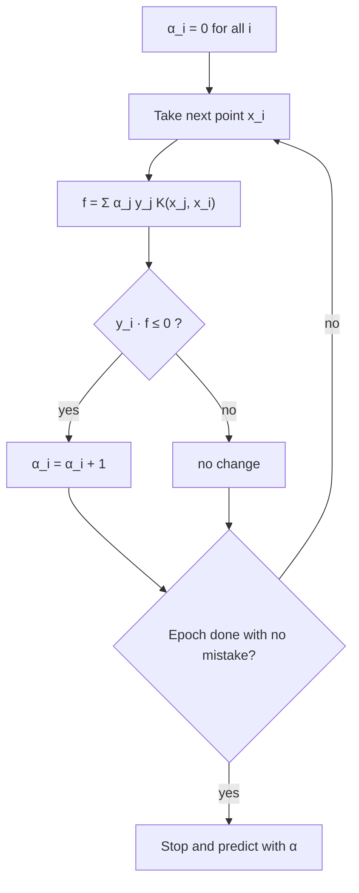
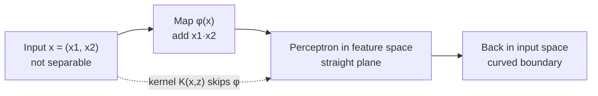
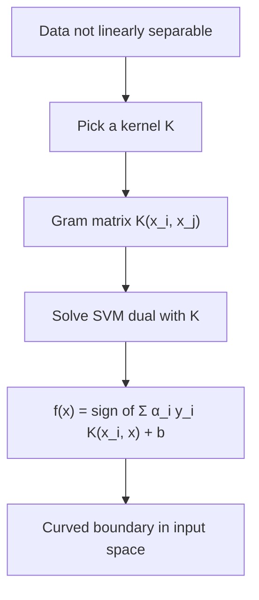
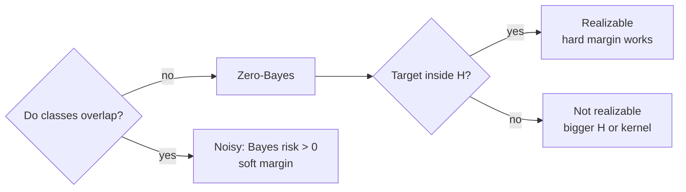
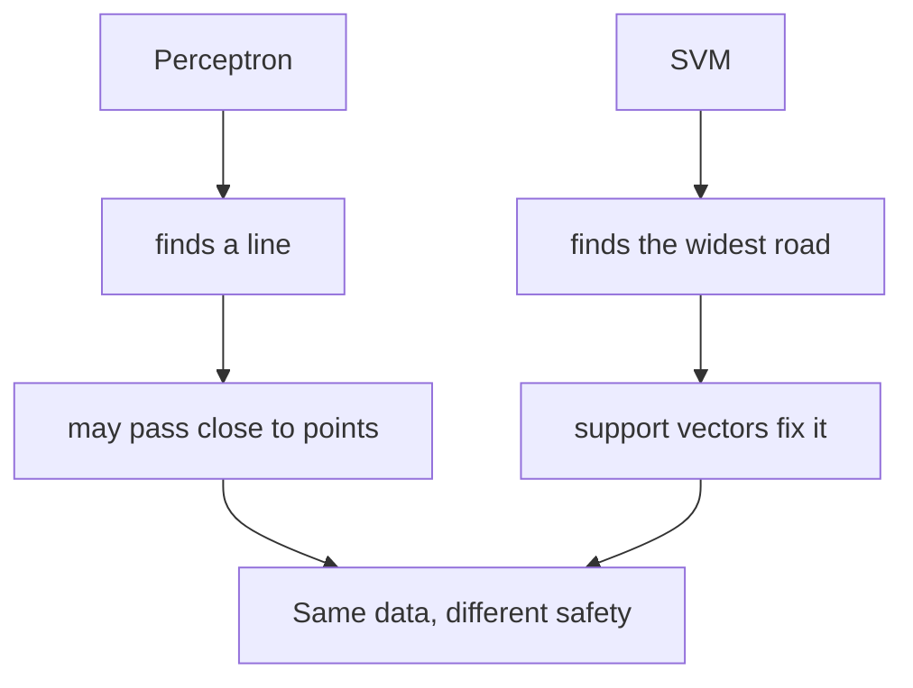

# Unit 5 · Support Vector Machines, Kernels and Margin Theory

> **Exam weight:** one full 14-mark question in the 2025-26 end-sem (Q4: (a) define SVM, its working, advantages and disadvantages · (b) hard vs soft margin and the kernel trick), and the earlier mid paper asked "Define the working of SVM classifier" (Q6). SVM is the **number 4 topic** on the site (asked in 2 of 3 papers, about 12.5% of the end-sem). The dual perceptron and margin-based bounds have **never been asked** yet, so learn them as short notes.

**Prefer to watch first?** [Video lectures for Unit 5 →](#videos/unit5)

Unit 5 joins two ideas from earlier units: the **perceptron** of [Unit 2](#unit2) (a linear classifier) and the **learning theory** of [Unit 4](#unit4) (why a classifier generalises). The SVM is a linear classifier that chooses the safest line, and the theory explains why "safest" means "best on new data". Every number on this page was computed by a Python program.

*Fig. 5.1: Map of Unit 5.*

## 5.1 Support Vector Machine: the idea and definition  ⭐⭐ (End Q4a, earlier mid Q6)

**In simple words.** Many straight lines can separate two classes. Which one is best? The SVM picks the line that stays **as far as possible from the nearest points of both classes**, like drawing the widest possible road between two villages. The width of the empty road is the **margin**. The few points that touch the edges of the road are the **support vectors**; they alone decide where the line goes.

**Definition.** <u>A Support Vector Machine (SVM) is a supervised learning method that finds the separating hyperplane w·x + b = 0 with the largest margin between two classes. The training points closest to the hyperplane are called support vectors. With kernel functions an SVM can also learn non-linear boundaries.</u>

| Symbol | Meaning |
|---|---|
| x = (x1, x2, …, xd) | input (feature vector) |
| y ∈ {+1, −1} | class label |
| w | weight vector, perpendicular (normal) to the hyperplane |
| b | bias: shifts the hyperplane away from the origin |
| w·x + b = 0 | the decision boundary (a line in 2-D, a plane in 3-D, a hyperplane in general) |
| w·x + b = +1 and −1 | the two margin lines (edges of the road) |
| ‖w‖ = √(w12 + w22 + …) | length of w |

*Fig. 5.2: The road picture. Margin lines pass through the support vectors (SV); the gap between them is 2/‖w‖. In the exam draw a 2-D scatter with three parallel lines.*

**Decision rule after training:** class = sign(w·x + b). Positive value → class +1, negative → class −1.

## 5.2 Margin of a classifier: functional and geometric margin  ⭐ (End Q4a)

The margin of a point tells how far it is from the boundary, **on the correct side**. A big positive margin means safely correct; a negative margin means the point is on the wrong side (misclassified).

**Definition.** <u>For a training example (xi, yi) and classifier f(x) = w·x + b, the functional margin is γ̂i = yi(w·xi + b) and the geometric margin is γi = yi(w·xi + b) / ‖w‖, the actual distance of the point from the hyperplane. The margin of the classifier is the smallest geometric margin over all training points: γ = mini γi.</u>

| | Functional margin | Geometric margin |
|---|---|---|
| Formula | y(w·x + b) | y(w·x + b) / ‖w‖ |
| Meaning | sign shows correct or wrong side | true perpendicular distance |
| Multiply w and b by 2 | doubles | **unchanged** |
| Used for | fixing the scale (canonical form) | measuring and maximising the margin |

**Worked check** (hyperplane x1 = 2, point (3, 1) of class +1):

| (w, b) | Line | Functional margin | ‖w‖ | Geometric margin |
|---|---|---|---|---|
| ((1, 0), −2) | x1 − 2 = 0 | 1 × (3 − 2) = **1** | 1 | 1 / 1 = **1** |
| ((2, 0), −4) | 2x1 − 4 = 0 (same line) | 1 × (6 − 4) = **2** | 2 | 2 / 2 = **1** |

The line is the same, the functional margin doubled, the geometric margin did not change. So we **fix the scale** by asking the closest points to have functional margin exactly 1 (the **canonical hyperplane**). Then:

1. The closest points lie on w·x + b = +1 and w·x + b = −1.
2. Each margin line is at distance 1/‖w‖ from the middle line.
3. **Margin width (the full road) = 2/‖w‖.**
4. Distance of any point x from the hyperplane = |w·x + b| / ‖w‖.

::: warn Say which margin you mean
Some books call 1/‖w‖ the margin (half the road) and others call 2/‖w‖ the margin (the full road). Write "margin width = 2/‖w‖" and you will never be marked wrong.
:::

## 5.3 Maximal margin classifier (hard-margin SVM)  ⭐⭐ (End Q4a, Q4b)

To make the road 2/‖w‖ as wide as possible, make ‖w‖ as small as possible, while keeping every point on its correct side and outside the road.

**Definition.** <u>The maximal margin classifier (hard-margin SVM) is the hyperplane that solves: minimise ½‖w‖2 subject to yi(w·xi + b) ≥ 1 for every training example i. It exists only when the data are linearly separable, and it is unique.</u>

**Primal problem**

  minimise ½‖w‖2 over w, b
  subject to yi(w·xi + b) ≥ 1,  i = 1, …, m

- Maximising 2/‖w‖ is the same as minimising ‖w‖. We minimise ½‖w‖2 because it is smooth: the problem becomes a **convex quadratic program** with **one global minimum** (no local minima, unlike a neural network).
- The constraint says: every point is correctly classified with functional margin at least 1.

*Fig. 5.3: Which SVM to use.*

## 5.4 Support vectors and the dual problem  ⭐ (End Q4a)

We solve the primal problem with **Lagrange multipliers** αi ≥ 0, one per constraint.

**Lagrangian:** L(w, b, α) = ½‖w‖2 − Σi αi [yi(w·xi + b) − 1]

Setting ∂L/∂w = 0 and ∂L/∂b = 0 gives:
- **w = Σi αi yi xi**
- **Σi αi yi = 0**

Putting these back gives the **dual problem**:

  maximise W(α) = Σi αi − ½ Σi Σj αi αj yi yj (xi·xj)
  subject to αi ≥ 0 and Σi αi yi = 0

**KKT (complementary slackness):** αi [yi(w·xi + b) − 1] = 0. So:

| Point | yi(w·xi + b) | αi | Role |
|---|---|---|---|
| Outside the road | > 1 | 0 | does not affect the answer |
| On a margin line | = 1 | ≥ 0 (usually > 0) | **support vector** when αi > 0 |

**Definition.** <u>Support vectors are the training points that lie on the margin lines w·x + b = ±1; they are the only points with αi > 0, and the hyperplane is built from them alone: w = Σi∈SV αi yi xi.</u>

- **Classifier:** f(x) = sign( Σi∈SV αi yi (xi·x) + b ).
- **b from any support vector s:** b = ys − w·xs.
- **Useful checks:** Σ αi yi = 0 and (hard margin) ‖w‖2 = Σ αi.
- The data appear **only inside dot products xi·xj**. This is what makes the kernel trick possible (Section 5.10).
- Removing a non-support point does not change the answer, so the SVM is compact and not disturbed by far-away points.

## 5.5 Working of SVM: the full exam answer, advantages and disadvantages  ⭐⭐ (End Q4a, earlier mid Q6)

**Working of SVM (write as numbered steps):**

1. **Input:** m labelled points (xi, yi) with yi ∈ {+1, −1}.
2. **Choose the form of boundary:** a hyperplane w·x + b = 0 (or a kernel if the data are curved).
3. **Fix the scale:** the closest points must satisfy yi(w·xi + b) = 1, so the margin width is 2/‖w‖.
4. **Optimise:** minimise ½‖w‖2 subject to yi(w·xi + b) ≥ 1 (soft margin: add C Σ ξi).
5. **Solve the dual** for αi; points with αi > 0 are the support vectors.
6. **Compute** w = Σ αi yi xi and b = ys − w·xs.
7. **Predict:** class of a new x = sign(w·x + b), or sign(Σ αi yi K(xi, x) + b) with a kernel.

*Fig. 5.4: Training and prediction in an SVM.*

| Advantages | Disadvantages |
|---|---|
| Best margin gives good generalisation on new data | Choosing the kernel, C and σ needs care (trial and cross-validation) |
| Convex problem: unique global solution, no local minima | Training is slow on very large data sets (QP grows with m2) |
| Works well in high dimensions (text, genes), even when d > m | Output is a class, not a probability |
| Kernels give curved boundaries without building features | Basic form is for two classes only (needs one-vs-rest for more) |
| Model needs only the support vectors (compact) | Sensitive to noise and overlap if C is too large |
| Margin-based theory guarantees low risk | Hard to interpret in kernel space |

**Applications:** text and spam classification, handwriting recognition, face detection, bio-informatics (protein and gene classification), image classification.

::: tip Template for End Q4(a) (7 marks)
Introduction (many lines separate the data) → underlined definition → Fig. 5.2 road diagram → functional vs geometric margin, margin = 2/‖w‖ → optimisation problem → support vectors and dual → working steps → a 2-point numerical (Section 5.6) → advantages/disadvantages table → conclusion.
:::

## 5.6 SVM numericals: finding the maximal margin hyperplane

**Method (for 2–4 points by hand):**
1. Plot the points. Guess the support vectors: the closest pair (or trio) of opposite classes.
2. Write w·xs + b = ys for every support vector and solve.
3. Check yi(w·xi + b) ≥ 1 for **every** point. If one fails, your guess was wrong: add that point as a support vector.
4. Report w, b, ‖w‖, margin 2/‖w‖ and the support vectors.

### Numerical 1: two points
**Question.** Find the maximal margin hyperplane for (3, 3) of class +1 and (1, 1) of class −1. Find the margin.

1. With one point per class both are support vectors, and w points from the negative to the positive point: w = k(3 − 1, 3 − 1) = k(2, 2).
2. The hyperplane passes through the midpoint (2, 2): w·(2, 2) + b = 0 → 8k + b = 0.
3. Canonical condition at (3, 3): 12k + b = 1. Subtract: 4k = 1, so k = 0.25.
4. w = (0.5, 0.5), b = −2. Check (1, 1): 0.5 + 0.5 − 2 = −1 ✓.

| Point | y | w·x + b | y(w·x + b) | Distance from line |
|---|---|---|---|---|
| (3, 3) | +1 | 1 | 1 | 1.4142 |
| (1, 1) | −1 | −1 | 1 | 1.4142 |

**Answer:** hyperplane **0.5x1 + 0.5x2 − 2 = 0**, i.e. x1 + x2 = 4. ‖w‖ = √0.5 = 0.7071; **margin width 2/‖w‖ = 2.8284**, which equals the distance between the two points (√8 = 2.8284), as it must. Dual check: α1 = α2 = 0.25, w = 0.25(3, 3) − 0.25(1, 1) = (0.5, 0.5) ✓, Σα = 0.5 = ‖w‖2 ✓.

### Numerical 2: three points
**Question.** Negative point (0, 0); positive points (2, 0) and (0, 2). Find the hyperplane, the margin and the α values. Classify (2, 2), (0.5, 0) and (1, 0.5).

By symmetry all three are support vectors. Equations w·x + b = y:

| Support vector | Equation |
|---|---|
| (0, 0), y = −1 | b = −1 |
| (2, 0), y = +1 | 2w1 + b = 1 → w1 = 1 |
| (0, 2), y = +1 | 2w2 + b = 1 → w2 = 1 |

w = (1, 1), b = −1. ‖w‖ = √2 = 1.4142. **Margin width = 2/‖w‖ = 1.4142** (each point is 0.7071 from the line).

α values from w = Σ αi yi xi = α2(2, 0) + α3(0, 2) = (1, 1) → α2 = α3 = 0.5, and Σ αi yi = 0 → α1 = 1. Check: Σα = 2 = ‖w‖2 ✓.

| New point | w·x + b | Class |
|---|---|---|
| (2, 2) | 3 | +1 |
| (0.5, 0) | −0.5 | −1 |
| (1, 0.5) | 0.5 | +1 (inside the road, low confidence) |

**Answer:** **x1 + x2 − 1 = 0**, margin 1.4142, α = (1, 0.5, 0.5).

### Numerical 3: eight points (common exam pattern)
**Question.** Positive: (3, 1), (3, −1), (6, 1), (6, −1). Negative: (1, 0), (0, 1), (0, −1), (−1, 0). Find the maximal margin hyperplane, support vectors and margin. Classify (4, 2) and (1.5, 0).

**Step 1 – spot the support vectors:** the closest points are (1, 0) on the negative side and (3, 1), (3, −1) on the positive side.

**Step 2 – Method 1 (direct):**
- w1(1) + w2(0) + b = −1 … (1)
- w1(3) + w2(1) + b = +1 … (2)
- w1(3) + w2(−1) + b = +1 … (3)
- (2) − (3): 2w2 = 0 → w2 = 0. (2) − (1): 2w1 = 2 → w1 = 1, b = −2.

**Method 2 (augmented vectors, used in many lecture notes):** write s̃ = (x1, x2, 1) and solve Σj α̃j(s̃j·s̃i) = yi:

| | α̃1 | α̃2 | α̃3 | = y |
|---|---|---|---|---|
| s̃1 = (1, 0, 1) | 2 | 4 | 4 | −1 |
| s̃2 = (3, 1, 1) | 4 | 11 | 9 | +1 |
| s̃3 = (3, −1, 1) | 4 | 9 | 11 | +1 |

Solving: α̃1 = −3.5, α̃2 = 0.75, α̃3 = 0.75. Then w̃ = Σ α̃j s̃j = (1, 0, −2), so w = (1, 0) and b = −2. Same answer. (α̃ already contains the sign y, so it is not the true α.)

**Step 3 – check every point:**

| Point | y | w·x + b | y(w·x + b) | Support vector? |
|---|---|---|---|---|
| (3, 1) | +1 | 1 | 1 | yes |
| (3, −1) | +1 | 1 | 1 | yes |
| (6, 1) | +1 | 4 | 4 | no |
| (6, −1) | +1 | 4 | 4 | no |
| (1, 0) | −1 | −1 | 1 | yes |
| (0, 1) | −1 | −2 | 2 | no |
| (0, −1) | −1 | −2 | 2 | no |
| (−1, 0) | −1 | −3 | 3 | no |

**Answer:** hyperplane **x1 − 2 = 0** (w = (1, 0), b = −2); margin lines x1 = 1 and x1 = 3; ‖w‖ = 1; **margin width = 2**. Support vectors (1, 0), (3, 1), (3, −1). Classify: (4, 2) → 4 − 2 = 2 > 0 → **positive**; (1.5, 0) → −0.5 < 0 → **negative**. True multipliers: α = 0.5 for (1, 0) and 0.25 for each of (3, ±1); Σαiyi = −0.5 + 0.25 + 0.25 = 0 ✓ and ‖w‖2 = Σα = 1 ✓.

::: tip In the exam
Draw the points on graph paper first. The support vectors and the line are often visible by eye; then confirm with the equations. Always state ‖w‖ and the margin.
:::

## 5.7 Hard-margin vs soft-margin SVM  ⭐ (End Q4b)

Real data are noisy: a few points may sit on the wrong side, and then no hard-margin solution exists. The **soft-margin SVM** lets some points break the margin, at a price.

**Definition.** <u>A hard-margin SVM requires every training point to be correctly classified outside the margin (yi(w·xi + b) ≥ 1); a soft-margin SVM allows violations through slack variables ξi ≥ 0 and adds a penalty C Σ ξi to the objective.</u>

**Soft-margin problem**

  minimise ½‖w‖2 + C Σi ξi
  subject to yi(w·xi + b) ≥ 1 − ξi, ξi ≥ 0

| Value of ξi | Meaning |
|---|---|
| ξi = 0 | point correctly outside the margin |
| 0 < ξi ≤ 1 | inside the road but on the correct side |
| ξi > 1 | on the wrong side: misclassified |

**The C parameter:** large C → violations are expensive → narrow margin, fits the training data closely (risk of overfitting, behaves like hard margin). Small C → wide margin, more violations allowed (smoother, risk of underfitting). In the dual, the only change is **0 ≤ αi ≤ C** (box constraint).

**Hinge loss.** At the optimum ξi = max(0, 1 − yi(w·xi + b)), so the soft-margin SVM is the same as minimising

  ½‖w‖2 + C Σi max(0, 1 − yi f(xi))

Hinge loss is 0 for points with y f(x) ≥ 1 and grows linearly as the point moves into the road and across the line.

*Fig. 5.5: Hinge loss in three zones.*

**Numerical: slack values.** Take w = (1, 0), b = −2 (the line x1 = 2) and these points:

| Point | y | f = w·x + b | y·f | ξ = max(0, 1 − y·f) | Zone |
|---|---|---|---|---|---|
| (3, 1) | +1 | 1 | 1 | 0 | on margin |
| (6, 1) | +1 | 4 | 4 | 0 | safe |
| (2.5, 0) | +1 | 0.5 | 0.5 | 0.5 | inside road, correct |
| (1.5, 0) | +1 | −0.5 | −0.5 | 1.5 | misclassified |
| (1, 0) | −1 | −1 | 1 | 0 | on margin |
| (2.2, 1) | −1 | 0.2 | −0.2 | 1.2 | misclassified |

Σξ = **3.2**, ½‖w‖2 = 0.5. Objective ½‖w‖2 + CΣξ = **0.82** (C = 0.1), **3.7** (C = 1), **32.5** (C = 10). With a large C the slack term dominates, so the solver would move the line to reduce the violations, giving a narrower margin.

| Basis | Hard-margin SVM | Soft-margin SVM |
|---|---|---|
| Data | must be linearly separable | works on overlapping, noisy data |
| Constraint | yi(w·xi + b) ≥ 1 | yi(w·xi + b) ≥ 1 − ξi |
| Objective | ½‖w‖2 | ½‖w‖2 + C Σξi |
| Slack variables | none | ξi ≥ 0 |
| Training errors | zero | some allowed |
| Dual bounds | αi ≥ 0 | 0 ≤ αi ≤ C |
| Outliers | one outlier can ruin the margin | robust |
| Overfitting | high risk on noisy data | controlled by C |
| Loss view | infinite penalty for any violation | hinge loss |

## 5.8 Dual perceptron algorithm

Recall the perceptron of [Unit 2](#unit2): on a mistake, w ← w + yixi (learning rate 1, w starts at 0). So **w is always a sum of training points**: w = Σi αi yi xi, where **αi = the number of mistakes made on point i**. The dual perceptron stores the counts αi instead of w.

**Definition.** <u>The dual perceptron is the perceptron written in terms of mistake counts αi: it predicts with f(x) = Σi αi yi (xi·x) and, whenever point i is misclassified, it adds 1 to αi.</u>

**Algorithm:**
1. Set αi = 0 for all i. (Include the bias by adding a constant 1 to every x, or use a kernel with a constant term.)
2. Pre-compute the Gram matrix Gij = xi·xj (or K(xi, xj)).
3. For each training point i: compute f(xi) = Σj αj yj Gji.
4. If yi f(xi) ≤ 0 (mistake), set αi ← αi + 1.
5. Repeat epochs until an epoch has no mistakes.
6. Predict a new x by sign( Σi αi yi K(xi, x) ).

*Fig. 5.6: Dual perceptron loop.*

**Numerical: linear dual perceptron.** Points (augmented with a 1 for the bias): (2, 2, 1) +1, (3, 1, 1) +1, (0, 0, 1) −1, (1, −1, 1) −1. Convention: mistake if y·f ≤ 0.

Gram matrix G = xi·xj:

| | x1 | x2 | x3 | x4 |
|---|---|---|---|---|
| x1 = (2, 2, 1) | 9 | 9 | 1 | 1 |
| x2 = (3, 1, 1) | 9 | 11 | 1 | 3 |
| x3 = (0, 0, 1) | 1 | 1 | 1 | 1 |
| x4 = (1, −1, 1) | 1 | 3 | 1 | 3 |

| Epoch | Point | y | f = Σ αjyjGji | y·f ≤ 0? | α after |
|---|---|---|---|---|---|
| 1 | x1 | +1 | 0 | yes | (1, 0, 0, 0) |
| 1 | x2 | +1 | 9 | no | (1, 0, 0, 0) |
| 1 | x3 | −1 | 1 | yes | (1, 0, 1, 0) |
| 1 | x4 | −1 | 1 − 1 = 0 | yes | (1, 0, 1, 1) |
| 2 | x1 | +1 | 9 − 1 − 1 = 7 | no | same |
| 2 | x2 | +1 | 9 − 1 − 3 = 5 | no | same |
| 2 | x3 | −1 | 1 − 1 − 1 = −1 | no | same |
| 2 | x4 | −1 | 1 − 1 − 3 = −3 | no | same |

Epoch 2 has no mistakes, so stop with **α = (1, 0, 1, 1)**. Then w̃ = 1·(2, 2, 1) − 1·(0, 0, 1) − 1·(1, −1, 1) = **(1, 3, −1)**, i.e. the line **x1 + 3x2 − 1 = 0**. This is exactly the line the ordinary perceptron would find; the dual form only stores it differently.

## 5.9 Learning nonlinear hypotheses with the perceptron

A single perceptron draws only a straight line, so it cannot learn XOR ([Unit 2](#unit2)). Two fixes:
1. **Explicit features:** map x to φ(x) with extra features (x12, x1x2, …) and run the perceptron on φ(x). A line in φ-space is a curve in x-space. Problem: the number of features explodes (degree 3 on 100 inputs gives C(103, 3) = 176,851 features, counting all terms up to degree 3 including the constant).
2. **Kernel perceptron:** the dual perceptron uses x only in dot products, so replace xi·x by K(xi, x) = φ(xi)·φ(x). We learn in the big space without ever building φ.

*Fig. 5.7: Nonlinear learning = linear learning in a feature space.*

**XOR becomes separable with φ(x) = (x1, x2, x1x2):**

| Input (x1, x2) | Class (XOR) | φ(x) | sign(−x1x2) |
|---|---|---|---|
| (1, 1) | −1 | (1, 1, 1) | −1 ✓ |
| (−1, −1) | −1 | (−1, −1, 1) | −1 ✓ |
| (1, −1) | +1 | (1, −1, −1) | +1 ✓ |
| (−1, 1) | +1 | (−1, 1, −1) | +1 ✓ |

The third coordinate x1x2 is −1 for every positive point and +1 for every negative point, so the plane x1x2 = 0 separates them.

**Numerical: kernel perceptron on XOR** with K(x, z) = (x·z + 1)2 (no separate bias; the "+1" acts as one). Kernel matrix:

| K | (1, 1) | (−1, −1) | (1, −1) | (−1, 1) |
|---|---|---|---|---|
| (1, 1) | 9 | 1 | 1 | 1 |
| (−1, −1) | 1 | 9 | 1 | 1 |
| (1, −1) | 1 | 1 | 9 | 1 |
| (−1, 1) | 1 | 1 | 1 | 9 |

| Epoch | Point | y | f = Σ αjyjKji | Mistake? | α after |
|---|---|---|---|---|---|
| 1 | (1, 1) | −1 | 0 | yes | (1, 0, 0, 0) |
| 1 | (−1, −1) | −1 | −1 | no | (1, 0, 0, 0) |
| 1 | (1, −1) | +1 | −1 | yes | (1, 0, 1, 0) |
| 1 | (−1, 1) | +1 | −1 + 1 = 0 | yes | (1, 0, 1, 1) |
| 2 | (1, 1) | −1 | −9 + 1 + 1 = −7 | no | same |
| 2 | (−1, −1) | −1 | −1 + 1 + 1 = 1 | yes | (1, 1, 1, 1) |
| 2 | (1, −1) | +1 | 8 | no | same |
| 2 | (−1, 1) | +1 | 8 | no | same |
| 3 | all four | | −8, −8, +8, +8 | no | (1, 1, 1, 1) |

**Answer:** α = (1, 1, 1, 1) after 3 epochs. Expanding the kernel, f(x) = Σ αiyi(xi·x + 1)2 = **−8x1x2**: the perceptron discovered the x1x2 feature by itself. New points: (2, 3) → −48 → class −1; (2, −3) → +48 → class +1; (0.5, −0.5) → +2 → class +1.

## 5.10 Kernel functions and the kernel trick  ⭐ (End Q4b)

**Definition.** <u>A kernel function K(x, z) = φ(x)·φ(z) computes the dot product of two points after a (possibly very high-dimensional) feature mapping φ, without computing φ explicitly.</u>

**Definition.** <u>The kernel trick: because the SVM (and the dual perceptron) use the data only through dot products, we replace every xi·xj by K(xi, xj). The classifier f(x) = sign(Σ αiyiK(xi, x) + b) is a linear separator in feature space and a curved boundary in input space.</u>

**Kernel SVM dual:** maximise Σαi − ½ΣΣ αiαjyiyj K(xi, xj), with 0 ≤ αi ≤ C and Σαiyi = 0.

| Kernel | Formula | Notes |
|---|---|---|
| Linear | K(x, z) = x·z | plain SVM, no mapping |
| Polynomial | K(x, z) = (x·z + c)d | all products of features up to degree d |
| Gaussian / RBF | K(x, z) = exp(−‖x − z‖2 / 2σ2) | infinite-dimensional φ, most popular, near 1 for close points |
| Sigmoid | K(x, z) = tanh(κ x·z + θ) | like a neural network, valid only for some κ, θ |

**Mercer's condition:** <u>K is a valid kernel if, for any set of points, the kernel (Gram) matrix Kij = K(xi, xj) is symmetric and positive semi-definite (all eigenvalues ≥ 0).</u>

*Fig. 5.8: The kernel trick pipeline.*

::: tip Mnemonic
"Map high, compute low": the separation happens in the high-dimensional space; the arithmetic is done in the low-dimensional input space.
:::

## 5.11 Implicit non-linear feature space

The space where φ(x) lives is the **implicit feature space**: it exists, the SVM separates the data there, but we never write its coordinates down.

**Numerical 1 (the classic check).** x = (1, 2), z = (3, 4), K(x, z) = (x·z)2, φ(x) = (x12, √2 x1x2, x22).

| Route | Working | Result |
|---|---|---|
| Kernel (2-D) | x·z = 1×3 + 2×4 = 11, K = 112 | **121** |
| φ(x) | (1, 2√2, 4) = (1, 2.8284, 4) | |
| φ(z) | (9, 12√2, 16) = (9, 16.9706, 16) | |
| φ(x)·φ(z) | 1×9 + (2√2)(12√2) + 4×16 = 9 + 48 + 64 | **121** ✓ |

Same answer: the kernel needed 2 multiplications and a square, φ needed a 3-D map. **Why it always works:** (x·z)2 = (x1z1 + x2z2)2 = x12z12 + 2x1x2z1z2 + x22z22 = φ(x)·φ(z).

**Numerical 2 (practice).** x = (2, −1), z = (1, 3): x·z = 2 − 3 = −1, K = (−1)2 = **1**. φ(x) = (4, −2√2, 1), φ(z) = (1, 3√2, 9); φ(x)·φ(z) = 4 − 12 + 9 = **1** ✓.

**Other kernels for x = (1, 2), z = (3, 4):**

| Kernel | Working | Value |
|---|---|---|
| Linear | x·z | 11 |
| Polynomial (x·z + 1)2 | 122 | 144 |
| RBF, σ = 1 | ‖x − z‖2 = 22 + 22 = 8, e−8/2 = e−4 | 0.0183 |
| RBF, σ = 2 | e−8/8 = e−1 | 0.3679 |
| Sigmoid, κ = 0.1, θ = −1 | tanh(1.1 − 1) = tanh(0.1) | 0.0997 |

**Numerical 3 (Mercer check).** Points (1, 2), (3, 4), (0, 1) with K = (x·z)2:

| | (1, 2) | (3, 4) | (0, 1) |
|---|---|---|---|
| (1, 2) | 25 | 121 | 4 |
| (3, 4) | 121 | 625 | 16 |
| (0, 1) | 4 | 16 | 1 |

Symmetric, and eigenvalues **0.0543, 2.0445, 648.9012**, all ≥ 0, so it is positive semi-definite as Mercer's condition requires.

## 5.12 Theory: zero-Bayes and the realizable case

**Risk** R(h) = probability that h misclassifies a new random example. The **Bayes risk** R* is the smallest risk any classifier can have (Unit 1, Bayes decision theory).

**Definition.** <u>The zero-Bayes (noise-free) setting is when the Bayes risk is zero: the label is a deterministic function of x, the classes do not overlap, and some classifier makes no mistakes at all.</u>

**Definition.** <u>The realizable setting is when the true target classifier belongs to the hypothesis class H, so some h ∈ H has zero risk (and zero training error).</u>

| Setting | Bayes risk | Best h in H | SVM version |
|---|---|---|---|
| Zero-Bayes and realizable | 0 | zero error | hard-margin SVM (separable with margin γ) |
| Zero-Bayes, not realizable | 0 | some error (H too small) | use a kernel to enlarge H |
| Noisy (agnostic) | > 0 | some error | soft-margin SVM |

*Fig. 5.9: Which theory case applies.*

## 5.13 Realizable infinite hypothesis class and finite covering

**Finite class, realizable (from [Unit 4](#unit4)).** If H is finite and contains the target, any h with zero training error has risk ≤ ε with probability ≥ 1 − δ once

  m ≥ (1/ε)(ln|H| + ln(1/δ))

| Size of H | ε | δ | ln (size of H) | ln(1/δ) | m ≥ |
|---|---|---|---|---|---|
| 1000 | 0.05 | 0.05 | 6.9078 | 2.9957 | 198.07 → **199** |
| 106 | 0.05 | 0.05 | 13.8155 | 2.9957 | 336.22 → **337** |

A thousand times more hypotheses needs only about 1.7 times more data, because |H| enters through a logarithm.

**Realizable infinite hypothesis class.** <u>An infinite hypothesis class (for example all lines in the plane) is realizable when the target is one of its members; since ln|H| is infinite, the finite bound is useless, and we instead measure the size of H by its VC dimension or by a finite cover.</u> For lines in 2-D the VC dimension is 3, and m grows like (VC dimension × ln(1/ε) + ln(1/δ)) / ε.

**Finite covering.** <u>An ε-cover of H is a finite set of hypotheses such that every h in H is within distance ε of some member of the set; the covering number N(ε) is the size of the smallest such set.</u>

1. Many hypotheses in an infinite class are almost the same (two lines that differ by a tiny angle make the same predictions on nearly all points).
2. Group them: pick one representative per group, giving a finite cover of size N(ε).
3. Apply the finite-class bound with **ln N(ε) in place of ln|H|**.
4. For margin classifiers with margin γ on data inside a ball of radius R, ln N grows roughly like **R2/γ2** (times log factors), **not with the number of features**. This is where the margin bound comes from.

*Fig. 5.10: From an infinite class to a margin bound.*

## 5.14 Margin-based bounds on risk

**In simple words.** Getting the training data right is not enough; we want few mistakes on new data (low risk). Theory gives: true risk ≤ training error + a complexity penalty. For SVMs the penalty depends on the **margin**, not on the number of features.

**Definition.** <u>A margin-based bound on risk is an upper bound on the true (expected) error of a classifier that depends on the margin γ it achieves on the training data relative to the radius R of the data: the larger γ is compared with R, and the more examples m there are, the smaller the bound.</u>

**Statement (qualitative, for m points inside a ball of radius R):**
- **Separable case:** if every training point has geometric margin ≥ γ, then with probability ≥ 1 − δ the risk is at most of order (1/m)·[(R2/γ2)·log2m + log(1/δ)], i.e. roughly **(R2/γ2)/m**.
- **Soft-margin case:** risk ≤ (fraction of training points with margin < γ) + a term of order **√( (R2/γ2)/m )** (ignoring log factors).
- The **effective capacity is R2/γ2**, which plays the role of the VC dimension. The perceptron's mistake bound (Novikoff) has the same quantity: at most (R/γ)2 mistakes on separable data.

**Vapnik's form.** With probability ≥ 1 − η, R(f) ≤ Remp(f) + √{ [h(ln(2N/h) + 1) − ln(η/4)] / N }, where for hyperplanes with margin ρ (distance of the closest point, i.e. 1/‖w‖ in canonical form) on data in a ball of radius R in d dimensions, **h ≤ min(⌈R2/ρ2⌉, d) + 1**.

**Illustration:** N = 10,000 points, R = 10, d = 1000 features, η = 0.05, training error 0.

| Margin ρ | R2/ρ2 | h ≤ | Confidence term (bound on error) |
|---|---|---|---|
| 1 | 100 | 101 | 0.2529 |
| 2 | 25 | 26 | 0.1425 |
| 5 | 4 | 5 | 0.0713 |
| ignored (use d) | — | 1001 | 0.6327 |

With margin 5 the true error is guaranteed below about 7%; with margin 1 only below about 25%; ignoring the margin the guarantee is 63%, nearly useless. **Bigger margin → smaller capacity → tighter bound → better generalisation.** This is the theoretical reason the SVM maximises the margin, and why kernel SVMs can work in huge (even infinite) feature spaces without overfitting. Trading training error against capacity like this is **structural risk minimisation** ([Unit 4](#unit4)).

*Fig. 5.11: Why a wide margin generalises.*

::: warn Common mistake
The bound depends on R2/γ2, so scaling all the data up by 10 does not help: R and γ both grow 10 times. A good margin is large **relative to the spread of the data**.
:::

## 5.15 SVM vs perceptron

**Same data, two answers.** For (2, 2), (3, 1) of class +1 and (0, 0), (1, −1) of class −1, the perceptron (Section 5.8) found x1 + 3x2 − 1 = 0. Its closest point, (0, 0), is only **0.3162** from the line. The maximal margin hyperplane is 0.5x1 + 0.5x2 − 1 = 0 (x1 + x2 = 2), and **every** point is **1.4142** from it (margin width 2.8284). Both separate the data; the SVM line is about 4.5 times safer.

| Basis | Perceptron (Unit 2) | SVM (Unit 5) |
|---|---|---|
| Goal | any separating line | separating line with the largest margin |
| Objective | reduce mistakes | minimise ½‖w‖2 (+ CΣξ) |
| Answer | depends on start weights and order of points | unique (convex problem) |
| Training | online, one point at a time | quadratic programming, all points |
| Points that matter | every misclassified point | only support vectors |
| Non-separable data | never stops | soft margin handles it |
| Non-linear data | needs features or kernel perceptron | kernel trick built in |
| Dual form | αi = mistake count (integer) | αi = Lagrange multiplier (0 ≤ αi ≤ C) |
| Theory | mistake bound (R/γ)2 | margin-based bound on risk |
| Speed | very fast | slower on large data |

*Fig. 5.12: Perceptron vs SVM.*

::: tip Mnemonic
SVM in four words: **widest road, few posts** (posts = support vectors), and **kernels bend the road**.
:::

## Exam checklist for Unit 5
- [ ] Underlined SVM definition; road diagram with w·x + b = 0, ±1 and margin 2/‖w‖
- [ ] Functional vs geometric margin table; the scaling example (1 vs 2, geometric stays 1)
- [ ] Hard-margin primal: minimise ½‖w‖2 with yi(w·xi + b) ≥ 1
- [ ] Dual: w = Σαiyixi, Σαiyi = 0, support vectors have α > 0
- [ ] Working of SVM in 7 steps; advantages and disadvantages table (End Q4a)
- [ ] Numericals: 2 points (x1 + x2 = 4, margin 2.8284), 3 points (x1 + x2 = 1, margin 1.4142), 8 points (x1 = 2, margin 2)
- [ ] Soft margin: ξ, C, hinge loss, slack table; hard vs soft comparison table (End Q4b)
- [ ] Dual perceptron algorithm with α counts; linear run giving x1 + 3x2 − 1 = 0
- [ ] Nonlinear perceptron: XOR with x1x2; kernel perceptron gives f(x) = −8x1x2
- [ ] Kernel trick definition; four kernels with formulas; Mercer's condition
- [ ] Implicit feature space check: (x·z)2 = φ(x)·φ(z) = 121 for (1, 2), (3, 4)
- [ ] Zero-Bayes vs realizable; finite class bound (m ≥ 199); infinite class via VC dimension and finite covering
- [ ] Margin-based bound: capacity R2/γ2, risk about (R2/γ2)/m; table for ρ = 1, 2, 5
- [ ] SVM vs perceptron table with the 0.3162 vs 1.4142 example
